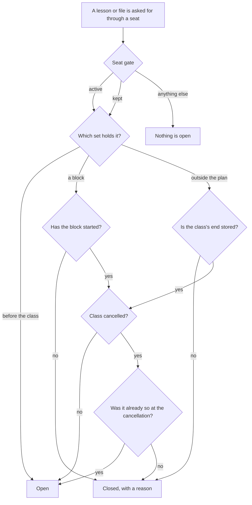

# Scheduled Classes, Part 3: The Class Page and Class Materials

- **Author:** skypad123
- **Status:** Proposed, not yet reviewed
- **Date:** 2026-11-27 (first draft 2026-11-25)

---

## Overview

Elevate sells self-paced courses, and since Parts 1 and 2 it can also run and
sell **classes**: a course taught live on fixed dates by one instructor to a
limited group. This design is the third of three that come from the
[scheduled classes RFC](./scheduled-classes-brief.md).

| Part              | Covers                                                                                                                                                                                   | Status                                                       |
| ----------------- | ---------------------------------------------------------------------------------------------------------------------------------------------------------------------------------------- | ------------------------------------------------------------ |
| 1                 | Class and attendance records, class setup, check-in, the roster and code screens.                                                                                                        | Built. [Design](./scheduled-classes-attendance.md), ADR 012. |
| 2                 | Selling a class: checkout with reserved seats, held payouts, withdrawal, cancellation, refunds.                                                                                          | Built. [Design](./scheduled-classes-selling.md), ADR 013.    |
| 3 (this document) | What a class learner can open: the class page, a plan of materials per block, class progress, the class certificate, notices of a changed class, and joining details for a remote class. | This document.                                               |

After Parts 1 and 2 a learner can buy a seat, check in and get a refund. They
can open none of the course through the seat, and the course page says so.
Part 3 gives the seat its content.

In one paragraph: a teacher plans which lessons and files each block of a
class covers. A block's set opens for every learner in the class when the
block starts, and the lessons no block covers open when the class ends. What
has opened stays open. Progress on a class seat counts every lesson of the
course. A learner who was at every block and finished every lesson earns a
class certificate: attendance decides the certificate and nothing else. When a class's venue, instructor or
joining details change, every learner with a seat is emailed.

### Words used in this document

Words from Parts 1 and 2 keep their meaning. The ones this design leans on:

| Word                | Meaning                                                                                                                                                                                                  |
| ------------------- | -------------------------------------------------------------------------------------------------------------------------------------------------------------------------------------------------------- |
| Block               | One dated period of a class in which attendance is taken once (Part 1). The learner app calls it a session.                                                                                              |
| Seat                | One learner's class enrollment (Part 1). It is a separate enrollment from a self-paced one for the same course.                                                                                          |
| Counted as attended | Part 2's stricter meaning, used for money: the learner's own check-in that stands, or a manual mark that has settled. A manual mark settles 7 days after it is made, if the learner has not disputed it. |
| Plan                | New. A class's list of which lessons and files belong to which block.                                                                                                                                    |
| Set                 | New. The lessons and files the plan gives one block. One more set, "before the class", belongs to no block.                                                                                              |
| Class file          | New. A file the teacher adds for one class. It is not part of the course.                                                                                                                                |
| Open                | New. A lesson or file is open to a learner when they can read it through their seat.                                                                                                                     |
| Class page          | New. The learner app's screen for one seat: its blocks, what is open, progress, and the certificate.                                                                                                     |
| Joining details     | New. What a learner needs to join a remote class: a link and a note.                                                                                                                                     |

### Who decided what

Entries marked **Author** were decided by the author at a question in the
drafting session of 2026-11-25 and 2026-11-26. On 2026-11-26 the finished
draft was compared with the RFC, and the author changed D1, D5, D7 and D14
and reworded D6; the table gives them as they now stand, and "Alternatives
Considered" records what each replaced. Entries marked **Drafting** were set
while writing, where one answer follows from the others or from the code;
approving a section confirms them.

| #   | Question                                             | Decision                                                                                                                                                                                                              | By     |
| --- | ---------------------------------------------------- | --------------------------------------------------------------------------------------------------------------------------------------------------------------------------------------------------------------------- | ------ |
| D1  | How a lesson or file becomes open                    | A plan per block. A block's set opens for every learner with a seat in the class when the block starts, whether or not the learner attends. Nobody opens a set by hand.                                               | Author |
| D2  | What a class learner's progress counts               | Every live lesson of the course, as for a self-paced learner.                                                                                                                                                         | Author |
| D3  | What earns the class certificate                     | Both: counted as attended in every block, and every lesson complete.                                                                                                                                                  | Author |
| D4  | How long a learner keeps what was opened             | No end date. It stays open while the seat is active.                                                                                                                                                                  | Author |
| D5  | What the cancelled-class switch does                 | As the RFC has it: the profile can let learners refunded by a cancellation keep what had been shared with the class by then. Nothing new opens for anyone.                                                            | Author |
| D6  | How a learner is told of a change                    | By app and email. This part builds the email, sent at once, as Part 2's change emails are. The notice in the app is a later part. The class page shows the current details.                                           | Author |
| D7  | A class whose plan leaves a course lesson out        | It can be sold. When the class ends, the lessons outside its plan open to every learner with a seat in it.                                                                                                            | Author |
| D8  | Which classes Part 3 applies to                      | Every class, from the moment Part 3 is switched on. Nothing is recorded per class. A class that existed before has an empty plan.                                                                                     | Author |
| D9  | Reading the "before the class" set, then withdrawing | Accepted. The set opens with the seat. The plan page tells the teacher that this set can be read before the withdrawal deadline.                                                                                      | Author |
| D10 | A planned lesson is deleted from the course          | The plan row goes with the lesson. The course editor does not change. Progress on the lesson is deleted, as it is for a self-paced learner.                                                                           | Author |
| D11 | Which lessons the certificate needs                  | Finishing is recorded once, when every live lesson is complete, and kept. A lesson that goes live afterwards does not take it away.                                                                                   | Author |
| D12 | Block changes after a class has ended                | When the last block ends, the class stores that moment and its block list, once. Later block changes are allowed and do not count.                                                                                    | Author |
| D13 | A class certificate after it is issued               | It stands. An overturned check-in or a cancelled class does not revoke it.                                                                                                                                            | Author |
| D14 | A moved seat and what it had open                    | Part 2's move rule stays as built. Access follows the new class: the learner loses the old class's opened sets and gets the new class's. Progress is kept.                                                            | Author |
| D15 | A changed venue and the right to withdraw            | A changed venue gives the same right as a changed time: a learner who has not attended can withdraw in full before the class starts.                                                                                  | Author |
| D16 | What issues a certificate when no request does       | Its own scheduled task, apart from the release job.                                                                                                                                                                   | Author |
| D17 | How a seat's lessons are loaded                      | Two reads: the seat through the full database client, the live lessons through the learner client.                                                                                                                    | Author |
| D18 | Profiles and the new held-payout terms               | Every profile is on the new version. None accepted the old one in production, so no second acceptance is built. Test profiles and test seats on development and staging are moved to the new versions by a migration. | Author |

### Tensions these decisions leave

Each is a consequence of the decisions above, stated so that it is accepted
knowingly and not found later.

- **A learner who attends nothing ends up holding every lesson of the
  course, with no end date, for the course's price** (D1, D7). The RFC's rule
  "a class purchase never opens the self-paced course" holds in form: it is
  a separate enrollment with its own progress and certificate. In substance
  the lessons are the same, and attendance is not needed to get them.
- **A learner who misses one block cannot earn the certificate** (D3). They
  can still open and finish every lesson. Only a manual mark changes the
  attendance, and a manual mark says the learner was there.
- **A session that is not held still opens its set** (D1). The set opens at
  the scheduled time. Nothing checks that teaching took place.
- **Nothing records that a learner was told of a change, until the notice
  in the app is built** (D6). The RFC's review raised this, and it stands
  for this part. A learner who missed a moved class cannot be shown to have
  been emailed.
- **The switch gives back only what the class had reached** (D5). For a
  class cancelled before it starts, that is the "before the class" set. For
  a class cancelled after it ended, it is every lesson of the course. Once
  on, the switch cannot be turned off.
- **A learner can read the "before the class" set and then withdraw (D9).**
  Withdrawal stays open until 7 days before the first block, for the price
  less Stripe's fee, and in full after a changed time, a changed venue (D15)
  or a move. What a teacher puts in this set can be read and downloaded for
  that cost. Within one class no block's set is exposed this way: a block's
  set never opens before the block starts, and no withdrawal is possible
  once the class has started. A move is the exception, below.
- **A learner moved out of a class that has started can have read its
  sessions' sets, and can then withdraw in full (D1, D14).** Part 2 gives a
  moved learner who is not counted as attended a full refund until the new
  class starts, and the profile bears Stripe's fee. If the old class had
  ended, every lesson of the course was open to them first. A move is the
  teacher's act, so the teacher decides whether to allow it.
- **A block added after a class has ended never counts (D12).** The
  certificate reads the block list stored at the end. A make-up session can
  be added and takes check-ins, but it cannot help a learner who missed a
  block earn the certificate. A stored block cannot be re-dated or removed.
- **A session that was not held counts against every learner's certificate
  (D12).** If it is still in the schedule when the last block ends, it is
  stored with the rest, and nobody in the class can then earn the
  certificate. The teacher must move its lessons and files to another set
  and remove it before the last block ends; Teach warns about a past session
  with no attendance. After the last block ends it cannot be removed (S24).
- **A manual mark can be made for a block before it starts.** Part 1 sets no
  time on a mark. Once settled it counts, so a certificate can rest on marks
  made before any session was held. Each mark has an instructor's name and a
  reason on the record.
- **Once a block has started, its time is fixed while its set holds
  anything (S41).** A teacher who wants to re-date a started session, held
  or not, must first move its lessons and files to another open set. They
  cannot be taken back out of the plan (S3).
- **A class file that was open can still be removed (S4).** S3 and S40 keep
  an open lesson or file from moving to a set that is not open, but a
  teacher can remove a file at any time, also after a cancellation.
- **A class can have two ends (D12).** Part 2 still reads the live schedule
  for the release date and for money, so a block added after the stored end
  moves when the profile is paid and changes nothing for the certificate.
- **A moved learner loses the old class's materials (D14).** The sets that
  had opened in the old class, and its files, close for them. They get the
  new class's "before the class" set, and each block's set as it starts.
  Lessons they completed stay completed.
- **Any venue change exposes the class's money to full refunds (D15).** The
  system cannot tell a corrected typo from a move across the island, so
  both give every learner who has not attended a full-refund right until the
  class starts. The profile bears Stripe's fee on each such refund. This
  changes one Part 2 rule, refund term 5 and held-payout term 17, none of
  which a lawyer has read, and it goes live with the release, not with the
  Part 3 setting.
- **An issued class certificate can outlive what it rests on (D13).** A
  check-in can be overturned at any time, and a class can be cancelled after
  its last block with every seat refunded in full. The certificate still
  verifies as valid in both cases.
- **A class certificate can be issued without the course's newest lesson
  (D11).** "Every lesson" means every lesson that was live when the learner
  finished. Progress can read under 100% beside an issued certificate.
- **Finishing is recorded when something looks, not when it happens (D11).**
  If a deleted lesson leaves a seat complete, and a new lesson goes live
  before the learner next opens the class page, the seat was never recorded
  as complete and now needs the new lesson.
- **Deleting a lesson from the course takes it out of every class's plan,
  with no warning (D10).** A block's set shrinks, and a class learner's
  progress on the lesson goes with it. A lesson re-created afterwards is a
  new lesson that no plan holds.
- **A class that existed before Part 3 gains materials it was not sold with
  (D8).** A class that has already ended has an empty plan, so under D7 every
  lesson of the course opens at once to every learner with an active seat in
  it. Those seats were sold under the sentence "does not include the
  self-paced lessons".

## The Problem

**A seat has no content.** A learner who buys a seat gets the live teaching
and nothing in the app but their attendance. The course page tells them so:
"A seat is bought on its own and does not include the self-paced lessons."
Part 2's risk table lists it: "A class learner can open no materials until
Part 3."

**A teacher cannot give a class anything.** There is no way to hand a class
the course's lessons, a worksheet or a set of slides. The RFC asked for a day
view that "controls which materials the class can open"; Part 1 built the
roster and left this out.

**The code has one way into a lesson, and a class seat is locked out of it.**
Every learning route loads the enrollment through the self-paced view, so a
class enrollment answers "not found" for every lesson, quiz and certificate.
That was Part 1's goal. A lesson locks for one reason only, an unfinished
prerequisite, checked in three places in the API and again in the app.

**A class learner has no progress and can earn no certificate.** Both hang
off the enrollment row, so a seat can carry its own. Nothing writes or reads
them for a seat today.

**A remote class has no place for its link.** Part 2 sells remote classes and
left joining details to the instructor, who sees learners' emails on the
roster and writes to them. A learner who buys late may get no link.

**Some changes reach nobody.** Part 2 emails learners when a block's time
changes, when a class is cancelled and when they are moved. A changed venue
or a changed instructor sends nothing.

## Goals

Each goal is something a test or a walkthrough step can check; the
Verification Plan maps them.

**Planning and opening**

- **A teacher can plan what each block covers.** For a class, the owner or a
  manager assigns live lessons of the class's course, and class files, to a
  block or to "before the class".
- **A block's set opens for every learner with a seat in the class when the
  block starts** (D1), whether or not the learner attends. The "before the
  class" set is open to every learner with an active seat.
- **What is open stays open while the seat is active** (D4). There is no end
  date, and nothing that happens to a learner's attendance closes a set.
- **When a class ends, the lessons outside its plan open to every learner
  with a seat in it** (D7). A class ends when its last block ends. The class
  stores its end and its block list at that moment, and a block changed
  afterwards does not count (D12). A class cancelled before its last block
  ended has no end.
- **A teacher can add files for a class.** A learner with the file's set open
  can download it. Nobody else can.

**Progress and the certificate**

- **A class seat has its own progress**, counted over every live lesson of
  the course (D2). It is separate from the same learner's self-paced
  progress, if they have both.
- **A class learner earns a class certificate when the class has ended, they
  are counted as attended in every block, and every lesson is complete**
  (D3). It names the class and its dates, and is separate from the
  self-paced certificate. "Every lesson complete" is recorded once, the
  first time it is true, and a lesson that goes live later does not undo it
  (D11). An issued certificate is not revoked (D13).
- **Attendance decides the certificate and nothing else in this design.** A
  self-paced learner needs no attendance and keeps today's certificate.

**The class page**

- **A learner's class page shows their seat in one place:** the blocks, what
  is open and what opens when, their progress, and their certificate once
  earned, or what it still needs. After a check-in the learner lands on it.
- **A class learner reads a lesson and takes a quiz as a self-paced learner
  does**, through the seat, with the same content.

**Cancelled classes**

- **After a cancellation, the profile can let refunded learners keep what
  had been shared with the class** (D5): the "before the class" set, the
  set of every block that had started and, when the class had ended before
  it was cancelled, the lessons outside the plan that had opened (S25). Once
  given, it is not taken back.
  Learners whose seat stays active keep the same under D4. Nothing new opens
  for anyone.

**Remote classes and changes**

- **A remote class has joining details.** The teacher enters them. Only a
  learner with an active seat, the instructor and the profile's managers can
  see them.
- **Every learner with a seat is emailed, at once, when the venue, the
  instructor or the joining details change** (D6), as they already are for a
  changed time. The class page always shows the current details.
- **A changed venue gives the right a changed time gives** (D15): a learner
  who has not attended can withdraw for a full refund before the class
  starts.

**What must not change**

- **A self-paced learner sees no change.** Every existing learner route
  answers what it answered before.
- **A class seat still opens nothing through the self-paced routes**, and
  opens only what the plan and the class's schedule allow.
- **Parts 1 and 2 keep their rules, with one stated change.** Attendance
  rows are only added; refunds, moves and held money work as built. The
  change: a changed venue now gives the withdrawal right that a changed time
  gives (D15).

## Non-Goals

- **Reminders and push notifications.** The RFC lists them as later.
- **The notice in the app when a class changes, and a stored record of who
  was told** (D6). The author wants the notice; it is a later part.
- **An end date on a learner's access, or a tool to extend it** (D4).
- **Opening anything new after a cancellation** (D5).
- **A certificate for a class that was cancelled, a partial certificate, or
  one the teacher awards by hand.** D3 is the only way to earn one.
- **An attendance rule for anything but the certificate.** There is no
  minimum attendance to keep a seat, to open a block's set or to open the
  lessons outside the plan.
- **Opening by attendance, or by hand.** D1 opens a block's set by its start
  time, for the whole class. There is no control that opens a set early,
  holds one back, or opens one for a single learner. A manager can still
  open a lesson for the whole class at once, by putting it in "before the
  class" or in a block that has started, and cannot take it back (S3).
- **Class-only lessons or quizzes.** A class adds files; lessons and quizzes
  are the course's.
- **Editing the course from a class.** The course editor is unchanged.
- **Hosting or embedding the video call** of a remote class.
- **Chat, comments, assignments or grading.**
- **Any connection to SSG or Singpass.**
- **Copying a plan from one class to another.**
- **Revoking a class certificate** (D13).
- **A make-up session that counts.** A block added after a class has ended
  takes check-ins and counts for nothing (D12).
- **Class seats in My Learning's "Continue".** A seat stays a link to its
  class page.
- **New Support screens.** The audit log carries the new actions.
- **Telling a "material" venue change from a small one** (D15).
- **Keeping the old class's materials after a move** (D14).

## Open Questions

Each names who can answer it and what waits for the answer.

- **Refund term 5 and held-payout term 17 change meaning** (D15): each
  must cover a changed venue. A lawyer, with the other terms; `docs/terms/`
  holds the wording. Both get a new version in this release.
- **A profile that opts in on production before this release.** The author
  decided on 2026-11-27 that every profile is on the new held-payout terms,
  and that none has accepted `2026-12`, so nothing is built to ask for a
  second acceptance (R48, D18). Test profiles and test seats on development
  and staging are moved to `2027-01` by a migration in this release. If
  class sales are switched on in production before this release, that
  migration must not ship and this decision must be reopened: it would mark
  a real profile as having accepted terms it has not read.
- **Whether the terms need new sentences** for materials, the certificate
  rule, D4 and D9. A lawyer.
- **Which rules bind seats sold before Part 3 is on** (D8). Those seats were
  sold under "does not include the self-paced lessons". A lawyer. If no seat
  is sold to a real learner before Part 3 goes on, the question does not
  arise.
- **Whether a PDF upload becomes ready on S3.** The uploader was read, not
  run, and may leave a non-video file unfinished. A check on staging, before
  the plan page is built.
- **The Chinese text** of every new learner screen and email was signed off
  by the author on 2026-11-27, as written in the plan's entries. A sentence
  the build changes needs sign-off again.

## Critical User Journeys (CUJs)

Each journey is one walkthrough step. Names in code font are defined in the
Technical Plan.

### CUJ 1: A teacher plans a class

Mei owns a profile and has a five-session, in-person class on her live
course of 16 lessons. On the class's plan page she assigns three lessons to
"before the class" and two lessons to each session, and uploads a worksheet
PDF to session 2. The page shows "3 lessons are outside the plan". On the
"before the class" set it shows a note that this set can be read before the
withdrawal deadline (D9). She publishes the class.

### CUJ 2: A session starts and its set opens

Arun buys a seat. His class page shows the "before the class" lessons as
open and each session's set as "Opens when this session starts". He finishes
the three "before the class" lessons. When session 1 starts, its two lessons
open on his class page. He checks in, lands on the class page, and completes
one lesson and its quiz. His progress reads 4 of 16 lessons.

### CUJ 3: A learner misses a session

Arun misses session 2. Its set opened when the session started, as it did
for everyone, so he can read its lessons and download the worksheet. Under
the certificate his class page shows "You were not marked present at
session 2, so you cannot earn the certificate" (D3). A later manual mark
would change that line.

### CUJ 4: A check-in is overturned

Bea's check-in to session 3 was flagged, because her location was out of
range. The instructor overturns it with a reason. Nothing closes: session
3's set stays open on Bea's class page. The line under the certificate now
names session 3.

### CUJ 5: The class ends

Session 5 ends. The class stores its end and its five blocks (D12). The
three lessons outside the plan open for every learner with a seat. Chen
attended every session by her own check-in. She finishes the three lessons;
the seat records that it is complete (D11); a class certificate is issued
and emailed. It names the class and its dates, and the public verify page
shows the class line. Arun finishes them too: his progress reads 16 of 16
and he has no certificate.

### CUJ 6: A manual mark settles after the class

Dev was marked present by hand in session 5 and finished every lesson in
the days after the class. The mark settles 7 days after it was made. From
that moment he is counted as attended in every block, and the certificates
task issues his certificate within the hour (D16).

### CUJ 7: A class is cancelled part-way

Mei cancels a class after session 2. Chen checked in to both sessions: Part
2 refunds her for the three sessions not taught and her seat stays active,
so she still sees the "before the class" set and both sessions' sets, with
no switch. Farid attended neither session: Part 2 refunds him in full, his
seat ends, and his class page shows nothing open. Mei then turns on "Let
refunded learners keep their materials". Farid's class page shows the
"before the class" set and the sets of sessions 1 and 2 again, and he gets
an email saying so. Sessions 3 to 5 never open for anyone, and no
certificate can be earned.

### CUJ 8: The venue changes

Mei changes the venue address of a published class a week before it starts.
Before saving, Teach tells her that learners will be able to withdraw for a
full refund and that she bears Stripe's fee on each. Every learner with a
seat gets one email with the old and new address. A learner who has not
attended is told they can withdraw for a full refund before the class
starts (D15), and their class page shows the withdraw button.

### CUJ 9: A remote class

Mei publishes a remote class without a link; Teach warns her. A learner's
class page shows "Joining details have not been provided yet". Mei adds the
link and a note two days later. Every learner with a seat gets an email that
says the joining details changed and points at the class page. The link is
never in the email.

### CUJ 10: The course changes during a class

A manager adds a lesson to the live course in week 2. It is outside every
plan: Teach shows "4 lessons are outside the plan", each seat's progress
total goes up by one, and the lesson opens at the end under D7. Later the
manager deletes a planned lesson: it leaves the plan, and progress on it is
deleted (D10).

### CUJ 11: A learner is moved

Gita missed session 1 of a class that has started, and had completed one of
its "before the class" lessons. Mei moves her to next month's class. The
move dialog says the learner will see the new class's materials and lose
access to this class's. Gita's class page now shows the new class: its
"before the class" set is open, its sessions open as they start, and the
lesson she completed is still completed. Her email says the same (D14). As
Part 2 allows after a move, she can also withdraw for a full refund until
the new class starts.

## Technical Plan (Architecture)

### Decisions

D1 to D18 are in "Who decided what".

**Set while drafting.** Each row has one answer that follows from D1 to D18
or from the code. Approving this section confirms them.

| #   | Question                                            | Answer                                                                                                                                                                                                                                                                                                                                                                                                                                                                                                             |
| --- | --------------------------------------------------- | ------------------------------------------------------------------------------------------------------------------------------------------------------------------------------------------------------------------------------------------------------------------------------------------------------------------------------------------------------------------------------------------------------------------------------------------------------------------------------------------------------------------ |
| S1  | The moment a block's set opens                      | The block's start time, and never earlier. Part 2 allows no withdrawal from a class once its first block has started, so a learner who stays in a class cannot read a block's set and then be refunded by a withdrawal. A learner who is moved out of a started class can (D14); the tensions say so.                                                                                                                                                                                                              |
| S2  | Course prerequisites on a seat                      | They lock nothing, as the RFC's review proposed. For a class learner the plan and the class's schedule are the only locks. A prerequisite in a later set, or outside the plan, would otherwise lock an open lesson until that set opens, and for good in a class cancelled before then.                                                                                                                                                                                                                            |
| S3  | Changing a set's lessons                            | An open set is "before the class" once the class has an active seat, or a block whose start has passed. A lesson in an open set can be moved only to another open set: not to a block that has not started, and not out of the plan. A lesson can be added to any set while the class is not cancelled. Once the end is stored, a lesson can be added or moved only to "before the class" or to a stored block.                                                                                                    |
| S4  | Removing a class file                               | Allowed at any time, also after a cancellation, with an audit row. It takes the file off the class. The stored PDF stays in the profile's media, where the profile's members and Support can still open it: nothing in the API deletes a media file today.                                                                                                                                                                                                                                                         |
| S5  | Removing a block that has plan rows or files        | Refused until the teacher moves them.                                                                                                                                                                                                                                                                                                                                                                                                                                                                              |
| S6  | The instructor's opening                            | Withdrawn on 2026-11-26. Under D1 as it now stands, nobody opens a set by hand.                                                                                                                                                                                                                                                                                                                                                                                                                                    |
| S7  | The cancelled-class switch                          | The owner or a manager turns it on. It cannot be turned off, so no learner loses lessons they were told they keep; a file can still be removed (S4). It works the same when Elevate cancelled. It reaches every learner whose seat ended with a refund from the cancellation. A kept seat reads and records progress.                                                                                                                                                                                              |
| S8  | Kinds of class file                                 | PDF only, up to 25 MiB, at most 50 files per class: the existing `document` media kind.                                                                                                                                                                                                                                                                                                                                                                                                                            |
| S9  | How a file reaches the learner                      | A signed link that lasts 5 minutes and downloads under the title the teacher gave the file, with `.pdf` added when missing. The storage providers gain a download name; today a link carries the stored key's name.                                                                                                                                                                                                                                                                                                |
| S10 | A remote class with no joining details              | It can be published. Teach warns; the learner sees "not provided yet".                                                                                                                                                                                                                                                                                                                                                                                                                                             |
| S11 | The joining link in emails                          | Never. The email points at the class page.                                                                                                                                                                                                                                                                                                                                                                                                                                                                         |
| S12 | What the new setting gates                          | Everything a learner or teacher can see or do in this design, except the venue right (D15), its reworded terms, and the change email for a venue or an instructor. Those are a change to Part 2 and ship switched on, as the changed-time email is: a term must state a rule the product enforces, and the terms text ships inside the app. The rules that keep the record right also run whatever the setting says: storing the end in a block edit and a cancellation, the refusals in S5, S24 and S41, and S25. |
| S13 | A manual mark the learner disputed and lost         | It never counts for the certificate, as it never counts for money. The dispute form and the manual-mark email say so.                                                                                                                                                                                                                                                                                                                                                                                              |
| S14 | Which events email the learner                      | A certificate issued; the kept switch turned on; a move, which gains one sentence about materials. The lessons outside the plan opening at the end show on the class page only.                                                                                                                                                                                                                                                                                                                                    |
| S15 | The "taught by" name on a class certificate         | The profile's display name, as on a self-paced certificate.                                                                                                                                                                                                                                                                                                                                                                                                                                                        |
| S16 | My Learning                                         | Unchanged. A seat stays a link to its class page; "Continue" still picks from self-paced courses.                                                                                                                                                                                                                                                                                                                                                                                                                  |
| S17 | Terms versions                                      | Both sets of terms get a new version in this release: refund term 5 and held-payout term 17 change meaning (D15). The `2026-12` files are kept, renamed, as `docs/terms/README.md` requires. Checkout already refuses an old version, so the API and the apps ship together.                                                                                                                                                                                                                                       |
| S18 | Support's screens                                   | Unchanged. The audit log carries the new actions.                                                                                                                                                                                                                                                                                                                                                                                                                                                                  |
| S19 | A live lesson with no content                       | It counts in a seat's total, as it does for a self-paced learner, and blocks 100% until it has content.                                                                                                                                                                                                                                                                                                                                                                                                            |
| S20 | When a class's end is stored (D12)                  | By the first of: a read of a seat's class page after the last block's end, while the setting is on; a block edit or a cancellation, which stores a due end before it changes anything, whatever the setting says; and the certificates task.                                                                                                                                                                                                                                                                       |
| S21 | Which venue change gives the right (D15)            | A change to the address text of a published in-person class, before the class starts. Moving the map pin, changing the instructor and changing joining details give no right.                                                                                                                                                                                                                                                                                                                                      |
| S22 | Which seats the certificates task looks at          | Seats of classes that ended, or that got a manual mark, in the last 8 days, and any class certificate left without a PDF or an email. At most 200 seats a run. An older case is picked up at the learner's next visit.                                                                                                                                                                                                                                                                                             |
| S23 | When a seat is recorded as complete (D11)           | By any caller that finds every live lesson complete: a progress write, a read of the class page, or the issuer. Completion reached through a deleted lesson is recorded at the next of those, not at the deletion.                                                                                                                                                                                                                                                                                                 |
| S24 | A stored block, after the end is stored             | It cannot be re-dated or removed. A block can still be added, and does not count (D12). A re-dated block would let attendance after the end earn the certificate; a removed one would leave the certificate needing attendance in a block that no longer exists.                                                                                                                                                                                                                                                   |
| S25 | A lesson that goes live after a cancellation        | It does not open. When a class with a stored end is cancelled, it stores the ids of the live lessons outside its plan, and D7 opens only those (D5). A lesson row has no go-live time to test instead. A class cancelled before this release stores that list when its end is first stored.                                                                                                                                                                                                                        |
| S26 | A moved seat's progress                             | It moves with the seat, with `completed_at`. A lesson completed in the old class shows as completed in the new one, whatever set holds it.                                                                                                                                                                                                                                                                                                                                                                         |
| S27 | An issued certificate and the gate                  | The class page and the certificate read return an issued certificate whatever the seat's state (D13). Only issuing needs an active seat.                                                                                                                                                                                                                                                                                                                                                                           |
| S28 | The dates on a class certificate                    | The earliest start among the stored blocks, and `ended_at`. A block added later does not move them.                                                                                                                                                                                                                                                                                                                                                                                                                |
| S29 | How often the certificates task runs (D16)          | Once an hour, off by default, with one alarm that emails the address the release job's alarms use. It fires when no run has finished in 2 hours while the schedule is on. A certificate that follows a class end or a settled mark arrives within the hour.                                                                                                                                                                                                                                                        |
| S30 | An open set with nothing in it, and a move          | Withdrawn on 2026-11-26. Under D14 as it now stands, a move is not refused for open materials.                                                                                                                                                                                                                                                                                                                                                                                                                     |
| S31 | An app that still carries the old terms sentences   | It cannot sell a seat. The checkout page sends the terms version compiled into the app, not the one the API reports, and the API refuses a version that is not current. Today the page sends back whatever the API reports, so the record of what a learner saw can be wrong.                                                                                                                                                                                                                                      |
| S32 | The footer of a class certificate                   | "Elevate verifies attendance at every session of this class and completion of its course. Single tier, no scheme claim attached."                                                                                                                                                                                                                                                                                                                                                                                  |
| S33 | Clearing the address of a published in-person class | Refused. Publishing already requires an address.                                                                                                                                                                                                                                                                                                                                                                                                                                                                   |
| S34 | Joining details once set                            | Replaced, never cleared. The link is required on every save; the note is optional.                                                                                                                                                                                                                                                                                                                                                                                                                                 |
| S35 | The instructor's name shown to a learner            | The instructor's name, or "your instructor" when none is set. Never the email address, which Teach shows in that case.                                                                                                                                                                                                                                                                                                                                                                                             |
| S36 | A time and a venue changed in one save              | Two emails: the existing changed-time email and the new one.                                                                                                                                                                                                                                                                                                                                                                                                                                                       |
| S37 | Who gets the "materials kept" email                 | The learners the switch reaches at the moment it is turned on. A seat that ends later, through a bank dispute, gets none.                                                                                                                                                                                                                                                                                                                                                                                          |
| S38 | Assigning a lesson in Teach                         | A select beside each lesson: "Before the class", each block, or "Outside the plan". No drag and drop. Teach keeps its word "block"; the learner app keeps "session".                                                                                                                                                                                                                                                                                                                                               |
| S39 | Listing existing classes for D8                     | A read-only program in the API image, run once by hand as the seed is. It prints each ended or cancelled class with its profile.                                                                                                                                                                                                                                                                                                                                                                                   |
| S40 | Moving a class file                                 | A file can be added to any set while the class is not cancelled. A file in an open set can be moved only to another open set, as a lesson can (S3). Removing it (S4) is the one way an open file closes.                                                                                                                                                                                                                                                                                                           |
| S41 | Re-dating a block whose start has passed            | Refused while the block's set holds a lesson or a file and the class has an active seat. Otherwise a set that had opened would close again for the whole class, against D4, and a first block moved later would put the class back on sale. The teacher first moves the lessons and files to another open set. It runs whatever the setting says.                                                                                                                                                                  |

### Where this design departs from the RFC

The author compared the finished draft with the RFC on 2026-11-26 and
settled each difference. These remain.

| The RFC says                                                                 | This design                                                                                                                                                                           | Why    |
| ---------------------------------------------------------------------------- | ------------------------------------------------------------------------------------------------------------------------------------------------------------------------------------- | ------ |
| The day view "controls which materials the class can open".                  | A plan made in advance. Each block's set opens for the whole class at the block's start. Nobody opens or holds back materials on the day.                                             | D1     |
| "There is no minimum-attendance rule."                                       | The certificate needs attendance in every block. Nothing else does: no material, refund, payout or seat rule depends on it.                                                           | D3     |
| "A class purchase never opens the self-paced course."                        | True in form: a separate enrollment, progress and certificate, reached through separate routes. Once a class has ended, every learner in it holds every lesson.                       | D2, D7 |
| "A class learner can open only what the teacher has shared."                 | The plan is what the teacher shares. The lessons it leaves out open when the class ends. The author reads this as within the RFC: what a class does not cover is unlocked at its end. | D7     |
| "Progress and certificates work the same for class and self-paced learners." | Progress counts the same lessons. Prerequisites lock nothing for a seat (S2), and the certificate adds attendance.                                                                    | D3, S2 |
| "Learners are told of class changes by app and email."                       | By email in this part. The notice in the app is a later part.                                                                                                                         | D6     |
| "Enrolled learners are told when a published class changes."                 | A changed venue also gives a right to withdraw in full.                                                                                                                               | D15    |

On the cancelled-class switch the design follows the RFC: refunded learners
keep what had been shared with the class (D5).

### Components

```text
packages/core
  domain/class-access.ts        new   classAccess(), classCertificateEarned(),
                                      seatGate()
  domain/attendance.ts          +     countedInBlock()
  domain/lesson-state.ts        +     computeLessonStates(..., { closedLessonIds })
  domain/class-sales.ts         +     two new terms versions
  contracts                     +     plan, files, joining, LearnerClassPage,
                                      two error codes, CertificateView.class

packages/db
  schema                        +     3 tables, columns on classes and
                                      certificates, one migration

apps/api
  ClassAccessService            new   loads a seat's facts, calls classAccess()
  ClassLearningService          new   extends LearningService for a seat
  ClassCertificatesService      new   the only issuer of a class certificate
  ClassPlanService              new   the only writer of the plan and files
  ClassJoiningService           new   the only reader and writer of joining
                                      details
  ClassNoticesService           new   the change email
  LearningService               +     four members become protected; hooks
  ClassesService                +     settleEnd; venue right; refusals for
                                      stored and started blocks
  SeatsService                  +     cancel stores the end and the lesson
                                      list; keepMaterials; the move email's
                                      sentence
  providers/storage             +     getUrl takes a download name
  class-certificates.ts         new   the certificates task's program (D16)
  list-past-classes.ts          new   prints ended and cancelled classes (D8)
  routes/dev.ts                 +     runs the certificates task at a given time
  routes/teach-classes.ts       +     8 routes
  routes/classes.ts             +     7 routes under /me/classes

apps/teach      plan page, joining card, keep switch, a line in the move
                dialog, a confirmation before a venue edit, a warning and
                a note on the class page
apps/learner    class page, lesson and quiz through a seat, certificate
docs/terms      new versions of both sets of terms
infra           one setting, CLASS_MATERIALS; the certificates task, its
                hourly schedule and one alarm
```

`routes/learning.ts` does not change, and a self-paced request runs the
same statements as today. The class routes build their own service objects.
No attendance row is written by this design: Part 1's record is read only.
One helper is added, `countedInBlock`, which `moneyAttendance` now calls;
its answers do not change.

### Data model

One migration, made with `npm run db:generate -- --name class_materials`. It
only adds tables and nullable columns.

**`class_plan_lessons`**: a live lesson's place in a class's plan. No row
means "outside the plan".

| Column                                   | Rule                                                                               |
| ---------------------------------------- | ---------------------------------------------------------------------------------- |
| `class_id`                               | Not null. Deleted with the class.                                                  |
| `lesson_id`                              | Not null. Deleted with the lesson (D10).                                           |
| `block_id`                               | Nullable; null means "before the class". A block with rows cannot be deleted (S5). |
| `created_by`, `created_at`, `updated_at` |                                                                                    |

The primary key is `(class_id, lesson_id)`, so a lesson is in one set at
most.

**`class_files`**: `id`, `class_id`, `block_id` (as above), `media_asset_id`
(a profile-owned PDF), `title`, `position`, `created_by`, timestamps. One
asset appears once per class.

**`class_joining_details`**: `class_id` (primary key), `url`, `note`,
`updated_at`, `updated_by`. It is a table of its own, not columns on
`classes`, because many services load the class row whole. With a side
table none of them holds the link.

**New columns**

| Table          | Columns                                                                         | For                                                                           |
| -------------- | ------------------------------------------------------------------------------- | ----------------------------------------------------------------------------- |
| `classes`      | `ended_at`, `ended_block_ids`                                                   | D12. Set once, together, and never changed.                                   |
| `classes`      | `cancelled_lesson_ids`                                                          | S25. The live lessons outside the plan at the cancellation. Set once.         |
| `classes`      | `materials_kept_at`, `materials_kept_by`                                        | D5. Set once (S7).                                                            |
| `certificates` | `class_id`, `class_name`, `class_starts_at`, `class_ends_at`, `class_time_zone` | A snapshot of the class on the certificate (S28). Set together or not at all. |
| `certificates` | `emailed_at`                                                                    | Claims the one email.                                                         |

`enrollments` gains nothing. A seat already has `completed_at`, its own
progress rows, its own quiz attempts and room for one certificate. No table
records what is open for a learner: it follows from the plan and the clock.

### The rule for "open"

"Open" is never stored. One pure function, `classAccess`, in
`packages/core/src/domain/class-access.ts`, works it out from facts the
server loads: the seat's status and refund rows; the class's status,
`cancelled_at`, `ended_at`, `cancelled_lesson_ids` and the kept switch;
every block with its start time; the plan; and the live lesson ids. It
returns, for every set, lesson and file, whether it is open and the reason
when it is not. The class page shows those reasons. A learner's attendance
is not an input to what is open.



The rules, in order:

1. **Gate.** `active` when the seat's status is `active`. `kept` when the
   class is cancelled, the switch is on, the seat is no longer active, and
   it has a `seat_refunds` row that carries the class's cancellation.
   Otherwise nothing is open.
2. **"Before the class"** is open whenever the gate passes (D9).
3. **A block's set** is open once the block has started (D1, S1).
4. **Lessons outside the plan** are open once the class's end is stored
   (D7, D12).
5. **A cancelled class.** A block's set is open only if the block had
   started by the cancellation. A lesson outside the plan is open only if
   the end was stored by then and the lesson is in `cancelled_lesson_ids`
   (S25). So nothing opens after a cancellation (D5), and what the switch
   keeps is what had been shared with the class. A class cancelled before
   its last block ended has no stored end, so rule 4 never passes for it.
6. Rules 2 to 5 are the same for both gates.
7. A plan row whose lesson is no longer live is ignored.
8. No rule ends access by a date (D4). The only times read are a block's
   start, against the current time or against `cancelled_at`, and whether
   `ended_at` is set.

The reasons a thing is closed are four: the seat is not active; the block
has not started; the class has not ended; the class was cancelled first.

**Attendance.** One helper, `countedInBlock`, goes beside `attendanceState`
in `attendance.ts`. It is the test the certificate uses for each stored
block, and Part 2's `moneyAttendance` calls it in place of its own two
inline tests, so "counted as attended" has one definition. Its answers do
not change.

**Who the `kept` gate reaches.** Part 2 refunds in full, and ends the seat
of, a learner who was not counted as attended when a profile cancels, and
every learner when Elevate cancels. With the switch on, each of them has
"before the class", the set of every block that had started and, when the
class was cancelled after its end was stored, the lessons in
`cancelled_lesson_ids`. A learner
who was counted when a profile cancels gets a part refund or none and keeps
an active seat: they pass the `active` gate and need no switch. A learner
whose seat ends later, through a bank dispute after a part refund, has a row
that carries the cancellation and is kept. One whose seat stayed active with
no refund row at all and later ends through a bank dispute is not.

**Storing the end (D12, S20).** `ClassesService.settleEnd(classId, now)`
first tests, with no lock, whether an end is due: the class has blocks, has
no stored end, its last block has ended, and it is published or was
cancelled at or after that last block's end. Only then does it lock the
class row, test again and write `ended_at` (the last block's end) and
`ended_block_ids`. It is called by the class page read while the setting
is on, by a block edit and by `SeatsService.cancel` inside their own
transactions before they change anything, and by the certificates task. In
a block edit and a cancellation it runs whatever `CLASS_MATERIALS` says, so
the record is right for a class that changes while the setting is off. A
class that ended before this release stores its end the first time one of
those callers reaches it, from its blocks as they stand then (D8). The
lesson, quiz, file and certificate routes do not store an end; the app reads
the class page first.

`ended_at` is what opens the lessons outside the plan. `ended_block_ids` is
what the certificate counts attendance over.

After the end is stored, a stored block cannot be re-dated or removed
(S24). A block added changes nothing in this design's rules. Part 2 still reads
the live schedule: the release date, the 75-day check, the changed-time
email and attendance for money all follow a block added later. A class can
therefore have two ends, the stored one for the certificate and D7 and the
live one for money.

**A block that has started keeps its time (S41).** What is open is read
from a block's current start, so a started block that was re-dated to next
week would close its set for everyone, and a first block moved later would
make the class "not started" again. `ClassesService.update` therefore
refuses to re-date a block whose start has passed while its set holds a
lesson or a file and the class has an active seat. Part 1 already refuses
it for a block with a check-in or a manual mark.

### Learning through a seat

```text
GET /me/classes/:enrollmentId/lessons/:lessonId
  -> ClassLearningService.lessonContent
       loadGraph        the seat, then the course's live lessons (D17)
       gate             ClassAccessService.forSeat -> classAccess()
       assertOpen       403 lesson_not_open, with the reason, when closed
       (base class)     the same content, media links and writes as self-paced
```

- `ClassLearningService` extends `LearningService`. In the base class,
  `deps`, `media`, `loadGraph` and `states` become `protected`. `states`
  takes its prerequisite list and its closed lesson ids from two methods a
  subclass can override; in the base they return each lesson's
  prerequisites and nothing. Two hooks are added that do nothing in the
  base, `gate` and `eventProperties`. The existing `onCompleted` hook is
  reused. A self-paced request runs the same statements as today.
- `assertOpen` runs in the four places a lesson is reached: reading a
  lesson, writing progress, starting a quiz attempt and submitting one. It
  runs before the base's `lesson_locked` checks, so a closed lesson answers
  `lesson_not_open` with its reason and never `lesson_locked`.
- `computeLessonStates` takes an optional `{ closedLessonIds }`. A closed
  lesson that is not completed shows as locked. A completed lesson stays
  completed. Totals count every live lesson (D2). With no third argument its
  output is unchanged.
- For a seat the prerequisite list is empty (S2).
- **Loading (D17).** The override of `loadGraph` makes two reads. The seat,
  with its class, progress, attempts and certificate, comes through
  `deps.db`, filtered by the user and by a class id that is not null. The
  course, with its live lessons, artefacts, quizzes and prerequisites,
  comes through `deps.learnerDb` with the same shape the self-paced path
  uses. It returns the graph the base class expects. The AGENTS rule "a
  learner-facing read of an enrollment goes through `deps.learnerDb`" is
  reworded to name this exception, and a rule in the new guard test lists
  the three services that may read a seat through `deps.db`:
  `class-access`, `class-learning` and `class-certificates`.
- Gate `none` answers 403 `enrollment_inactive`, as the base does. A seat
  that is not the user's, or an id that is not a class enrollment, answers
  404. The self-paced routes still answer 404 for a seat.
- Every new service reads lesson ids from the `live_lessons` view, never
  from `lessons`, and no relation from a plan row uses a raw content key, so
  `schema-guard.test.ts` passes unchanged.
- Every analytics event a seat writes carries `classId`, and the one
  self-paced summary a seat event could move, the drop-off query, leaves
  those events out.

### Progress, completion and the certificate

- A seat's progress is its own `artefact_progress` and `quiz_attempts`
  rows. They are apart from the same learner's self-paced rows because the
  enrollment differs.
- **Completion (D11, S23).** One function tests whether every live lesson
  is complete. The first caller that finds it true sets
  `enrollments.completed_at`. It is not cleared.
- **Eligibility.** `classCertificateEarned`: the gate is `active`, the class
  is not cancelled, the end is stored, the learner is counted as attended in
  every stored block, and `completed_at` is set (D3).
- **Issuing.** `ClassCertificatesService.tryIssue(enrollmentId, now)` is the
  only code that inserts a certificate with a class.
  1. One transaction locks the class row, then the enrollment row: ADR 013's
     order, and the row an attendance correction locks.
  2. Inside it, the events are read again and eligibility is tested.
  3. The row is inserted with the class snapshot, doing nothing on a
     conflict.
  4. After the commit, if the row has no PDF, the PDF is made and stored.
  5. If `emailed_at` is null, the email is claimed by setting it, then sent.

  Steps 4 and 5 run for any caller that finds a row unfinished, so a PDF or
  an email that failed once is finished at the next call.
- **Callers.** The class learning service after any write that leaves the
  seat complete; a read of the class page or of the certificate, when the
  seat is found eligible with no certificate; and the certificates task.
- **The certificates task (D16, S22, S29).** A program of its own,
  `apps/api/src/class-certificates.ts`, run on a schedule from the API's
  image, as the release job is, and sharing nothing with it at run time: its
  own lock, its own log event, its own alarm. A run does nothing when
  `CLASS_MATERIALS` is off. Otherwise it stores the end of each class whose
  end is due, records completion and calls `tryIssue` for the seats S22
  names, and finishes any class certificate left without a PDF or an email.
  It catches errors per seat, counts them, stops after a cap per run, and
  exits with a failure only when the run as a whole could not proceed.
- **After issue (D13, S27).** Nothing revokes a class certificate, and it
  can be read whatever the seat's state.
- **The PDF and the verify page** gain a class line: the class's name and
  its dates (S28) in the class's time zone. A self-paced certificate is
  unchanged.

The existing `issueForEnrollment` is not used for a seat: it reads the
enrollment through the learner client, stores the PDF before the insert, and
emails whether or not its insert won.

### The plan and class files

- `ClassPlanService` is the only writer of `class_plan_lessons` and
  `class_files`. Every lookup starts with `ClassesService.load`, and every
  write locks the class row first. A rule in the new guard test,
  `apps/api/test/class-materials-guards.test.ts`, holds it to that.
- **Saving lessons** compares the request with the stored rows and writes
  only the differences. Files have their own add, change and remove calls,
  so a file keeps its id and a learner's open download does not break.
- **Checks before any write:** the class is not cancelled, so a cancelled
  class's plan is frozen (D5); each lesson is a live lesson of the class's
  course; each block belongs to the class; S3 for a lesson and S40 for a
  file. Removing a file is the one write a cancelled class allows (S4): it
  opens nothing.
- **An empty plan is allowed** and adds no check to publishing (D7).
- **A class file** is a profile-owned media asset of the `document` kind,
  found with `MediaService.getProfileAsset`, so one profile's file cannot go
  on another's class. A learner downloads it through a route that finds the
  file by its id and the seat's class in one query and checks that its set
  is open.
- **Other edits.** Changing a draft class's course deletes its plan
  lessons.

### When the course changes

| Change                           | Effect on a class                                                                                             |
| -------------------------------- | ------------------------------------------------------------------------------------------------------------- |
| A lesson is edited or re-ordered | None. A live lesson keeps its id. Within a set, lessons show in course order.                                 |
| Content moves to another lesson  | It follows that lesson's set. The plan is by lesson.                                                          |
| A new lesson goes live           | It is outside every plan. It counts in progress at once (D2) and opens under D7, except in a cancelled class. |
| A lesson is deleted              | Its plan row and all progress on it go with it (D10). A seat can become complete this way (S23).              |

Teach shows the number of live lessons outside the plan on the class page
and the plan page, each time they are read.

### Moves and venue changes

- **A move (D14).** Part 2's move rule does not change, and `canMove` gains
  nothing. What is open is worked out from the seat's current class, so
  after a move the learner has the new class's "before the class" set and
  each of its blocks' sets as they start, and no longer has the old
  class's. The seat's progress and `completed_at` move with it (S26). The
  moved-seat email gains one sentence saying so, sent only while
  `CLASS_MATERIALS` is on, and Teach's move dialog says it before the move.
- **A venue change (D15, S21).** `ClassesService.update` already gives the
  right for a changed time, by setting `class_changed_at` on each active
  seat whose learner is not counted as attended, before the class starts.
  The same step now also runs when the address text of a published
  in-person class changes. `withdrawal()` in `class-sales.ts` does not
  change: it reads the same column. What changes around it:
  - Refund term 5 and held-payout term 17 are reworded to include the
    venue, and both sets of terms get a new version (S17). Under term 17
    the profile bears Stripe's fee on each seat refunded this way.
  - Teach's class form already asks for confirmation before a time edit
    that gives the right. It now asks before an address edit too, with
    wording that covers both.
  - The learner's seat card shows "This class's times changed after you
    paid" whenever `class_changed_at` is set. It is reworded to "This class
    changed after you paid. We emailed you what changed." Nothing stored
    tells a venue change from a time change.
  - This step is not behind `CLASS_MATERIALS` (S12).

### Joining details and change emails

- `ClassJoiningService` is the only file that names
  `class_joining_details`. The link must be `https`. Remote classes only.
- **Who can read the link:** a learner whose gate is `active` in a class
  that is not cancelled; the assigned instructor; an actor with
  `class.manage`. Staff, Support's views, the catalog, emails and audit rows
  never carry it.
- **One email**, `classDetailsChangedEmail`, with a paragraph for each of:
  venue (old and new address, and the right to withdraw where the learner
  has it), instructor (old and new name), joining details ("changed; open
  your class page").
- `ClassNoticesService.detailsChanged` sends it after the commit, for a
  published class that is not cancelled, when a trimmed value differs, to
  every active seat. The first save of joining details on a published class
  counts as a change.
- An audit row records which fields changed and how many seats were told.
  Nothing is stored per learner (D6).
- The three new learner emails (details changed, class certificate,
  materials kept) are built with `simpleEmail`, in `users.locale ?? 'en'`,
  from keys in the `email` area.

### Routes

Every handler returns `c.json(body, 200)`.

**Teach**, under `/teach/profiles/:profileId/classes/:id`, each with
`requireProfile` and a row in `role-routes.test.ts`. Every service behind
them loads the class through `ClassesService.load`.

| Method and path                                  | Capability                                                                                                            |
| ------------------------------------------------ | --------------------------------------------------------------------------------------------------------------------- |
| GET `/plan`                                      | `class.read`                                                                                                          |
| PUT `/plan/lessons`                              | `class.manage`                                                                                                        |
| POST `/files`, PATCH and DELETE `/files/:fileId` | `class.manage`                                                                                                        |
| GET `/joining-details`                           | `class.read` at the route; the service then needs `class.manage` or the assigned instructor, and answers 403 to staff |
| PUT `/joining-details`                           | `class.manage`                                                                                                        |
| POST `/keep-materials`                           | `class.manage`                                                                                                        |

That is eight routes. No new capability is added. The joining-details read
gets its own marker in `role-routes.test.ts`, as the roster has, because
staff hold `class.read` and are refused. The AGENTS rule that names the
documents holding the Teach route tables gains this one. `ClassDetail` gains
five additive fields: plan counts, whether joining details are set,
`materialsKeptAt`, the stored end, and on each block whether it is one of
the stored blocks. The plan counts are null while `CLASS_MATERIALS` is off,
which is how Teach knows to hide the new controls. The roster and the seat
list do not change.

**Learner**, under `/me/classes/:enrollmentId`:

| Method and path                                    | Answers                                         |
| -------------------------------------------------- | ----------------------------------------------- |
| GET `/`                                            | `LearnerClassPage`                              |
| GET `/lessons/:lessonId`                           | The lesson's content                            |
| POST `/artefacts/:artefactId/progress`             | The progress result                             |
| POST `/quizzes/:quizId/attempts`, and `.../submit` | As the self-paced quiz routes                   |
| GET `/files/:fileId`                               | A download link, its file name and its expiry   |
| GET `/certificate`                                 | The class certificate, issuing it if now earned |

`LearnerClassPage` is today's `LearnerClass` plus the course, the class
status, the instructor's name, joining details, and `materials`: the gate,
every set with its lessons and files and why each closed one is closed,
progress, and the certificate with what it still needs, which includes the
blocks the learner is not counted in. `GET /me/classes` keeps its shape; it
must keep listing a seat whose gate is `kept`, which it drops today 30 days
after the seat's refund row was created.

**Screens.** Teach: a plan page, which shows on the "before the class" set
that it can be read before the withdrawal deadline (D9); a joining card on
a remote class; the keep switch on a cancelled class; the confirmation
before a venue edit; a line in the move dialog saying the learner will see
the new class's materials and lose this class's (D14); and, on the class
page before the last block ends, a warning for each past block that has no
attendance, saying that nobody in the class can earn the certificate unless
its lessons and files are moved and it is removed (D12); and, on a block
added after the stored end, a note that it counts for money and not for the
certificate. Learner app: the class page moves to
`class/[enrollmentId]/index.tsx` at the same address, with new lesson and
certificate screens beside it. The lesson screen's body moves out of
`src/app`; it and `QuizRunner`, which is already a component, take their
data functions as inputs, so the self-paced and class paths show the same
components. A successful check-in goes to the class page.

**Words.** Every new learner string is in English and Chinese. Six shipped
strings become wrong and are reworded, each so that it is true whether the
setting is on or off: the course page's "does not include the self-paced
lessons"; the two that say "your instructor will email you how to join";
the seat card's "times changed" line; refund term 5 on the checkout page;
and Support's label "Withdrew after a time change". An app installed before
this release keeps the old sentences until it updates.

### Settings and switches

- **`CLASS_MATERIALS`**, default off, beside `CLASSES` and `CLASS_SALES`
  (S12). Off: the class page answers with `materials: null`; every other
  new route answers 404; a move's email has no sentence about materials;
  no joining-details email is sent; no certificate is issued, and the
  certificates task does nothing.
  Certificate verify and PDF routes are never gated.
- **Not behind it:** the venue right, the change email for a venue or an
  instructor, the two new terms versions, `settleEnd` in a block edit and a
  cancellation, the refusals in S5, S24 and S41, and the lesson list a
  cancellation stores (S25). They go live
  with the release, so the reworded terms and their Chinese text must be
  ready before the release, not before the setting.
- With `CLASSES` off, nothing here is served.
- **Existing classes (D8).** Before the setting goes on in an environment,
  one query lists every class that has ended or been cancelled, with its
  profile, so the profiles can be told what their past learners gain.
- **Rollback** of the materials is the setting. Plans, files,
  joining details, seat progress and issued certificates stay, and
  certificates still verify. The migration only adds, so the Part 2 API
  image still runs against it. Rolling back the venue right means going
  back to the Part 2 release and its terms version; a seat sold under the
  new terms keeps a right the older code does not give, so that rollback
  needs Support to honour it by hand.

## Alternatives Considered

Each entry is an option that was put to the author, or weighed while
drafting, and not taken. "Rejected by author" means the author chose
another option at that decision; the cost given is the one stated when the
choice was put. Entries from the RFC are quoted from its "Alternatives
Weighed" where they bear on this part.

### What opens, and when

- **The instructor turns each lesson or file on or off for the whole class,
  by hand** (D1, option A). Nothing opens by itself, and the teacher has
  full control on the day. A session's materials then depend on someone
  remembering to open them. Rejected by author: D1 opens a set by the
  block's start time.
- **A block's set opens for each learner by that learner's own check-in,
  and the instructor opens it for an absent learner one at a time** (D1,
  option C). Materials are tied to showing up. It needs a record of
  openings, a rule that closes a set after an overturn, and a rule for
  moving a learner who has a set open. The author chose it on 2026-11-25
  and replaced it on 2026-11-26, at the comparison with the RFC: absent and
  present learners both get a session's materials. Rejected by author.
- **A block's set opens for everyone once the block has attendance.** A
  session that was not held would open nothing. A session that is taught
  with nobody checking in, such as a remote class where the code is never
  shown, would open nothing either. Rejected by author at the comparison
  with the RFC.
- **A class is on sale only when every live lesson is in its plan** (D7,
  option A). Every learner could then reach 100%. A lesson added to the
  course would take every class of it off sale until its teacher re-planned.
  Rejected by author: D7 lets a class be sold with a gap.
- **A class with a gap is sold with a warning and earns no certificate**
  (D7, option B). Honest at the point of sale. It makes the certificate
  depend on plan upkeep, not on the learner. Rejected by author.
- **The lessons outside the plan open only to learners counted as attended
  in every block** (D7 as first decided). One missed session would then
  keep a learner from those lessons, from 100% and from finishing. Replaced
  by the author on 2026-11-26: they open for everyone at the end.
- **Open the "before the class" set only once the learner can no longer
  withdraw** (D9, option B). It closes the read-then-refund gap without
  touching a refund rule. Pre-reading would reach an early buyer only a week
  ahead, and a changed time would reopen the gap or close the set again.
  Rejected by author: D9 accepts the gap and warns the teacher.
- **Reading a lesson or file ends the right to withdraw** (D9, option C).
  It closes the gap completely. It changes Part 2's withdrawal rule and two
  refund terms, and a learner who opens one file loses a refund they
  expected. Rejected by author.
- **Apply the course's prerequisites to a seat** (S2). It would match the
  self-paced experience. A prerequisite in a later set, or outside the plan,
  would lock an open lesson until that set opens or the class ends, and
  for good in a class cancelled before then. The
  RFC's author had already rejected "prerequisites decide what a class
  learner can open".

### Progress and the certificate

- **Progress counts the class's plan** (D2, option A), or **only what is
  open to the learner** (D2, option B). Either lets every learner reach
  100%. The first makes the total depend on the teacher's plan; the second
  makes it grow as each session starts, so a percentage means little. Rejected
  by author: D2 counts the whole course.
- **The certificate needs materials only** (D3, option A). It reuses the
  self-paced rule and proves nothing about attending. Or **attendance only**
  (D3, option B), which proves nothing about the lessons. Rejected by
  author: D3 needs both.
- **Count the lessons again when the certificate is issued** (D11, option
  B). The certificate would always cover the course as it stands. A learner
  who had finished could lose it through someone else's edit. Rejected by
  author.
- **Fix the lesson list when the class ends** (D11, option C). Every
  learner of a class would be held to one list. It needs storage, and the
  progress bar and the certificate could disagree. Rejected by author.
- **Revoke a certificate when eligibility breaks, and restore it when it
  returns** (D13, option B), or **revoke only when Elevate cancels** (D13,
  option C). The verify page would match the record. A learner who has
  shared the link is embarrassed by a mistaken overturn that takes 7 days to
  repair. Rejected by author: D13 lets it stand.
- **Run the completion test inside every lesson deletion** (S23). It would
  record a seat as complete at the moment a deletion completes it. It puts
  a scan of every class seat of the course inside the course editor's
  transaction, against D10's "the course editor does not change". Not taken
  while drafting; the narrow case is a stated tension.
- **Use the self-paced issuer for a seat.** It reads the enrollment through
  the learner client, which cannot see a seat, stores the PDF before the
  insert, and emails whether or not its insert won. Rejected on technical
  grounds.

### How long, and after a cancellation

- **Access ends a fixed number of days after the last session** (D4, option
  B), or **closes with the last session unless the teacher extends it** (D4,
  option C). Either limits what a class seat gives against a self-paced
  purchase. Both add a clock to build, state before purchase and explain,
  and the second conflicts with finishing lessons for the certificate.
  Rejected by author: D4 has no end date.
- **The switch opens the whole plan to every learner who held a seat** (D5,
  option A). A learner refunded in full would get lessons for sessions that
  never ran. Rejected by author.
- **Each refunded learner keeps only what was open to that learner** (D5 as
  first decided). With sets opening by attendance, this gave a learner who
  had attended nothing only the "before the class" set. Replaced by the
  author on 2026-11-26 with the RFC's reading. With D1 as it now stands the
  two are the same: what was open to a learner is what had been shared with
  the class.
- **No switch** (D5, option C). Nothing to build. It departs from the RFC,
  and a learner refunded by Elevate's cancellation loses what they had.
  Rejected by author.
- **A switch that can be turned off again** (S7). It would let a teacher
  undo a mistake. It would also take materials from learners who were
  emailed that they keep them, with no notice. Not taken while drafting.
- **Open a lesson that goes live after a cancellation** (S25). It needs no
  column. It breaks D5's "nothing new opens". Not taken.

### Telling learners, and venue changes

- **One stored notice per learner, sent by the job with retries, listed in
  the app** (D6, option B), or **the same without the list** (D6, option
  C). Either leaves a record that a learner was told and survives a mail
  failure. Both add a table, a job step and, for B, a screen. Not built in
  this part: D6 sends the email now, and the author has put the notice in
  the app in a later part.
- **A changed venue sends an email and gives no right** (D15, option A). No
  refund term changes. A learner who cannot reach the new venue relies on a
  discretionary refund. Rejected by author.
- **The teacher says whether a venue change is material** (D15, option C).
  A typo fix would cost nothing. A teacher could answer "no" to a real move
  to avoid refunds. Rejected by author: D15 gives the right for any change
  of address.
- **Put the venue right behind the Part 3 setting** (S12). One switch would
  roll back everything. The checkout page would then show a term the API
  does not enforce while the setting is off. Rejected while drafting, after
  the review.
- **Put the joining link in the email** (S11). It would reach a learner who
  cannot sign in minutes before class. A forwarded email would carry the
  link to people with no seat, and a teacher-typed address would sit in an
  Elevate email. Not taken.
- **Require joining details before a remote class is published** (S10). No
  learner would ever see "not provided yet". A teacher often does not have
  the link when the class goes on sale. Not taken.

### When the course, the schedule or the seat changes

- **Part 3 applies only to classes published after it is switched on** (D8,
  option B), or **only to classes that had not ended** (D8, option C).
  Either keeps a past class as it was sold. Both need a column per class,
  and B leaves a class published the day before empty for its whole run.
  Rejected by author: D8 applies it to every class.
- **Refuse to delete a lesson while a class plans it** (D10, option B).
  Nothing would vanish from a running class. Three deletion paths must each
  handle the refusal, and one planned lesson would stop a whole change set's
  approval. Rejected by author.
- **No database link from a plan to a lesson** (D10, option C). Nothing
  blocks or cascades. Every reader must skip dead rows. Rejected by author.
- **Refuse every block change once the last block has ended** (D12, option
  A). No storage and no second meaning of "ended". A make-up session would
  need a new class. Rejected by author.
- **Keep every schedule a published class has had** (D12, option C). A
  history of schedules for Support. Nothing in this design reads the older
  copies. The author chose it once, withdrew that answer and chose B.
- **Leave a session with no attendance out of the stored block list**
  (D12). A session that was never held would not count against anyone. In a
  class of one learner, a missed session has no attendance either, so that
  learner would be treated as having attended every block. Rejected while
  drafting.
- **Refuse a move for a learner who has a block's set open** (D14 as first
  decided). Nothing a learner could open would be taken away by a move.
  With sets opening for everyone at the block's start, it would stop every
  move once a class has started, including the usual one: a learner who
  missed the first session. Replaced by the author on 2026-11-26.
- **Keep what the old class had opened when a seat is moved** (D14, option
  C at the comparison). Nothing is lost by a move. It needs a record of
  every move, and the class page would show parts of two plans. Rejected by
  author: access follows the new class.

### How it is built

- **One table for lessons and files, replaced whole on every save.** Fewer
  tables. Every save would give each file a new id, so a learner's open
  download link would break. Rejected on technical grounds.
- **A stored "open" flag per learner and lesson.** A lookup instead of a
  rule. Every plan edit, block edit, move and cancellation would have to
  keep it right, and one that forgot would leave a lesson open. "Open" is
  worked out from the plan and the clock each time.
- **Joining details as columns on the class row.** One table fewer. Many
  services load that row whole; each would then hold a link that only three
  kinds of reader may see. Rejected on technical grounds.
- **Put Part 3 under the existing `CLASSES` setting.** No new setting. Part
  3 would go live at deploy, before the Chinese text is signed off.
  Rejected on technical grounds.
- **A new media kind for slides, spreadsheets and images** (S8). Teachers
  could share more than PDFs. It needs a new private storage prefix and an
  accept list, and a type that a browser renders inline or that carries
  macros is a risk. Left for later.
- **Stream each file through the API** (S9). Every byte would pass the
  gate. At 25 MiB a download it loads the single API task. Not taken.
- **Issue certificates from a step in the release job** (D16, option A).
  No new infrastructure, and a certificate within 15 minutes. It puts PDF
  work inside the job that sends refunds and payouts, and a fault in its
  isolation would delay money. Rejected by author: D16 gives it a task of
  its own.
- **No scheduled issuing** (D16, option C). Nothing to run or watch. A
  learner who finished early and does not open the app again never gets the
  certificate or its email. Rejected by author.
- **A second database view for class seats** (D17, option B). One read, and
  every learner-facing read stays on the learner client. That client could
  then return a class enrollment, which Part 1 built it not to do. Rejected
  by author: D17 reads the seat through the full client.
- **Add the class materials to the self-paced routes with a flag.** No new
  routes. Part 1's rule is that a class enrollment answers "not found" on
  every self-paced route, and a guard test holds it. Rejected on technical
  grounds.

### From the RFC

- **"Prerequisites decide what a class learner can open, alone or together
  with teacher sharing."** Rejected by the RFC's author. S2 follows it.
- **"A minimum-attendance threshold."** Rejected by the RFC's author "for
  now". D3 brings in an attendance rule for the certificate, and for
  nothing else. The departures table records it.
- **"Offering self-paced access when a class is cancelled."** Rejected by
  the RFC's author: the packages are not mixed. D5 keeps to it.
- **"Push notifications in the first cut."** Rejected by the RFC's author.
  D6 is email only.
- **"A separate seat table that owns progress and certificates."** Rejected
  on technical grounds in the RFC. This design uses the seat's enrollment
  row for both.

## Risks & Mitigations

| Risk                                                                                | Impact                                                                                                                                    | Mitigation                                                                                                                                                                                       |
| ----------------------------------------------------------------------------------- | ----------------------------------------------------------------------------------------------------------------------------------------- | ------------------------------------------------------------------------------------------------------------------------------------------------------------------------------------------------ |
| A learner reads the "before the class" set and withdraws (D9).                      | The teacher's pre-class content is had for Stripe's fee, or for nothing after a changed time, a changed venue or a move.                  | The plan page says so on that set. Within one class no block's set can be reached this way.                                                                                                      |
| A learner is moved out of a class that has started, then withdraws (D1, D14).       | They have read every set the old class opened, or every lesson if it had ended, and are refunded in full. The profile bears Stripe's fee. | A move is the teacher's act, and Part 2's move dialog states the refund right. Accepted.                                                                                                         |
| A signed link outlives a closed set.                                                | A lesson's media link lasts up to 2 hours and a file link 5 minutes; either can be passed on.                                             | Accepted. The file link is short. Lesson media uses the self-paced lifetime.                                                                                                                     |
| A session that was not held is still in the schedule when the class ends (D12).     | Nobody in the class can earn the certificate. Its set also opened at the scheduled time.                                                  | Teach warns about each past session with no attendance until the last block ends: move its lessons and files, then remove it. After that, only a new class repairs the certificate.              |
| Attendance changes long after a class.                                              | An overturn or a manual mark months later changes who can earn a certificate. An issued certificate stands.                               | Accepted (D13). Each correction is an attendance row with a reason and an actor. What is open does not depend on attendance.                                                                     |
| A learner who attends nothing holds every lesson once the class has ended (D1, D7). | A class seat gives the self-paced content for the same price, with no attendance.                                                         | Accepted. The certificate still needs attendance in every block.                                                                                                                                 |
| A move takes the old class's materials from a learner (D14).                        | A file they were using is gone, and lessons reopen only as the new class's blocks start.                                                  | The move dialog and the move email say so. Completed lessons stay completed.                                                                                                                     |
| Owners, managers and staff edit a live course with no notice to running classes.    | A deleted lesson takes progress with it; a new lesson lowers every seat's percentage.                                                     | Teach shows the count of lessons outside the plan on every read. Accepted otherwise (D10).                                                                                                       |
| Any venue edit gives a full-refund right (D15).                                     | A corrected typo exposes the class's money, and the profile bears Stripe's fee on each refund.                                            | Teach asks for confirmation before the edit, with the cost stated.                                                                                                                               |
| A change email fails part-way.                                                      | Some learners are not told and nothing records which (D6).                                                                                | Accepted by D6. The class page always shows the current details. The audit row holds the count of seats.                                                                                         |
| A PDF upload never becomes ready on S3.                                             | A teacher cannot attach a file. Read from the uploader's code, not run.                                                                   | Checked on staging before the plan page is built; the fix, if needed, is in the uploader and is part of this work.                                                                               |
| Uploaded bytes are not checked against the declared type.                           | A file that is not a PDF is served to learners as one.                                                                                    | The attach step checks the stored size and the PDF header. Links download; they do not render inline.                                                                                            |
| A removed class file is still stored.                                               | A file with personal data stays reachable by the profile's members and Support.                                                           | Stated on the remove dialog. Deleting stored media is a later change.                                                                                                                            |
| The certificates task stops.                                                        | No certificate is issued for a learner who finished early; it waits for their next visit.                                                 | One alarm emails a person. A visit to the class page issues it in any case. Money is not affected: the task shares nothing with the release job.                                                 |
| A seat is read through the full database client (D17).                              | A new reader copies the pattern and shows a learner a draft lesson.                                                                       | Lesson content still comes through the live views; the source guard is unchanged and a new guard names the files that may read a seat.                                                           |
| An older installed app meets Part 3.                                                | It shows a class page with no materials, the old "times changed" line, and the old term 5.                                                | The checkout page sends the terms version compiled into the app and the API refuses one that is not current (S31), so an old app cannot sell a seat. The rest is cosmetic until the app updates. |
| The venue right cannot be rolled back with the setting.                             | Going back to the Part 2 release leaves seats sold under a term the older code does not enforce.                                          | Support honours the right by hand for those seats. Stated in the rollout notes.                                                                                                                  |
| A class has two ends.                                                               | Money follows the live schedule and the certificate follows the stored one; they can differ.                                              | Stated in ADR 014 and on the Teach class page when a block is added after the end.                                                                                                               |
| The reworded terms have had no legal review.                                        | A term may not hold.                                                                                                                      | The gate from Part 2 stands: a lawyer reads the terms before production. The author signed off the Chinese text of this design on 2026-11-27; a sentence the build changes needs it again.       |

### Limits

- Class files are PDFs of at most 25 MiB, 50 per class.
- One plan per class. It is not copied between classes.
- A lesson is in one set at most.
- The certificates task runs once an hour and looks back 8 days from a
  class's end, not from when the end was stored. A class whose end is stored
  later than that is picked up at a learner's next visit.

## Non-Functional Requirements

### Security and privacy

- **A seat opens nothing through the self-paced routes**, and a self-paced
  enrollment opens nothing through the class routes. A test asks every
  route of each kind with the other kind's id and expects 404.
- **The lesson-open check runs on the server in four places**; the app's
  locked state is a display. A test asks for a lesson, and submits a quiz,
  of a block that has not started and expects a refusal.
- **A class file is found by its id and the seat's class in one query**, so
  an id from another class answers 404. Another profile's media cannot be
  attached.
- **The joining link has three kinds of reader** and one service that names
  its table. Tests ask as staff, as Support and through the catalog and
  expect no link; the audit rows and emails are searched for it.
- **Text a person typed** (addresses, names, a class name, a file title, a
  joining note) reaches an email only through `simpleEmail`.
- **No new personal data is collected.** The plan and files hold ids. The certificate snapshot holds the class's name and dates.

### Performance

- A lesson request through a seat adds reads of the class's blocks and the
  plan rows. The class page and the certificate also read the learner's
  attendance events. Classes are tens of learners and blocks; none of these is measured, and
  none is expected to need an index beyond the ones named in the data
  model.
- `settleEnd` costs one unlocked read per class page read and takes a lock
  once per class.
- The certificates task is bounded by S22 and by a cap per run.

### Rollout and rollback

1. The migrations: the new tables and columns, and the one that moves test
   data to the `2027-01` terms (D18).
2. The API and the job image with `CLASS_MATERIALS` off, and the
   certificates task with its schedule off. The venue right,
   the two new terms versions and the venue and instructor emails are live
   from this step, so the reworded terms and their Chinese text are signed
   off before it.
3. Teach and Support, then the learner web app, then the native app. The
   API and the apps carry the same terms version.
4. On staging: confirm a PDF upload becomes ready; run the walkthrough of
   CUJ 1 to 11 with the setting on.
5. List existing ended and cancelled classes (D8) and tell their profiles.
6. The setting on in production, then the certificates task's schedule.

Rollback of the materials is the setting, at any step. Rollback of the
venue right is the Part 2 release, with the consequence in the risks table.
The migration is not reversed; it only adds.

### Additional Resources

- [The scheduled classes RFC](./scheduled-classes-brief.md):
  its open decisions 3, 6 and 9 are settled here.
- [Part 1](./scheduled-classes-attendance.md) and
  [ADR 012](../adr/012-class-records-and-attendance.md): attendance
  states, the insert-only record, the learner database client.
- [Part 2](./scheduled-classes-selling.md) and
  [ADR 013](../adr/013-class-sales-and-held-payouts.md): "counted as
  attended", withdrawal, moves, cancellation, the release job, lock order.
- [The class refund terms](../terms/class-refund-terms.md) and
  [the held-payout terms](../terms/held-payout-terms.md): term 5 and
  term 17 change.
- [ADR 010](../adr/010-locale-resolution-and-email-language.md): error
  codes and the language of learner emails.

### Future Improvements

- **Deleting stored media.** A removed class file, and any other unused
  upload, stays in storage today.
- **More kinds of class file.** Slides, spreadsheets and images, on a
  private storage prefix with its own accept list.
- **Copying a plan** from one class to the next class of the same course.
- **A make-up session that counts**, standing in for a named missed block.
- **The notice in the app when a class changes**, which the author wants
  (D6), with a stored record of who was told and retries.
- **Reminders**, by email first and push later, as the RFC orders them.
- **Class seats in My Learning's "Continue"**, with progress on the card.
- **Telling a small venue change from a large one.**
- **A Support view** of a class's plan and of why a lesson is closed to a
  learner.

## Detailed Implementation Plan

**Prerequisite.** Parts 1 and 2 are built, on the branch that holds both.
This plan extends their files and names them as they are in that branch.

**How this plan was made, and what that leaves unchecked.** Every entry was
written from the code as read. Nothing was run: no migration was generated,
and no typecheck, test, lint or Terraform validation was done against these
changes. Entry 1.7 lists what the migration is expected to contain, and the
implementer compares the generated SQL with it. Where an entry and the code
disagree at build time, the code is right for names and the design is right
for behaviour; the difference goes in that phase's "As built" note, as in
Parts 1 and 2.

**The work.** One small change ships first, on its own. Then nine phases, in
build order.

| Phase | Delivers                                                    | Ends with                                             |
| ----- | ----------------------------------------------------------- | ----------------------------------------------------- |
| 0     | The uploader fix, and the two sets of terms at `2027-01`    | `npx turbo run typecheck build`; `npm run lint`       |
| 1     | Tables, columns, the migration and the grants               | `npx turbo run typecheck test`                        |
| 2     | The rule for "open", the contract types and the error codes | `npx turbo run typecheck test`                        |
| 3     | The class record, the plan, files, joining details, notices | `npx turbo run typecheck test`                        |
| 4     | Learning through a seat and the class page                  | `npx turbo run typecheck test`                        |
| 5     | Class certificates and the certificates task                | `npx turbo run typecheck test`                        |
| 6     | Teach, Support and web-ui                                   | `npx turbo run typecheck build`                       |
| 7     | The learner app                                             | `npx turbo run typecheck test`; `npx expo-doctor`     |
| 8     | The setting, the certificates task, its schedule and alarm  | Terraform and the workflow validated; nothing applied |
| 9     | The documents                                               | `npm run lint`                                        |

A local walkthrough follows Phase 7. The rollout to staging follows Phase 9
and needs the author's go-ahead.

**Rules that hold across phases.**

- **Each entry is one file.** Entries name the function to change and give
  no line numbers. A file that two phases change has two entries; part F of
  the shared definitions lists them.
- **Optional until filled.** A field that Phase 2 adds to a type the API
  already builds is written optional there, so that each phase ends with a
  passing typecheck. The entry for the service that fills the field also
  removes the `?` from the type in `packages/core`. The fields are
  `ClassDetail.plan`, `joiningDetailsSet`, `materialsKeptAt` and `endedAt`,
  and `ClassBlockView.stored` (Phase 3); `CertificateView.class` (Phase 5).
  These removals are the one case where an entry edits a second file.
- **The terms land together.** The terms files of Phase 0 and the terms
  group of Phase 3 (the two constants, the two catalog sentences in English
  and Chinese, the venue step and `release.test.ts`) go out in one release.
  Between those phases the files say `2027-01` and the constants say
  `2026-12`.
- **Phase 8 is a commit of its own,** apart from the application code, so
  that the application can be reverted without reverting the Terraform (R47).
- **The Chinese text is signed off.** The author signed off the Chinese
  sentences of this design on 2026-11-27, as they are written in the
  entries. Where an entry still calls a sentence a first draft, this
  overrides it. A Chinese sentence that the build changes, or adds, needs
  the author's sign-off again; the phase's "As built" note lists each one.
- **Teach class pages are English only,** as they are today. The new Teach
  sentences are fixed in the Phase 6 entries and have not been read by the
  author.

### Shared definitions used by the entries

The entries cite these by letter and number, for example "R17" or "shared
definitions, part C".

#### A. Points settled while planning

Each is a point the Technical Plan left to the plan. Rows S31 to S41 of "Set
while drafting" restate the ones that change what a person sees. R6, R7 and
R12 were withdrawn on 2026-11-26, when the author changed D1 and D14.

- **R1. A cancelled class: what stays open.** A block's set if the block had
  started by `cancelled_at`; a lesson outside the plan if the end was stored
  by then and the lesson is in `cancelled_lesson_ids`.
- **R2. New terms version.** `2027-01` for both `REFUND_TERMS_VERSION` and
  `CLASS_SALES_TERMS_VERSION`.
- **R3. Joining details.** `url` is required on every save (https, 1 to 2048
  characters); `note` is optional (up to 1000). Details are replaced, never
  cleared by a request. No row means "not provided". The API deletes the row
  only when a draft class becomes in-person.
- **R4. How Teach learns `CLASS_MATERIALS` is off.** `ClassDetail.plan` is
  `null`. Teach then hides the plan card and the plan page, the joining card
  and its warning, the keep switch, the line in the move dialog, the D12
  warning and the note on a block added after the end. No flag on the
  profile view.
- **R5. The stored end on `ClassDetail`.** `ClassDetail.endedAt: string |
  null` and `ClassBlockView.stored: boolean` (the block is in
  `ended_block_ids`). Filled whatever the setting says. `ClassDetail` gains
  five additive fields in all.
- **R6.** Withdrawn.
- **R7.** Withdrawn.
- **R8. Blocks that keep a learner from the certificate before the end is
  stored:** every block whose end has passed and in which the learner is not
  counted, with its reason.
- **R9. Second learner error code:** `file_not_open`, 403, `details {
  reason, blockId }`, as `lesson_not_open`.
- **R10. Array columns:** `uuid[]` through `uuid().array()`, nullable, for
  `ended_block_ids` and `cancelled_lesson_ids`.
- **R11. No CHECK constraints for "set together".**
  `ClassesService.settleEnd` and `ClassCertificatesService.tryIssue` are the
  only writers.
- **R12.** Withdrawn.
- **R13. Delete rules not stated in the design:** `class_files.class_id`
  cascade; `class_joining_details.class_id` cascade;
  `class_files.media_asset_id` restrict; `certificates.class_id` restrict.
- **R14. The demo seed is unchanged.** No plan, file or joining details are
  seeded. `packages/db/src/seed/*`, `packages/db/scripts/seed.ts`,
  `apps/api/src/seed.ts` and `seed-classes.test.ts` are not touched.
- **R15. The design's final path:**
  `docs/designs/scheduled-classes-materials.md`. Code comments name it.
- **R16. A class page read with the setting off does not call `settleEnd`.**
  With the setting off only a block edit and a cancellation store a due end.
  `GET /me/classes` (the list) never stores an end.
- **R17. The guard for reading a seat.** A new file,
  `apps/api/test/class-materials-guards.test.ts`, holds every source guard
  of Part 3. Seat rule: outside `class-access.service.ts`,
  `class-learning.service.ts` and `class-certificates.service.ts`, fail (a)
  a `query.enrollments` read on the full client whose `with:` names
  `progress`, `attempts` or `certificate`; (b) any reference to
  `s.artefactProgress` or `s.quizAttempts` outside those three files and
  `learning.service.ts`; (c) any insert into `certificates` outside the two
  certificate services. `class-guards.test.ts` is not edited.
- **R18. The certificates task's cap:** 200 seats looked at per run. The
  finished line says `capped: true` when at least one candidate was left
  out.
- **R19. The task's one alarm:** no `class_certificates_run_finished` line
  in 2 hours while the schedule is on. Every run that returns writes that
  line, also with the setting off (zero counts, `off: true`), except a run
  that found another run holding the lock. No dead-letter queue.
- **R20. The footer of a class certificate PDF:** "Elevate verifies
  attendance at every session of this class and completion of its course.
  Single tier, no scheme claim attached."
- **R21. The name a class file downloads under:** `class_files.title`, made
  safe for a file name, with `.pdf` added when missing.
- **R22. The instructor's name on the learner class page:**
  `instructorName: string | null`: the user's name, or null when none is
  set. Never the email. The app words null as "your instructor".
- **R23. The certificate is tried** after every write on a seat that is
  complete and has no certificate row.
- **R24. S22's window:** the seats of classes whose `ended_at` is within 8
  days, and the seats that themselves got a `manual_mark` row in their class
  within 8 days. No stored-at column.
- **R25. A dev route for the task:** `POST /dev/class-certificates-run` with
  an optional `now`, beside `POST /dev/release-run`, with a test.
- **R26. Write-side rules are not gated by the setting:** the S24 re-date
  refusal, the S5 `block_has_materials` refusal, clearing plan lessons when a draft's course changes,
  clearing joining details when a draft becomes in-person, `settleEnd` in a
  block edit and a cancellation, and writing `cancelled_lesson_ids`. They
  keep the record right.
- **R27. Files follow S40.** A file can be added to any set while the class
  is not cancelled. A file in an open set can be moved only to another open
  set. A file can be removed at any time (S4).
- **R28. Each reworded shipped sentence is true whether the setting is on or
  off.** No sentence is chosen by the setting, with two exceptions, both
  added only when `CLASS_MATERIALS` is on: the paragraph in the manual-mark
  email about the certificate (S13), with the matching line on the dispute
  form, which shows only when `materials` is not null; and the materials
  sentence in the moved-seat email (D14), with the matching line in Teach's
  move dialog, which shows only when `plan` is not null.
- **R29. The keep-materials write lives in `SeatsService.keepMaterials`.**
- **R30. The kept email goes to** the learners whose gate is `kept` at the
  moment the switch is turned on. A seat that ends later gets no email.
- **R31. `cancelled_lesson_ids` for a class cancelled before this release:**
  `settleEnd`, when it stores the end of a class that is already cancelled
  and has none, also writes `cancelled_lesson_ids` from the lessons live and
  outside the plan at that moment. In `classAccess` a null list reads as
  empty.
- **R32. Clearing the address of a published in-person class** is refused in
  `update` with 422 `venue_address_missing`.
- **R33. `ClassBlockView.removable` is unchanged.** A block with materials
  answers 409 `block_has_materials` and Teach shows it beside the block.
- **R34. One save that changes a time and the venue sends two emails:** the
  existing times email and `classDetailsChangedEmail`. The times email is
  not changed.
- **R35. The app opens a file link** with `WebBrowser.openBrowserAsync(url)`
  on native and a new tab on web. No new Expo package. A check on an iOS and
  an Android dev build is a step of the verification plan.
- **R36. S13's "dispute screen and email"** are the dispute form on the
  class page and the manual-mark email (see R28).
- **R37. A successful check-in always goes to the class page,** also with
  the setting off.
- **R38. Chinese words in new strings** follow the glossary in
  `packages/i18n/src/messages/zh.ts` (申诉, 课节). Older email strings are
  left for the author's sign-off pass.
- **R39. Joining details in Teach** are on the class page: read by an owner,
  a manager and the assigned instructor; edited in a dialog by an owner or a
  manager. Not on the class form.
- **R40. A lesson is assigned to a set with a select per lesson** ("Before
  the class", each block, "Outside the plan"). No drag and drop.
- **R41. Support's label for `changed_withdrew`** is reworded to "Withdrew
  after a change" in `apps/support/src/lib/class-sales.ts`. One string; no
  screen changes.
- **R42. Teach keeps the word "Block".** New Teach strings say "block"
  ("Block {n} has ended with no attendance"). The learner app keeps
  "session".
- **R43. "A past session with no attendance" (the D12 warning)** is a block
  whose end has passed, with `frozen === false` (no check-in and no manual
  mark), in a published class whose last block has not ended. After that a
  block edit stores the end first, so removing the block no longer helps,
  and the warning stops. It says that nobody in the class can earn the
  certificate unless the block's lessons and files are moved and the block
  is removed.
- **R44. Changing a draft class's course:** Teach shows a hint under the
  Course select when the draft has planned lessons: saving removes them.
- **R45. Tests for the portals:** pure-helper tests only, plus the
  walkthrough. No DOM test setup is added.
- **R46. Running the D8 query:** a read-only one-off program in the API
  image, `apps/api/src/list-past-classes.ts`, built as
  `dist/list-past-classes.js` and run with the same `run-task` call the seed
  uses. It prints one line per class to the log.
- **R47. Rolling back the venue right:** revert the application code only.
  Part 3's Terraform and workflow stay. The certificates schedule is turned
  off first.
- **R48. An opted-in profile and the new held-payout version:** every
  profile is to be on `2027-01`. The author states that no profile has
  accepted `2026-12`, so no re-acceptance is built: a profile that opts in
  accepts `2027-01`. Teach Settings shows which version was accepted and
  shows the current text under the current version. A profile that opted in
  on staging or in development under `2026-12` is test data, and so is a
  seat sold there under the `2026-12` refund terms. A migration in this
  release moves both to `2027-01` (D18; the last entry of Phase 3).
- **R49. An old app and the terms version:** the learner checkout page sends
  `REFUND_TERMS_VERSION` compiled into the app, not the version the API's
  view returned, and shows that same value. On `terms_changed` it tells the
  learner to reload or update. So an app with old sentences cannot record a
  new version. The Teach settings page already sends its compiled-in
  constant.

#### B. Types and names

Entries 2.1, 2.8 and 2.9 define these in full. The names every phase must agree
on:

- `class-access.ts` exports `classAccess(input): ClassAccess`,
  `classCertificateEarned(input): { earned, needs, uncountedBlocks }`,
  `seatGate(input): ClassAccessGate` and `isClassClosedReason(value)`.
  `classAccess` takes one argument; the current time and the seat's refund
  rows are inside it. `AttendanceService.listForLearner` calls `seatGate`.
- Constants, in core only: `MAX_CLASS_FILES = 50`,
  `CLASS_FILE_LINK_SECONDS = 300`, `CLASS_CERTIFICATE_LOOKBACK_MS` (8 days),
  `CLASS_CERTIFICATE_RUN_CAP = 200`.
- `LearnerClassPage`: today's `LearnerClass` plus `course`, `classStatus`,
  `instructorName: string | null`, `joining: { url: string; note: string |
  null } | null`, and `materials: null | { gate, sets, outside, progress,
  certificate }`. A set has `blockId, open, reason, lessons, files`. The certificate part is `{ issued: CertificateView | null, needs,
  uncountedBlocks }`. The app works out a session's number and an open
  mark's date from `LearnerClassPage.blocks`, and "not provided yet" from a
  null `joining` on a remote class with an active gate.
- `ClassFileDownload = { url, filename, expiresAt }`; the route answers
  `{ download: ClassFileDownload }`.
- Teach request schemas: `setPlanLessonsSchema`, `addClassFileSchema`,
  `updateClassFileSchema` (at least one key), `setJoiningDetailsSchema`.
- `ClassPlanView`: lessons with titles, sets with `started` and
  `acceptsLessons`, files, `outsideLessons`, `editable`, `endedAt`,
  `filesCount`, `maxFiles`. Teach reads `acceptsLessons` for S3.
- `JoiningDetailsView = { url: string; note: string | null; updatedAt:
  string; updatedByName: string | null }`. `GET /joining-details` answers
  `{ joining: JoiningDetailsView | null }`; `PUT /joining-details` answers
  `{ joining: JoiningDetailsView }`.
- `ClassDetail` gains `plan: { lessons: number; outsideLessons: number;
  files: number } | null`, `joiningDetailsSet: boolean`, `materialsKeptAt:
  string | null`, `endedAt: string | null`; `ClassBlockView` gains `stored:
  boolean`. `ClassBlockView.frozen` keeps today's meaning, a check-in or a
  manual mark. A stored block is refused in its own way (`block_stored`,
  S24), and a started block with materials in its own (`block_set_open`,
  S41).
- `CertificateView.class: { name; startsAt; endsAt; timeZone } | null`.
- The closed reasons are four: `seat_inactive`, `class_cancelled`,
  `not_started`, `class_not_ended`.

**Audit actions** (`CLASS_MATERIALS_AUDIT_ACTIONS`): `class.plan_changed`,
`class.file_added`, `class.file_changed`, `class.file_removed`,
`class.joining_details_changed`, `class.details_changed`,
`class.materials_kept`, `class.end_stored`. `settleEnd` writes
`class.end_stored` in the transaction that stores the end, with no actor.

**Error codes.** A learner-reachable code is in `USER_ERROR_CODES` with an
`apiError.<code>` message in English and Chinese; the others are Teach
codes.

| Code                    | Status | Thrown by                                                                          | Learner-reachable |
| ----------------------- | ------ | ---------------------------------------------------------------------------------- | ----------------- |
| `lesson_not_open`       | 403    | class learning routes, `details { reason, blockId }`                               | Yes               |
| `file_not_open`         | 403    | class file route, `details { reason, blockId }`                                    | Yes               |
| `plan_set_started`      | 409    | plan save or file move (S3, S40), `details { lessonIds }` or `{ fileId }`          | No                |
| `plan_class_ended`      | 409    | plan save after the end (S3), `details { lessonIds }`                              | No                |
| `lesson_not_in_course`  | 422    | plan save                                                                          | No                |
| `block_has_materials`   | 409    | class update (S5), `details { blockId }`                                           | No                |
| `block_stored`          | 409    | class update: a stored block re-dated or removed (S24), `details { blockId }`      | No                |
| `block_set_open`        | 409    | class update: a started block with materials re-dated (S41), `details { blockId }` | No                |
| `too_many_class_files`  | 422    | file add                                                                           | No                |
| `file_already_on_class` | 409    | file add                                                                           | No                |
| `not_a_pdf`             | 422    | file add                                                                           | No                |
| `file_too_large`        | 422    | file add                                                                           | No                |
| `class_not_remote`      | 422    | joining details                                                                    | No                |
| `class_not_cancelled`   | 409    | keep-materials                                                                     | No                |
| `venue_address_missing` | 422    | class update (S33)                                                                 | No                |

Existing codes are reused where they fit: `class_cancelled`, `block_frozen`,
`enrollment_inactive`
(a learner's seat), `terms_changed` (learner checkout) and `terms_version`
(the Teach opt-in). A refused learner request is worded from
`apiError.<code>.<reason>`, with `apiError.<code>` as the fallback; the
class page words a closed set from `learnerClass.closed.<reason>`.

#### C. Signatures the phases share

- `ClassesService.settleEnd(classId: string, now: Date, tx?: Tx):
  Promise<{ stored: boolean; end: { endedAt: Date; blockIds: string[] } |
  null }>`. `stored` is true only when this call wrote the end. `end` is the
  stored end whenever one exists after the call.
- `ClassAccessService.forSeat(enrollmentId, { userId?, tx?, now? }):
  Promise<SeatFacts>`. `SeatFacts` holds the loaded rows and `access:
  ClassAccess`. It stores no end; the class page read and the certificates
  task call `settleEnd` themselves.
- `ClassJoiningService.forLearner(classRow, gate): Promise<{ url: string;
  note: string | null } | null>`: null unless the class is remote, not
  cancelled, the gate is `active` and a row exists. `get(actor, classId)`
  and `set(actor, classId, input)` serve Teach.
- `ClassNoticesService.detailsChanged(classId, changed: { venue?: { before,
  after }; instructor?: { before, after }; joining?: true }, actor,
  seats?)`. An instructor's `before` and `after` are names or null, never an
  email address.
- `ClassCertificatesService.tryIssue(enrollmentId, now)` and `run(now)`. The
  run lock types are imported as types from `release.service.ts`; nothing
  else is shared with the release job.
- `SeatsService.keepMaterials(actor, classId)`.
- **Log events of the certificates task.**
  `class_certificates_run_finished` with `endsStored, completionsRecorded,
  certificatesIssued, certificatesFinished, failed, capped, off`.
  `class_certificates_run_failed` when the run as a whole could not proceed.
  `class_certificates_run_locked` when another run holds the lock; that run
  writes no finished line, so a task stuck on the lock raises the alarm.
- The S5 `block_has_materials` test is made inside the update's transaction
  after the class row is locked.

#### D. The terms, as the source for every copy

Refund term 5 (`docs/terms/class-refund-terms.md`, copied to
`learnerCheckout.terms.changes.5`):

> If the teacher changes the date or time of a session, or the address of
> the venue, after you have paid, we email you. You can then withdraw at any
> time before the class starts, and we refund the price you paid in full, as
> long as you have not attended a session.

Held-payout term 17 (`docs/terms/held-payout-terms.md`, copied to
`classSales.term.17.lead` and `classSales.term.17`, split after the bold
sentence):

> **You change a session's date or time, or the venue's address, after a
> seat is sold.** Every learner with a seat is emailed. A learner who has
> not attended can then withdraw until the class starts and is refunded in
> full. You bear Stripe's fee on each seat refunded this way. Any change to
> the address counts, however small.

The `2026-12` files are renamed `class-refund-terms-2026-12.md` and
`held-payout-terms-2026-12.md` and not edited. The new files carry version
`2027-01` and the status "Draft, not read by a lawyer, not in force".

#### E. Email keys

| Email                                             | Keys                           | Built in                                   | Phase |
| ------------------------------------------------- | ------------------------------ | ------------------------------------------ | ----- |
| Details changed (venue, instructor, joining)      | `email.classDetailsChanged.*`  | `apps/api/src/emails/class-notices.ts`     | 3     |
| Materials kept                                    | `email.classMaterialsKept.*`   | `apps/api/src/emails/class-notices.ts`     | 3     |
| Manual mark: the certificate paragraph (R28)      | `email.manualMark.certificate` | `apps/api/src/emails/class-sales.ts`       | 3     |
| Class receipt and moved seat: the online sentence | `email.classReceipt.online`    | `apps/api/src/emails/class-sales.ts`       | 3     |
| Moved seat: the materials sentence (D14)          | `email.seatMoved.materials`    | `apps/api/src/emails/class-sales.ts`       | 3     |
| Class certificate                                 | `email.classCertificate.*`     | `apps/api/src/emails/class-certificate.ts` | 5     |

Each is built with `simpleEmail`, in `users.locale ?? 'en'`. The learner
phase adds no `email.*` key.

#### F. Files with more than one entry

| File                                                               | Entries              | Split                                                                                                  |
| ------------------------------------------------------------------ | -------------------- | ------------------------------------------------------------------------------------------------------ |
| `packages/core/src/domain/class-sales.ts`                          | 2.4, 3.4             | The comments for the venue right; then the two terms constants.                                        |
| `apps/api/src/services/attendance.service.ts`                      | 3.19, 4.9            | The stored flag on a block and the manual-mark email's note; then `listForLearner` and `learnerClass`. |
| `apps/api/src/services/certificates.service.ts`                    | 4.10, 5.1            | `view` made public; then the class fields.                                                             |
| `apps/api/src/routes/classes.ts`                                   | 4.12, 5.7            | Learner routes 1 to 6; then the certificate route.                                                     |
| `packages/i18n/src/messages/areas/email.en.ts`, `.zh.ts`           | 3.10, 3.11; 5.3, 5.4 | Per part E.                                                                                            |
| `packages/i18n/src/messages/areas/learnerCheckout.en.ts`, `.zh.ts` | 3.5, 3.6; 7.10, 7.11 | Term 5; then the success and "terms outdated" sentences.                                               |
| `apps/api/test/class-materials-setting.test.ts`                    | 3.35, 4.20           | Created with the Teach cases; the learner cases are added.                                             |
| `apps/api/test/class-materials-guards.test.ts`                     | 3.23, 4.21, 5.19     | Created with the plan and joining rules; then the seat rule; then the certificate rule.                |

`class-guards.test.ts` and `classes-setting.test.ts` are not edited. The
demo seed is not touched (R14).

### Phase 0: Before Phase 1: the uploader and the terms

Entry 0.1 ships on its own, ahead of Phase 1, and a PDF upload must then be
checked on staging, where files are stored in S3, before the plan page of
Phase 6 is built. Entries 0.2 to 0.6 are not part of that release: they go
out with the terms group of Phase 3.

#### 0.1 `packages/web-ui/src/components/MediaUploader.tsx` (Modify)

- **Change:** In `handleFile`, in the `instructions.mode === 'put'` branch,
  after `putWithProgress(...)` resolves, call
  `api.media.assets[':id'].complete.$post({ param: { id } })` with the id of
  `instructions.asset`, through `unwrap`.
  - When the answered `asset.status === 'ready'`: `stopPolling()`,
    `setPhase({ kind: 'idle' })`, `onChange(asset)`.
  - Otherwise: `pollUntilReady(instructions.asset.id)`, as today.
  - A thrown error goes to the existing `catch`, which shows
    `errorMessage(error)` (for example 409 `upload_incomplete`).
  - The Mux branch is not touched. No prop and no message key is added.
  - The doc comment above `MediaUploader` says that a PUT upload is
    completed through the API and polled only when it is not ready yet.
  - Check after the deploy to staging: upload a PDF through a shipped
    uploader of the `document` kind and see it leave "Processing…". The
    result is written in the pull request before Phase 6 starts.
- **Why:** On S3 the row is inserted as `pending`, the browser PUTs to a
  presigned URL, and only `MediaService.complete` marks a stored file
  ready. The uploader never calls it, so a document, image or audio upload
  stays on "Processing…". On local disk the API's own PUT route sets
  `ready`, and `complete` answers the view for a row that is already ready,
  so the call is safe there. A class file (S8) must be a `document` asset
  that is `ready`. This was read from the code, not run, which is why the
  staging check is a step.

**The terms.**

This block writes both sets of terms at version `2027-01` in `docs/terms`.
Those files are the source that every catalog copy of term 5 and term 17 is
taken from (part D of the shared definitions). It needs nothing from
another phase. The two constants, the catalog text and `release.test.ts` move
in Phase 3, in the same release, and nothing is deployed in between. It ends
with `npm run lint`.

#### 0.2 `docs/terms/class-refund-terms-2026-12.md` (Rename)

- **Change:** Renamed from `docs/terms/class-refund-terms.md` with `git mv`.
  No byte of it is edited: its Status and Version lines keep saying `2026-12`.
  Its relative links still resolve, because the file stays in the same folder.
- **Why:** S17. `docs/terms/README.md` says an old version's file is kept,
  renamed with its version, and not edited. `enrollments.refund_terms_version`
  records which version a learner saw.

#### 0.3 `docs/terms/held-payout-terms-2026-12.md` (Rename)

- **Change:** Renamed from `docs/terms/held-payout-terms.md` with `git mv`. No
  byte of it is edited.
- **Why:** S17. `profiles.class_sales_terms_version` records which version an
  owner accepted.

#### 0.4 `docs/terms/class-refund-terms.md` (Create)

- **Change:** The new current version. It is a copy of the text that entry 0.2
  renamed, with these changes only.
  - **Status** line: "Draft, revised on (the build date) for Part 3's decision
    D15. Not read by a lawyer. Not signed off by the author. Not in force."
  - **Version** line: "`2027-01`, carried in the code as
    `REFUND_TERMS_VERSION`. The previous version is
    `[2026-12](./class-refund-terms-2026-12.md)`."
  - **Rules it states**: add the sentence "Term 5 also rests on [Scheduled
    Classes, Part 3](../designs/scheduled-classes-materials.md), decisions D15
    and S21." The link's target is saved in Phase 9 (entry 9.1).
  - **Chinese text** line: "drafted in the catalogs. Not signed off by the
    author."
  - Term 5 keeps its number and its heading "If the class changes" and reads,
    word for word:
    > If the teacher changes the date or time of a session, or the address of
    > the venue, after you have paid, we email you. You can then withdraw at
    > any time before the class starts, and we refund the price you paid in
    > full, as long as you have not attended a session.
  - "What each term rests on", row 5. Rule: "A block's time, or the address of
    a published in-person class, can change after a sale; a learner not
    counted as attended can withdraw in full. Moving the map pin, a new
    instructor and new joining details give no right." Decision: "R3; Part 3
    D15, S21".
  - "Open before these terms can be in force" gains three items, placed before
    the last one:
    - "**Term 5 now covers a changed venue address** (Part 3, D15). A lawyer
      has not read the new sentence. Any change to the address text counts,
      however small (S21)."
    - "**Whether the terms need new sentences** for class materials, the rule
      for the class certificate, access with no end date (D4) and reading the
      'before the class' materials before withdrawing (D9). A lawyer."
    - "**Which rules bind seats sold before Part 3 was on** (D8). Those seats
      were sold under the sentence 'does not include the self-paced lessons'.
      A lawyer."
  - The last item of that list becomes: "**The Chinese text** is drafted in
    the catalogs and is to be signed off by the author."
  - Terms 1 to 4 and 6 to 13, and every other row and item, are unchanged.
- **Why:** D15 and S17: refund term 5 changes meaning, so it gets a new
  version. A term must state a rule the product enforces (S12). The open items
  are the design's open questions for a lawyer.

#### 0.5 `docs/terms/held-payout-terms.md` (Create)

- **Change:** The new current version. It is a copy of the text that entry 0.3
  renamed, with these changes only.
  - **Status** line: as in entry 0.4.
  - **Version** line: "`2027-01`, carried in the code as
    `CLASS_SALES_TERMS_VERSION`. The previous version is
    `[2026-12](./held-payout-terms-2026-12.md)`."
  - **Rules it states**: add the sentence "Term 17 also rests on [Scheduled
    Classes, Part 3](../designs/scheduled-classes-materials.md), decisions D15
    and S21."
  - **Chinese text** line: as in entry 0.4.
  - Term 17 keeps its number and reads, word for word, with its first sentence
    in bold as the other terms' leads are:
    > **You change a session's date or time, or the venue's address, after a
    > seat is sold.** Every learner with a seat is emailed. A learner who has
    > not attended can then withdraw until the class starts and is refunded in
    > full. You bear Stripe's fee on each seat refunded this way. Any change
    > to the address counts, however small.
  - Term 18 is not edited. Its words "the same right to withdraw as in term
    17" still hold.
  - "What each term rests on", row "17, 18". Rule: "`changed_withdrew`: after
    a changed block time or a changed venue address, the profile's net on the
    seat is Stripe's fee, lost. A move gives the same right." Decision: "R3;
    Part 3 D15, S21".
  - "Open before these terms can be in force" gains three items, placed before
    the last one:
    - "**Term 17 now covers a changed venue address** (Part 3, D15). A lawyer
      has not read the new sentences. The last one says that any change to the
      address counts (S21)."
    - "**No profile accepted version `2026-12` in production.** Every
      profile that opts in accepts `2027-01`. Acceptance is checked only
      when a profile opts in, so if a profile had accepted `2026-12`, it
      would have to be asked to accept this version before these terms are
      in force for it."
    - "**Whether these terms need new sentences** for class materials and for
      the switch that lets refunded learners keep them (Part 3, D5). A
      lawyer."
  - The last item of that list becomes the sentence given in entry 0.4.
  - Terms 1 to 16 and 18 to 32, and every other row and item, are unchanged.
- **Why:** D15 and S17: under term 17 the profile now bears Stripe's fee on
  each seat refunded after a venue change. R48: no re-acceptance is built, so
  the file says so.

#### 0.6 `docs/terms/README.md` (Modify)

- **Change:**
  - "The terms" table: the two current rows show version `2027-01` and keep
    their status. Add two rows, for `class-refund-terms-2026-12.md` and
    `held-payout-terms-2026-12.md`, each linked as the others are. Who sees
    it: "No one now. Shown until `2027-01` replaced it." Version: `2026-12`.
    Status: "Superseded by `2027-01`. Kept as the record of what a person saw
    or accepted. Not edited."
  - In "Rules for this folder", the rule that begins "Every file states its
    version" gains three sentences at its end: "The current version of a set
    of terms is the file with no version in its name. When a version is
    replaced, its file is renamed `<name>-<version>.md` and the new text takes
    the old file name, so links to the current terms keep working. A version
    is named for a month, `YYYY-MM`, and two versions never share a name."
  - Add one rule after it: "**The API and every app carry the same version.**
    A new version ships in one release with its constant and its English and
    Chinese catalog text. An app sends the version compiled into it, and the
    API refuses a class checkout or an opt-in that names another version, so
    the version recorded for a person is the version of the sentences that
    person saw."
  - No other rule changes.
- **Why:** S17, S31 and R49. The README's rule on versions did not say how a
  renamed file or a version is named, or that an app must send its own
  version.

### Phase 1: Database

This phase adds the three class-materials tables, five nullable columns on
`classes`, six on `certificates`, and one generated migration. It needs
nothing from another phase; the uploader fix and the terms of Phase 0 do not
touch these files. It ends with `npx turbo run typecheck test`, which must
pass with no change to any file outside the entries below.

The demo seed is not touched (R14): `packages/db/src/seed/*`,
`packages/db/scripts/seed.ts`, `apps/api/src/seed.ts` and
`apps/api/test/seed-classes.test.ts` stay as they are. No other file in
`packages/db` changes: `enrollments` gains no column, so the
`self_paced_enrollments` view is not recreated; `media_kind` already has
`document`; `src/pglite.ts` already migrates and then applies
`apiRoleGrantStatements`. Comments that name the design use its final path,
`docs/designs/scheduled-classes-materials.md` (R15).

#### 1.1 `packages/db/src/schema/class-materials.ts` (Create)

- **Change:** A new schema file with three tables, each
  `snakeCase.table(...)`. A header comment names
  `docs/designs/scheduled-classes-materials.md` and the one writer of each
  table: `ClassPlanService` for the first two, `ClassJoiningService` for
  the third. It imports `users` from `./auth`, `classBlocks` and `classes`
  from `./classes`, the column helpers from `./columns`, `lessons` from
  `./courses` and `mediaAssets` from `./media`. No schema file imports this
  one, so every `references` is a plain callback.

  `classPlanLessons`, table `class_plan_lessons`. Primary key
  `(class_id, lesson_id)`. No other index. No row means "outside the plan".

  | Column       | Type        | Null | Default              | Foreign key, on delete      |
  | ------------ | ----------- | ---- | -------------------- | --------------------------- |
  | `class_id`   | uuid        | no   |                      | `classes.id`, cascade       |
  | `lesson_id`  | uuid        | no   |                      | `lessons.id`, cascade (D10) |
  | `block_id`   | uuid        | yes  |                      | `class_blocks.id`, restrict |
  | `created_by` | uuid        | yes  |                      | `users.id`, set null        |
  | `created_at` | timestamptz | no   | `createdAt()` helper |                             |
  | `updated_at` | timestamptz | no   | `updatedAt()` helper |                             |

  A null `block_id` means "before the class". The database does not check
  that the lesson is live, that it belongs to the class's course, or that
  the block belongs to the class; `ClassPlanService` does (Phase 3).

  `classFiles`, table `class_files`. Unique index on
  `(class_id, media_asset_id)`, written `uniqueIndex().on(t.classId,
  t.mediaAssetId)` with no name. No other index.

  | Column           | Type        | Null | Default              | Foreign key, on delete            |
  | ---------------- | ----------- | ---- | -------------------- | --------------------------------- |
  | `id`             | uuid        | no   | `id()` helper        | primary key                       |
  | `class_id`       | uuid        | no   |                      | `classes.id`, cascade (R13)       |
  | `block_id`       | uuid        | yes  |                      | `class_blocks.id`, restrict       |
  | `media_asset_id` | uuid        | no   |                      | `media_assets.id`, restrict (R13) |
  | `title`          | text        | no   |                      |                                   |
  | `position`       | integer     | no   | 0                    |                                   |
  | `created_by`     | uuid        | yes  |                      | `users.id`, set null              |
  | `created_at`     | timestamptz | no   | `createdAt()` helper |                                   |
  | `updated_at`     | timestamptz | no   | `updatedAt()` helper |                                   |

  `position` orders the files within one set. The 50-file limit, the
  `document` kind and the profile match are checked by the API.

  `classJoiningDetails`, table `class_joining_details`, with no third
  argument. A doc comment says it is a table of its own so that a load of
  the class row never holds the link, and that only `ClassJoiningService`
  names it. No row means "not provided" (R3).

  | Column       | Type        | Null | Default              | Foreign key, on delete                   |
  | ------------ | ----------- | ---- | -------------------- | ---------------------------------------- |
  | `class_id`   | uuid        | no   |                      | primary key; `classes.id`, cascade (R13) |
  | `url`        | text        | no   |                      |                                          |
  | `note`       | text        | yes  |                      |                                          |
  | `updated_at` | timestamptz | no   | `updatedAt()` helper |                                          |
  | `updated_by` | uuid        | yes  |                      | `users.id`, set null                     |

- **Why:** The design's "Data model": the plan (D1), a plan row that goes
  with its lesson (D10), a block that cannot be removed while it has
  materials (S5), and joining details kept off the class row. R3 and R13
  fix the nullability and the delete rules.

#### 1.2 `packages/db/src/schema/classes.ts` (Modify)

- **Change:** In `classes`, after `reviewNote`, add a comment line naming
  `docs/designs/scheduled-classes-materials.md` and five nullable columns
  with no default:

  | Field                | Column                 | Type        | Foreign key, on delete |
  | -------------------- | ---------------------- | ----------- | ---------------------- |
  | `endedAt`            | `ended_at`             | timestamptz |                        |
  | `endedBlockIds`      | `ended_block_ids`      | uuid[]      |                        |
  | `cancelledLessonIds` | `cancelled_lesson_ids` | uuid[]      |                        |
  | `materialsKeptAt`    | `materials_kept_at`    | timestamptz |                        |
  | `materialsKeptBy`    | `materials_kept_by`    | uuid        | `users.id`, set null   |

  The two lists are `uuid().array()` (R10); their TypeScript type is
  `string[] | null`. Their elements are not foreign keys: a stored block may
  later be removed and a lesson may later be deleted. Doc comments say:
  `endedAt` and `endedBlockIds` are set once, together, by
  `ClassesService.settleEnd` and never changed (D12);
  `cancelledLessonIds` holds the live lessons outside the plan at the
  cancellation and is set once (S25); `materialsKeptAt` and
  `materialsKeptBy` are set once (D5, S7). No CHECK constraint is added
  (R11), no column records when the end was stored (R24), and the table's
  index list is unchanged. No import changes.

  Reword the doc comment on `classBlocks`: a block also cannot be removed
  while a plan row or a class file points at it, because the database
  refuses the delete.

- **Why:** The design's "New columns": the stored end (D12), the lesson
  list at a cancellation (S25) and the kept switch (D5, S7). R10 and R11
  fix the type and the absence of checks.

#### 1.3 `packages/db/src/schema/learning.ts` (Modify)

- **Change:** Import `classes` from `./classes`. In `certificates`, after
  `revokedAt`, add six nullable columns with no default:

  | Field           | Column            | Type        | Foreign key, on delete       |
  | --------------- | ----------------- | ----------- | ---------------------------- |
  | `classId`       | `class_id`        | uuid        | `classes.id`, restrict (R13) |
  | `className`     | `class_name`      | text        |                              |
  | `classStartsAt` | `class_starts_at` | timestamptz |                              |
  | `classEndsAt`   | `class_ends_at`   | timestamptz |                              |
  | `classTimeZone` | `class_time_zone` | text        |                              |
  | `emailedAt`     | `emailed_at`      | timestamptz |                              |

  Doc comments say: the five `class*` columns are a snapshot of the class,
  set together by `ClassCertificatesService.tryIssue` or not at all, and
  null on a self-paced certificate (S28: the earliest start among the
  stored blocks, and `classes.ended_at`); `emailedAt` claims the one email
  of a class certificate and stays null on every self-paced row. No index,
  no CHECK constraint (R11), no third table argument. `enrollmentId` stays
  unique as it is; it is the conflict target of `tryIssue`'s insert. If
  TypeScript reports a circular initialiser for the new reference, annotate
  the callback as `(): AnyPgColumn`, as `classes.releasedRunId` does.

- **Why:** The design's "New columns": the class snapshot on a certificate
  (S28) and the claim of its one email. R13 fixes the delete rule.

#### 1.4 `packages/db/src/schema/index.ts` (Modify)

- **Change:** Add `export * from './class-materials'` in sorted order,
  after `./auth` and before `./classes`. `@elevate/db`'s `schema` then
  exports `classPlanLessons`, `classFiles` and `classJoiningDetails`.

- **Why:** `drizzle.config.ts` reads this file. Without the line the
  migration would not hold the three tables, and the guard tests of Phase 3
  match these export names.

#### 1.5 `packages/db/src/schema/relations.ts` (Modify)

- **Change:** Import the three tables from `./class-materials` and add them
  to `tables`, after `attendanceEventLocations`. Add these relations to the
  one `defineRelations` call, each with explicit `from` and `to`, and
  `optional: false` where the key column is not null:

  | Block                       | Key           | Kind | Target             | By               |
  | --------------------------- | ------------- | ---- | ------------------ | ---------------- |
  | `certificates`              | `class`       | one  | `classes`          | `classId` (null) |
  | `classes`                   | `planLessons` | many | `classPlanLessons` | `classId`        |
  | `classes`                   | `files`       | many | `classFiles`       | `classId`        |
  | `classBlocks`               | `planLessons` | many | `classPlanLessons` | `blockId`        |
  | `classBlocks`               | `files`       | many | `classFiles`       | `blockId`        |
  | `classPlanLessons` (new)    | `class`       | one  | `classes`          | `classId`        |
  | `classPlanLessons` (new)    | `block`       | one  | `classBlocks`      | `blockId` (null) |
  | `classFiles` (new)          | `class`       | one  | `classes`          | `classId`        |
  | `classFiles` (new)          | `block`       | one  | `classBlocks`      | `blockId` (null) |
  | `classFiles` (new)          | `media`       | one  | `mediaAssets`      | `mediaAssetId`   |
  | `classJoiningDetails` (new) | `class`       | one  | `classes`          | `classId`        |

  The new blocks go after `attendanceEvents`. Two relations are left out
  on purpose, each with a comment that says so:
  - No relation from `classes` to `classJoiningDetails`, so no
    `with: { ... }` on a class can load the link. `ClassJoiningService`
    queries the table by `classId`.
  - No relation from `classPlanLessons` to `lessons`. Readers match
    `lessonId` against the `live_lessons` view, so a plan row cannot return
    a draft or raw lesson row.

  No new key is `lessons`, `artefacts`, `quiz` or `prerequisites`, so
  `apps/api/test/schema-guard.test.ts` is not affected.

- **Why:** `db.query.*` reads relations only from this call. The design
  says "no relation from a plan row uses a raw content key" and keeps the
  joining link out of every load of a class.

#### 1.6 `packages/db/src/learner-relations.ts` (Modify)

- **Change:** Comment only. `tables` and `learnerRelations` do not change:
  none of the three new tables is added, `enrollments` stays the
  `self_paced_enrollments` view, and there is no class relation. Add one
  paragraph to the header comment: a class seat is never read through this
  set; the class services (`class-access`, `class-learning`,
  `class-certificates`) read the seat through the full client and the
  course's live lessons through this one
  (`docs/designs/scheduled-classes-materials.md`, D17). Add that
  `certificates` now carries the class snapshot columns, which are null on
  every row this client reaches through an enrollment.

- **Why:** D17: the learner relations do not change. The comment must not
  imply that every learner read of an enrollment comes through this set.

#### 1.7 `packages/db/drizzle/<timestamp>_class_materials/migration.sql` (Create)

- **Change:** Generated with `npm run db:generate -- --name
  class_materials` after entries 1.1 to 1.5. It is not written or edited by
  hand. `<timestamp>` is the one the command gives. Read the SQL and
  confirm it contains these statements and nothing else:
  - `CREATE TABLE "class_plan_lessons"` with the six columns of 1.1 and
    primary key `("class_id","lesson_id")`.
  - `CREATE TABLE "class_files"` with the nine columns of 1.1 and primary
    key `"id"`.
  - `CREATE TABLE "class_joining_details"` with the five columns of 1.1 and
    primary key `"class_id"`.
  - `ALTER TABLE "classes" ADD COLUMN` five times: `ended_at timestamp with
    time zone`, `ended_block_ids uuid[]`, `cancelled_lesson_ids uuid[]`,
    `materials_kept_at timestamp with time zone`, `materials_kept_by uuid`.
  - `ALTER TABLE "certificates" ADD COLUMN` six times: `class_id uuid`,
    `class_name text`, `class_starts_at timestamp with time zone`,
    `class_ends_at timestamp with time zone`, `class_time_zone text`,
    `emailed_at timestamp with time zone`.
  - One `CREATE UNIQUE INDEX` on `"class_files" ("class_id",
    "media_asset_id")`; the expected name is
    `class_files_class_id_media_asset_id_index`.
  - Twelve foreign keys:

    | Table                   | Column              | References        | On delete |
    | ----------------------- | ------------------- | ----------------- | --------- |
    | `class_plan_lessons`    | `class_id`          | `classes.id`      | cascade   |
    | `class_plan_lessons`    | `lesson_id`         | `lessons.id`      | cascade   |
    | `class_plan_lessons`    | `block_id`          | `class_blocks.id` | restrict  |
    | `class_plan_lessons`    | `created_by`        | `users.id`        | set null  |
    | `class_files`           | `class_id`          | `classes.id`      | cascade   |
    | `class_files`           | `block_id`          | `class_blocks.id` | restrict  |
    | `class_files`           | `media_asset_id`    | `media_assets.id` | restrict  |
    | `class_files`           | `created_by`        | `users.id`        | set null  |
    | `class_joining_details` | `class_id`          | `classes.id`      | cascade   |
    | `class_joining_details` | `updated_by`        | `users.id`        | set null  |
    | `classes`               | `materials_kept_by` | `users.id`        | set null  |
    | `certificates`          | `class_id`          | `classes.id`      | restrict  |

  It must contain no `DROP`, no `ALTER COLUMN`, no `CREATE TYPE`, no `ALTER
  TYPE`, no `CREATE VIEW`, no `CHECK` and no grant or revoke. No new column
  on `classes` or `certificates` is `NOT NULL` or has a default.
  `self_paced_enrollments` is not dropped or recreated. If anything else
  appears, correct the schema files, delete the generated folder and
  generate again. The script also re-checks the `CREATE EXTENSION` lines of
  the `init` migration; that file must come out unchanged.

- **Why:** The design: "One migration ... It only adds tables and nullable
  columns", so it is safe under the running Part 2 image and is not
  reversed on a rollback. AGENTS.md: migrations are made through the
  script.

#### 1.8 `packages/db/drizzle/<timestamp>_class_materials/snapshot.json` (Create)

- **Change:** Generated by the same command, in the same folder. Not
  edited. The two list columns appear with `"dimensions": 1`; every other
  column has `"dimensions": 0`.

- **Why:** drizzle-kit computes the next migration from this snapshot.

#### 1.9 `packages/db/test/api-role.test.ts` (Modify)

- **Change:** Keep the fixture. Add one case to
  `describe('the API database role')`:
  1. "may write the class-materials tables": as the role, insert a
     `class_joining_details` row for the fixture class with `url`
     `'https://example.com/j'`, update its `url`, then delete it; each
     affects 1 row.

  The existing attendance cases are not edited and must still pass.

- **Why:** R3 needs the API to delete a joining-details row when a draft
  class becomes in-person. The case shows that the API's database user may
  write a new class-materials table.

#### 1.10 `packages/db/test/class-materials.test.ts` (Create)

- **Change:** A new vitest file, modelled on `api-role.test.ts`:
  `createPgliteDb({ apiRole: 'elevate_api' })`, a raw SQL fixture in
  `beforeAll`, `client.close()` in `afterAll`. The fixture holds a user, a
  profile, a course, one lesson row, one `media_assets` row of kind
  `document`, a draft class with two blocks, and a published class with one
  block. A helper `integrity(statement, params)` expects a rejection whose
  `code` matches `/^23(001|503)$/`: a restrict refusal is `23001` on the
  in-memory Postgres 18 and `23503` on production's Postgres 17. Cases:
  1. "a lesson is in one set at most": a second `class_plan_lessons` row
     for the same class and lesson, in another block, is refused with
     `23505`.
  2. "a block with a plan row or a file cannot be deleted" (S5): `delete
     from class_blocks` is refused by `integrity` for a block with a plan
     row, and for a block with a file; after both rows are moved to
     `block_id` null, the delete succeeds.
  3. "an asset appears once per class, and stays while a file uses it": a
     second `class_files` row with the same class and asset is refused with
     `23505`; the same asset on the other class is accepted; `delete from
     media_assets` for that asset is refused by `integrity`.
  4. "deleting a draft class takes its blocks, plan, files and joining
     details": the draft class has a plan row on a block, a file on a block
     and a `class_joining_details` row; `delete from classes where id = $1`
     succeeds and `class_blocks`, `class_plan_lessons`, `class_files` and
     `class_joining_details` hold no row for it. This is the statement
     `ClassesService.remove` runs.
  5. "a plan row goes with its lesson" (D10): delete the lesson; no
     `class_plan_lessons` row for it remains.
  6. "the stored end round-trips as a list": through the Drizzle client,
     set `endedAt` and `endedBlockIds: [blockId]` on a class; a
     `db.query.classes.findFirst` with columns `endedBlockIds` and
     `cancelledLessonIds` equals `{ endedBlockIds: [blockId],
     cancelledLessonIds: null }`, and a `db.select()` returns the same
     list.

  Each case that needs a plan row or a file inserts its own, so the cases
  do not depend on their order, except that case 5 runs after the cases
  that use the lesson. No case asserts a CHECK constraint; there is none
  (R11). `vitest.config.ts` has no include list, so the file is picked up
  with no config change.

- **Why:** The foreign-key rules carry D10 and S5, and nothing else in
  `packages/db` exercises them. Case 4 guards the existing delete of a
  draft class. Case 6 guards the first list columns in the schema (R10).

### Phase 2: Shared logic

This phase adds to `@elevate/core` the pure rule for "open" (`classAccess`),
the certificate test, one attendance helper, the closed-lesson option of
`computeLessonStates`, and every request schema and answer type of Part 3,
with the two learner error codes and their messages. It needs nothing
from Phase 1; a field added to a type the API already builds is optional
here, and the phase that fills it removes the `?` (each entry names that
phase). It ends with `npx turbo run typecheck test`.

#### 2.1 `packages/core/src/domain/class-access.ts` (Create)

- **Change:** A new pure module, modelled on `domain/class-sales.ts`: a
  header comment naming `docs/designs/scheduled-classes-materials.md`, a
  local `type Instant = Date | string | number`, a local `toMillis`, value
  lists written `as const` with a derived type. It imports only
  `AttendanceEventFacts`, `attendanceState` and `countedInBlock` from
  `./attendance` (entry 2.2). No function reads a clock; every time comes
  in through the input.

  **Constants.**
  - `MAX_CLASS_FILES = 50` (S8).
  - `CLASS_FILE_LINK_SECONDS = 300` (S9).
  - `CLASS_CERTIFICATE_LOOKBACK_MS`: 8 days, in milliseconds (S22, R24).
  - `CLASS_CERTIFICATE_RUN_CAP = 200` (S22, R18).

  **Value lists,** each with its type, in this order:
  - `CLASS_ACCESS_GATES = ['active', 'kept', 'none']`: `ClassAccessGate`.
  - `CLASS_SET_KINDS = ['before', 'block', 'outside']`: `ClassSetKind`.
  - `CLASS_CLOSED_REASONS = ['seat_inactive', 'class_cancelled',
    'not_started', 'class_not_ended']`: `ClassClosedReason`.
  - `CLASS_CERTIFICATE_NEEDS = ['seat_inactive', 'class_cancelled',
    'class_not_ended', 'attendance', 'lessons']`: `ClassCertificateNeed`.
  - `CLASS_UNCOUNTED_REASONS = ['block_removed', 'not_present',
    'check_in_overturned', 'mark_voided', 'mark_open', 'mark_disputed']`:
    `ClassUncountedReason`.
  - `CLASS_MATERIALS_AUDIT_ACTIONS = ['class.plan_changed',
    'class.file_added', 'class.file_changed', 'class.file_removed',
    'class.joining_details_changed', 'class.details_changed',
    'class.materials_kept', 'class.end_stored']`:
    `ClassMaterialsAuditAction`. The API writes these as string literals;
    the list is the agreed spelling, as `CLASS_SALES_AUDIT_ACTIONS` is.

  **Input.**

  ```ts
  type ClassAccessInput = {
    seat: {
      status: string                 // enrollments.status
      completedAt: Instant | null    // read only by classCertificateEarned
      // every seat_refunds row of the enrollment
      refunds: readonly { classId: string; cancellationId: string | null }[]
    }
    class: {
      id: string
      status: string                 // classes.status
      cancelledAt: Instant | null
      endedAt: Instant | null
      endedBlockIds: readonly string[] | null
      cancelledLessonIds: readonly string[] | null   // null reads as empty
      materialsKeptAt: Instant | null
    }
    blocks: readonly {               // every block the class has now
      id: string
      startsAt: Instant
      endsAt: Instant                // read only by classCertificateEarned
      // this learner's, any order; read only by classCertificateEarned
      events: readonly AttendanceEventFacts[]
    }[]
    plan: {
      // class_plan_lessons rows; blockId null is "before the class"
      lessons: readonly { lessonId: string; blockId: string | null }[]
      // class_files rows, in position order
      files: readonly { id: string; blockId: string | null }[]
    }
    liveLessonIds: readonly string[] // from live_lessons, in course order
    now: Instant
  }
  ```

  **Output.**

  ```ts
  type ClassAccessSet = {
    blockId: string | null           // null is "before the class"
    open: boolean
    reason: ClassClosedReason | null // null when open
    lessonIds: string[]              // live lessons here, in course order
    fileIds: string[]                // in plan.files order
  }
  type ClassLessonAccess = {
    lessonId: string
    set: ClassSetKind
    blockId: string | null           // null for 'before' and 'outside'
    open: boolean
    reason: ClassClosedReason | null
  }
  type ClassFileAccess = {
    fileId: string
    blockId: string | null
    open: boolean
    reason: ClassClosedReason | null
  }
  type ClassAccess = {
    gate: ClassAccessGate
    sets: ClassAccessSet[]           // "before the class", then every block
    // one per live lesson, in liveLessonIds order
    lessons: ClassLessonAccess[]
    files: ClassFileAccess[]         // plan.files order
    closedLessonIds: string[]        // live lessons that are not open
  }
  type ClassCertificateStatus = {
    earned: boolean                  // needs is empty
    needs: ClassCertificateNeed[]    // every one that applies, in list order
    uncountedBlocks: { blockId: string; reason: ClassUncountedReason }[]
  }
  ```

  **Exports.** The constants, lists and types above, and four functions:

  ```ts
  isClassClosedReason(value: unknown): value is ClassClosedReason
  seatGate(input: {
    seatStatus: string
    classId: string
    cancelled: boolean
    materialsKeptAt: Instant | null
    refunds: readonly { classId: string; cancellationId: string | null }[]
  }): ClassAccessGate
  classAccess(input: ClassAccessInput): ClassAccess
  classCertificateEarned(input: ClassAccessInput): ClassCertificateStatus
  ```

  **`seatGate`.** `active` when `seatStatus === 'active'`. Otherwise `kept`
  when `cancelled` is true, `materialsKeptAt` is not null, and some refund
  row has a non-null `cancellationId` and a `classId` equal to `classId`.
  Otherwise `none`. `classAccess` and `classCertificateEarned` call it; no
  other code repeats the test.

  **`classAccess`, in steps.**
  1. `cancelled` is `class.status === 'cancelled'` or `class.cancelledAt`
     not null. `ended` is `class.endedAt` not null and `class.endedBlockIds`
     a non-empty list. `gate` is `seatGate(...)` from the seat and class.
  2. Any plan row or file with a non-null `blockId` that names no block in
     `input.blocks` throws an `Error` (the foreign key forbids it).
  3. A plan row whose lesson is not in `liveLessonIds` is ignored (rule 7).
     A live lesson with no plan row has set `outside`.
  4. Gate `none`: every set, lesson and file is closed with `seat_inactive`.
     Steps 5 to 7 are skipped.
  5. "Before the class" is open, with `reason` null.
  6. A block's set. Attendance is not read.
     - In a class that is not cancelled, the set is open when
       `now >= startsAt`. A closed set's reason is `not_started`.
     - In a cancelled class, the set is open when `cancelledAt` is not
       null and `startsAt <= cancelledAt`. A closed set's reason is
       `class_cancelled`, also once `now` has passed the block's start. A
       cancelled class with a null `cancelledAt` has every block's set
       closed.
  7. A lesson outside the plan. Attendance is not read. The first that
     applies:
     - cancelled, and any of: not `ended`; `cancelledAt` null; the lesson
       id is not in `cancelledLessonIds`: `class_cancelled`.
     - not `ended`: `class_not_ended`.
     - otherwise open.
  8. A lesson or file takes `open` and `reason` from its set.
  9. Shape. `sets`: "before the class" first, then every block of
     `input.blocks` by `startsAt` ascending, ties by `id`, also a block
     with no rows. `closedLessonIds`: the live lessons that are not open.

  `classAccess` does not read `seat.completedAt`, a block's `endsAt` or a
  block's `events`.

  **Which reasons reach what.** A file or a block's set can have only
  `seat_inactive`, `class_cancelled` and `not_started`. A lesson outside
  the plan can have only `seat_inactive`, `class_cancelled` and
  `class_not_ended`. `seat_inactive` never travels in an error: gate `none`
  answers 403 `enrollment_inactive`.

  **`classCertificateEarned`.** `needs` holds, in list order:
  `seat_inactive` (the gate is not `active`; a `kept` seat cannot earn),
  `class_cancelled`, `class_not_ended` (not `ended`), `attendance`
  (`uncountedBlocks` is not empty), `lessons` (`seat.completedAt` is null).
  `earned` is `needs.length === 0`. `uncountedBlocks`:
  - when `ended`: each id of `endedBlockIds`, in stored order, that names
    no block (`block_removed`) or whose block is not
    `countedInBlock(events, now)`;
  - when not `ended` (R8): each block of `input.blocks`, by `startsAt`,
    with `endsAt <= now` that is not counted.

  The reason comes from `attendanceState(events, now)`: `not_arrived` gives
  `not_present`; `overturned` gives `check_in_overturned`; `mark_voided`
  gives `mark_voided`; `marked_by_hand` with sub-state `open` gives
  `mark_open`; with `disputed` or `upheld` gives `mark_disputed` (S13).
- **Why:** D1, D3, D4, D5, D7, D12, S13, S25; rules 1 to 8
  of "The rule for open"; R1 (a cancelled class is tested as of
  `cancelled_at`), R8, R18. "Open" is never stored, so the API, the
  certificates task and the tests share this one definition.
  `AttendanceService.listForLearner` needs the gate alone, hence
  `seatGate`; the learner app narrows `details.reason` with
  `isClassClosedReason`.

#### 2.2 `packages/core/src/domain/attendance.ts` (Modify)

- **Change:** Add a section "Counted as attended" between `attendanceState`
  and "Attendance for money".
  - `countedInBlock(events: readonly AttendanceEventFacts[], now: Instant):
    boolean`: true when the state is `present` or `present_flagged`, or
    `marked_by_hand` with sub-state `settled`. Doc comment: the one
    definition of "counted as attended" for one block; a mark the learner
    disputed never counts, also when upheld (S13).
  - In `moneyAttendance`, replace the two inline tests that set `counted`
    with one call to `countedInBlock(events, now)`. The open-mark lines
    stay. Its signature and answers do not change.
  - Reword the doc comment on `MoneyAttendance.counted`: "some block is
    `countedInBlock`".
  - `CLASS_AUDIT_ACTIONS` is not changed.
- **Why:** The helper that goes beside `attendanceState` in "The rule for
  open". "Counted as attended" keeps one definition for money and the
  certificate (the AGENTS rule on "Attended").

#### 2.3 `packages/core/src/domain/lesson-state.ts` (Modify)

- **Change:** `computeLessonStates(lessons, progress, options?:
  LessonStateOptions)`, with the exported type `LessonStateOptions =
  { closedLessonIds?: Iterable<string> }`. The status choice becomes:
  `completed` first, as now; then `locked` when `blockedBy` is not empty or
  the lesson id is in `closedLessonIds`; then `in_progress`; then
  `available`. `blockedBy` still lists only unfinished prerequisites, so a
  closed lesson with none has `blockedBy: []`. Artefact counts, `percent`,
  the totals, `isComplete` and `resume` are computed as now; `resume`
  already picks only from `available` and `in_progress` lessons. An id that
  is no lesson is ignored. With no third argument the output is unchanged.
  The doc comment gains: a lesson is also locked while it is closed to a
  class seat.
- **Why:** "`computeLessonStates` takes an optional `{ closedLessonIds }`"
  in "Learning through a seat"; D2 (totals count every live lesson); CUJ 11
  and S26 (a completed lesson stays completed). The self-paced path passes
  no third argument.

#### 2.4 `packages/core/src/domain/class-sales.ts` (Modify)

- **Change:**
  - Doc comment on `withdrawal`: `classChangedAt` is set when a block's
    time changes, when the address of a published in-person class changes
    (D15, S21), and when the seat is moved. The body does not change.
  - Header comment: one line pointing at
    `docs/designs/scheduled-classes-materials.md` for the venue right.
  - `REFUND_TERMS_VERSION` and `CLASS_SALES_TERMS_VERSION` are **not**
    changed here. Phase 3 changes both, with the terms text and
    `release.test.ts`.
- **Why:** D15 and S21 (what "a changed class" now covers). The terms
  constants wait for Phase 3 because the API test that holds the literal
  must change in the same commit (shared definitions, part F).

#### 2.5 `packages/core/src/domain/index.ts` (Modify)

- **Change:** Add `export * from './class-access'` after `./categories`
  and before `./class-code`.
- **Why:** The API, Teach and the learner app import the new names from
  `@elevate/core`.

#### 2.6 `packages/core/src/contracts/errors.ts` (Modify)

- **Change:** Add two codes to `USER_ERROR_CODES`, after the "Selling a
  class" group, under a new comment line "Class materials":
  - `'lesson_not_open'`, comment: `details.reason`, one of
    `CLASS_CLOSED_REASONS`; `details.blockId`, or null.
  - `'file_not_open'`, same comment.

  Both are 403 with `details: { reason: ClassClosedReason; blockId: string
  | null }`. No other code is added. The Teach codes of Part 3
  (`plan_set_started`, `plan_class_ended`, `lesson_not_in_course`,
  `block_has_materials`, `block_set_open`, `block_stored`,
  `too_many_class_files`, `file_already_on_class`, `not_a_pdf`,
  `file_too_large`, `class_not_remote`, `class_not_cancelled`,
  `venue_address_missing`) are string literals in the API and are not
  listed in core.
- **Why:** ADR 010: a code a learner can reach is in `USER_ERROR_CODES`,
  one code per meaning, with the variable part in `details`. R9 names the
  second code.

#### 2.7 `packages/core/src/contracts/learning.ts` (Modify)

- **Change:** `CertificateView`: add, after `teacherName`,
  `class?: { name: string; startsAt: string; endsAt: string; timeZone:
  string } | null`. Doc comment: "A class certificate's class, as stored on
  the certificate when it was issued (S28): the earliest stored block's
  start and the class's stored end. Null for a self-paced certificate."
  Optional in this phase; Phase 5 fills it in `CertificatesService` and
  removes the `?`. `CertificateVerification` is built from `CertificateView`
  and needs no edit.
- **Why:** "The PDF and the verify page gain a class line"; S28; the
  `certificates` columns `class_name`, `class_starts_at`, `class_ends_at`
  and `class_time_zone` of Phase 1.

#### 2.8 `packages/core/src/contracts/classes.ts` (Modify)

- **Change:** Every new field is optional in this phase; Phase 3 fills
  them in `ClassesService` and removes each `?`.
  - Header comment: add "No type in this file carries a joining link."
  - `ClassBlockView`: add `stored?: boolean` after `removable`. Doc
    comment: "The block is in the class's stored end (`ended_block_ids`);
    it can no longer be re-dated or removed (S24). Filled whatever
    `CLASS_MATERIALS` says." `removable` keeps its meaning (R33).
  - `ClassDetail`: add four fields after `seatsWithChangeRight`.
    - `plan?: { lessons: number; outsideLessons: number; files: number } |
      null`: live lessons in the plan, live lessons outside it, class
      files. Null while `CLASS_MATERIALS` is off; Teach reads that to hide
      the plan card, the joining card and the keep switch (R4).
    - `joiningDetailsSet?: boolean`: a row exists. Never the link.
    - `materialsKeptAt?: string | null`.
    - `endedAt?: string | null`: the stored end, whatever the setting
      says (R5).
  - `ClassDetail.seatsWithChangeRight`, doc comment only: "The seats that
    a block-time edit, or an address edit of a published in-person class,
    would give the right to withdraw in full."
  - `LearnerClass`, doc comment only: `GET /me/classes/:enrollmentId`
    answers `LearnerClassPage` (`contracts/class-materials.ts`).
- **Why:** "Routes": `ClassDetail` gains five additive fields (the fifth is
  `ClassBlockView.stored`). R4, R5, R33; D15 for the reworded count.

#### 2.9 `packages/core/src/contracts/class-materials.ts` (Create)

- **Change:** A new contracts file, modelled on `contracts/class-sales.ts`:
  a header comment naming the design, "Requests", then "Answers", each
  with its route in a doc comment. The header says: instants are ISO
  strings; only `JoiningDetailsView` and `LearnerClassPage.joining` carry a
  joining link. Type-only imports: the five types of 2.1 that the shapes
  name, `ClassStatus` and `LearnerClass` from `./classes`,
  `CertificateView`, `CourseProgressView` and `LessonProgressView` from
  `./learning`; `uuidSchema` from `./common`.

  **Requests** (zod schema and its inferred type):
  - `setPlanLessonsSchema`, `SetPlanLessons` (PUT `/plan/lessons`):
    `{ lessons: { lessonId: uuid; blockId: uuid | null }[] }`, at most 500
    rows.
  - `addClassFileSchema`, `AddClassFile` (POST `/files`):
    `{ mediaAssetId: uuid; blockId: uuid | null; title: string }`, the
    title trimmed, 1 to 120 characters.
  - `updateClassFileSchema`, `UpdateClassFile` (PATCH `/files/:fileId`):
    `{ title?: string; blockId?: uuid | null; position?: number }`, the
    title as above, the position an integer of 0 or more.
  - `setJoiningDetailsSchema`, `SetJoiningDetails` (PUT
    `/joining-details`): `{ url: string; note?: string }`. `url` is
    trimmed, 1 to 2048 characters, an absolute URL whose scheme is
    `https`. `note` is trimmed, at most 1000 characters.

  Rules on top of the shapes:
  - `setPlanLessonsSchema`: the list is the whole plan; a live lesson left
    out is outside the plan. A `lessonId` listed twice adds an issue at
    `['lessons', index, 'lessonId']` on the second row.
  - `updateClassFileSchema`: at least one of the three keys must be
    present, so `{}` fails (400). `{ blockId: null }` passes.
  - `setJoiningDetailsSchema`: `url` is required on every save (R3, S34).
    The https test is a refine on the parsed URL's protocol. `note` may be
    missing or empty; the API stores both as null.
  - `keep-materials` and DELETE `/files/:fileId` take no body.

  **Teach answers.**

  ```ts
  type ClassFileView = {
    id: string; blockId: string | null; title: string; position: number
    mediaAssetId: string; filename: string; sizeBytes: number | null
    createdAt: string
  }
  type ClassPlanSetView = {
    blockId: string | null          // null is "before the class"
    startsAt: string | null         // null for "before the class"
    endsAt: string | null
    // the open set of S3 and S40: "before the class" once the class has
    // an active seat, or a block whose start has passed. A lesson or file
    // here can move only to another set whose started is true.
    started: boolean
    acceptsLessons: boolean         // S3: a lesson can be added
    files: ClassFileView[]          // in position order
  }
  type ClassPlanView = {
    classId: string; courseId: string
    // every live lesson, in course order
    lessons: {
      id: string; title: string; position: number
      set: ClassSetKind; blockId: string | null
    }[]
    // "before the class" first, then blocks by start
    sets: ClassPlanSetView[]
    outsideLessons: number
    editable: boolean               // false for a cancelled class (S4 aside)
    endedAt: string | null
    filesCount: number
    maxFiles: number                // MAX_CLASS_FILES
  }
  type JoiningDetailsView = {
    url: string; note: string | null
    updatedAt: string; updatedByName: string | null
  }
  ```

  `GET /plan` and every plan or file write answer `ClassPlanView`.
  `GET /joining-details` answers `{ joining: JoiningDetailsView | null }`;
  null means no row. `keep-materials` answers `ClassDetail`.

  **Learner answers.**

  ```ts
  type LearnerClassLesson = LessonProgressView & {
    open: boolean; reason: ClassClosedReason | null
  }   // prerequisiteIds and blockedBy are always [] for a seat (S2)
  type LearnerClassFile = {
    id: string; title: string
    open: boolean; reason: ClassClosedReason | null
  }
  type LearnerClassSet = {
    blockId: string | null
    open: boolean; reason: ClassClosedReason | null
    lessons: LearnerClassLesson[]; files: LearnerClassFile[]
  }
  type LearnerClassCertificate = {
    issued: CertificateView | null  // whatever the seat's state (S27)
    needs: ClassCertificateNeed[]
    uncountedBlocks: { blockId: string; reason: ClassUncountedReason }[]
  }
  type LearnerClassMaterials = {
    gate: ClassAccessGate
    // "before the class" first, then blocks by start
    sets: LearnerClassSet[]
    outside: LearnerClassLesson[]   // live lessons outside the plan
    progress: CourseProgressView    // over every live lesson (D2)
    certificate: LearnerClassCertificate
  }
  type LearnerClassPage = LearnerClass & {
    course: { id: string; slug: string; title: string }
    classStatus: ClassStatus
    instructorName: string | null   // never the email (R22)
    joining: { url: string; note: string | null } | null
    // null while CLASS_MATERIALS is off
    materials: LearnerClassMaterials | null
  }
  type ClassFileDownload = {
    url: string; filename: string; expiresAt: string
  }
  ```

  `joining` is null unless the class is remote and not cancelled, the gate
  is `active` and a row exists. `GET /me/classes/:enrollmentId` answers
  `LearnerClassPage`. `GET .../files/:fileId` answers
  `{ download: ClassFileDownload }`. The lesson, progress and quiz routes
  answer the existing self-paced types; `GET .../certificate` answers
  `CertificateView`. The app derives a session's number and an open mark's
  date from `LearnerClassPage.blocks`; no field carries them.
- **Why:** "Routes"; part B of the shared definitions, which fixes these names
  and shapes for the API, Teach and the learner app. R3, R5, R9, R21, R22.

#### 2.10 `packages/core/src/contracts/index.ts` (Modify)

- **Change:** Add `export * from './class-materials'` after `./checkout`
  and before `./class-sales`.
- **Why:** `@elevate/core` re-exports the contracts folder.

#### 2.11 `packages/i18n/src/messages/areas/apiError.en.ts` (Modify)

- **Change:** Add a group "Class materials" after the "Selling a class"
  keys, with a comment: the `.<reason>` keys are picked by `details.reason`
  (a `ClassClosedReason`); `seat_inactive` never arrives, and a reason with
  no key gets the base sentence. Keys:
  - `apiError.lesson_not_open`: "This lesson is not open to you yet."
  - `apiError.lesson_not_open.class_cancelled`: "This class was cancelled
    before this lesson opened for you, so it stays closed."
  - `apiError.lesson_not_open.not_started`: "This lesson belongs to a
    session that has not started. It opens when that session starts."
  - `apiError.lesson_not_open.class_not_ended`: "This lesson is not part of
    any session. It opens after the class ends."
  - `apiError.file_not_open`: "This file is not open to you yet."
  - `apiError.file_not_open.class_cancelled`: "This class was cancelled
    before this file opened for you, so it stays closed."
  - `apiError.file_not_open.not_started`: "This file belongs to a session
    that has not started. It opens when that session starts."

  `lesson_not_open` has a key for each of the three reasons that can
  travel; `file_not_open` for the two a file can have. No key takes a
  placeholder. Until Phase 7 the app shows the base sentence for both
  codes, through the last line of `errorMessage`.
- **Why:** ADR 010 and the catalog test: every code in `USER_ERROR_CODES`
  needs `apiError.<code>` in English, and the learner app's typed
  ``t(`apiError.${code}`)`` does not compile without it. The reason is the
  variable part, so it gets a sentence per value, as `lesson_locked` has
  `.after`.

#### 2.12 `packages/i18n/src/messages/areas/apiError.zh.ts` (Modify)

- **Change:** The same seven keys, after the "Selling a class" keys,
  under the comment "Class materials: drafted by Claude; needs the
  author's sign-off before production." First drafts, in the glossary's
  words (课时, 课节, 班级):
  - `apiError.lesson_not_open`: 本课时尚未对您开放。
  - `apiError.lesson_not_open.class_cancelled`:
    这个班级在本课时对您开放之前已取消，因此本课时不会开放。
  - `apiError.lesson_not_open.not_started`:
    本课时所属的课节尚未开始。该课节开始后，本课时即会开放。
  - `apiError.lesson_not_open.class_not_ended`:
    本课时不属于任何课节。班级结束后，本课时即会开放。
  - `apiError.file_not_open`: 此文件尚未对您开放。
  - `apiError.file_not_open.class_cancelled`:
    这个班级在此文件对您开放之前已取消，因此此文件不会开放。
  - `apiError.file_not_open.not_started`:
    此文件所属的课节尚未开始。该课节开始后，此文件即会开放。
- **Why:** The file is typed `satisfies Record<keyof typeof apiErrorEn,
  string>`, so a key missing here is a type error. R38: new Chinese
  strings follow the glossary and wait for the author's sign-off.

#### 2.13 `packages/core/test/class-access.test.ts` (Create)

- **Change:** Modelled on `class-sales.test.ts` (a fixed `T0`, `at(offset)`,
  a `base` input with overrides) with the event builders of
  `attendance.test.ts`. Cases:

  **Lists and guards.**
  - Each value list holds exactly the values of entry 2.1, in order.
  - `isClassClosedReason` accepts every list value; refuses another
    string, a number, null and undefined.
  - `MAX_CLASS_FILES` 50, `CLASS_FILE_LINK_SECONDS` 300,
    `CLASS_CERTIFICATE_LOOKBACK_MS` 8 days, `CLASS_CERTIFICATE_RUN_CAP`
    200.

  **`seatGate` and the gate of `classAccess`.**
  - An active seat is `active`, also in a cancelled class with the switch
    on.
  - A refunded seat in a class that is not cancelled is `none`;
    `pending_payment` is `none`.
  - Cancelled, switch on, seat refunded, a refund row carrying this
    class's cancellation: `kept`.
  - The same with the switch off, with a row whose `cancellationId` is
    null, or with a row of another class: `none`.
  - `classAccess(...).gate` equals `seatGate(...)` for each case above.
  - Gate `none`: every set, lesson and file closed with `seat_inactive`;
    `closedLessonIds` is every live lesson.

  **"Before the class".**
  - Open for `active` and for `kept`, also in a cancelled class.
  - Still open with `now` ten years later (D4).

  **A block's set.**
  - `not_started` one millisecond before the start; open at the start
    exactly.
  - Open once started with no events, with refused attempts only, with a
    standing check-in, flagged or not, and with a manual mark in each
    sub-state (open, settled, disputed, upheld): attendance plays no
    part.
  - Still open after an overturned check-in and after a voided mark; with
    `now` past the block's end, `classCertificateEarned` lists the block
    in `uncountedBlocks` with `check_in_overturned` or `mark_voided`.
  - A set open today is still open with `now` ten years later (D4).

  **Lessons outside the plan.**
  - `class_not_ended` with no stored end, and with an empty stored list.
  - Open once the end is stored, with no events at all and with a stored
    block that is not counted; still open with `now` ten years later
    (D4).
  - A block added after the end changes nothing, with or without
    attendance.
  - An empty plan puts every live lesson outside (D8).
  - A plan row for a lesson that is not live is ignored.

  **A cancelled class.**
  - A set whose block had started by the cancellation stays open, for
    `active` and `kept`, whatever the attendance.
  - A block that starts at exactly `cancelledAt` is open.
  - `class_cancelled` for a block that starts after the cancellation, also
    once `now` has passed its start, for `active` and `kept`; for every
    block when `cancelledAt` is null.
  - An overturn or a voided mark after the cancellation closes nothing.
  - Outside the plan: `class_cancelled` with no stored end; open for a
    lesson in `cancelledLessonIds`; `class_cancelled` for a live lesson
    not in the list and when the list is null.

  **Shape.**
  - Sets are "before the class" then blocks by start, also a block with no
    rows; lessons follow `liveLessonIds`; files follow `plan.files`;
    `closedLessonIds` is the lessons not open.
  - Instants may be Dates, ISO strings or numbers.
  - A plan row or a file naming an unknown block throws.

  **`classCertificateEarned`.**
  - Earned with an active seat, no cancellation, a stored end, every
    stored block counted and `completedAt` set.
  - Each need alone: a refunded seat in a class that is not cancelled
    (gate `none`), a cancelled class with an active seat, no stored end,
    one uncounted block, `completedAt` null. A `kept` seat has
    `seat_inactive` and `class_cancelled` together.
  - Several needs come in list order.
  - Each uncounted reason: `block_removed`, `not_present`,
    `check_in_overturned`, `mark_voided`, `mark_open`, `mark_disputed`
    (disputed, and upheld).
  - An open mark at exactly 7 days is not earned; one millisecond later it
    is.
  - Before the end is stored, a block whose end has passed and is not
    counted is listed with its reason; a future block and a block still
    running are not (R8).
- **Why:** The rule for "open" has one definition, so its cases are proved
  here once. The D4 cases are among them.

#### 2.14 `packages/core/test/attendance.test.ts` (Modify)

- **Change:** A new `describe('countedInBlock')` before
  `describe('moneyAttendance')`, with the file's builders:
  - no events, and refused attempts only: false;
  - a standing check-in, ok and flagged: true;
  - an overturned check-in: false;
  - a manual mark at exactly 7 days: not counted; one millisecond
    later: counted;
  - a disputed mark and an upheld mark: not counted;
  - a voided mark: false.

  One more case in `describe('moneyAttendance')`: for each fixture there,
  `counted` equals "some block is `countedInBlock`". The existing cases are
  not edited and must pass.
- **Why:** S13 at the level of one block; the unchanged
  `moneyAttendance` cases prove its answers did not move.

#### 2.15 `packages/core/test/lesson-state.test.ts` (Modify)

- **Change:** New cases in `describe('computeLessonStates')`:
  - no third argument, `{}` and an empty `closedLessonIds` all give
    today's output for the file's fixtures;
  - a closed lesson with no progress is `locked` with `blockedBy: []`;
  - a closed lesson part-way keeps its `percent` and `completedArtefacts`
    and is `locked`;
  - a closed lesson that is completed stays `completed` and counts in
    `completedLessons` (CUJ 11 and S26);
  - `totalLessons` counts closed lessons, and `isComplete` is true when
    every lesson is complete though some are closed (D2);
  - `resume` skips a closed lesson, also when its artefact is the latest
    in progress;
  - a lesson both closed and blocked by a prerequisite is `locked` with
    the prerequisite in `blockedBy`;
  - an id in `closedLessonIds` that is no lesson is ignored;
  - an array and a `Set` are both accepted.
- **Why:** D2, CUJ 11 and S26, and the promise that the self-paced output is
  unchanged.

#### 2.16 `packages/core/test/class-materials.test.ts` (Create)

- **Change:** The request schemas of entry 2.9, modelled on
  `preferences.test.ts`:
  - `setJoiningDetailsSchema` accepts an `https://` link and trims it;
    refuses `http://`, `javascript:`, a relative path, plain text, an
    empty string, a missing `url` and a link of 2049 characters;
  - it accepts a missing note and a note of 1000 characters, and refuses
    one of 1001;
  - `setPlanLessonsSchema` accepts an empty list and a `blockId` of null;
    refuses a `lessonId` listed twice, with the issue on the second row;
    refuses 501 rows and an id that is not a UUID;
  - `addClassFileSchema` refuses an empty title, a title of spaces only
    and a title of 121 characters; trims a title;
  - `updateClassFileSchema` refuses `{}`; accepts `{ blockId: null }`,
    `{ title }` alone and `{ position: 0 }`; refuses a negative position
    and a position that is not an integer.
- **Why:** The API answers 400 from these schemas alone, so the limits of
  R3 and section B (an empty PATCH is 400) are proved where they are
  written.

### Phase 3: API: the class record and the Teach side

This phase delivers the `CLASS_MATERIALS` setting, the stored end of a class,
the services that write the plan, class files and joining details, the
change email, the moved-seat sentence, the venue right with the two
`2027-01` terms versions, the keep switch and the eight Teach routes. It
needs Phase 0 (the `2027-01` terms files), Phase 1 (the three tables, the
new columns) and Phase 2 (`class-access.ts`, the contracts in
`contracts/class-materials.ts`, `seatGate`, and the new fields on
`ClassDetail` and `ClassBlockView`). It ends with
`npx turbo run typecheck test`.

What `CLASS_MATERIALS` gates in this phase (S12, R5, R26, R28). Each entry
repeats its own rows under "Setting".

| Behaviour                                                                  | With the setting off                      |
| -------------------------------------------------------------------------- | ----------------------------------------- |
| The eight Teach routes: plan, files, joining details, keep switch          | 404                                       |
| The joining-details email and the materials-kept email                     | Not sent: only the gated routes send them |
| `ClassDetail.plan` and `ClassDetail.joiningDetailsSet`                     | `null` and `false`                        |
| The certificate paragraph of the manual-mark email                         | Left out                                  |
| The materials sentence of the moved-seat email                             | Left out                                  |
| `ClassDetail.endedAt`, `materialsKeptAt` and `ClassBlockView.stored`       | Filled as stored (not gated)              |
| The venue right, and the 422 `venue_address_missing`                       | Runs (not gated)                          |
| The details-changed email for a venue or an instructor, with its audit row | Sent (not gated)                          |
| The `2027-01` terms versions, term 5, term 17, `email.classReceipt.online` | Same text (not gated)                     |
| `settleEnd` in a block edit and a cancellation; `cancelled_lesson_ids`     | Runs (not gated)                          |
| 409 `block_stored`, 409 `block_has_materials`, 409 `block_set_open`        | Runs (not gated)                          |
| Plan lessons cleared when a draft's course changes                         | Runs (not gated)                          |
| Joining details cleared when a draft becomes in-person                     | Runs (not gated)                          |

With `CLASSES` off, every class route answers 404 and none of this is
reachable.

#### 3.1 `apps/api/src/env.ts` (Modify)

- **Change:** Add `CLASS_MATERIALS: bool.default(false)` to `envSchema`,
  straight after `CLASS_SALES`. Its doc comment lists what off means (the
  first five rows of the table above) and what runs whatever it says (the
  other rows). Nothing else changes.
- **Why:** S12; "Settings and switches": one setting beside `CLASSES` and
  `CLASS_SALES`, default off.

#### 3.2 `.env.example` (Modify)

- **Change:** Add `CLASS_MATERIALS=true` with a one-line comment, after
  `CLASS_SALES=true`.
- **Why:** S12. Local development runs with the Part 3 routes on, as it does
  for `CLASSES` and `CLASS_SALES`.

#### 3.3 `apps/api/src/middleware/classes-enabled.ts` (Modify)

- **Change:** Add `export const requireClassMaterials = (deps: Deps)`: a
  middleware that throws `errors.notFound()` when `!deps.env.CLASSES ||
  !deps.env.CLASS_MATERIALS`. `requireClasses` does not change. The eight
  Teach routes (3.20) use it here; Phase 4 uses the same export for the
  gated learner routes.
- **Why:** "Settings and switches": with `CLASS_MATERIALS` off every new
  route answers 404; with `CLASSES` off nothing is served.

#### 3.4 `packages/core/src/domain/class-sales.ts` (Modify)

- **Change:** Set `CLASS_SALES_TERMS_VERSION` and `REFUND_TERMS_VERSION` to
  `'2027-01'`. Nothing else in this entry; Phase 2 made its own changes to
  this file and left the two constants alone. Entries 3.4 to 3.14 and the
  venue step of 3.17 (with `changedSeats` and the `detailsChanged` call)
  land in one commit: a term must state a rule the code enforces, and
  `release.test.ts` fails between the constant and 3.9.
  Setting: not gated.
- **Why:** S17, R2, D15. Refund term 5 and held-payout term 17 change
  meaning, so both versions move. Checkout and the opt-in already refuse a
  version that is not current (`terms_changed` at checkout, `terms_version`
  at the opt-in).

#### 3.5 `packages/i18n/src/messages/areas/learnerCheckout.en.ts` (Modify)

- **Change:** Reword one key. The sentence is copied from
  `docs/terms/class-refund-terms.md` version `2027-01` (Phase 0), which is
  the source.

  | Key                               | English                                                                                                                                                                                                                                                                |
  | --------------------------------- | ---------------------------------------------------------------------------------------------------------------------------------------------------------------------------------------------------------------------------------------------------------------------- |
  | `learnerCheckout.terms.changes.5` | If the teacher changes the date or time of a session, or the address of the venue, after you have paid, we email you. You can then withdraw at any time before the class starts, and we refund the price you paid in full, as long as you have not attended a session. |

  In the comment above `learnerCheckout.terms.title` and the comment above
  `learnerCheckout.terms.version`, replace `2026-12` with `2027-01`. No key
  is added or renamed. This entry changes term 5 only; Phase 7 rewords the
  other learner strings of this file. Setting: not gated.
- **Why:** D15, S17, shared definitions, part D. The terms text ships inside the
  app, so it goes live with the release.

#### 3.6 `packages/i18n/src/messages/areas/learnerCheckout.zh.ts` (Modify)

- **Change:** Reword the same key.

  | Key                               | Chinese, first draft                                                                                                                                                           |
  | --------------------------------- | ------------------------------------------------------------------------------------------------------------------------------------------------------------------------------ |
  | `learnerCheckout.terms.changes.5` | 如果教师在您付款后更改了某节课的日期或时间，或更改了上课地点的地址，我们会通过电子邮件通知您。只要您尚未出席任何课节，您可以在班级开始前随时退出，我们会全额退还您支付的价格。 |

  The comment that says the refund terms need the author's sign-off and a
  lawyer's reading stays. This sentence states a refund right, so its
  sign-off is needed before the release, not before the setting.
- **Why:** D15, S17, R38: the glossary's words for venue and session. Every
  key has an `en` and a `zh` message.

#### 3.7 `packages/i18n/src/messages/areas/teachSettings.en.ts` (Modify)

- **Change:** Reword two keys. The text is copied from
  `docs/terms/held-payout-terms.md` version `2027-01` (Phase 0), which is
  the source.

  | Key                       | English                                                                                                                                                                                                                                       |
  | ------------------------- | --------------------------------------------------------------------------------------------------------------------------------------------------------------------------------------------------------------------------------------------- |
  | `classSales.term.17.lead` | You change a session’s date or time, or the venue’s address, after a seat is sold.                                                                                                                                                            |
  | `classSales.term.17`      | Every learner with a seat is emailed. A learner who has not attended can then withdraw until the class starts and is refunded in full. You bear Stripe’s fee on each seat refunded this way. Any change to the address counts, however small. |

  In the comment above `classSales.terms.title`, replace `2026-12` with
  `2027-01`. `classSales.term.18` still points at term 17 and does not
  change. No re-acceptance is built for a profile that accepted `2026-12`
  (R48). Setting: not gated.
- **Why:** D15, S17, shared definitions, part D. Under term 17 the profile bears
  Stripe's fee on a seat refunded after a venue change.

#### 3.8 `packages/i18n/src/messages/areas/teachSettings.zh.ts` (Modify)

- **Change:** Reword the same two keys.

  | Key                       | Chinese, first draft                                                                                                                                                        |
  | ------------------------- | --------------------------------------------------------------------------------------------------------------------------------------------------------------------------- |
  | `classSales.term.17.lead` | 名额售出后，您更改了某个课节的日期或时间，或上课地点的地址。                                                                                                                |
  | `classSales.term.17`      | 每位持有名额的学员都会收到邮件。尚未出席的学员此后可以在班级开始前退出，并获得全额退款。以这种方式退款的每个名额，Stripe 手续费由您承担。地址的任何改动都算在内，无论多小。 |

  The lead uses the glossary's word for a session (R38). The neighbouring
  terms keep their older word until the author's sign-off pass. The file's
  comment about sign-off stays.
- **Why:** D15, S17, R38.

#### 3.9 `apps/api/test/release.test.ts` (Modify)

- **Change:** In "finishes an opt-in left at switching, and fills in a late
  Stripe fee", replace the literal `termsVersion: '2026-12'` with
  `CLASS_SALES_TERMS_VERSION` imported from `@elevate/core`, as
  `class-sales.test.ts` and `role-routes.test.ts` already do. No case is
  added. This is the only API test that pins the version. The learner test
  `apps/learner/src/__tests__/class-checkout.test.tsx` passes `'2026-12'`
  into its own fixture and still passes; Phase 7 changes it with R49.
- **Why:** S17, R2. With the literal, the opt-in in this test answers 422
  `terms_version` once 3.4 lands.

#### 3.10 `packages/i18n/src/messages/areas/email.en.ts` (Modify)

- **Change:** Add sixteen keys, each group under a translator comment that
  names its placeholders, as the class groups have today. Add the two new
  emails to the header comment's list of learner emails. Phase 5 adds
  `email.classCertificate.*` to this file in its own entry.
  `email.seatMoved.materials` joins the existing `email.seatMoved.*` group;
  the moved-seat email holds it only when `CLASS_MATERIALS` is on (3.13).

  | Key                                          | English                                                                                                                       |
  | -------------------------------------------- | ----------------------------------------------------------------------------------------------------------------------------- |
  | `email.classDetailsChanged.title`            | Changes to {className}                                                                                                        |
  | `email.classDetailsChanged.changed`          | The teacher has changed "{className}", a class you have a seat in.                                                            |
  | `email.classDetailsChanged.venueBefore`      | The venue was: {address}                                                                                                      |
  | `email.classDetailsChanged.venueAfter`       | The new venue is: {address}                                                                                                   |
  | `email.classDetailsChanged.venueWithdraw`    | If the new venue does not suit you, you can withdraw on the class's page in Elevate for a full refund until the class starts. |
  | `email.classDetailsChanged.instructor`       | Your instructor was {before}. Your instructor is now {after}.                                                                 |
  | `email.classDetailsChanged.instructorNow`    | Your instructor is now {after}.                                                                                               |
  | `email.classDetailsChanged.instructorNoName` | Your instructor for this class has changed.                                                                                   |
  | `email.classDetailsChanged.joining`          | The joining details for this class have been updated. Open your class page in Elevate to see them.                            |
  | `email.classDetailsChanged.button`           | View your class                                                                                                               |
  | `email.classMaterialsKept.title`             | You keep your materials: {className}                                                                                          |
  | `email.classMaterialsKept.kept`              | "{className}" was cancelled. The teacher has let you keep the lessons and files that were already open to you.                |
  | `email.classMaterialsKept.nothingNew`        | Nothing new will open for this class.                                                                                         |
  | `email.classMaterialsKept.button`            | View your class                                                                                                               |
  | `email.manualMark.certificate`               | If you dispute the mark, the session will not count towards your class certificate, whatever the teacher decides.             |
  | `email.seatMoved.materials`                  | You now see the materials of your new class on its class page. The materials of your old class are no longer open to you.     |

  Reword one key so that it is true with the setting on or off (R28). Today
  it says "Your instructor will email you how to join."

  | Key                         | English                                                                                                                                                |
  | --------------------------- | ------------------------------------------------------------------------------------------------------------------------------------------------------ |
  | `email.classReceipt.online` | The class is taught online. Your instructor will tell you how to join. If joining details are added in Elevate, you will find them on your class page. |

  Setting: the keys are always in the catalog. Which emails use them, and
  when, is in 3.12 to 3.14.
- **Why:** AGENTS: a new string in a learner email is a key in the `email`
  area. D6, D14, S11, S13, S14, S35 (a name, never an email address), R28,
  shared definitions, part E.

#### 3.11 `packages/i18n/src/messages/areas/email.zh.ts` (Modify)

- **Change:** The same sixteen keys, in the glossary's words (R38).

  | Key                                          | Chinese, first draft                                                                        |
  | -------------------------------------------- | ------------------------------------------------------------------------------------------- |
  | `email.classDetailsChanged.title`            | “{className}”有变动                                                                         |
  | `email.classDetailsChanged.changed`          | 教师已更改您所报名的班级“{className}”。                                                     |
  | `email.classDetailsChanged.venueBefore`      | 原上课地点：{address}                                                                       |
  | `email.classDetailsChanged.venueAfter`       | 新上课地点：{address}                                                                       |
  | `email.classDetailsChanged.venueWithdraw`    | 如果新的上课地点不适合您，您可以在班级开始前，在 Elevate 的班级页面上退出，并获得全额退款。 |
  | `email.classDetailsChanged.instructor`       | 您的讲师原为 {before}，现为 {after}。                                                       |
  | `email.classDetailsChanged.instructorNow`    | 您的讲师现为 {after}。                                                                      |
  | `email.classDetailsChanged.instructorNoName` | 本班级的讲师已更换。                                                                        |
  | `email.classDetailsChanged.joining`          | 本班级的加入方式已更新。请打开 Elevate 的班级页面查看。                                     |
  | `email.classDetailsChanged.button`           | 查看班级                                                                                    |
  | `email.classMaterialsKept.title`             | 您可以保留资料：{className}                                                                 |
  | `email.classMaterialsKept.kept`              | “{className}”已取消。教师允许您保留此前已向您开放的课时和文件。                             |
  | `email.classMaterialsKept.nothingNew`        | 本班级不会再开放新的内容。                                                                  |
  | `email.classMaterialsKept.button`            | 查看班级                                                                                    |
  | `email.manualMark.certificate`               | 如果您对该标记提出申诉，无论教师如何决定，这节课都不会计入您的班级证书。                    |
  | `email.seatMoved.materials`                  | 您现在可以在新班级的班级页面上查看该班级的资料。原班级的资料不再向您开放。                  |

  The same reworded key:

  | Key                         | Chinese, first draft                                                                         |
  | --------------------------- | -------------------------------------------------------------------------------------------- |
  | `email.classReceipt.online` | 本班级为线上授课。讲师会告诉您如何加入。如果加入方式已添加到 Elevate，您可以在班级页面查看。 |

  The older strings of this file are not touched (R38). The author signs
  off the Chinese before production. `venueWithdraw` states a refund right
  and `classReceipt.online` ships live, so both need the sign-off before
  the release, not before the setting.
- **Why:** AGENTS: every key has an `en` and a `zh` message; learner emails
  are sent in `users.locale ?? 'en'` (ADR 010). R38.

#### 3.12 `apps/api/src/emails/class-notices.ts` (Create)

- **Change:** Two learner emails, each built with `simpleEmail` and
  `translate(locale, key, vars)` from the `email` area, as the functions in
  `class-sales.ts` are. The header comment says that every address, name
  and class name was typed by a person and goes in only through
  `simpleEmail`, and names `docs/designs/scheduled-classes-materials.md`.
  - `classDetailsChangedEmail(input: { to; locale: Locale; learnerUrl;
    enrollmentId; className; venue: { before: string; after: string } |
    null; instructor: { before: string | null; after: string | null } |
    null; joiningChanged: boolean; canWithdraw: boolean }): MailMessage`.
    Title `.title`. Paragraphs in this order: `.changed`; when `venue`:
    `.venueBefore`, `.venueAfter`, and `.venueWithdraw` when `canWithdraw`;
    when `instructor`: `.instructor` when both names are set,
    `.instructorNow` when only `after` is set, `.instructorNoName` when
    `after` is null; when `joiningChanged`: `.joining`. Button `.button` to
    `classScreen(learnerUrl, enrollmentId)`. The input has no field for the
    joining link or note, so neither can reach the email.
  - `classMaterialsKeptEmail(input: { to; locale: Locale; learnerUrl;
    enrollmentId; className }): MailMessage`. Title
    `email.classMaterialsKept.title`; paragraphs `.kept` and `.nothingNew`;
    button `.button` to the class screen.

  The class certificate email is not here: Phase 5 creates
  `emails/class-certificate.ts`. Setting: this file reads no setting.
- **Why:** D5, D6, S7, S11, S14, S35, shared definitions, part E; AGENTS: typed
  text goes into an email only through `simpleEmail`.

#### 3.13 `apps/api/src/emails/class-sales.ts` (Modify)

- **Change:**
  - Export `classScreen` (a private const today) so `class-notices.ts`
    builds the same link.
  - `manualMarkEmail` gains the input `certificateNote: boolean`. When true
    it adds one paragraph, `email.manualMark.certificate`, straight after
    `email.manualMark.dispute`.
  - `seatMovedEmail` gains the input `materialsNote: boolean`. When true it
    adds one paragraph, `email.seatMoved.materials`, straight after the
    place line and before `email.seatMoved.withdraw`.
  - No code change for `email.classReceipt.online`: the class receipt and
    the moved-seat email keep using the key, and only its text changes
    (3.10, 3.11).
  - The header comment names the Part 3 design beside Part 2's.

  Setting: the caller passes `certificateNote: env.CLASS_MATERIALS` (3.19),
  so the paragraph is gated (R28). `SeatsService.move` passes
  `materialsNote: env.CLASS_MATERIALS` (3.18), so that sentence is gated
  too. The reworded online sentence is not.
- **Why:** S13, R28, R36; D14: the moved-seat email says that the learner
  now sees the new class's materials and no longer the old class's;
  "Words": the sentence "your instructor will email you how to join"
  becomes wrong.

#### 3.14 `apps/api/src/services/class-notices.service.ts` (Create)

- **Change:** `ClassNoticesService(deps)` with one method, and one exported
  type.
  - `export type ChangedSeat = { enrollmentId: string; email: string;
    locale: Locale | null; canWithdraw: boolean }`. It replaces the private
    `TimesChangedSeat` of `classes.service.ts`.
  - `detailsChanged(classId: string, changed: { venue?: { before: string;
    after: string }; instructor?: { before: string | null; after: string |
    null }; joining?: true }, actor: ProfileActor, seats?: ChangedSeat[]):
    Promise<number>`. It answers the number of seats told.
    1. Read the class row by id (`profileId`, `name`, `status`,
       `cancelledAt`). Answer 0 and do nothing unless the status is
       `published`, `cancelledAt` is null and `changed` has a key.
    2. Recipients: `seats` when given. Otherwise every enrollment of the
       class with status `active`, with the user's `email` and `locale`,
       each with `canWithdraw: false`. With none, answer 0.
    3. One audit row through `recordAudit`: action `class.details_changed`,
       entity `class`, the class id, `profileId`, actor `actor.userId`,
       metadata `{ fields: ('venue' | 'instructor' | 'joining')[], seats:
       n, withdrawRight: n }`. No address, name or link in the metadata.
    4. Then one `classDetailsChangedEmail` per recipient, in `seat.locale ??
       'en'`, with `canWithdraw: seat.canWithdraw && !!changed.venue`. The
       audit row is written first, as the times-changed step does.

  It is called after the caller's commit. Nothing is stored per learner.
  An instructor name here is `users.name` trimmed, or null when empty; it
  is never `nameOf`, which falls back to the email address.
  Setting: the service reads no setting. A venue or instructor change calls
  it whatever the setting says. The only caller with `joining` is
  `ClassJoiningService.set`, which is behind the setting.
- **Why:** D6, S11, S12, S21, S35, S36, shared definitions, part C; "Joining details
  and change emails".

#### 3.15 `apps/api/src/services/class-plan.service.ts` (Create)

- **Change:** The only file under `apps/api/src` that inserts, updates or
  deletes `class_plan_lessons` and `class_files`. Layout and locking
  follow `seats.service.ts`: every write runs in one
  transaction that locks the class row first, reads it again, runs every
  check, then writes, and inserts its audit row in the same transaction
  (entity `class`, the class id, `profileId`).

  `ClassPlanService(deps)` holds a `ClassesService` and a `MediaService`.
  Every method starts with `ClassesService.load(actor, classId)`.
  - `get(actor, classId): Promise<ClassPlanView>`. Reads the class, its
    blocks by start, the live lessons of its course from `s.liveLessons`
    (never `s.lessons`), the plan rows, and the files with their asset's
    `filename` and `sizeBytes`. Fills core's `ClassPlanView`: `lessons` is
    every live lesson in course order with `set` and `blockId` (a plan row
    whose lesson is not live is ignored); `sets` is "before the class"
    first, then one per block, each with `started`, `acceptsLessons` and
    its files in position order; `outsideLessons` is the count of live
    lessons with no plan row; `editable` is false for a cancelled class;
    `endedAt` is the stored end or null; `filesCount`; `maxFiles` is
    `MAX_CLASS_FILES`.
  - "Started" (S3): a block is started when its start has passed (`now >=
    block.startsAt`). "Before the class" is started when the class has an
    enrollment with status `active`. A started set is what S3 and S40 call
    an open set.
  - `acceptsLessons`: false for a cancelled class. Once `ended_at` is
    stored, true only for "before the class" and the blocks in
    `ended_block_ids`.
  - `setLessons(actor, classId, input: SetPlanLessons):
    Promise<ClassPlanView>`. `input.lessons` is the whole wanted plan; a
    live lesson left out is outside the plan. Checks, in this order, all
    before any write: the class is cancelled: 409 `class_cancelled`; a
    `lessonId` is not a live lesson of the class's course: 422
    `lesson_not_in_course` with `{ lessonIds }`; a non-null `blockId` is
    not a block of this class: `errors.notFound('Block')`; a stored row in
    a started set would be removed, or moved to a set that is not started:
    409 `plan_set_started` with `{ lessonIds }`; `ended_at` is stored and a
    row would be inserted into, or moved to, a set whose `acceptsLessons`
    is false: 409 `plan_class_ended` with `{ lessonIds }`. A row in a
    started set may move to another started set. A row in a set that is
    not started moves freely. A lesson with no row may be added to any
    set, subject to `plan_class_ended`. Then write the differences
    only: insert new rows (`createdBy: actor.userId`), update `blockId` of
    moved rows, delete removed rows. An untouched row is not written. A
    stored row whose lesson is not live is left alone and takes no part.
    When something was written: audit `class.plan_changed` with `{ added,
    moved, removed }` (counts). The same body sent again writes nothing.
    An empty plan is allowed.
  - `addFile(actor, classId, input: AddClassFile): Promise<ClassPlanView>`.
    Before the transaction: the asset through
    `MediaService.getProfileAsset(actor.profileId, input.mediaAssetId, {
    ready: true, kind: 'document' })` (another profile's asset is 404; the
    existing `asset_not_ready` and `wrong_kind` apply);
    `deps.storage.head(asset.storageKey)` must exist with a size up to
    `MAX_UPLOAD_BYTES.document`, else 422 `file_too_large`; the first five
    bytes from `deps.storage.get` must be `%PDF-`, else 422 `not_a_pdf`.
    Under the lock: cancelled: 409 `class_cancelled`; `blockId` null or a
    block of the class, else 404; the class already has `MAX_CLASS_FILES`
    files: 422 `too_many_class_files`; the asset is already on the class:
    409 `file_already_on_class`. Insert with `position` one more than the
    highest in that set. Audit `class.file_added` with `{ fileId,
    mediaAssetId, blockId }`. S3 does not limit adding a file (R27, S40):
    any set takes one, also after the end is stored.
  - `updateFile(actor, classId, fileId, input: UpdateClassFile):
    Promise<ClassPlanView>`. The file is found by `id` and `classId` in one
    query, else `errors.notFound('File')`. Cancelled: 409
    `class_cancelled`. A new `blockId` is null or a block of the class.
    S40: when the set changes, the file's set is started and the target
    set is not, 409 `plan_set_started` with `{ fileId }`. A file in a
    started set may move to another started set; a file in a set that is
    not started moves freely; a new title or position in the same set is
    never refused by this check.
    `position` is the 0-based place among the target set's files; with a
    new `blockId` and no `position` the file goes last. The target set, and
    the set it left, are renumbered from 0. The row keeps its id. Audit
    `class.file_changed` with `{ fileId, fields }`.
  - `removeFile(actor, classId, fileId): Promise<ClassPlanView>`. Found by
    `id` and `classId`. This is the one write with no `class_cancelled`
    check (S4). It deletes the `class_files` row only; the `media_assets`
    row and the stored object stay. Audit `class.file_removed` with `{
    fileId, mediaAssetId, blockId, title }`.

  Module-level exports, each taking a client or an open transaction:
  - `planCounts(db, classRow): Promise<{ lessons: number; outsideLessons:
    number; files: number }>`: live lessons with a plan row, live lessons
    without one, files of the class.
  - `outsidePlanLessonIds(db, classRow): Promise<string[]>`: the live
    lessons with no plan row, in course order.
  - `blocksWithMaterials(db, blockIds): Promise<Set<string>>`: blocks with a
    plan row or a file.
  - `clearPlanLessons(tx, classId): Promise<void>`: deletes the class's
    plan rows. Files stay.

  Nothing here names `class_joining_details`, calls Stripe, or uses a
  relation key `lessons:` inside a `with:` block. Setting: the five methods
  are reached only through gated routes. The module-level reads run
  whatever the setting says, for the callers in 3.17 and 3.18.
- **Why:** D1, D7, D10, S3, S4, S5, S8, R27, S40; "The plan and class
  files"; the risk row "Uploaded bytes are not checked against the declared
  type".

#### 3.16 `apps/api/src/services/class-joining.service.ts` (Create)

- **Change:** The only file under `apps/api/src` that names
  `s.classJoiningDetails`. `ClassJoiningService(deps)` holds a
  `ClassesService` and a `ClassNoticesService`.
  - `get(actor, classId): Promise<JoiningDetailsView | null>`.
    `ClassesService.load` first, so a writer who does not instruct the
    class gets 404. Then `can(actor, 'class.manage') ||
    isAssignedInstructor(actor, classRow)`, else `errors.forbidden()`:
    staff get 403. Answers `{ url, note, updatedAt, updatedByName }`, or
    null when there is no row. `updatedByName` is `nameOf` the user, or
    null when `updated_by` is null.
  - `set(actor, classId, input: SetJoiningDetails):
    Promise<JoiningDetailsView>`. After `load`: cancelled: 409
    `class_cancelled`; `delivery !== 'remote'`: 422 `class_not_remote`. In
    one transaction: lock the class row, test cancelled again, read the
    stored row, compare the trimmed `url` and the trimmed `note` (a missing
    note equals an empty one). When nothing differs, write nothing: no
    audit row, no email. Otherwise upsert by `classId` (`url`, `note` or
    null, `updatedAt: now`, `updatedBy: actor.userId`) and insert audit
    `class.joining_details_changed` with `{ first: boolean, urlChanged:
    boolean, noteChanged: boolean }`. After the commit, call
    `ClassNoticesService.detailsChanged(classId, { joining: true },
    actor)`: it emails only a published class, so the first save on a
    published class counts as a change and a draft sends nothing. No method
    clears the row (R3, S34).
  - `forLearner(classRow: Pick<ClassRow, 'id' | 'delivery' | 'status' |
    'cancelledAt'>, gate: ClassAccessGate): Promise<{ url: string; note:
    string | null } | null>`. Null unless the class is remote, not
    cancelled, the gate is `active` and a row exists. Phase 4's class page
    calls it; it is the only way learner code reaches the link.

  Module-level exports for `ClassesService`:
  - `joiningDetailsSet(db, classId): Promise<boolean>`: a row exists.
  - `clearJoining(tx, classId): Promise<void>`: deletes the row.

  The link and the note never go into an email, a log line or an audit
  row. Setting: `get` and `set` are reached only through gated routes, so
  no joining-details email is sent while it is off. `forLearner` is gated
  by its Phase 4 caller. `joiningDetailsSet` is gated by `detail()` (3.17).
  `clearJoining` is not gated (R26).
- **Why:** S10, S11, S34, R3, R39, shared definitions, part C; "Joining details and
  change emails"; the NFR that one service names the table.

#### 3.17 `apps/api/src/services/classes.service.ts` (Modify)

- **Change:**
  - **New `settleEnd(classId: string, now: Date, tx?: Tx): Promise<{
    stored: boolean; end: { endedAt: Date; blockIds: string[] } | null
    }>`.**
    1. With no lock, through `tx ?? deps.db`, read the class's `status`,
       `cancelledAt`, `endedAt`, `endedBlockIds`, `cancelledLessonIds`,
       and its blocks' `id`, `position`, `endsAt`. When `endedAt` is set,
       answer `{ stored: false, end }` with the stored pair.
    2. An end is due when the class has a block, `lastEnd = max(endsAt)` is
       at or before `now`, and the status is `published` or `cancelledAt`
       is at or after `lastEnd`. A draft is never due. Not due: answer `{
       stored: false, end: null }`.
    3. Due: lock the class row, read the row and blocks again, test again.
       Write `endedAt = lastEnd` and `endedBlockIds` = every block id as
       it stands, by position, `where ended_at is null`. `updatedAt` is not
       touched. When the class is cancelled at that moment and
       `cancelledLessonIds` is null, also write `cancelledLessonIds =
       outsidePlanLessonIds(tx, row)` (R31).
    4. In the same transaction insert one audit row: action
       `class.end_stored`, entity `class`, the class id, `profileId`,
       `actorId: null`, metadata `{ endedAt, blocks: n }`.
    5. Answer `{ stored: true, end }`. When the second test finds an end
       that another call stored, answer `{ stored: false, end }`.

    With `tx`, steps 3 and 4 run in it. Without, they run in their own
    `db.transaction`. It never reads `env.CLASS_MATERIALS`. No other code
    writes `ended_at` or `ended_block_ids` (R11). Callers in this phase:
    `update` and `SeatsService.cancel`. Phase 4 calls it from a class page
    read while the setting is on; Phase 5 from the certificates task.
  - **`update()`, before the transaction.** `venueChanges = published &&
    row.delivery === 'in_person' && input.venueAddress !== undefined &&
    input.venueAddress.trim() !== (row.venueAddress ?? '').trim()` (S21).
    A new map pin (`setVenueLocation`) is not a venue change. When the
    class is published and in-person, and `input.venueAddress` is sent and
    is empty after trimming, throw 422 `venue_address_missing` through
    `errors.unprocessable`, with the message "A published in-person class
    needs a venue address" (R32). `planBlocks()` does not change.
  - **`update()`, in the transaction,** straight after the class row lock
    and before the capacity check, when `input.blocks !== undefined`:
    1. `const { end } = await this.settleEnd(row.id, now, tx)`.
    2. S24: when `end` is not null, a kept block whose id is in
       `end.blockIds` and whose `startsAt` or `endsAt` differs from its
       entry in `plan.before` throws 409 `block_stored` with `{ blockId
       }`. So does a removed block whose id is in `end.blockIds`. Adding
       a block stays allowed; an added block is not in `end.blockIds` and
       does not count.
    3. S5: a removed block in `blocksWithMaterials(tx, plan.removed)`
       throws 409 `block_has_materials` with `{ blockId }`.
    4. S41: when the class has an enrollment with status `active`, a kept
       block throws 409 `block_set_open` with `{ blockId }` when all three
       hold: its `startsAt` in `plan.before` is at or before `now`; its
       `startsAt` or `endsAt` differs from that entry; and
       `blocksWithMaterials(tx, ...)` holds its id, so its set has a plan
       lesson or a file. It runs whatever `env.CLASS_MATERIALS` says.

    Steps 3 and 4 run under the lock because `ClassPlanService` locks the
    same row for every write; no code relies on the database's RESTRICT.
  - **The seats step.** Rename the private `timesChangedSeats` to
    `changedSeats(tx, row, what: { times: { before: Span[]; after: Span[] }
    | null; venue: boolean }, now): Promise<ChangedSeat[]>` and call it
    when `change || venueChanges`. The `SEAT_HORIZON_MS` check runs only
    when `what.times` is set. "Started" is tested on the blocks as they
    were before the edit: `what.times.before` when set, else the class's
    blocks read in the transaction. The rest is as today: before the class
    starts, each active seat that `moneyAttendanceByEnrollment` does not
    count gets `classChangedAt = now`; every active seat is returned with
    `canWithdraw`. `withdrawal()` in core does not change.
  - **After `tx.update(s.classes)`.** When `courseChanges` (a draft only):
    `clearPlanLessons(tx, row.id)`; files stay. When `deliveryChanges &&
    input.delivery === 'in_person'` (a draft only): `clearJoining(tx,
    row.id)`.
  - **After the commit.** The times-changed audit row and
    `classTimesChangedEmail` loop keep their condition (`change &&
    told.length > 0`) and their text (R34). Then, when `published &&
    (venueChanges || instructorChanges)`, call
    `ClassNoticesService.detailsChanged(row.id, { venue: { before:
    row.venueAddress ?? '', after: the new address }, instructor: { before,
    after } }, actor, venueChanges ? told : undefined)`, with each key only
    when that field changed. The instructor names are the two users'
    `name`, trimmed, or null. One save that changes a time and the address
    sends two emails to each seat (S36).
  - **`setInstructor()`.** After the update and `auditInstructor`, when
    `row.status === 'published'`, call `detailsChanged(row.id, {
    instructor: { before, after } }, actor)`. Choosing the current
    instructor still does nothing.
  - **`blockView()`** gains a fourth parameter `stored: boolean` and
    returns it. All three callers pass it.
  - **`detail()`.** Per block: `stored` is true when the block's id is in
    `row.endedBlockIds`. `frozen` keeps today's meaning: the block has a
    check-in or a manual mark. `removable` does not
    read plan rows or files (R33). Five new fields: `plan`
    (`planCounts(db, row)` when `env.CLASS_MATERIALS`, else null);
    `joiningDetailsSet` (`joiningDetailsSet(db, id)` when
    `env.CLASS_MATERIALS` and the class is remote, else false);
    `materialsKeptAt` and `endedAt` (ISO strings or null); and `stored` on
    each block. `detail()` does not call `settleEnd`. `summaryOf`,
    `SUMMARY_RELATIONS` and `list()` do not change. Support's class answer
    is this one, so it gains the same fields and never the link. This
    entry also removes the `?` from `ClassDetail.plan`,
    `joiningDetailsSet`, `materialsKeptAt` and `endedAt` and from
    `ClassBlockView.stored` in `packages/core/src/contracts/classes.ts`.
  - **No change:** `publish()` (S10: a remote class with no joining details
    publishes; an empty plan adds no check) and `remove()` (the cascades
    from `classes` clear a draft's plan rows, files and joining details;
    3.30 has the test).
  - Replace the private type `TimesChangedSeat` with the imported
    `ChangedSeat`. The class comment says that this service reads the plan
    and joining details through the two services' exported functions and
    never writes them.

  Setting: gated: `plan` and `joiningDetailsSet` in `detail()`. Not gated:
  `settleEnd` in a block edit, `block_stored`, `block_has_materials`,
  `block_set_open`, the venue step, `venue_address_missing`,
  the details-changed email for a venue or an instructor, the two clears
  on a draft, `endedAt`, `materialsKeptAt` and `stored`.
- **Why:** D12, S20, S24, R11, R31 (the stored end); D15, S21, S12, R32,
  S33 (the venue right); D6, S35, S36 (the email); S5, S41, R26, R33; R4,
  R5 (the five fields); shared definitions, part C.

#### 3.18 `apps/api/src/services/seats.service.ts` (Modify)

- **Change:** Two things in this phase, and one argument in `move`.
  - **`cancel()`** (both `cancelClass` and `cancelClassByElevate` go
    through it). Straight after `lockClass` and the `isCancelled(locked)`
    check, before the blocks are read: `const { end } = await
    this.classes.settleEnd(row.id, now, tx)`. Then `cancelledLessonIds =
    end ? await outsidePlanLessonIds(tx, row) : null`, added to the `.set()`
    that marks the class cancelled when it is not null. A class cancelled
    before its last block ended stores no end and no list.
  - **New `keepMaterials(actor: ProfileActor, classId: string):
    Promise<ClassDetail>`**, after `cancelClass`.
    1. `this.classes.load(actor, classId)`. Not cancelled: 409
       `class_not_cancelled`.
    2. One transaction: `lockClass`. When `materialsKeptAt` is already set,
       change nothing and go to step 4 with no email. Otherwise set
       `materialsKeptAt = now` and `materialsKeptBy = actor.userId`,
       `where materials_kept_at is null`. The kept seats are the class's
       enrollments whose status is not `active` and for which core's
       `seatGate({ seatStatus, classId, cancelled: true, materialsKeptAt:
       now, refunds })` answers `kept`, with `refunds` the enrollment's
       `seat_refunds` rows. Insert audit `class.materials_kept` with `{
       seats: n }`.
    3. After the commit, send each kept seat `classMaterialsKeptEmail` in
       `users.locale ?? 'en'` (R30). A seat that ends later gets none.
    4. Answer `this.classes.detail(row.id, isAssignedInstructor(actor,
       row))`.

    No method clears the two columns (S7). It works the same when Elevate
    cancelled.
  - The class comment names the two additions.
  - **`move()`.** Where it sends `seatMovedEmail` after the commit, pass
    `materialsNote: this.deps.env.CLASS_MATERIALS`. Nothing else in `move`
    changes: a move follows Part 2's rule as built, and `list` and
    `moveTargets` do not change.

  Setting: `cancel()`'s two steps are not gated (R26). `keepMaterials` is
  reached only through a gated route. The materials sentence of the
  moved-seat email is gated by the argument `move()` passes.
- **Why:** S20, S25, D12, R26 (cancel stores a due end, then the lesson
  list); D5, S7, S14, S37, R29, R30 (the keep switch and its email); D14
  (the moved-seat sentence).

#### 3.19 `apps/api/src/services/attendance.service.ts` (Modify)

- **Change:** The block view's `stored` and the manual-mark email.
  `listForLearner` and `learnerClass` are Phase 4.
  - `rosterView()` and `supportBlock()`: in the call to `blockView`, the
    new fourth argument is whether the class's `endedBlockIds` holds the
    block.
  - `manualMark()`: pass `certificateNote: this.deps.env.CLASS_MATERIALS`
    to `manualMarkEmail`.
  - No change to `overturn`, the write in `manualMark`, `dispute` or
    `decideDispute`: each only inserts an `attendance_events` row. None
    closes a set, because what is open does not read attendance. The
    certificate's `uncountedBlocks` is worked out from those rows on every
    read, with no extra write.

  Setting: gated: the certificate paragraph. Not gated: `stored`.
- **Why:** S13, R28, R36; R5.

#### 3.20 `apps/api/src/routes/teach-classes.ts` (Modify)

- **Change:** Build `const plan = new ClassPlanService(deps)`, `const
  joining = new ClassJoiningService(deps)`, `const materials =
  requireClassMaterials(deps)` and `const fileId = uuidParam('fileId',
  'File')`. Add eight routes under `${base}/:id`, after the seats routes and
  before `POST /:id/cancel`. Each starts with `enabled, materials,
  on(<capability>), classId`, then its other id guards and `validate('json',
  schema)`, and answers `c.json(body, 200)`.

  | #   | Method and path         | Capability     | Body schema               | Call                  | Answer body                                   |
  | --- | ----------------------- | -------------- | ------------------------- | --------------------- | --------------------------------------------- |
  | 1   | GET `/plan`             | `class.read`   | none                      | `plan.get`            | `{ plan: ClassPlanView }`                     |
  | 2   | PUT `/plan/lessons`     | `class.manage` | `setPlanLessonsSchema`    | `plan.setLessons`     | `{ plan }`                                    |
  | 3   | POST `/files`           | `class.manage` | `addClassFileSchema`      | `plan.addFile`        | `{ plan }`                                    |
  | 4   | PATCH `/files/:fileId`  | `class.manage` | `updateClassFileSchema`   | `plan.updateFile`     | `{ plan }`                                    |
  | 5   | DELETE `/files/:fileId` | `class.manage` | none                      | `plan.removeFile`     | `{ plan }`                                    |
  | 6   | GET `/joining-details`  | `class.read`   | none                      | `joining.get`         | `{ joining }`: a `JoiningDetailsView` or null |
  | 7   | PUT `/joining-details`  | `class.manage` | `setJoiningDetailsSchema` | `joining.set`         | `{ joining: JoiningDetailsView }`             |
  | 8   | POST `/keep-materials`  | `class.manage` | none                      | `seats.keepMaterials` | `{ class: ClassDetail }`                      |

  Route 6 asks `class.read` at the route because `requireProfile` takes
  one capability and a writer who instructs
  the class lacks `class.manage`; the service then lets in `class.manage`
  or the assigned instructor and answers 403 to staff. It answers
  `{ joining: null }` when no row exists. An empty body on route 4 and an
  `http:` URL on route 7 are 400 from the schemas. No route gets
  `recentSignIn`. No capability is added to `permissions.ts`. The header
  comment gains: the eight routes answer 404 while `CLASS_MATERIALS` is
  off; how route 6 is limited.
  Setting: all eight are gated by `requireClassMaterials`.
- **Why:** "Routes", the Teach table; R39; AGENTS: every Teach route is
  under `/teach/profiles/:profileId`, uses `requireProfile` with a
  capability and returns `c.json(body, 200)`.

#### 3.21 `apps/api/test/helpers/test-app.ts` (Modify)

- **Change:**
  - Add `CLASS_MATERIALS: 'true'` to the default env, so every suite runs
    with the setting on, as with `CLASSES` and `CLASS_SALES`.
  - `createDocumentMedia(profileId, options?: { bytes?: Uint8Array;
    status?: 'pending' | 'ready'; filename?: string }): Promise<string>`.
    Puts `options.bytes`, or a few bytes that start `%PDF-1.4`, into the
    test storage under `document/fixture/<n>.pdf` and inserts a
    `media_assets` row (`kind: 'document'`, `provider: 'local'`, `status`
    default `ready`, `mimeType: 'application/pdf'`, `sizeBytes`). Answers
    the media id. Model: `createVideoMedia`.
  - `planLessons(classId, rows: { lessonId: string; blockId: string | null
    }[]): Promise<void>`: inserts `class_plan_lessons` rows.
  - `classFile(classId, blockId: string | null, mediaAssetId, title?:
    string): Promise<string>`: inserts a `class_files` row last in its set
    and answers its id.
  - Export the three on the returned object. The two row helpers write
    straight to the database, for fixtures; Phase 4 uses all three.
- **Why:** The eight routes must not answer 404 in `role-routes.test.ts`;
  the file tests need a ready PDF with real bytes.

#### 3.22 `apps/api/test/role-routes.test.ts` (Modify)

- **Change:** One row per new route in `ROUTES`:
  - `GET classes/:id/plan`: `class.read`.
  - `PUT classes/:id/plan/lessons`: `class.manage`, body `{ lessons: [{
    lessonId, blockId: null }] }`.
  - `POST classes/:id/files`: `class.manage`, body with the fixture's
    document media id.
  - `PATCH classes/:id/files/:fileId`: `class.manage`, body `{ title }`.
  - `GET classes/:id/joining-details`: a new marker `joining`.
  - `PUT classes/:id/joining-details`: `class.manage`. The fixture class is
    in person, so an allowed actor gets 422 `class_not_remote`.
  - `POST classes/:id/keep-materials`: `class.manage`, straight after the
    cancel row.
  - `DELETE classes/:id/files/:fileId`: `class.manage`, among the deletions
    at the end; it is allowed on the cancelled class.

  `Route['capability']` gains `'joining'`, and `allowed()` its rule:
  `can(actor, 'class.read') && (can(actor, 'class.manage') || actor.role
  === 'writer')` (the fixture's class is taught by a writer). `Fixture`
  gains `documentMediaId` and `fileId`, from `t.createDocumentMedia` and
  `t.classFile`. The header comment documents the marker. The written-out
  lists: `CLASS_MANAGE_ROUTES` gains the six `class.manage` routes; a new
  `JOINING_READ` list holds the
  joining-details read and is added to the staff refusals only. In "lets
  only the assigned instructor run a class", `GET plan` and `GET
  joining-details` join the routes that are 404 for a writer who does not
  instruct the class. The 401, stranger-404 and unapproved-profile cases
  cover the new rows unchanged.
- **Why:** AGENTS: a new Teach route needs a row here. "Routes": the
  joining-details read gets its own marker because staff hold `class.read`
  and are refused.

#### 3.23 `apps/api/test/class-materials-guards.test.ts` (Create)

- **Change:** A source guard over the files under `apps/api/src`, built as
  `class-guards.test.ts` is. `class-guards.test.ts` is not edited. Phases 4
  and 5 add the seat and certificate rules to this file. Rules in this
  phase:
  - Plan tables: `.insert(`, `.update(` or `.delete(` on `classPlanLessons`
    or `classFiles` outside `services/class-plan.service.ts` fails.
  - Joining details: the identifier `classJoiningDetails` anywhere outside
    `services/class-joining.service.ts` fails.

  Cases: the source passes both rules; `class-plan.service.ts` does
  insert into `classPlanLessons` and `classFiles`, and
  `class-joining.service.ts` does name its table, so a moved file cannot
  pass for the wrong reason; "fires on each
  rule" feeds one offending line per rule to the matcher and expects a
  failure.
- **Why:** R17, shared definitions, part F; "The plan and class files";
  one service names the joining table.

#### 3.24 `apps/api/test/class-end.test.ts` (Create)

- **Change:** `settleEnd`, S24 and R31. Cases:
  - Not due, `{ stored: false, end: null }`: a class with no blocks; a
    draft; a class whose last block ends later.
  - Due: a published class at its last block's end stores `endedAt` (that
    end) and every block id by position, and answers `stored: true`.
  - A second call answers `stored: false` with the same `end` and writes
    nothing.
  - Two calls at once store one value; one answers `stored: true`.
  - One `class.end_stored` audit row, with no actor.
  - A block edit after the end is due stores the end first.
  - Re-dating a stored block is 409 `block_stored` with its id. So is
    removing one, also with no attendance and no materials.
  - Adding a block succeeds; `endedBlockIds` does not change.
  - A class cancelled before its last block ended never gets an end.
  - A class cancelled at or after its last block's end, with no stored end
    and no list (as before this release), gets both on the first call:
    `cancelledLessonIds` is the live lessons outside the plan then (R31).
  - A class that ended before any call stores its end on the first block
    edit, from its blocks as they stand (D8).
  - A Teach read of the class does not store the end.
- **Why:** D8, D12, S20, S24, R11, R31, shared definitions, part C.

#### 3.25 `apps/api/test/class-plan.test.ts` (Create)

- **Change:** The plan, through the routes. Cases:
  - An empty plan: every live lesson has set `outside`; one set per block
    after "before the class"; `maxFiles` is 50.
  - A save assigns lessons; the same body again writes no row and no audit
    row.
  - A move and a removal write only the changed rows; an untouched row
    keeps its `updatedAt`; one `class.plan_changed` row with the counts.
  - Refused: a lesson of another course and a draft lesson row (422
    `lesson_not_in_course`); a block of another class (404); a repeated
    lesson id (400); a cancelled class (409 `class_cancelled`).
  - S3: a lesson in a block whose start has passed cannot be moved to a
    block that has not started, nor put outside the plan (409
    `plan_set_started` with `lessonIds`). The same holds for a lesson in
    "before the class" once a seat is active.
  - A lesson in a started set can be moved to another started set: from a
    started block to another, and to and from "before the class" once a
    seat is active. With no active seat, a move from a started block to
    "before the class" is 409 `plan_set_started`.
  - A lesson in a block that has not started, or in "before the class"
    with no active seat, moves to any set and can be put outside the plan.
  - A lesson can be added from outside the plan to any set, started or
    not.
  - After the end is stored: adding to "before the class" and to a stored
    block works; adding to a block added later is 409 `plan_class_ended`.
  - `started`, `acceptsLessons`, `editable` and `endedAt` on the view match
    each of the cases above.
  - D10: deleting a lesson in the course editor removes its plan row, and
    the class detail's counts change; a new live lesson raises
    `plan.outsideLessons` by one.
  - A draft's course change deletes its plan lessons and keeps its files.
  - S5: removing a block with a plan row or a file is 409
    `block_has_materials` with its id, and works once they are moved.
  - S41: on a class with an active seat, re-dating a block whose start has
    passed and that holds a plan row or a file is 409 `block_set_open`
    with its id. It works once they are moved to another started set. It
    works on a started block with no plan row and no file, on a block
    that has not started, and on a class with no active seat.
  - A writer reads the plan of a class they instruct and gets 404 for
    another.
- **Why:** D1, D7, D10, S3, S5, S41; "The plan and class files".

#### 3.26 `apps/api/test/class-files.test.ts` (Create)

- **Change:** The Teach writes of class files. The learner download is
  Phase 4's `class-file-download.test.ts`. Cases:
  - Adding a ready PDF of the profile puts it last in its set.
  - Refused: another profile's asset (404, also for a person on both
    profiles); a video asset (`wrong_kind`); a pending asset
    (`asset_not_ready`); bytes that do not start `%PDF-` (422
    `not_a_pdf`); a stored object over 25 MiB (422 `file_too_large`); the
    same asset twice (409 `file_already_on_class`); a 51st file (422
    `too_many_class_files`); a cancelled class (409 `class_cancelled`).
  - A file can be added to any set of a class whose end is stored, a block
    added later included (R27).
  - Changing the title, the set or the position keeps the file's id and
    renumbers both sets from 0.
  - S40: a file in a block whose start has passed, or in "before the
    class" once a seat is active, cannot be moved to a set that is not
    started (409 `plan_set_started` with `fileId`). It can be moved to
    another started set, and its title and position can change.
  - A file in a block that has not started moves to any set.
  - An empty PATCH body is 400.
  - A file id of another class is 404 on PATCH and DELETE.
  - Removing is allowed on a cancelled class, writes `class.file_removed`,
    and leaves the `media_assets` row and the stored object (S4).
  - Each write has its audit row; `filesCount` follows.
- **Why:** S4, S8, R27, S40.

#### 3.27 `apps/api/test/class-joining.test.ts` (Create)

- **Change:** Joining details. Cases:
  - A save on a remote class answers the view with `updatedByName`; a read
    before any save answers `{ joining: null }`.
  - Refused: an `http:` URL (400); a missing `url` (400); an in-person
    class (422 `class_not_remote`); a cancelled class (409
    `class_cancelled`).
  - Readers: the owner, a manager on a corporate profile and the assigned
    instructor (a writer) get 200; staff get 403; a writer who does not
    instruct the class gets 404.
  - The first save on a published class emails every active seat
    `email.classDetailsChanged.joining`, in each learner's language, and
    writes `class.details_changed` with `fields: ['joining']`.
  - A draft emails nobody. The same values again write nothing: no audit
    row, no email. A changed note emails again.
  - The link string is in no mail's html or text, in no `audit_log` row,
    and in none of: `GET /support/classes?q=`, `GET /support/classes/:id`,
    `GET /support/classes/:id/blocks/:blockId`, `GET /support/audit-log`,
    the catalog course page's classes, class checkout, and `GET
    /teach/.../classes/:id`, which carries only `joiningDetailsSet: true`.
  - `forLearner` answers null for an in-person class, a cancelled class, a
    gate that is not `active` and a class with no row; else the url and
    note.
  - A draft that becomes in-person loses its details.
  - A remote class with no details publishes; its detail says
    `joiningDetailsSet: false` (S10).
- **Why:** S10, S11, S34, R3, R39; "Joining details and change emails".

#### 3.28 `apps/api/test/class-cancel-materials.test.ts` (Create)

- **Change:** Cancellation and the keep switch. Cases:
  - Cancelling after the last block's end stores the end and
    `cancelledLessonIds` = the live lessons outside the plan at that
    moment; a lesson that goes live afterwards is not added.
  - Cancelling before the last block's end stores neither.
  - Elevate's cancellation does the same in both cases.
  - Keep switch: 409 `class_not_cancelled` on a class that is not
    cancelled; 403 for a writer and for staff.
  - The first call sets `materialsKeptAt` and `materialsKeptBy`, writes
    `class.materials_kept` with the seat count, and emails
    `email.classMaterialsKept.*` to each learner whose gate is `kept`, in
    their language.
  - Nobody whose seat stayed active is emailed.
  - A second call changes nothing and sends nothing.
  - It works the same on a class Elevate cancelled.
  - The class detail carries `materialsKeptAt`. No route clears it.

  The case that `GET /me/classes` keeps listing a kept seat belongs to
  Phase 4, with `listForLearner`.
- **Why:** D5, S7, S14, S20, S25, S37, R26, R30.

#### 3.29 `apps/api/test/class-checkout.test.ts` (Modify)

- **Change:** The venue right, beside the times-changed cases in "the Teach
  class page and edits once seats are sold". New cases:
  - Changing the address of a published in-person class before it starts
    sets `classChangedAt` on each seat not counted as attended and on no
    counted seat.
  - Each seat holder gets one `email.classDetailsChanged` mail with the old
    and the new address; the withdraw sentence is only in the mails of
    those given the right.
  - One `class.details_changed` row with `{ fields: ['venue'], seats,
    withdrawRight }`.
  - The learner's seat in `GET /me/classes` then offers the full
    withdrawal, and the refund's kind is `changed_withdrew`.
  - An address that differs only by surrounding spaces, a name change and
    a new map pin (`PUT venue-location`) give no right and send nothing.
  - An address edit after the class started gives no right and still
    emails.
  - One save that changes a time and the address sends both emails (S36).
  - A draft class's address edit sends nothing.
- **Why:** D15, S12, S21, S36, R34.

#### 3.30 `apps/api/test/classes.test.ts` (Modify)

- **Change:** New cases in the existing groups:
  - "the instructor": on a draft a reassignment emails nobody. On a
    published class with a seat it emails the seat holder the old and the
    new instructor's names, by `PUT instructor` and by `PATCH` with
    `instructorUserId`, and writes `class.details_changed` with `fields:
    ['instructor']`.
  - "the instructor": when the new instructor has no name, the mail holds
    `email.classDetailsChanged.instructorNoName` and no email address.
  - "creating and editing": a new class's detail has `plan: { lessons: 0,
    outsideLessons: <the live lessons>, files: 0 }`, `joiningDetailsSet:
    false`, `materialsKeptAt: null`, `endedAt: null` and `stored: false`
    on each block.
  - "creating and editing": clearing the address of a published in-person
    class is 422 `venue_address_missing`; a draft may clear it.
  - "deleting": a draft with plan rows, a file and joining details is
    deleted, and its rows are gone.
- **Why:** D6, S33, S35, R4, R5, R32; the database area's finding that the
  cascades clear a draft's rows.

#### 3.31 `apps/api/test/emails.test.ts` (Modify)

- **Change:** New cases, each in `en` and `zh`. The class certificate
  email is tested in Phase 5's `apps/api/test/class-certificates.test.ts`,
  not here.
  - `classDetailsChangedEmail`: the venue paragraphs appear only with a
    venue change; the withdraw sentence only with `canWithdraw`; the
    joining sentence only with `joiningChanged`.
  - The instructor paragraph: `.instructor` with both names,
    `.instructorNow` with only the new one, `.instructorNoName` with no
    new name.
  - An address, a name and a class name holding `<script>` are escaped.
  - The only URL in the text is the class page.
  - `classMaterialsKeptEmail`: title, two paragraphs, button.
  - `manualMarkEmail` has `email.manualMark.certificate` only when
    `certificateNote` is true.
  - `seatMovedEmail` has `email.seatMoved.materials` only when
    `materialsNote` is true.
  - The class receipt for a remote class holds the reworded
    `email.classReceipt.online`.
- **Why:** S11, S13, S35, R28, D14; AGENTS: typed text is escaped by
  `simpleEmail`.

#### 3.32 `apps/api/test/attendance-corrections.test.ts` (Modify)

- **Change:**
  - "emails the learner in their language...": the mail also holds
    `email.manualMark.certificate` (the test app has the setting on).
  - "freezes the block" passes unchanged.
- **Why:** S13, R28.

#### 3.33 `apps/api/test/support-classes.test.ts` (Modify)

- **Change:**
  - In "reads the class with its profile and blocks": a remote class with
    joining details saved answers `joiningDetailsSet: true`, and the
    response text does not hold the link.
  - "has no write route under /support/classes but Elevate's cancellation
    and review" passes unchanged, which shows that no Support write route
    was added.
- **Why:** S18; "Staff, Support's views ... never carry it".

#### 3.34 `apps/api/test/staff-acting.test.ts` (Modify)

- **Change:** New cases for staff acting in a profile:
  - `GET classes/:id/plan` is 200 and is not recorded.
  - `GET classes/:id/joining-details` is 403.
  - `PUT plan/lessons`, `POST files`, `PUT joining-details` and `POST
    keep-materials` are 403.
  - No `staff.*` audit row is written for any of them.
- **Why:** "Routes": 403 for staff on the joining-details read; staff hold
  `class.read` only.

#### 3.35 `apps/api/test/class-materials-setting.test.ts` (Create)

- **Change:** The setting-off cases of the Teach side. Phase 4 adds the
  learner cases to this file. `classes-setting.test.ts` is not edited.
  - With `createTestApp({ CLASSES: 'false' })`: the eight routes answer
    404.
  - With `createTestApp({ CLASS_MATERIALS: 'false' })`:
    - the eight routes answer 404 to the owner;
    - the class detail has `plan: null` and `joiningDetailsSet: false`,
      and still has `endedAt` and `stored`;
    - the manual-mark email has no certificate sentence;
    - the moved-seat email has no materials sentence;
    - a venue edit still sets `classChangedAt` and sends the details
      email; clearing the address is still 422 `venue_address_missing`;
    - an instructor change still emails;
    - a block edit and a cancellation after the last block's end still
      store `endedAt`, and the cancellation stores `cancelledLessonIds`;
    - re-dating a stored block is still 409 `block_stored`;
    - re-dating a started block with a plan row written by
      `t.planLessons`, on a class with an active seat, is still 409
      `block_set_open`;
    - removing a block with a plan row written by `t.planLessons` is
      still 409 `block_has_materials`;
    - a draft's course change still deletes its plan lessons, and a draft
      that becomes in-person still loses a joining row inserted by the
      test;
    - the class receipt holds the same `email.classReceipt.online`
      sentence as with the setting on.
- **Why:** S12, R4, R5, R26, R28, shared definitions, part F.

#### 3.36 `packages/db/drizzle/<timestamp>_class_terms_2027_01/migration.sql` (Create)

- **Change:** A migration that changes data and no schema. Make its folder
  with `npm run db:generate -- --custom --name class_terms_2027_01`, which
  passes `--custom` on to drizzle-kit and writes an empty `migration.sql`
  beside the `snapshot.json` it needs; then write two statements in it:
  - `UPDATE profiles SET class_sales_terms_version = '2027-01' WHERE
    class_sales_terms_version = '2026-12';`
  - `UPDATE enrollments SET refund_terms_version = '2027-01' WHERE
    refund_terms_version = '2026-12';`

  It is the one migration of this design that is written by hand. It is
  generated after the `class_materials` migration, so it runs after it. It
  lands with the terms group of this phase (the two constants, term 5, term
  17 and `release.test.ts`). The repository's drizzle-kit lists `--custom`
  ("Prepare empty migration file for custom SQL"); the command itself was
  not run for this design.

  Not shipped if class sales have been switched on in production before
  this release: check `class_sales` in the production settings and that no
  production profile has `class_sales_accepted_at` set. Setting: not gated.
- **Why:** D18. The author decided on 2026-11-27 that every profile is on
  the new terms and that test data on development and staging is moved to
  them. A migration is the only way SQL reaches the staging database, and
  every development database runs it too. In production it changes
  nothing: the class tables and columns reach production in the same
  release train, with class sales off, so no row there can hold `2026-12`.
  The demo seed sets neither column (R14).

### Phase 4: API: learning through a seat

This phase lets a learner read lessons, record progress, take quizzes and
download class files through a seat, and serves the class page. It needs
Phase 1's tables and columns, Phase 2's `classAccess`, `seatGate`,
`computeLessonStates` options, contracts and error codes, and Phase 3's
`CLASS_MATERIALS`, `requireClassMaterials`, `ClassesService.settleEnd`,
`ClassJoiningService.forLearner` and test helpers. It ends with `npx turbo run
typecheck test`.

#### 4.1 `apps/api/src/providers/storage/types.ts` (Modify)

- **Change:** `StorageProvider.getUrl` becomes `getUrl(key: string,
  ttlSeconds?: number, options?: { downloadName?: string }): Promise<string>`.
  A `public/` key ignores `downloadName`. Add `export function
  contentDisposition(name: string): string`. It removes control characters,
  double quotes, backslashes and path separators, falls back to `file` when
  nothing is left, and returns `attachment; filename="<ASCII form, any other
  character as _>"; filename*=UTF-8''<encodeURIComponent(name)>`.
- **Why:** S9. A signed link must download under a name the caller gives.
  Today a link carries the stored key's name.

#### 4.2 `apps/api/src/providers/storage/s3.ts` (Modify)

- **Change:** `getUrl(key, ttlSeconds = DEFAULT_TTL, options = {})`. For a
  private key with `options.downloadName`, the `GetObjectCommand` gains
  `ResponseContentDisposition: contentDisposition(options.downloadName)`.
  Without a name the command is as today.
- **Why:** S9, for the deployed driver.

#### 4.3 `apps/api/src/providers/storage/local-disk.ts` (Modify)

- **Change:** `getUrl(key, ttlSeconds = DEFAULT_TTL, options = {})`. For a
  private key with `options.downloadName`, sign the subject
  `<key>:download:<name>` (purpose `file`) and append
  `&download=<encodeURIComponent(name)>` to the URL. Without a name the URL
  and its signature are as today. `verifyFileSignature(key, exp, sig,
  downloadName?: string)`: with a name, verify against the same subject, so a
  changed name fails.
- **Why:** S9, for the driver that development and the walkthrough use.

#### 4.4 `apps/api/src/providers/storage/fake.ts` (Modify)

- **Change:** `getUrl(key, ttlSeconds?, options?)` records each call in a new
  public `urlRequests: { key: string; ttlSeconds: number | undefined;
  downloadName: string | undefined }[]`. For a private key with a name it
  appends `&download=<encodeURIComponent(name)>`. Otherwise the returned URL
  is exactly as today, because existing tests compare it.
- **Why:** The file route's tests read the link's lifetime and download name.

#### 4.5 `apps/api/src/routes/files.ts` (Modify)

- **Change:** For a private key on the local driver: read
  `c.req.query('download')`, pass it to `storage.verifyFileSignature(key, exp,
  sig, download)`, and when it is present set `Content-Disposition` to
  `contentDisposition(download)`. Public keys and the S3 branch do not change.
- **Why:** S9. The local driver serves private files through this route, so
  the download name is applied here.

#### 4.6 `apps/api/src/services/media.service.ts` (Modify)

- **Change:** Add `async downloadFor(asset: MediaAssetRow, downloadName:
  string, ttlSeconds: number): Promise<{ url: string; filename: string;
  expiresAt: string }>`. It throws `errors.conflict('asset_not_ready', ...)`
  (the existing learner code) when `asset.status !== 'ready'` or there is no
  `storageKey`. Otherwise `url = await storage.getUrl(asset.storageKey,
  ttlSeconds, { downloadName })`, `filename = downloadName`, and `expiresAt`
  is `deps.now()` plus `ttlSeconds`, as an ISO string. `playbackFor` does not
  change, so lesson media keeps the self-paced lifetime.
- **Why:** S9: a link that lasts 5 minutes and carries the file's name.

#### 4.7 `apps/api/src/services/class-access.service.ts` (Create)

- **Change:** New `ClassAccessService`, constructor `(deps: Deps)`. It loads a
  seat's facts and calls core's `classAccess`. It writes nothing, never calls
  `settleEnd` and never reads `CLASS_MATERIALS`. Its callers read the setting;
  only the class page read and the certificates task call `settleEnd` (S20).

  Exports:
  - `type SeatFacts = { seat: EnrollmentRow; classRow: ClassRow; blocks:
    ClassBlockRow[]; planLessons: { lessonId: string; blockId: string | null
    }[]; files: ClassFileRow[]; input: ClassAccessInput; access: ClassAccess
    }`.
  - `forSeat(enrollmentId: string, options?: { userId?: string; tx?: Tx; now?:
    Date }): Promise<SeatFacts>`.

  `forSeat`, with every read on `options.tx ?? deps.db`:
  1. The seat: `enrollments` by `id`, `classId: { isNotNull: true }` and, only
     when `userId` is given, `userId`. Leave the key out otherwise; never pass
     `undefined`. None: `errors.notFound('Class')`. A seat of any status is
     returned; the gate decides.
  2. Class facts: the `classes` row; its `class_blocks` by `startsAt`; every
     `class_plan_lessons` row of the class; every `class_files` row of the
     class by `position`; the live lesson ids of `classRow.courseId`, selected
     from `s.liveLessons` in `position` then `createdAt` order. Never
     `s.lessons`.
  3. Seat facts: the seat's `attendance_events` in that class, oldest first,
     grouped by block through `toFacts` of `classes.service.ts`; its
     `seat_refunds` rows (`classId`, `cancellationId`). The events are loaded
     for `classCertificateEarned` alone; they play no part in what is open.
  4. Build `ClassAccessInput` as core defines it: `seat` (`status`,
     `completedAt`, `refunds`); `class` (`id`, `status`, `cancelledAt`,
     `endedAt`, `endedBlockIds`, `cancelledLessonIds`, `materialsKeptAt`);
     each block with its `events`; `plan.lessons` and `plan.files`;
     `liveLessonIds`; `now: options.now ?? deps.now()`. Call
     `classAccess(input)`.

  With a `tx`, every read goes through it, the live lesson ids included: the
  test database has one session, and a query on another client waits for the
  open transaction. No `with:` block in this file uses the keys `lessons`,
  `artefacts`, `quiz` or `prerequisites`.
- **Why:** "The rule for open" (the facts `classAccess` reads); D17; D14;
  shared definitions, part C.

#### 4.8 `apps/api/src/services/learning.service.ts` (Modify)

- **Change:** A self-paced request must run the same statements, in the same
  order, as today. `apps/api/test/learning.test.ts` passes with no edit.
  1. Export the type `EnrollmentGraph`. Move the `course: { with: ... }`
     object of `loadGraph` into an exported constant `COURSE_GRAPH`
     (`thumbnail`, `profile`, `liveLessons` in order with `livePrerequisites`
     and `liveArtefacts`, those with `media` and `liveQuiz`). `loadGraph` uses
     `course: { with: COURSE_GRAPH }`; its query does not change.
  2. `deps`, `media`, `loadGraph` and `states` become `protected`. The
     private method `progressView(enrollment)` and `attemptSummary` stay
     private; the module function `progressView(row)` is not exported.
  3. Two protected methods feed `states`. `prerequisitesOf(enrollment,
     lesson): string[]` returns, in the base, the lesson's `livePrerequisites`
     ids. `closedLessonIds(enrollment): ReadonlySet<string> | undefined`
     returns, in the base, `undefined`. `states` builds `prerequisiteIds` from
     the first. It calls `computeLessonStates(lessons, progress)` with two
     arguments when the second returns `undefined`, and with a third argument
     `{ closedLessonIds }` otherwise.
  4. Two hooks that do nothing in the base: `protected async gate(enrollment:
     EnrollmentGraph, lessonId: string): Promise<void>` and `protected
     eventProperties(enrollment: EnrollmentGraph): Record<string, unknown>`,
     which returns `{}`.
  5. `gate` is awaited in the four places a lesson is reached, after the 404
     for the thing asked for and before any `lesson_locked` check: in
     `lessonContent` after the lesson 404; in `updateProgress` after the
     artefact 404; in `startAttempt` after the quiz 404; in `submitAttempt`
     after the quiz 404 and before the attempt lookup. `submitAttempt` finds
     the lesson and the artefact the way `startAttempt` does, in place of its
     `flatMap`, so it has the lesson's id. No `lesson_locked` check is added
     to `submitAttempt`.
  6. The four `trackEvent` calls add `...this.eventProperties(enrollment)` as
     the last entry of `properties`.
  7. `recomputeCompletion` and `onCompleted` keep their bodies, and `detail`
     changes only as item 8 says. The class comment says that a subclass can
     load a class seat and names `class-learning.service.ts`.
  8. Move the lesson mapping of `detail` into `protected
     lessonViews(enrollment: EnrollmentGraph, st): LessonProgressView[]`,
     where `st` is what `states` returned. It takes each lesson's
     `prerequisiteIds` from `prerequisitesOf`. `detail` calls it and its
     output does not change.
- **Why:** "Learning through a seat": four members become protected, `states`
  takes its two lists from methods a subclass overrides, and two hooks are
  added. A self-paced request is unchanged.

#### 4.9 `apps/api/src/services/attendance.service.ts` (Modify)

- **Change:** The Phase 3 entry for this file changes the roster and the
  manual-mark email. This entry is the learner half.
  1. Move the body of the loop in `listForLearner` into a private
     `learnerClassOf(enrollment, now, seats)` that returns one `LearnerClass`.
     The output does not change.
  2. `listForLearner` keeps a kept seat. Its `seatRefunds` read for ended
     seats drops the `createdAt` filter and selects `enrollmentId`,
     `createdAt`, `classId` and `cancellationId`. A seat that is not `active`
     is listed when it has a row created in the last `RECENT_REFUND_MS`, as
     today, or when `env.CLASS_MATERIALS` is on and core's `seatGate({
     seatStatus, classId, cancelled, materialsKeptAt, refunds })` answers
     `kept` for it. `cancelled` is true when the class's `status` is
     `cancelled` or its `cancelledAt` is set. With the setting off the list is
     exactly as today. The list never calls `settleEnd` (R16).
  3. New public `learnerClass(user, enrollmentId): Promise<LearnerClass |
     null>`: one enrollment by `id`, `userId`, `classId: { isNotNull: true }`
     and `status: { in: ['active', 'refunded', 'cancelled'] }`, with the
     relations `listForLearner` loads, passed through `learnerClassOf`. It has
     no 30-day rule. A reservation (`pending_payment`) answers null.
  4. Reword the comments on `listForLearner` and `RECENT_REFUND_MS` to say
     both.

  No insert into `attendance_events` is added.
- **Why:** "Routes": `GET /me/classes` must keep listing a seat whose gate is
  `kept`, which it drops today 30 days after the refund row. The class page is
  readable in every seat state (S27). Shared definitions, part B: `listForLearner`
  calls `seatGate`.

#### 4.10 `apps/api/src/services/certificates.service.ts` (Modify)

- **Change:** `view` loses `private`. Nothing else.
- **Why:** The class page calls it: `page` in entry 4.11 builds
  `certificate.issued` with `certificates.view(row)`.

#### 4.11 `apps/api/src/services/class-learning.service.ts` (Create)

- **Change:** `export class ClassLearningService extends LearningService`. The
  constructor calls `super(deps)` and builds a `ClassAccessService`, a
  `ClassesService`, an `AttendanceService`, a `ClassJoiningService` and a
  `CertificatesService`. Local type `SeatGraph = EnrollmentGraph & { class:
  ClassRow; facts: SeatFacts }`. Every graph this class handles came from its
  own loader, so the overrides narrow with `as SeatGraph`.

  Private `loadSeatGraph(user, enrollmentId): Promise<SeatGraph>` (D17):
  1. The seat through `deps.db`: `query.enrollments.findFirst` with `where: {
     id: enrollmentId, userId: user.id, classId: { isNotNull: true } }` and
     `with: { progress: true, attempts: true, certificate: true }`. None:
     `errors.notFound('Class')`.
  2. `facts = await access.forSeat(enrollmentId, { userId: user.id })`.
  3. The course through `deps.learnerDb`: `query.courses.findFirst({ where: {
     id: seat.courseId }, with: COURSE_GRAPH })`. None:
     `errors.notFound('Class')`.
  4. Return `{ ...seat, class: facts.classRow, course, facts }`.

  Overrides:
  - `loadGraph`: `loadSeatGraph`, then for gate `none` throw `new
    HttpError(403, 'enrollment_inactive', 'This enrollment is not active')`,
    as the base does. Gates `active` and `kept` pass.
  - `prerequisitesOf`: `[]` (S2).
  - `closedLessonIds`: `new Set(facts.access.closedLessonIds)`.
  - `gate(graph, lessonId)` calls private `assertOpen`. When the lesson's
    entry in `facts.access.lessons` is not open, it throws `new HttpError(403,
    'lesson_not_open', 'This lesson is not open', { reason, blockId })` with
    that entry's `reason` and `blockId`. A closed lesson that is completed is
    refused too.
  - `eventProperties`: `{ classId: graph.classId }`.
  - `recomputeCompletion(user, enrollmentId)` does not call `super`. It runs
    `loadGraph` and `st = this.states(graph)`. When `st.isComplete` and
    `completedAt` is null it calls `markComplete`. Then, when the seat is
    complete (now or from before) and the graph has no certificate row, it
    awaits `this.onCompleted?.(enrollmentId)` (R23). It returns the
    `CourseProgressView` built from `st`.

  New members:
  - `private markComplete(seat): Promise<boolean>`: `update enrollments set
    completed_at = deps.now() where id = ? and completed_at is null returning
    id`. When a row came back: `trackEvent` `courseCompleted` with `{
    courseId, classId }`, and `recordAudit` `enrollment.completed`, as the
    base's `recomputeCompletion` does. The column is never cleared.
  - `recordCompletion(enrollmentId: string): Promise<{ completedAt: Date |
    null; recorded: boolean }>`, for the issuer and the task. It takes no user
    and reads no gate. It reads the class enrollment by id with `progress`
    through `deps.db`; none: `errors.notFound('Class')`. With `completedAt`
    set it returns that and `recorded: false`. Otherwise it reads the course
    through `deps.learnerDb` with `liveLessons` (`id`, `position`) and their
    `liveArtefacts` (`id`), runs `computeLessonStates` with empty
    prerequisites and no closed ids, and calls `markComplete` when
    `isComplete`.
  - `page(user, enrollmentId): Promise<LearnerClassPage>`:
    1. `base = await attendance.learnerClass(user, enrollmentId)`; null:
       `errors.notFound('Class')`.
    2. Read the class through `deps.db` with its instructor's `name` and its
       course's `id`, `slug` and `title`. `classStatus` is the row's `status`.
       `instructorName` is the trimmed name, or null when there is none; never
       the email (R22).
    3. With `CLASS_MATERIALS` off, return `{ ...base, course, classStatus,
       instructorName, joining: null, materials: null }`. No `settleEnd` and
       no completion write (R16).
    4. `await classes.settleEnd(base.class.id, deps.now())` (S20), then `graph
       = await loadSeatGraph(user, enrollmentId)`. Gate `none` is not a 403
       here.
    5. `st = this.states(graph)`. When `st.isComplete` and `completedAt` is
       null, `markComplete` (S23).
    6. `joining = await joining.forLearner(facts.classRow,
       facts.access.gate)`.
    7. `materials`, in core's shape. `gate` is `facts.access.gate`. `sets` has
       one entry per entry of `facts.access.sets`, in that order, with
       `blockId`, `open`, `reason`, its `lessons` and its `files`.
       `outside` holds the live lessons whose set is `outside`. `progress`
       comes from `st`. A lesson is its entry in `this.lessonViews(graph,
       st)` (status and percent from `st`, `prerequisiteIds: []`,
       `blockedBy: []`) plus `open` and `reason` from `facts.access.lessons`.
       A file is `{ id, title, open, reason }`, in position order.
    8. `materials.certificate`. When the seat has a certificate row: `{
       issued: certificates.view(row), needs: [], uncountedBlocks: [] }`,
       whatever the seat's state (S27). Otherwise work out
       `classCertificateEarned(facts.input)`, with `seat.completedAt` as it
       stands after step 5. When `earned` is true, await
       `this.onCompleted?.(enrollmentId)` (the Phase 5 entry for
       `apps/api/src/routes/classes.ts` sets it to `tryIssue`; it logs and
       does not throw), read the seat's certificate row again and answer it
       as `issued` when it now exists (S22). Otherwise `{ issued: null,
       needs, uncountedBlocks }`.
  - `fileDownload(user, enrollmentId, fileId): Promise<ClassFileDownload>`.
    `facts = await access.forSeat(enrollmentId, { userId: user.id })`. Gate
    `none`: 403 `enrollment_inactive`. One query finds the file by
    `class_files.id = fileId and class_files.class_id = facts.seat.classId`,
    joined to its `media_assets` row; none: `errors.notFound('File')`. When
    its entry in `facts.access.files` is not open: `new HttpError(403,
    'file_not_open', 'This file is not open', { reason, blockId })`. Then
    return `media.downloadFor(asset, downloadName(file.title),
    CLASS_FILE_LINK_SECONDS)`.
  - Module function `downloadName(title: string): string` (R21): remove
    control characters and each of `/ \ : * ? " < > |`, collapse runs of white
    space, trim, cut to 120 characters, fall back to `file`, and add `.pdf`
    unless the name already ends with it in any letter case.

  `page` needs `CertificatesService.view` to be public. Entry 4.10 makes that
  one-word change. No method here inserts, updates or deletes
  `attendance_events` or an enrollment's `class_id`. Lesson ids come only from
  the live views.
- **Why:** "Learning through a seat" (D17, S2, `assertOpen` in four places,
  403 and 404 rules, `classId` on events); D2, D11, S23 (one completion test,
  recorded by any caller); R9, R16, R21, R22, R23; S9, S20, S22, S27; "Routes"
  (`LearnerClassPage`, the file route).

#### 4.12 `apps/api/src/routes/classes.ts` (Modify)

- **Change:** In `classRoutes(deps)` build once: `const learning = new
  ClassLearningService(deps)`, `const materials = requireClassMaterials(deps)`
  and `const fileId = uuidParam('fileId', 'File')`. Add six routes to the
  chain. Each has `requireUser()`, `enabled` and the existing `enrollmentId`
  check, and returns `c.json(body, 200)`. Other path ids are checked as
  `routes/learning.ts` checks them.

  | #   | Method and path                                                  | Extra middleware                               | Calls                                                       | Body of the answer            |
  | --- | ---------------------------------------------------------------- | ---------------------------------------------- | ----------------------------------------------------------- | ----------------------------- |
  | 1   | GET `/:enrollmentId`                                             | none                                           | `learning.page`                                             | `{ class: LearnerClassPage }` |
  | 2   | GET `/:enrollmentId/lessons/:lessonId`                           | `materials`                                    | `learning.lessonContent`                                    | `{ lesson }`                  |
  | 3   | POST `/:enrollmentId/artefacts/:artefactId/progress`             | `materials`, `validate` `progressUpdateSchema` | `learning.updateProgress`                                   | the result itself             |
  | 4   | POST `/:enrollmentId/quizzes/:quizId/attempts`                   | `materials`                                    | `learning.startAttempt`                                     | the result itself             |
  | 5   | POST `/:enrollmentId/quizzes/:quizId/attempts/:attemptId/submit` | `materials`, `validate` `quizSubmitSchema`     | `learning.submitAttempt` with `c.req.valid('json').answers` | the result itself             |
  | 6   | GET `/:enrollmentId/files/:fileId`                               | `materials`, `fileId`                          | `learning.fileDownload`                                     | `{ download }`                |

  Routes 2 to 5 answer in the shapes the routes of `routes/learning.ts`
  answer. The file comment says: with `CLASS_MATERIALS` off the class page
  answers `materials: null` and the other routes answer 404. `app.ts`,
  `routes/learning.ts` and `routes/certificates.ts` do not change:
  `classRoutes(deps)` is already mounted at `/me/classes`, and the typed
  client takes the routes from `AppType`. The Phase 5 entry for this file adds
  route 7.
- **Why:** "Routes", the learner table; "The class routes build their own
  service objects"; "Settings and switches"; every handler returns
  `c.json(body, 200)`.

#### 4.13 `apps/api/test/helpers/class-learning.ts` (Create)

- **Change:** Not a test. One helper for the suites of Phases 4 and 5:
  `completeLessons(t, enrollmentId, lessonIds?)` writes a completed
  `artefact_progress` row, straight to the database, for every live artefact
  of those lessons (default: every live lesson of the seat's course). It sets
  no `completed_at`. Fixtures are otherwise built with the existing selling
  helpers and Phase 3's `createDocumentMedia`, `classFile` and `planLessons`.
- **Why:** Several suites need a seat with every lesson complete, also where a
  set is closed and the routes would refuse the write.

#### 4.14 `apps/api/test/storage-s3.test.ts` (Modify)

- **Change:** New cases:
  - `getUrl(key, 300, { downloadName })` presigns with `X-Amz-Expires=300` and
    a `response-content-disposition` of `attachment` carrying the name.
  - A name with quotes, a newline or non-ASCII characters is made safe.
  - Without a name the URL has no disposition, as today.
- **Why:** S9.

#### 4.15 `apps/api/test/storage-local.test.ts` (Create)

- **Change:** Cases for the local driver and `/api/files/*`:
  - A private URL made with a download name is served with
    `Content-Disposition: attachment` and that name.
  - The same URL with the `download` value changed answers 403.
  - A private URL without a name is served as today, with no disposition.
  - `contentDisposition` strips control characters, quotes and path
    separators, and falls back to `file`.
- **Why:** S9, for the driver the walkthrough uses.

#### 4.16 `apps/api/test/class-learning.test.ts` (Create)

- **Change:** Cases, through learner routes 2 to 5:
  - "Before the class" lessons are open to an active seat. A block's lesson
    answers 403 `lesson_not_open` with `details { reason: 'not_started',
    blockId }` before the block starts.
  - A block's set opens when the block starts, also for a learner who has not
    checked in: lesson read, progress write, attempt start and attempt submit
    each answer 200. A manual mark made before the block starts opens
    nothing; the set stays closed (`not_started`) until the start.
  - An overturned check-in closes nothing: lesson read, progress write,
    attempt start and attempt submit each still answer 200, and a lesson
    completed earlier stays completed.
  - A voided manual mark closes nothing at the routes.
  - Lessons outside the plan answer 403 `lesson_not_open` with
    `class_not_ended` until the end is stored. Once it is stored they are
    open to every active seat, also one that attended no block.
  - On a course with prerequisites, a seat reads a later lesson whose
    prerequisite is unfinished and never gets `lesson_locked` (S2).
  - A cancelled class: "before the class" and the set of every block that had
    started by the cancellation stay open to an active seat. A block that
    starts after the cancellation stays closed with `class_cancelled`, also
    once its start has passed. The lessons outside the plan stay closed when
    no end was stored before the cancellation, and a lesson that went live
    afterwards stays closed (D5, S25).
  - A refunded seat answers 403 `enrollment_inactive`. With the kept switch on
    it reads and records progress again (S7).
  - Seat progress is apart from the same learner's self-paced progress on the
    course.
  - A seat that is not the user's, and a self-paced enrollment id, answer 404
    on routes 2 to 5.
  - `lesson_started`, `quiz_submitted` and `course_completed` events written
    through a seat carry `classId`.
  - Progress totals count every live lesson. A new live lesson raises the
    total by one (D2).
  - A set that is open today is still open with the clock years later (D4).
- **Why:** D1, D2, D4, D5, D7, S2, S7, S25.

#### 4.17 `apps/api/test/class-page.test.ts` (Create)

- **Change:** Cases for `GET /me/classes/:enrollmentId` and `GET /me/classes`:
  - The page answers today's `LearnerClass` fields plus `course`,
    `classStatus`, `instructorName`, `joining` and `materials`.
  - `instructorName` is null for an instructor with no name, and never the
    email (R22).
  - Sets come "before the class" first, then blocks by start. Each is
    `{ blockId, open, reason, lessons, files }`. A block that has not started
    is closed with `not_started`. A block that has started is open, also for
    a learner who has not checked in.
  - `outside` lists the lessons outside the plan. They are closed with
    `class_not_ended` until the end is stored, and open to every active seat
    after it, also one that attended no block.
  - In a cancelled class, a block that starts after the cancellation stays
    closed with `class_cancelled`, for an active seat too.
  - `joining` is `{ url, note }` for an active seat of a remote class with
    details. It is null when none are set, for an in-person class, for a
    cancelled class and for a seat that is not active.
  - The page shows a changed venue and a changed instructor after the edit.
  - `certificate` has `issued: null` with the `needs` and `uncountedBlocks` of
    the seat's state.
  - After a block has ended, an overturned check-in closes nothing: the
    block's set stays open, and `certificate.uncountedBlocks` gains the block
    with `check_in_overturned`. A voided manual mark does the same with
    `mark_voided`.
  - A read that finds every live lesson complete sets `completed_at` once. A
    lesson that goes live afterwards does not clear it (D11, S23).
  - A read after the last block's end stores the class's end. `GET
    /me/classes` does not (S20, R16).
  - Gate `none` answers 200 with nothing open.
  - Another user's seat, a reservation and a self-paced enrollment id answer
    404.
  - `GET /me/classes` still lists a kept seat more than 30 days after its
    refund row, and drops a refunded seat that is not kept.
  - A moved seat: after a move through the Teach route, the page shows the
    new class's sets and none of the old class's, and a lesson completed
    before the move still shows as completed (D14, S26).
- **Why:** "Routes" (`LearnerClassPage`); D14; R16, R22; S20, S23, S26, S27.

#### 4.18 `apps/api/test/class-file-download.test.ts` (Create)

- **Change:** Cases for `GET /me/classes/:enrollmentId/files/:fileId`:
  - An open file answers `{ download: { url, filename, expiresAt } }`.
    `expiresAt` is 300 seconds from the clock. The fake storage recorded a
    300-second lifetime and the download name.
  - `filename` is the file's title made safe, with `.pdf` added when missing
    and not doubled when present (R21).
  - A file in the set of a block that has not started answers 403
    `file_not_open` with `details { reason: 'not_started', blockId }`. Once
    the block has started, a learner who has not checked in downloads it.
  - An overturned check-in closes nothing: the file still downloads.
  - A file id of another class answers 404, also when the learner has a seat
    in that class.
  - Another learner's seat id answers 404.
  - A file whose media is not ready answers 409 `asset_not_ready`.
  - Gate `none` answers 403 `enrollment_inactive`. A kept seat downloads a
    file of a block that had started by the cancellation.
  - A file of a block that starts after the cancellation answers 403
    `file_not_open` with `class_cancelled`, for a kept seat and for an active
    one, also once the block's start has passed.
  - A file id that is not a UUID answers 404.
- **Why:** S8, S9, R9, R21.

#### 4.19 `apps/api/test/class-entitlement.test.ts` (Modify)

- **Change:** The existing cases stay: a seat's id answers 404 on every
  self-paced route and earns no self-paced certificate. New case: a self-paced
  enrollment's id answers 404 on learner class routes 1 to 6 and writes no
  progress. Reword the head comment: a seat opens nothing through the
  self-paced routes; it opens its plan through the class routes.
- **Why:** "Learning through a seat": the wall holds in both directions.

#### 4.20 `apps/api/test/class-materials-setting.test.ts` (Modify)

- **Change:** Phase 3 creates this file with the Teach cases. Add the learner
  cases.
  - With `CLASSES` on and `CLASS_MATERIALS` off: `GET
    /me/classes/:enrollmentId` answers 200 with `materials: null` and
    `joining: null`, and stores no end for a class whose end is due (R16).
  - Same settings: routes 2 to 6 answer 404 for an active seat with a plan
    whose block has started.
  - Same settings: `GET /me/classes` drops a refunded seat after 30 days even
    when the kept switch is set.
  - With `CLASSES` off and `CLASS_MATERIALS` on: routes 1 to 6 answer 404.
- **Why:** S12; "Settings and switches"; R16.

#### 4.21 `apps/api/test/class-materials-guards.test.ts` (Modify)

- **Change:** Phase 3 creates this file. Add the seat rule (R17) with
  `SEAT_READERS = ['services/class-access.service.ts',
  'services/class-learning.service.ts',
  'services/class-certificates.service.ts']`. Comments are stripped first, as
  the file's other rules do.
  - Rule "seat read": outside `SEAT_READERS`, a `query.enrollments.findFirst(`
    or `findMany(` call whose receiver does not end in `learnerDb` and whose
    argument text has a `with:` that names `progress`, `attempts` or
    `certificate`.
  - Rule "seat progress": outside `SEAT_READERS` and
    `services/learning.service.ts`, any reference to `s.artefactProgress` or
    `s.quizAttempts`.

  Cases: no file under `apps/api/src` breaks either rule;
  `class-learning.service.ts` does make the read rule "seat read" names, so a
  moved file cannot pass for the wrong reason; each rule fires alone on a
  sample line; neither fires on a `learnerDb` read, on the seat reads Parts 1
  and 2 already make (`with: { user }`, `with: { class }`), or on words in a
  comment. `class-guards.test.ts` is not edited.
- **Why:** D17 and R17: three services may read a seat's learning rows through
  `deps.db`, and a test holds every other file to the learner client.

### Phase 5: API: certificates and the certificates task

This phase issues the class certificate, with its PDF line and its email,
serves it on learner route 7, and adds the two programs: the hourly
certificates task and the one-off list of past classes. It needs Phase 4's
`ClassAccessService` and `ClassLearningService`, Phase 3's `settleEnd`, Phase
2's `classCertificateEarned` and constants, and Phase 1's columns on
`certificates`. It ends with `npx turbo run typecheck test`.

#### 5.1 `apps/api/src/services/certificates.service.ts` (Modify)

- **Change:**
  1. Export the module helper `displayName`.
  2. `view` adds `class`: `{ name, startsAt, endsAt, timeZone }` with ISO
     strings when `className`, `classStartsAt`, `classEndsAt` and
     `classTimeZone` are all set, else `null`. A self-paced row answers
     `class: null`. `view` is already public: the Phase 4 entry for
     `apps/api/src/services/certificates.service.ts` made it so. This entry
     also removes the `?` from `CertificateView.class` in
     `packages/core/src/contracts/learning.ts`, which the Phase 2 entry for
     that file left optional, so the field is required from this phase.
  3. `refreshName` becomes public. Its `renderCertificatePdf` input gains
     `class`, built from the same four columns as Dates when they are set, so
     a reprint keeps the class line. Nothing else in it changes.
  4. `verify`, `pdf`, `issueForEnrollment`, `forEnrollment` and
     `routes/certificates.ts` do not change. `verify` reads through `deps.db`,
     so a class certificate verifies. A class certificate whose PDF is not
     stored yet answers 404 on the PDF route until `ClassCertificatesService`
     has stored it. Neither route reads `CLASS_MATERIALS`.
     `issueForEnrollment` reads the enrollment through `deps.learnerDb` and is
     not used for a seat.
- **Why:** "The PDF and the verify page gain a class line"; D13, S27, S28;
  "Certificate verify and PDF routes are never gated".

#### 5.2 `apps/api/src/lib/certificate-pdf.ts` (Modify)

- **Change:** `CertificateInput` gains optional `class?: { name: string;
  startsAt: Date; endsAt: Date; timeZone: string }`. In
  `renderCertificatePdf`, when `input.class` is given:
  - Draw one centred line under the "taught by" line, at `afterTitle - 60`:
    `<name> (<start> to <end>)`, or `<name> (<date>)` when both dates fall on
    the same day in the class's zone. Dates are `toLocaleDateString('en-SG', {
    day: 'numeric', month: 'long', year: 'numeric', timeZone })`. The name
    goes through `chain.pick`, like the other typed text.
  - When the line is wider than `width - 200` at size 12, draw it at size 10,
    and cut the name with an ellipsis if it is still too wide.
  - The issue date moves to `afterTitle - 84`.
  - The footer reads: "Elevate verifies attendance at every session of this
    class and completion of its course. Single tier, no scheme claim
    attached."

  Without `input.class`, every drawn string and position is as today.
- **Why:** S28, S32, R20. A self-paced certificate is unchanged.

#### 5.3 `packages/i18n/src/messages/areas/email.en.ts` (Modify)

- **Change:** Add four keys after the `email.certificate.*` block, with a
  comment naming the placeholders. Add "the class certificate" to the list in
  the file's head comment. The verify line and the button reuse
  `email.certificate.verify` and `email.certificate.button`.

  | Key                               | English                                                                                                     |
  | --------------------------------- | ----------------------------------------------------------------------------------------------------------- |
  | `email.classCertificate.title`    | Your class certificate: {className}                                                                         |
  | `email.classCertificate.congrats` | Congratulations, {name}. You attended every session of "{className}" and completed "{course}" by {teacher}. |
  | `email.classCertificate.dates`    | The class ran from {start} to {end}.                                                                        |
  | `email.classCertificate.date`     | The class was held on {date}.                                                                               |
- **Why:** S14; shared definitions, part E; a new string in a learner email is a key
  in the `email` area.

#### 5.4 `packages/i18n/src/messages/areas/email.zh.ts` (Modify)

- **Change:** The same four keys, with the same placeholders. First draft; the
  author signs the text off before release.

  | Key                               | Chinese (first draft)                                                              |
  | --------------------------------- | ---------------------------------------------------------------------------------- |
  | `email.classCertificate.title`    | 您的班级证书：{className}                                                          |
  | `email.classCertificate.congrats` | 恭喜您，{name}！您已出席“{className}”的全部课节，并完成了 {teacher} 的“{course}”。 |
  | `email.classCertificate.dates`    | 班级上课日期：{start} 至 {end}。                                                   |
  | `email.classCertificate.date`     | 班级上课日期：{date}。                                                             |
- **Why:** Every new learner string is in English and Chinese, and the catalog
  test fails on a key one language lacks. R38: 课节 for a session.

#### 5.5 `apps/api/src/emails/class-certificate.ts` (Create)

- **Change:** `classCertificateEmail(input: { to: string; locale: Locale;
  learnerUrl: string; enrollmentId: string; learnerName: string; course:
  string; teacher: string; className: string; timeZone: string; startsAt:
  Date; endsAt: Date; verifyUrl: string }): MailMessage`, built with
  `simpleEmail` and `translate`. Title: `email.classCertificate.title`.
  Paragraphs, in order: `email.classCertificate.congrats`;
  `email.classCertificate.dates`, or `email.classCertificate.date` when both
  dates word the same; `email.certificate.verify`. Button:
  `email.certificate.button`, to
  `<learnerUrl>/class/<enrollmentId>/certificate`. A date is worded by a
  helper in this file: `new Intl.DateTimeFormat(intlLocale(locale), {
  timeZone, day: 'numeric', month: 'long', year: 'numeric' })`. The head
  comment says that every name and title was typed by a person and goes in
  only through `simpleEmail`.
- **Why:** S14: a certificate issued emails the learner. Shared definitions, part E
  gives this file and these keys to this phase.

#### 5.6 `apps/api/src/services/class-certificates.service.ts` (Create)

- **Change:** `export class ClassCertificatesService`: the only code that
  inserts a certificate with a class, and the home of the certificates task's
  run. Constructor `(deps, options: { lock?: TakeRunLock; cap?: number } =
  {})`. `RunLock` and `TakeRunLock` are imported as types from
  `release.service.ts`; nothing else comes from that file, and it is not
  edited. The service holds a `ClassAccessService`, a `ClassLearningService`,
  a `CertificatesService` and a `ClassesService`. The cap defaults to core's
  `CLASS_CERTIFICATE_RUN_CAP`; the look-back is core's
  `CLASS_CERTIFICATE_LOOKBACK_MS`.

  Module exports: `CLASS_CERTIFICATES_LOCK_KEY = 7_310_258_422`, and
  `classCertificatesRunLock(db): TakeRunLock`, a copy of `advisoryRunLock`
  with this key and its own `WeakSet`.

  `tryIssue(enrollmentId: string, now: Date): Promise<IssueResult>`, with
  `type IssueResult = { status: 'not_earned' | 'issued' | 'exists';
  certificate: CertificateRow | null; completionRecorded: boolean; finished:
  boolean }`. `certificate` is null only for `not_earned`. `finished` is true
  when this call stored a PDF or sent the email for a row that existed before
  it.
  1. `CLASS_MATERIALS` off: `not_earned`.
  2. A `certificates` row exists for the enrollment: `finish(row)`, return
     `exists`. No seat state is tested (D13, S27).
  3. `learning.recordCompletion(enrollmentId)` (S23).
  4. Test without a lock: `facts = await access.forSeat(enrollmentId, { now
     })`. When `classCertificateEarned(facts.input).earned` is false, return
     `not_earned`.
  5. Read, outside the transaction, what the snapshot needs: the user's
     `name`, `email` and `locale`, the course's title, and the profile's
     `displayName` (S15).
  6. One transaction. Lock the `classes` row `for update`, then the
     `enrollments` row `for update` (ADR 013's order). If the enrollment's
     `classId` is no longer that class, return `not_earned`. Load
     `access.forSeat(enrollmentId, { tx, now })` and test
     `classCertificateEarned` again; false: `not_earned`. Insert into
     `certificates` with `.onConflictDoNothing().returning()`: `enrollmentId`,
     `token: certificateToken()`, `pdfStorageKey: null`, `learnerName:
     displayName(user)`, `courseTitle`, `teacherName`, `issuedAt: now`,
     `classId`, `className: classRow.name`, `classStartsAt` (the earliest
     `startsAt` among the blocks whose ids are in `endedBlockIds`),
     `classEndsAt: classRow.endedAt`, `classTimeZone: classRow.timeZone`,
     `emailedAt: null`. When a row came back, insert the audit row with
     `tx.insert(s.auditLog)` in the same transaction, not through
     `recordAudit`, which writes on `deps.db`: `actorId: null`, action
     `certificate.issue`, `entityType: 'certificate'`, `entityId` the row's
     id, metadata `{ enrollmentId, classId }`.
  7. After the commit: when the insert won, `trackEvent` `certificateIssued`
     with `{ courseId, classId, certificateId }`. Read the row (this call's,
     or the one already there), `finish` it, and return `issued` when this
     call inserted it, else `exists`.

  `private finish(row): Promise<boolean>` runs for any caller that finds a row
  unfinished, and answers whether it did anything:
  - A revoked row: nothing.
  - `pdfStorageKey` null: `renderCertificatePdf` with the row's snapshot and
    its `class`; `storage.put('certificates/<enrollmentId>/<token>.pdf', pdf,
    'application/pdf')`; `update certificates set pdf_storage_key = ? where id
    = ? and pdf_storage_key is null`.
  - Then `emailedAt` null: claim it with `update certificates set emailed_at =
    now where id = ? and emailed_at is null returning id`. Only when a row
    came back, send `classCertificateEmail` in `users.locale ?? 'en'`. If the
    send throws, set `emailed_at` back to null and rethrow, so the next call
    sends it.

  `forSeat(user, enrollmentId): Promise<CertificateView>`, for route 7. Read
  the class enrollment by `id`, `userId` and `classId` not null through
  `deps.db`, with `certificate` and the user's `name` and `email`; none:
  `errors.notFound('Class')`. With a certificate row: `finish` it, then return
  `certificates.refreshName(user, row, learner)`. Otherwise
  `tryIssue(enrollmentId, deps.now())`: `issued` or `exists` answers
  `certificates.view(row)`; `not_earned` answers
  `errors.notFound('Certificate')`.

  `run(now: Date): Promise<RunResult>`, with `type RunResult = { status:
  'locked' } | { status: 'finished'; endsStored: number; completionsRecorded:
  number; certificatesIssued: number; certificatesFinished: number; failed:
  number; capped: boolean; off: boolean }`:
  1. `CLASS_MATERIALS` off: read nothing, take no lock, write one `info` line
     with `event: 'class_certificates_run_finished'`, zero counts, `capped:
     false` and `off: true`, and return it (R19).
  2. Take the lock. Held elsewhere: one `info` line with `event:
     'class_certificates_run_locked'`, return `{ status: 'locked' }`. No
     finished line, as in the release job.
  3. Store due ends. Select the ids of classes where `ended_at is null`, the
     class has a block, no block has `ends_at > now`, and the class is
     `published` or is cancelled with `cancelled_at` at or after its last
     block's end. For each, `classes.settleEnd(id, now)` inside try and catch.
     `endsStored` counts the calls that answered `stored: true`; a throw
     counts in `failed`. Not capped.
  4. Candidates (S22, R24), at most the cap, group (a) first:
     - (a) enrollments with a `certificates` row where `class_id is not null`,
       `revoked_at is null`, and `pdf_storage_key is null` or `emailed_at is
       null`;
     - (b) `active` class enrollments with no certificate row, in a class that
       is not cancelled and has `ended_at` set, where `ended_at >= now -
       look-back` or the enrollment has an `attendance_events` row of type
       `manual_mark` in that class with `created_at >= now - look-back`.
       Random order, so the cap does not starve the same seats each hour.

     `capped` is true when at least one candidate was left out (R18).
  5. For each candidate, inside try and catch: `tryIssue(id, now)`. Count
     `completionsRecorded` (`completionRecorded`), `certificatesIssued`
     (`issued`), `certificatesFinished` (`exists` with `finished`) and
     `failed`. A failure writes a `warn` line with the enrollment id and the
     message.
  6. Write one `info` line with `event: 'class_certificates_run_finished'`,
     the counts, `capped` and `off: false`. Release the lock in `finally`.

  The run throws only when the lock or a candidate query fails.
- **Why:** "Progress, completion and the certificate" (issuing steps 1 to 5,
  callers, the task); D3, D11, D13, D16; S13, S15, S22, S23, S27, S28, S29;
  R11, R18, R19, R23, R24; shared definitions, part C.

#### 5.7 `apps/api/src/routes/classes.ts` (Modify)

- **Change:** The Phase 4 entry for this file adds routes 1 to 6. This entry
  adds the certificate.
  Build `const certificates = new ClassCertificatesService(deps)` and set
  `learning.onCompleted = (id) => certificates.tryIssue(id,
  deps.now()).then(() => undefined, (error) => deps.log.warn('class
  certificate not issued after a write', { enrollmentId: id, error }))`. A
  failure after a committed progress write is logged, not thrown; the next
  read or the task finishes it. Add route 7: `GET /:enrollmentId/certificate`,
  with `requireUser()`, `enabled`, the `enrollmentId` check and `materials`,
  calling `certificates.forSeat(user, enrollmentId)` and returning `c.json({
  certificate }, 200)`. The file comment's list of routes behind the setting
  gains it.
- **Why:** "Routes": the class certificate, issued if now earned. R23: the
  certificate is tried after every write on a complete seat with no
  certificate row.

#### 5.8 `apps/api/src/services/analytics.service.ts` (Modify)

- **Change:** In `summary`, the drop-off query (`starts`): the `where` keeps
  its test of the event name and gains a second one, joined with `and`: a
  `sql` fragment that reads `->>'classId' is null` on
  `s.analyticsEvents.properties`. `and` and `sql` are already imported. Add a
  one-line comment: a class seat's events carry `classId` and are left out, as
  class enrollments are left out of the completion numbers. No other query
  changes.
- **Why:** "Learning through a seat": the one self-paced summary a seat event
  could move leaves those events out.

#### 5.9 `apps/api/src/class-certificates.ts` (Create)

- **Change:** The certificates task's program, in the shape of
  `src/release.ts`: `loadEnv()`, `createDeps(env)`, `await new
  ClassCertificatesService(deps).run(new Date())` in a `try`. On a throw: an
  `error` line "class certificates run failed" with `event:
  'class_certificates_run_failed'` and the message, and exit code 1.
  `deps.close()` in `finally`, then `process.exit(code)`. Exit 0 for `locked`
  and `finished`, also when seats failed inside the run and when the setting
  is off. Head comment: a schedule starts it once an hour from the API's image
  with the command `node dist/class-certificates.js`; it connects as
  `elevate_api` with `DATABASE_URL`; it shares no lock, log event or alarm
  with the release job.
- **Why:** D16, S29: a program of its own, run on a schedule from the API's
  image.

#### 5.10 `apps/api/src/list-past-classes.ts` (Create)

- **Change:** A read-only one-off program in the shape of `src/seed.ts`:
  `loadEnv()`, `createDb(env.DATABASE_URL)`, one query, `pool.end()` in
  `finally`. It takes no argument and writes nothing to the database. The
  query selects every class that is cancelled, or is `published` with at least
  one block and no block ending after now, with its profile's `id` and
  `displayName`, ordered by profile and then class name. For each it prints
  one `console.log` line of JSON: `{ event: 'past_class', profileId,
  profileName, classId, className, state: 'ended' | 'cancelled',
  lastBlockEndsAt: string | null, cancelledAt: string | null }`. Then one line
  `{ event: 'past_classes_listed', classes: n }`. It prints no email address
  and nothing about a learner. A query that throws prints the message and
  exits 1. Head comment: run once in an environment before `CLASS_MATERIALS`
  goes on there (D8), as a one-off task from the API image with the command
  `node dist/list-past-classes.js`, the way the seed is run. It has no unit
  test; the rollout reads its output on staging.
- **Why:** D8, S39, R46: the profiles of past classes can be told what their
  learners gain before the setting goes on.

#### 5.11 `apps/api/tsup.config.ts` (Modify)

- **Change:** Add `'src/class-certificates.ts'` and
  `'src/list-past-classes.ts'` to `entry`, after `'src/release.ts'`. The
  comment says nine entries and names both: `class-certificates`, the
  certificates task a schedule starts every hour, and `list-past-classes`, a
  fourth command run by hand. `package.json` does not change.
- **Why:** Both programs are built to `dist/` the way `dist/release.js` and
  `dist/seed.js` are.

#### 5.12 `apps/api/Dockerfile` (Modify)

- **Change:** Comment only. Add to the list of entry files in the head
  comment: `dist/class-certificates.js`, the certificates task, which its own
  task definition runs as its command once an hour; and
  `dist/list-past-classes.js`, run by hand as a one-off task. No instruction
  changes: the `COPY` of `dist` already carries every entry, and the
  certificate fonts in `apps/api/assets` are already copied.
- **Why:** The image comment lists every entry file the image runs.

#### 5.13 `apps/api/src/routes/dev.ts` (Modify)

- **Change:** Add `POST /class-certificates-run` to `devRoutes`, validated
  with the schema `/release-run` uses (an optional body with an optional
  `now`). `now` is the body's value or `deps.now()`. It returns `c.json({ run:
  await new ClassCertificatesService({ ...deps, now: () => now }).run(now) },
  200)`. The file comment gains a paragraph: the route runs the certificates
  task inside the API with its clock moved, for instance past a manual mark's
  7 days; page reads still use the real clock.
- **Why:** R25. The walkthrough of CUJ 6 needs a run after a mark's 7 days,
  and nothing else can move the task's clock.

#### 5.14 `apps/api/test/certificate-pdf.test.ts` (Modify)

- **Change:** New cases; the existing ones, with no `class`, are unchanged.
  - `renderCertificatePdf` with `class` returns a PDF.
  - A Chinese class name with no fallback font does not throw.
  - A very long class name does not throw.
  - A class whose start and end fall on one day renders.
- **Why:** S28, R20.

#### 5.15 `apps/api/test/certificates-earnings.test.ts` (Modify)

- **Change:** In "issues a certificate on completion", assert `class: null` on
  the route's answer and on the verify answer. The reprint case passes as it
  is.
- **Why:** A self-paced certificate is unchanged apart from the new null
  field.

#### 5.16 `apps/api/test/class-certificates.test.ts` (Create)

- **Change:** Cases for `tryIssue`, route 7 and the email:
  - Not earned, one case each: class not ended; a stored block the learner
    missed; a block attended only by an open manual mark, which earns once the
    clock passes its 7 days; a mark that was disputed and upheld (S13);
    lessons not complete; class cancelled; seat not active.
  - Earned: one `certificates` row with `class_id`, `class_name`,
    `class_starts_at` (the earliest stored block's start), `class_ends_at`
    (`classes.ended_at`), `class_time_zone` and the profile's display name as
    teacher; one `certificate.issue` audit row; one `certificate_issued` event
    with `classId`; one email, in Chinese for a `zh` account.
  - Two calls, and two calls at once, leave one row and one email.
  - A storage `put` that throws leaves a row with no PDF and no email. The
    next call stores the PDF and sends the email once.
  - A mailer that throws leaves `emailed_at` null. The next call sends.
  - Route 7 issues when earned and answers 404 `not_found` when not.
  - The class page shows `certificate.issued` after issue, and route 7 answers
    it, also for a seat that was later refunded (S27).
  - A seat that is eligible with no certificate row, in a class that ended
    more than 8 days ago, gets its certificate from `GET
    /me/classes/:enrollmentId`, which answers `certificate.issued` (S22).
  - An overturn after issue, and a cancellation after issue, leave the
    certificate valid on the verify route (D13).
  - A block added after the end is stored changes neither eligibility nor the
    snapshot's dates (D12, S28).
  - Verify answers `certificate.class` with the name, dates and zone, and the
    PDF route answers a PDF.
  - A changed profile name reprints through route 7, and the row keeps its
    class columns.
  - A progress write that leaves a seat complete issues the certificate
    through `onCompleted`. A later write on a complete seat with no
    certificate tries again (R23). A PDF failure there does not fail the
    write.
  - A self-paced enrollment id answers 404 on route 7, and
    `issueForEnrollment` still refuses a seat.
  - With `CLASS_MATERIALS` off: route 7 answers 404, `tryIssue` answers
    `not_earned` and writes no row, and a class certificate issued earlier
    still answers on the verify and PDF routes.
  - `classCertificateEmail` builds in `en` and `zh` with the class name,
    course, teacher and dates in the class's time zone; a one-day class uses
    `email.classCertificate.date`; a class name with markup is escaped in the
    HTML part; the button links to `/class/<enrollmentId>/certificate`.
- **Why:** D3, D11, D12, D13, S13, S14, S15, S22, S27, S28, R23; "Issuing",
  steps 1 to 5.

#### 5.17 `apps/api/test/class-certificates-run.test.ts` (Create)

- **Change:** Cases for `run` and the dev route:
  - With `CLASS_MATERIALS` off, the run returns `finished` with zero counts
    and `off: true`, logs one `class_certificates_run_finished` line, and
    writes nothing, also for a class whose end is due (R19).
  - It stores the end of a class whose last block has ended, and not of a
    class cancelled before its last block ended. `endsStored` counts only ends
    this run stored.
  - CUJ 6: a complete seat marked by hand gets no certificate before the mark
    settles, and gets one in the first run after 7 days.
  - A seat with every lesson complete and no `completed_at` has it recorded by
    the run, counted in `completionsRecorded`.
  - S22: a seat of a class that ended more than 8 days ago with no recent
    manual mark is not looked at; one with a manual mark in the last 8 days
    is.
  - A certificate row left without a PDF, and one left without an email, are
    finished by a run, also when the seat is no longer active.
  - One seat that throws is counted in `failed` and logged, and the other
    seats are still processed.
  - With a cap of 1 and two candidates, one is processed and `capped` is true.
    With a cap of 2, `capped` is false.
  - A second run while the first holds the lock returns `locked` and logs
    `class_certificates_run_locked`. The release job's lock does not block it.
  - A run that finishes logs exactly one `class_certificates_run_finished`
    line with all seven fields.
  - A candidate query that throws makes `run` throw.
  - `POST /api/dev/class-certificates-run` with `now` past a mark's 7 days
    issues the certificate and answers `{ run }`; a `now` that is not a date
    answers 400; with dev endpoints off it answers 404.
- **Why:** D16, S22, S29, R18, R19, R24, R25; shared definitions, part C (the log
  events).

#### 5.18 `apps/api/test/class-analytics.test.ts` (Create)

- **Change:** One case: after a class learner starts lessons through a seat,
  the drop-off numbers of Support's analytics summary are what they were
  before, and a self-paced learner's start still moves them.
- **Why:** "Learning through a seat": the drop-off query leaves a seat's
  events out.

#### 5.19 `apps/api/test/class-materials-guards.test.ts` (Modify)

- **Change:** Add the certificate rule (R17). Rule "certificate insert":
  `.insert(s.certificates)` in any file other than
  `services/certificates.service.ts` and
  `services/class-certificates.service.ts`. Cases: no file under
  `apps/api/src` breaks it; `class-certificates.service.ts` does insert into
  `certificates`; the rule fires on a sample line. Extend the first case of
  the Phase 4 entry for this file: `class-certificates.service.ts` now exists
  and is one of `SEAT_READERS`.
- **Why:** R11, R17: `tryIssue` is the only writer of a class certificate.

### Phase 6: Teach, Support and web-ui

This phase delivers the Teach screens of Part 3: the plan page, class files,
the joining card, the new parts of the class page, the class form and the
terms card, plus one reworded label in Support. It needs the Teach routes,
the `ClassDetail` and error-code additions of Phase 3, core's types from
Phase 2, and the uploader fix of Phase 0 checked on staging. It ends with
`npx turbo run typecheck build`; the helper test of 6.4 runs under
`npm -w @elevate/teach test`.

Three rules hold for every entry below:

- `materialsOn` means `detail.plan !== null` (R4). When it is false, Teach
  shows none of: the plan card, the plan page, the joining card and its
  warning, the keep-materials control, the line in the move dialog, the D12
  warning, the note on a block added after the end.
- The Teach class pages are English literals, as they are today. No message
  key is added in this phase, so there is no Chinese text to draft.
- A refusal that an entry does not name is shown with the server's sentence
  through `errorMessage(error)`.

`packages/web-ui` has no entry in this phase; its one change is 0.1.

#### 6.1 `apps/teach/src/lib/keys.ts` (Modify)

- **Change:** Add two keys to `classKeys`:
  - `plan: (profileId, id) => ['teach', profileId, 'class', id, 'plan']`
  - `joining: (profileId, id) =>
    ['teach', profileId, 'class', id, 'joining-details']`

  Both are `as const` and start with the `detail` key, as `seats` does.
- **Why:** Cache keys for GET `/plan` and GET `/joining-details`.

#### 6.2 `apps/teach/src/lib/classes.ts` (Modify)

- **Change:** Import from `@elevate/core`: `ClassPlanView`,
  `JoiningDetailsView`, and the request types `SetPlanLessons`,
  `AddClassFile`, `UpdateClassFile`, `SetJoiningDetails`.
  - New hook `usePlan(id: string, enabled = true)`: GET
    `scoped.classes[':id'].plan`, returns `.plan` (`ClassPlanView`). Key
    `classKeys.plan`, `retry: retryUnlessRefused`, `staleTime: 0`.
  - New hook `useJoiningDetails(id: string, enabled = true)`: GET
    `scoped.classes[':id']['joining-details']`, returns `.joining`
    (`JoiningDetailsView | null`). Key `classKeys.joining`,
    `retry: retryUnlessRefused`.
  - New functions on the object `useClassActions` returns, each with its
    route under `/classes/:id` and the key of its answer:
    - `savePlanLessons(id, input: SetPlanLessons)`: PUT `/plan/lessons`,
      `{ plan }`.
    - `addClassFile(id, input: AddClassFile)`: POST `/files`, `{ plan }`.
    - `updateClassFile(id, fileId, input: UpdateClassFile)`: PATCH
      `/files/:fileId`, `{ plan }`.
    - `removeClassFile(id, fileId)`: DELETE `/files/:fileId`, `{ plan }`.
    - `setJoiningDetails(id, input: SetJoiningDetails)`: PUT
      `/joining-details`, `{ joining }`.
    - `keepMaterials(id)`: POST `/keep-materials`, `{ class }`.
  - The four plan and file functions put the answered plan under
    `classKeys.plan(profileId, id)` with `setQueryData`, invalidate
    `classKeys.detail(profileId, id)` with `exact: true` (the counts on
    `ClassDetail`), and return the plan.
  - `setJoiningDetails` puts the answered `joining` under
    `classKeys.joining(profileId, id)`, invalidates `classKeys.detail` with
    `exact: true`, and returns it.
  - `keepMaterials` uses the `on(id)` param helper and finishes with
    `storeClass`, as `publish` does.
- **Why:** Client functions for the eight Teach routes of the design's route
  table. The answer keys are those of the shared definitions (`plan`,
  `joining`, `class`).

#### 6.3 `apps/teach/src/lib/class-plan.ts` (Create)

- **Change:** Pure functions, no React and no fetch, over core's
  `ClassPlanView`, `ClassDetail` and `UpdateClass`.
  - `type SetKey = string`: `'before'`, `'outside'`, or a block id.
  - `setKeyOf(lesson: { set: ClassSetKind; blockId: string | null }):
    SetKey`.
  - `planSets(plan, blocks: readonly { id: string }[])`: one entry per
    `plan.sets` item, in its order: `{ key, label, blockId, started,
    acceptsLessons, files }`. The label is "Before the class" for
    `blockId === null`, else "Block n", where n is the block's 1-based
    place in `blocks` (`detail.blocks`), so numbers match the class page.
  - `assignmentsOf(plan): Map<string, SetKey>`: lesson id to stored set.
  - `groupLessons(plan.lessons, assignments): Map<SetKey, Lesson[]>`: the
    lessons of each key, `'outside'` included, each list by `position`.
  - `outsideCount(assignments): number`.
  - `lessonChoices(plan, lesson, readOnly): { locked: boolean; allowed:
    SetKey[] }`. `locked` is true when `readOnly` or when `plan.editable`
    is false. When the lesson's stored set has `started` true (S3: it can
    move only to another open set), `allowed` holds the stored key and
    every other set whose `started` and `acceptsLessons` are both true, and
    not `'outside'`. Otherwise `allowed` holds the stored key, `'outside'`,
    and every set whose `acceptsLessons` is true.
  - `lessonsBody(assignments): SetPlanLessons`: `{ lessons: [{ lessonId,
    blockId }] }` for every lesson not `'outside'`; `blockId` is null for
    `'before'`.
  - `isDirty(plan, assignments): boolean`.
  - `fileTitleFrom(filename: string): string`: the name without a trailing
    `.pdf` in any case, trimmed, cut to 120 characters; "File" when
    nothing is left.
  - `blocksWithoutAttendance(detail: ClassDetail, now: number): { block:
    ClassBlockView; number: number; lastEndsAt: string }[]` (R43): empty
    unless `detail.status === 'published'`, `detail.endedAt === null`,
    `detail.lastBlockEndsAt !== null` and
    `Date.parse(detail.lastBlockEndsAt) > now` (the last block has not
    ended): once it has, a block edit stores the end first, so removing a
    block no longer helps. Otherwise every block with
    `Date.parse(endsAt) <= now` and `frozen === false`, with its 1-based
    place in `detail.blocks` and with `lastEndsAt`, which is
    `detail.lastBlockEndsAt`.
  - `changeNeedsConfirmation(initial: ClassDetail, patch: UpdateClass,
    timesChanged: boolean): boolean`: true when
    `initial.seatsWithChangeRight > 0` and either `timesChanged`, or the
    class is published and in person, `patch.venueAddress` is defined, and
    its trimmed value differs from the trimmed stored address
    (`initial.venueAddress ?? ''`).
- **Why:** The plan page (S3, R40), the D12 warning (R43) and the form's
  confirmation (D15, S21) share small rules. Teach has no DOM test setup
  (R45), so the rules live where a node test can reach them.

#### 6.4 `apps/teach/src/lib/class-plan.test.ts` (Create)

- **Change:** Vitest, node environment, the first test file in
  `apps/teach`. Cases:
  - `setKeyOf` answers `'before'`, the block id and `'outside'`.
  - `planSets` puts "Before the class" first and numbers each block by its
    place in the blocks passed in.
  - `groupLessons` keeps course order inside a set and lists a lesson with
    no set under `'outside'`.
  - `outsideCount` is 3 for 16 lessons with 13 assigned (CUJ 1), and 4
    when the plan view gains a 17th lesson outside the plan (CUJ 10).
  - `lessonChoices`, for a lesson in a started set, allows the stored set
    and the other started sets, and neither `'outside'` nor a set that has
    not started; locked when `editable` is false; locked when `readOnly`;
    leaves out a set whose `acceptsLessons` is false; always allows the
    stored set and `'outside'` for a lesson in a set that has not started.
  - `lessonsBody` sends `blockId: null` for `'before'` and leaves
    `'outside'` lessons out.
  - `isDirty` is false straight after `assignmentsOf`, true after one
    change, false again when the change is put back.
  - `fileTitleFrom` strips `.pdf` and `.PDF`, cuts to 120 characters, and
    answers "File" for `.pdf` alone.
  - `blocksWithoutAttendance` returns an ended block with `frozen` false of
    a published class whose `endedAt` is null, with its number and
    `lastEndsAt`; returns
    nothing for a draft, a cancelled class, a frozen block, a block that
    has not ended, and a class whose `endedAt` is set.
  - `changeNeedsConfirmation` is true for a times change and for a trimmed
    address change on a published in-person class with
    `seatsWithChangeRight > 0`; false when that count is 0, when only
    white space changed, for a draft, and for a remote class.
- **Why:** R45: pure-helper tests only; the screens are covered by the
  walkthrough of CUJ 1, 7, 8, 9 and 11.

#### 6.5 `apps/teach/src/components/class-files.tsx` (Create)

- **Change:** `ClassFiles({ classId, set, sets, manages, cancelled, total,
  max })` shows the files of one set and the uploader. `set` and `sets`
  come from `planSets`; `total` is `plan.filesCount`, `max` is
  `plan.maxFiles`.
  - List: `SortableList` over `set.files` (already in `position` order),
    `disabled` unless `manages && !cancelled`. `onReorder` calls
    `actions.updateClassFile(classId, fileId, { position })` with the moved
    file's new 0-based place.
  - Each row: a `FileText` icon and the title. For `manages`, three
    actions:
    - "Rename": a `Dialog` with one `Input`, required, trimmed, at most 120
      characters; saves `{ title }`.
    - "Move to": a `NativeSelect` of the other sets, by label; saves
      `{ blockId }` (null for "Before the class"). When `set.started` is
      true, the select lists only the other sets whose `started` is true
      (S40: a file in an open set moves only to another open set). With no
      set to list, "Move to" is not shown.
    - "Remove": a `Dialog` titled "Remove {title}?", description "The file
      is taken off this class, and learners can no longer download it. The
      PDF itself stays in your profile’s stored media, where your profile’s
      members and Elevate Support can still open it." Buttons "Keep the
      file" and "Remove" (`variant="danger"`); calls
      `actions.removeClassFile`.
  - On a cancelled class "Rename", "Move to" and reordering are hidden;
    "Remove" stays (S4).
  - Uploader, shown when `manages && !cancelled && total < max`:
    `MediaUploader` with `api`, `profileId`, `kind="document"`,
    `value={null}`, `label="Add a file"`, `hint="PDF, up to 25 MB."`. Its
    `onChange(asset)` calls `actions.addClassFile(classId, { mediaAssetId:
    asset.id, blockId: set.blockId, title: fileTitleFrom(asset.filename)
    })`.
  - When `total >= max`, in place of the uploader: "This class has {max}
    files, the most a class can hold."
  - An empty set shows "No files in this set."
  - Every failure is a danger toast titled "Could not change the files"
    with `errorMessage(error)`. This covers `too_many_class_files`,
    `file_already_on_class`, `not_a_pdf`, `file_too_large`,
    `asset_not_ready`, `plan_set_started` and `class_cancelled`.
- **Why:** Goal "a teacher can add files for a class". S8 (PDF, 25 MiB, 50
  files), S4 (removal at any time; the PDF stays in storage, said on the
  dialog), D5 (a cancelled class is frozen except for removal), S40. The
  limit is read from the plan view, so Teach holds no copy of
  `MAX_CLASS_FILES`.

#### 6.6 `apps/teach/src/routes/classes/plan.tsx` (Create)

- **Change:** `ClassPlanPage`, at `/p/:profileId/classes/:id/plan`.
  - Loads `useClass(id)`. When the class is loaded and `detail.plan ===
    null`, it renders `<Navigate replace>` to the class page and reads
    nothing else (R4). Otherwise `usePlan(id, !!detail)`. It does not read
    the course tree: titles, order and the S3 flags come in
    `ClassPlanView`.
  - Back link to `path('/classes/' + id)` with the class name. Loading and
    error states as `RosterPage` has for its two queries; the error is an
    `EmptyState tone="danger"` titled "Could not load the plan".
  - `manages = can('class.manage')`; `cancelled = detail.status ===
    'cancelled'`; `readOnly = !manages || !plan.editable`.
  - `PageHeader`: eyebrow the class name, title "Plan", description
    "Choose what each block covers. A block’s lessons and files open for
    every learner with a seat when the block starts."
  - Under it, when `outsideCount > 0`, counted from the page's current
    assignments: "{n} lessons are outside the plan. They open when the
    class ends, to every learner with a seat." (singular: "1 lesson is
    outside the plan. It opens when …").
  - Cancelled class: a `role="status"` box, "This class was cancelled, so
    its plan can no longer change. You can still remove a file."
  - `plan.endedAt !== null` and not cancelled: a `role="status"` box, "This
    class ended on {formatClassInstant(plan.endedAt, zone)}. A lesson can
    now be added only to “Before the class” or to a block that was part of
    the class when it ended."
  - Body: one `Card` per entry of `planSets(plan, detail.blocks)`, then a
    last card "Outside the plan".
    - A block card's header shows its label and `formatBlockSpan` of that
      block from `detail.blocks`.
    - The "Before the class" card carries the D9 note in a warning-tint
      box: "Every learner with a seat can read this set as soon as they
      have paid. That is before the withdrawal deadline, so a learner can
      read or download it and still withdraw."
    - A set with `started` true shows the caption "Learners already have
      this set, so a lesson or file in it can move only to another set
      they already have."
    - Each card lists its lessons from `groupLessons`: the title and a
      `NativeSelect` (R40) with `aria-label` "Set for {title}" and the
      options "Before the class", "Block n" for each block, "Outside the
      plan", in that order. From `lessonChoices`: the select is disabled
      when `locked`; an option not in `allowed` is disabled. So a lesson in
      a set with `started` true can go only to another set with `started`
      true, and not to "Outside the plan".
    - A set with no lesson shows "No lessons in this set."
    - Every card except "Outside the plan" ends with `<ClassFiles>` for
      that set (6.5).
  - Assignments are local state, a `Map` from `assignmentsOf(plan)`,
    refilled whenever the plan query's data changes.
  - While `isDirty`, a sticky footer shows "Save plan" and "Discard
    changes". Save calls `actions.savePlanLessons(detail.id,
    lessonsBody(assignments))` and toasts "Plan saved".
  - On a failed save, by code:
    - `plan_set_started`: under each lesson in `details.lessonIds`, "This
      lesson’s set has already started for learners, so it can move only
      to another set that has started." Those lessons go back to their
      stored set.
    - `plan_class_ended`: under each lesson in `details.lessonIds`, "The
      class has ended. This lesson can go only in “Before the class” or in
      a block that was part of the class when it ended." Those lessons go
      back to their stored set.
    - Any other code (`class_cancelled`, `lesson_not_in_course`, 404 for a
      block that is gone): a danger toast "Could not save the plan" with
      `errorMessage(error)`.
    - In every case, `plan.refetch()` afterwards.
- **Why:** Goal "a teacher can plan what each block covers". D1, D7 (an
  empty or partial plan is allowed, and the page says what happens to the
  lessons left out), D9 (the note on "before the class"), S3, D5, R40 (a
  select per lesson, no drag and drop), R42 (Teach says "block"). CUJ 1 and
  CUJ 10.

#### 6.7 `apps/teach/src/router.tsx` (Modify)

- **Change:** Import `ClassPlanPage` from `./routes/classes/plan`. Add
  `{ path: 'classes/:id/plan', element: <ClassPlanPage /> }` under
  `p/:profileId`, after `classes/:id/edit`.
- **Why:** The Teach portal mirrors
  `/teach/profiles/:profileId/classes/:id/plan` under `/p/:profileId`.

#### 6.8 `apps/teach/src/components/joining-details-card.tsx` (Create)

- **Change:** `JoiningDetailsCard({ detail })`, mounted by the class page
  for a remote class (R39). Not on the class form.
  - `canRead = can('class.manage') || detail.viewerIsInstructor`. It reads
    `useJoiningDetails(detail.id, canRead && detail.joiningDetailsSet)`.
    Staff never call the route (it answers them 403).
  - `Card` with `CardHeader title="Joining details"`.
  - Not set: "No joining details yet."
  - Set and `canRead`: the link as an `<a target="_blank"
    rel="noreferrer">` showing the URL, the note when there is one, and
    the caption "Last changed {formatClassInstant(updatedAt, zone)} by
    {updatedByName}" ("by …" left out when `updatedByName` is null).
  - Set and not `canRead`: "Joining details are set. Only the instructor,
    the owner and managers can see them."
  - For `can('class.manage')` on a class that is not cancelled: a button
    "Add joining details" (none set) or "Change joining details" that
    opens a `Dialog`:
    - `Input` "Link", `type="url"`, required, at most 2048 characters;
      error "The link must start with https://" unless it does.
    - `Textarea` "Note", optional, `maxLength={1000}`.
    - Text: "Once saved, joining details can be replaced but not removed."
      (S34). On a published class also: "Learners with a seat are emailed
      that the joining details changed. The link is never in the email;
      they open it from their class page." (S11, D6).
    - Save calls `actions.setJoiningDetails(detail.id, { url, note })` with
      both trimmed and `note` left out when empty. Toast "Joining details
      saved". On failure `if (signInAgain(err)) return`, else a danger
      toast "Could not save the joining details" with `errorMessage`.
- **Why:** Goal "a remote class has joining details". R39 (class page; read
  by the owner, a manager and the assigned instructor; edited by the owner
  or a manager), R3 and S34 (link required, replaced and never cleared),
  S10, S11, CUJ 9.

#### 6.9 `apps/teach/src/components/seat-dialogs.tsx` (Modify)

- **Change:** Add `KeepMaterialsDialog({ detail, open, onOpenChange })`
  beside `CancelClassDialog`, built the same way (`useClassActions`,
  `useSignInAgain`, `useToast`, a `busy` flag). No fields.
  - Title "Let refunded learners keep their materials?"
  - Description "Learners refunded by this cancellation keep the lessons
    and files that were open to them when the class was cancelled. Nothing
    new opens for anyone. Each of them is emailed. This cannot be turned
    off."
  - Buttons "Not now" and "Let them keep their materials". Confirm calls
    `actions.keepMaterials(detail.id)`, toasts "Refunded learners keep
    their materials" and closes. On failure `if (signInAgain(err)) return`,
    else a danger toast "Could not save" with `errorMessage(err)` (for
    example 409 `class_not_cancelled`).
  - `MoveSeatDialog` gains the prop `materialsOn: boolean`. When it is
    true, the dialog shows one more line under its description: "The
    learner will see the new class’s materials and lose access to this
    class’s." Nothing else in `MoveSeatDialog` changes.
- **Why:** D5 and S7: the owner or a manager turns the switch on, once, and
  nothing turns it off, so the control is a confirmation and not a toggle.
  R30: the learners it reaches are emailed. D14: a moved seat has the new
  class's sets and loses the old class's, and the move dialog says so. R4:
  the line shows only when the setting is on.

#### 6.10 `apps/teach/src/routes/classes/detail.tsx` (Modify)

- **Change:** In `ClassView` unless said. Add `const materialsOn =
  detail.plan !== null` and the state `keeping`.
  1. **Plan card**, when `materialsOn`, first in the right column, above
     "Details". `CardHeader title="Plan"`, then three lines from
     `detail.plan`:
     - "{lessons} lessons in the plan" ("1 lesson in the plan").
     - "{outsideLessons} lessons are outside the plan", in the warning
       tone when above zero, followed by "They open when the class ends,
       to learners with a seat." At zero: "No lesson is outside the plan."
     - "{files} files" ("1 file").

     Then a `Button asChild` link to `path('/classes/' + detail.id +
     '/plan')`: "Plan materials" for `manages && !cancelled`, else "View
     plan". Every viewer of the page sees the card.
  2. **D12 warning**, when `materialsOn`, above the grid, after the
     publish-problems box: one `role="alert"` warning box for each entry of
     `blocksWithoutAttendance(detail, Date.now())`: "Block {n}
     ({formatBlockSpan}) has ended with no attendance. If it is still in
     the schedule when the last block ends
     ({formatClassInstant(entry.lastEndsAt, zone)}), nobody in this class
     can earn the certificate. If it was not held, move its lessons and
     files to another set on the plan page, then remove it before then."
     For `manages`, a link "Edit the schedule" to the edit page.
  3. **Blocks table, "When" cell.** The "Times fixed" caption shows for
     `block.frozen || block.stored` (not gated: S24 holds whatever the
     setting says). When `materialsOn && detail.endedAt !== null &&
     !block.stored`, add the caption "Added after the class ended. It
     takes check-ins and moves the payout date; it does not count for the
     certificate."
  4. **Keep materials**, when `materialsOn`, inside the cancelled box:
     - `detail.materialsKeptAt` set: "Refunded learners keep the materials
       that were open to them, since
       {formatClassInstant(detail.materialsKeptAt, zone)}."
     - Otherwise, for `manages`: a `Button variant="secondary" size="sm"`
       "Let refunded learners keep their materials" that sets `keeping`,
       and `<KeepMaterialsDialog detail={detail} open={keeping}
       onOpenChange={setKeeping} />` beside the other dialogs.
     - No control turns it off. It is offered whoever cancelled the class.
  5. **Remote class**, when `materialsOn && detail.delivery === 'remote'`:
     `<JoiningDetailsCard detail={detail} />` in the right column, between
     the plan card and "Details". When also `!cancelled &&
     !detail.joiningDetailsSet`: a `role="status"` warning box above the
     grid, "This remote class has no joining details. Learners with a seat
     are told they have not been provided yet." It does not block Publish
     (S10).
  6. **`ReassignDialog`**: when `detail.status === 'published'`, its
     description gains "Learners with a seat are emailed the new
     instructor’s name." Not gated (S12).
  7. **`SeatsSection`, the move dialog.** Pass
     `materialsOn={detail.plan !== null}` to `<MoveSeatDialog>` (6.9). The
     Move button and its `canMove` rule are not changed.
- **Why:** The design's "Screens" list for Teach. D7 and "Teach shows the
  number of live lessons outside the plan on the class page" (1). D12 and
  R43 (2). The risk row on a class with two ends, with R5's `endedAt` and
  `stored` (3). D5, S7 (4). R39, S10 (5). D6 (6). D14 (7). R4:
  `plan === null` hides the new controls. S12 puts the D12 warning and the
  after-end note behind the setting as well, since both speak of the
  certificate.

#### 6.11 `apps/teach/src/components/class-schedule-editor.tsx` (Modify)

- **Change:**
  - `ScheduleRow` gains `stored: boolean` ("the block was part of the
    class when its end was stored"). `emptyRow` sets it false;
    `rowsFromBlocks` copies `block.stored`.
  - `locked = disabled || row.frozen || row.stored`.
  - The line under a row, first match:
    - `row.stored`: "This block was part of the class when it ended, so
      its times can no longer change and it cannot be removed."
    - `row.frozen`: the existing sentence, unchanged.
    - `!row.removable`: the existing sentence, unchanged.
  - The remove button is also hidden for `row.stored`: a stored block
    cannot be removed (S24). `removable` is not widened (R33).
  - Nothing here reads `ClassDetail.plan`: the lock follows the record
    whatever the setting says (R26).
- **Why:** S24: a stored block cannot be re-dated or removed, and the form
  should show that before the save is refused.

#### 6.12 `apps/teach/src/routes/classes/form.tsx` (Modify)

- **Change:**
  1. **Confirmation (D15, S21).** In `submit`, compute `timesChanged =
     !!patch.blocks && timesKey(patch.blocks) !==
     timesKey(blocksFromRows(startRows))` and hold the patch in
     `confirming` when `changeNeedsConfirmation(initial, patch,
     timesChanged)`. The one `Dialog` is reworded to cover both:
     - Title "Change the class’s times or venue?"
     - One learner: "1 learner has a seat and has not attended. They are
       emailed what changed, and can then withdraw with a full refund
       until the class starts. You bear Stripe’s fee on that refund."
     - More: "{n} learners have a seat and have not attended. Each is
       emailed what changed, and can then withdraw with a full refund
       until the class starts. You bear Stripe’s fee on each of those
       refunds."
     - Buttons "Keep it as it is" and "Save the change".

     The comments on `timesKey`, `confirming` and in `submit` name the
     venue address too.
  2. **Venue address hint.** For a published class, append: "Changing the
     address emails every learner with a seat. Before the class starts,
     any change, however small, lets those who have not attended withdraw
     with a full refund."
  3. **`showRefusal`.**
     - `block_has_materials`: the refused block is one the teacher removed
       in the editor, so `rows` no longer holds it. Put its row back from
       `startRows`, at its stored place, with `setRows` (not `changeRows`,
       which clears the row messages). Beside it: "This block has lessons
       or files in the class’s plan. Move them on the plan page first."
     - `block_stored`: beside the row whose `id` is `details.blockId`,
       "This block was part of the class when it ended, so its times can
       no longer change and it cannot be removed." When the refusal is for
       a removal, `rows` no longer holds the block: put its row back from
       `startRows` first, as for `block_has_materials`.
     - `block_set_open`: beside the row whose `id` is `details.blockId`,
       "This block has started and its lessons and files are open to
       learners. On the plan page, move them to “Before the class” or to
       another block that has started; then change its time."
     - `venue_address_missing`: `fields.venueAddress = 'A published
       in-person class needs a venue address.'`
     - `block_frozen` and `block_has_attempts` keep `error.message`.
  4. **Page description** for a published class: "This class is published.
     Its course and delivery are fixed; everything else can still change,
     except the times of a block that has attendance, or that was part of
     the class when it ended."
  5. **Course select hint (R44).** For a draft with `(initial.plan?.lessons
     ?? 0) > 0`, the hint reads: "Only courses on sale are listed. This
     class’s plan has {n} lessons. If you change the course, saving removes
     them from the plan; class files stay." ("has 1 lesson … removes it").
  - The joining card is not mounted here (R39).
- **Why:** "Teach's class form … now asks before an address edit too, with
  wording that covers both" (D15, S21, term 17). S5 and R33
  (`block_has_materials` beside the block), S24 (`block_stored`), S41
  (`block_set_open`), R32 (`venue_address_missing`), R44. Items 1 to 4 are
  not gated: the venue
  right and the record rules ship switched on (S12, R26).

#### 6.13 `apps/teach/src/routes/settings.tsx` (Modify)

- **Change:** In `ClassSalesCard`, in the `state === 'on'` branch, pass
  `version` (the current version) to `HeldPayoutTerms`, in place of
  `status.termsVersion ?? version`. The `classSales.accepted` sentence
  above it keeps `status.termsVersion ?? version`, so it still names the
  version the profile accepted. No other change: `TERMS` keeps term 17's
  keys, `accept()` already sends `CLASS_SALES_TERMS_VERSION`, and no
  re-acceptance state is built. No message key is added; term 17's text in
  the `teachSettings` catalogs is Phase 3's.
- **Why:** S17 and R48. The catalog holds one text, the current one. After
  this release a profile that accepted `2026-12` would otherwise read the
  new term 17 under the heading "Version 2026-12".

#### 6.14 `apps/support/src/lib/class-sales.ts` (Modify)

- **Change:** In `seatRefundKindLabel`, `changed_withdrew` becomes
  `'Withdrew after a change'` (it was `'Withdrew after a time change'`).
  No other file in `apps/support` changes: Support only reads
  `ClassDetail` and `RosterRow`, the added fields are additive, and the
  audit page prints an action's name as stored.
- **Why:** R41. After D15 the same refund kind follows a venue change, so
  the old label is wrong. It is one string and adds no screen, so S18
  holds. Teach already says "Withdrew after a change".

### Phase 7: Learner app

This phase gives a class learner the class page with its sets, files,
joining details, progress and certificate, the lesson and certificate
screens of a seat, and the reworded sentences, in English and Chinese. It
needs Phase 2 (`LearnerClassPage`, `ClassFileDownload`,
`isClassClosedReason`, the seven `apiError` messages), Phase 3 (the `2027-01`
terms constant and term 5) and Phases 4 and 5 (the seven routes under
`/me/classes/:enrollmentId` and `CertificateView.class`). It ends with
`npx turbo run typecheck test`; before the route files and `download.ts`
are written the implementer reads the SDK 58 pages for expo-router and
expo-web-browser, and the file link is checked on an iOS and an Android
dev build (R35).

#### 7.1 `packages/i18n/src/messages/zh.ts` (Modify)

- **Change:** In the header's list of terms, extend the "Scheduled classes"
  bullet with: class materials 班级资料 · file 文件 · open (a lesson or
  file) 开放 · joining details 加入方式 · class certificate 班级证书 ·
  counted as attended 计为出席. No import and no area changes.
- **Why:** ADR 008: the header holds the Chinese terms every area uses.
  R38: new strings follow this glossary.

#### 7.2 `packages/i18n/src/messages/areas/learnerClass.en.ts` (Modify)

- **Change:** Three things.
  1. Header comment: the class screen is `class/[enrollmentId]/index` and
     shows materials, joining details and the certificate
     (`docs/designs/scheduled-classes-materials.md`).
  2. Rename `learnerClass.seat.timesChanged` to
     `learnerClass.seat.classChanged` with the sentence below. The comment
     above `learnerClass.seat.withdrawFullAmount` becomes "after a move, a
     changed time or a changed venue address".
  3. Add the keys below, grouped under comments. The suffix of a
     `closed.*`, `certificate.needs.*` and `certificate.uncounted.*` key is
     the stored value of core's `CLASS_CLOSED_REASONS`,
     `CLASS_CERTIFICATE_NEEDS` and `CLASS_UNCOUNTED_REASONS`. `{number}`
     counts sessions from 1. `{date}` is a day, as `formatClassDay` words
     it. No other existing key changes; `learnerClass.checkIn.done` stays
     and the class page's banner now uses it.

  | Key                                                      | English                                                                                                                    |
  | -------------------------------------------------------- | -------------------------------------------------------------------------------------------------------------------------- |
  | `learnerClass.seat.classChanged`                         | This class changed after you paid. We emailed you what changed.                                                            |
  | `learnerClass.class.instructor`                          | Taught by {name}                                                                                                           |
  | `learnerClass.class.instructorUnnamed`                   | Taught by your instructor                                                                                                  |
  | `learnerClass.joining.title`                             | Joining details                                                                                                            |
  | `learnerClass.joining.open`                              | Open the joining link                                                                                                      |
  | `learnerClass.joining.notProvided`                       | Joining details have not been provided yet.                                                                                |
  | `learnerClass.joining.notProvidedBody`                   | We email you when the teacher adds them.                                                                                   |
  | `learnerClass.materials.title`                           | Class materials                                                                                                            |
  | `learnerClass.materials.before`                          | Before the class                                                                                                           |
  | `learnerClass.materials.session`                         | Materials for this session                                                                                                 |
  | `learnerClass.materials.outside`                         | The rest of the course                                                                                                     |
  | `learnerClass.materials.files`                           | Files                                                                                                                      |
  | `learnerClass.materials.download`                        | Download                                                                                                                   |
  | `learnerClass.materials.outsideOpen`                     | The class has ended, so these lessons are open.                                                                            |
  | `learnerClass.materials.kept`                            | This class was cancelled. The teacher has let you keep the lessons and files that were open to you. Nothing new will open. |
  | `learnerClass.materials.cancelled`                       | This class was cancelled. You keep what was open to you. Nothing new will open.                                            |
  | `learnerClass.closed.seat_inactive`                      | You no longer have a seat in this class, so its materials are closed to you.                                               |
  | `learnerClass.closed.class_cancelled`                    | This class was cancelled, so nothing new opens.                                                                            |
  | `learnerClass.closed.not_started`                        | Opens when this session starts.                                                                                            |
  | `learnerClass.closed.class_not_ended`                    | This opens when the class has ended.                                                                                       |
  | `learnerClass.certificate.title`                         | Class certificate                                                                                                          |
  | `learnerClass.certificate.rule`                          | You earn it when the class has ended, you are counted as attending every session, and you have finished every lesson.      |
  | `learnerClass.certificate.ready`                         | Your certificate is ready to download and share.                                                                           |
  | `learnerClass.certificate.preparing`                     | You have earned the certificate. It is being prepared and will appear here.                                                |
  | `learnerClass.certificate.needs.seat_inactive`           | You no longer have a seat in this class, so you cannot earn the certificate.                                               |
  | `learnerClass.certificate.needs.class_cancelled`         | This class was cancelled, so no certificate can be earned.                                                                 |
  | `learnerClass.certificate.needs.class_not_ended`         | The class has not ended yet.                                                                                               |
  | `learnerClass.certificate.needs.attendance`              | You are not counted as attending every session.                                                                            |
  | `learnerClass.certificate.needs.lessons.one`             | Finish every lesson: {completed} of {total} lesson done.                                                                   |
  | `learnerClass.certificate.needs.lessons.other`           | Finish every lesson: {completed} of {total} lessons done.                                                                  |
  | `learnerClass.certificate.uncounted.block_removed`       | A session was removed from this class after it ended. It cannot be counted, so you cannot earn the certificate.            |
  | `learnerClass.certificate.uncounted.not_present`         | You were not marked present at session {number}, so you cannot earn the certificate.                                       |
  | `learnerClass.certificate.uncounted.check_in_overturned` | Your check-in at session {number} was overturned, so you cannot earn the certificate.                                      |
  | `learnerClass.certificate.uncounted.mark_voided`         | The mark that you were present at session {number} was voided, so you cannot earn the certificate.                         |
  | `learnerClass.certificate.uncounted.mark_open`           | Your instructor marked you present at session {number} by hand. It counts after {date}, unless you dispute it.             |
  | `learnerClass.certificate.uncounted.mark_disputed`       | You disputed the mark for session {number}, so that session does not count and you cannot earn the certificate.            |
  | `learnerClass.dispute.certificate`                       | If you dispute this mark, the session does not count towards your class certificate, whatever is decided.                  |

- **Why:** The learner app has no English literals (AGENTS, ADR 008).
  Shared definitions, part B: a `closed` key for every
  `ClassClosedReason`, and a key for every `ClassCertificateNeed` and
  `ClassUncountedReason`; the app words a stored value with a typed
  template, so a missing key fails the typecheck. D15 and S21 (seat
  line), R22 and S35 (instructor), S10 (joining), D1, D5, D7 (reasons),
  D3 and CUJ 3 (certificate), S13 (dispute line).

#### 7.3 `packages/i18n/src/messages/areas/learnerClass.zh.ts` (Modify)

- **Change:** The same rename and the same keys, under one comment: "Class
  materials (Part 3): drafted by Claude; needs the author's sign-off
  before production." First-draft Chinese:

  | Key                                                      | Chinese (first draft)                                                                    |
  | -------------------------------------------------------- | ---------------------------------------------------------------------------------------- |
  | `learnerClass.seat.classChanged`                         | 您付款后，这个班级有所变动。我们已通过电子邮件将变动内容发送给您。                       |
  | `learnerClass.class.instructor`                          | 讲师：{name}                                                                             |
  | `learnerClass.class.instructorUnnamed`                   | 由您的讲师授课                                                                           |
  | `learnerClass.joining.title`                             | 加入方式                                                                                 |
  | `learnerClass.joining.open`                              | 打开加入链接                                                                             |
  | `learnerClass.joining.notProvided`                       | 加入方式尚未提供。                                                                       |
  | `learnerClass.joining.notProvidedBody`                   | 教师添加后，我们会通过电子邮件通知您。                                                   |
  | `learnerClass.materials.title`                           | 班级资料                                                                                 |
  | `learnerClass.materials.before`                          | 开课前                                                                                   |
  | `learnerClass.materials.session`                         | 这节课的资料                                                                             |
  | `learnerClass.materials.outside`                         | 课程的其余课时                                                                           |
  | `learnerClass.materials.files`                           | 文件                                                                                     |
  | `learnerClass.materials.download`                        | 下载                                                                                     |
  | `learnerClass.materials.outsideOpen`                     | 班级已结束，因此这些课时已开放。                                                         |
  | `learnerClass.materials.kept`                            | 这个班级已取消。教师允许您保留当时已向您开放的课时和文件。不会再有新的内容开放。         |
  | `learnerClass.materials.cancelled`                       | 这个班级已取消。已向您开放的内容仍可使用，不会再有新的内容开放。                         |
  | `learnerClass.closed.seat_inactive`                      | 您已不再拥有这个班级的名额，因此班级资料不再向您开放。                                   |
  | `learnerClass.closed.class_cancelled`                    | 这个班级已取消，不会再有新的内容开放。                                                   |
  | `learnerClass.closed.not_started`                        | 这节课开始时即会开放。                                                                   |
  | `learnerClass.closed.class_not_ended`                    | 班级结束后即会开放。                                                                     |
  | `learnerClass.certificate.title`                         | 班级证书                                                                                 |
  | `learnerClass.certificate.rule`                          | 班级结束后，如果您被计为出席了全部课节，并完成了所有课时，即可获得证书。                 |
  | `learnerClass.certificate.ready`                         | 您的证书已可下载和分享。                                                                 |
  | `learnerClass.certificate.preparing`                     | 您已获得证书。证书正在准备中，稍后会显示在这里。                                         |
  | `learnerClass.certificate.needs.seat_inactive`           | 您已不再拥有这个班级的名额，因此无法获得证书。                                           |
  | `learnerClass.certificate.needs.class_cancelled`         | 这个班级已取消，因此无法获得证书。                                                       |
  | `learnerClass.certificate.needs.class_not_ended`         | 班级尚未结束。                                                                           |
  | `learnerClass.certificate.needs.attendance`              | 您尚未被计为出席全部课节。                                                               |
  | `learnerClass.certificate.needs.lessons.one`             | 完成所有课时：已完成 {completed}/{total} 个课时。                                        |
  | `learnerClass.certificate.needs.lessons.other`           | 完成所有课时：已完成 {completed}/{total} 个课时。                                        |
  | `learnerClass.certificate.uncounted.block_removed`       | 班级结束后，有一节课被移除。这节课无法计入，因此您无法获得证书。                         |
  | `learnerClass.certificate.uncounted.not_present`         | 您在第 {number} 节课未被标记为出席，因此无法获得证书。                                   |
  | `learnerClass.certificate.uncounted.check_in_overturned` | 您第 {number} 节课的签到已被撤销，因此无法获得证书。                                     |
  | `learnerClass.certificate.uncounted.mark_voided`         | 您第 {number} 节课的出席标记已作废，因此无法获得证书。                                   |
  | `learnerClass.certificate.uncounted.mark_open`           | 讲师已手动将您标记为出席第 {number} 节课。如果您不提出申诉，该标记将在 {date} 之后计入。 |
  | `learnerClass.certificate.uncounted.mark_disputed`       | 您对第 {number} 节课的标记提出了申诉，因此这节课不计入，您无法获得证书。                 |
  | `learnerClass.dispute.certificate`                       | 如果您对该标记提出申诉，无论结果如何，这节课都不会计入您的班级证书。                     |

- **Why:** The file's `satisfies Record<keyof typeof learnerClassEn,
  string>` fails until every key is present. R38: 申诉 and 课节 from the
  glossary. The author signs the Chinese off before the setting goes on,
  except `learnerClass.seat.classChanged`, which ships with the release and
  is signed off before it (S12).

#### 7.4 `packages/i18n/src/messages/areas/learnerLearn.en.ts` (Modify)

- **Change:** Add four keys. `backToClass` goes beside
  `learnerLearn.backToCourse`; the other three beside the
  `learnerLearn.lesson.locked.*` keys. No existing key changes.

  | Key                                   | English                           |
  | ------------------------------------- | --------------------------------- |
  | `learnerLearn.backToClass`            | Back to your class                |
  | `learnerLearn.lesson.notOpen.eyebrow` | Not open                          |
  | `learnerLearn.lesson.notOpen.title`   | This lesson is not open to you    |
  | `learnerLearn.lesson.nextNotOpen`     | “{title}” is not open to you yet. |

- **Why:** The shared lesson component words the class path's back link, a
  lesson that answers 403 `lesson_not_open`, and a closed next lesson. S2:
  prerequisites lock nothing on a seat, so "Complete this lesson to
  unlock" would be false there.

#### 7.5 `packages/i18n/src/messages/areas/learnerLearn.zh.ts` (Modify)

- **Change:** The same four keys, under the comment "Class materials (Part
  3): drafted by Claude; needs the author's sign-off before production."

  | Key                                   | Chinese (first draft)   |
  | ------------------------------------- | ----------------------- |
  | `learnerLearn.backToClass`            | 返回班级                |
  | `learnerLearn.lesson.notOpen.eyebrow` | 未开放                  |
  | `learnerLearn.lesson.notOpen.title`   | 此课时尚未向您开放      |
  | `learnerLearn.lesson.nextNotOpen`     | “{title}”尚未向您开放。 |

- **Why:** The en and zh files change together; `satisfies` enforces it.

#### 7.6 `packages/i18n/src/messages/areas/learnerCertificate.en.ts` (Modify)

- **Change:** Add five keys and name the class certificate screen
  (`class/[enrollmentId]/certificate`) in the header comment. `{start}`,
  `{end}` and `{date}` are days in the class's time zone. No existing key
  changes.

  | Key                                        | English                                                                                                                                                |
  | ------------------------------------------ | ------------------------------------------------------------------------------------------------------------------------------------------------------ |
  | `learnerCertificate.card.class`            | Class: {name}, {start} – {end}                                                                                                                         |
  | `learnerCertificate.card.classOneDay`      | Class: {name}, {date}                                                                                                                                  |
  | `learnerCertificate.ownClass.back`         | Back to your class                                                                                                                                     |
  | `learnerCertificate.ownClass.notYet.title` | You have not earned this certificate yet                                                                                                               |
  | `learnerCertificate.ownClass.notYet.body`  | A class certificate needs the class to have ended, attendance at every session and every lesson finished. Your class page shows what is still missing. |

- **Why:** The card and the verify page show the class line (S28, CUJ 5).
  The class certificate screen has its own back link and its own "not
  yet" text, because D3 adds attendance.

#### 7.7 `packages/i18n/src/messages/areas/learnerCertificate.zh.ts` (Modify)

- **Change:** The same five keys, under a comment that they are drafted
  and need the author's sign-off. The file header's statement that the
  existing keys are signed off stays true for those keys only.

  | Key                                        | Chinese (first draft)                                                                  |
  | ------------------------------------------ | -------------------------------------------------------------------------------------- |
  | `learnerCertificate.card.class`            | 班级：{name}（{start} 至 {end}）                                                       |
  | `learnerCertificate.card.classOneDay`      | 班级：{name}（{date}）                                                                 |
  | `learnerCertificate.ownClass.back`         | 返回班级                                                                               |
  | `learnerCertificate.ownClass.notYet.title` | 您尚未获得这份证书                                                                     |
  | `learnerCertificate.ownClass.notYet.body`  | 获得班级证书需要班级已结束、出席全部课节并完成所有课时。您的班级页面会显示尚缺的条件。 |

- **Why:** The en and zh files change together.

#### 7.8 `packages/i18n/src/messages/areas/learnerCourse.en.ts` (Modify)

- **Change:** Reword `learnerCourse.class.intro` to: "A class is this
  course taught live by an instructor on the dates shown. A seat is bought
  on its own and is separate from buying the self-paced course." Add to
  the comment above `learnerCourse.class.title`: the sentence must be true
  whether `CLASS_MATERIALS` is on or off, so it says nothing about what a
  seat opens. `ClassChoice.tsx` reads the key and does not change.
- **Why:** "does not include the self-paced lessons" becomes wrong once a
  seat opens lessons (Words). R28: one sentence, true in both states.

#### 7.9 `packages/i18n/src/messages/areas/learnerCourse.zh.ts` (Modify)

- **Change:** Reword `learnerCourse.class.intro`. The sentence needs the
  author's sign-off before the release, because it ships with the release
  and not with the setting.

  | Key                         | Chinese (first draft)                                                                |
  | --------------------------- | ------------------------------------------------------------------------------------ |
  | `learnerCourse.class.intro` | 班级是由讲师在所示日期现场讲授的本课程。班级名额需单独购买，与购买自学课程相互独立。 |

- **Why:** The en and zh files change together (R28, S12).

#### 7.10 `packages/i18n/src/messages/areas/learnerCheckout.en.ts` (Modify)

- **Change:** Two keys. `learnerCheckout.terms.changes.5` and the version
  in the comment above `learnerCheckout.terms.title` were changed in Phase
  3 and are not touched here.
  1. Reword `learnerCheckout.classSuccess.remote` to: "Remote class: your
     instructor will tell you how to join. If joining details are added in
     Elevate, you will find them on your class page."
  2. Rename `learnerCheckout.class.termsReloaded` to
     `learnerCheckout.class.termsOutdated` with: "The refund terms have
     changed. Reload this page, or update the app, to read the current
     terms before you pay." Its comment becomes: shown when the API
     refused the terms version compiled into this app.
- **Why:** R28 and S11: "your instructor will email you how to join" is
  wrong once details live on the class page, and the new sentence is true
  with the setting off too. R49 and S31: the terms sentences are compiled
  into the app, so loading the view again cannot show new terms.

#### 7.11 `packages/i18n/src/messages/areas/learnerCheckout.zh.ts` (Modify)

- **Change:** The same two keys, first drafts. The file's comment that the
  terms text is drafted and needs sign-off and a lawyer's reading stays.

  | Key                                   | Chinese (first draft)                                                                |
  | ------------------------------------- | ------------------------------------------------------------------------------------ |
  | `learnerCheckout.classSuccess.remote` | 线上班级：讲师会告诉您如何加入。如果加入方式已添加到 Elevate，您可以在班级页面查看。 |
  | `learnerCheckout.class.termsOutdated` | 退款条款已更新。请重新加载本页或更新应用，在付款前阅读当前条款。                     |

- **Why:** The en and zh files change together. Both sentences ship with
  the release, so they are signed off before it (S12).

#### 7.12 `apps/learner/jest.setup.ts` (Modify)

- **Change:** Extend the mocked `api` object with a `jest.fn` for every
  route the new code calls. Under `me.classes[':enrollmentId']`: `$get`,
  `lessons[':lessonId'].$get`, `artefacts[':artefactId'].progress.$post`,
  `quizzes[':quizId'].attempts.$post`,
  `quizzes[':quizId'].attempts[':attemptId'].submit.$post`,
  `files[':fileId'].$get` and `certificate.$get`; `withdraw.$post` stays.
  Add `me.enrollments[':id']` with `$get`, `lessons[':lessonId'].$get`,
  `artefacts[':artefactId'].progress.$post`, the two quiz posts and
  `certificate.$get`. Add `certificates.verify[':token'].$get`.
- **Why:** Every API call a test makes is a `jest.fn` in this file. The
  class page, both lesson routes and the certificate screens are now under
  test.

#### 7.13 `apps/learner/src/lib/classes.ts` (Modify)

- **Change:**
  - `classKeys` gains `page(enrollmentId) = ['me','classes','page',
    enrollmentId]`, `lessons(enrollmentId) = ['me','classes','lesson',
    enrollmentId]`, `lesson(enrollmentId, lessonId) = [...lessons,
    lessonId]` and `certificate(enrollmentId) = ['me','classes',
    'certificate', enrollmentId]`. A comment says `classKeys.mine` is a
    prefix of all four, so invalidating it refetches them.
  - `useClassPage(enrollmentId): UseQueryResult<LearnerClassPage>`: key
    `classKeys.page`, enabled when the id is set, `retry: false`, reads
    `GET /me/classes/:enrollmentId` and returns the body's `class`. Model:
    `useCheckInContext`.
  - `fetchClassFile(enrollmentId, fileId): Promise<ClassFileDownload>`:
    reads `GET /me/classes/:enrollmentId/files/:fileId` and returns the
    body's `download` (`{ url, filename, expiresAt }`). A plain call, never
    cached: the link lasts 5 minutes.
  - `applyClassUpdate(queryClient, updated: LearnerClass): void`: writes
    `updated` into the `classKeys.mine` list as today's `setQueryData`
    does, merges it into the cached `classKeys.page(updated.enrollmentId)`
    entry (`{ ...old, ...updated }`), then invalidates that page key.
  - Header comment: the class page and its materials also live on
    `/me/classes`. `useMyClasses`, `checkIn`, `disputeMark`, `withdraw`,
    `seatState` and the formatters do not change.
- **Why:** The class page reads its own route (Routes, Learner). Withdraw
  and dispute still answer a `LearnerClass`, so the page cache must follow
  them. The file route's envelope and `filename` are those of the shared definitions
  (section B).

#### 7.14 `apps/learner/src/lib/class-learning.ts` (Create)

- **Change:** One function per seat route, each returning what its sibling
  in `src/lib/learning.ts` returns. The route parameter is `enrollmentId`.
  - `useClassLesson(enrollmentId, lessonId)`: key `classKeys.lesson`,
    `retry: false`, `GET .../lessons/:lessonId`, returns the body's
    `lesson` (`LessonContentView`).
  - `saveClassProgress(enrollmentId, artefactId, input: ProgressUpdate):
    Promise<ProgressUpdateResult>`:
    `POST .../artefacts/:artefactId/progress`.
  - `startClassQuiz(enrollmentId, quizId): Promise<QuizAttemptStart>`:
    `POST .../quizzes/:quizId/attempts`.
  - `submitClassQuiz(enrollmentId, quizId, attemptId, answers):
    Promise<QuizSubmitResult>`: `POST .../attempts/:attemptId/submit` with
    `{ answers }`.
  - `useClassCertificate(enrollmentId)`: key `classKeys.certificate`,
    `retry: false`, `GET .../certificate`, returns the body's
    `certificate` (`CertificateView`).
  - Header comment: a class enrollment is never sent to
    `/me/enrollments`, which answers 404 for it.
- **Why:** A seat learns through its own routes (Learning through a seat);
  the self-paced functions stay as they are.

#### 7.15 `apps/learner/src/lib/download.ts` (Create)

- **Change:** `openDownload(link: () => Promise<string>): Promise<void>`.
  - Installed app: `url = await link()`, then
    `WebBrowser.openBrowserAsync(url)` from `expo-web-browser`, as
    `CertificateActions.openPdf` does.
  - Web (`Platform.OS === 'web'` and `window` defined): open a new tab
    first, `window.open('about:blank', '_blank')`, before any `await`, and
    set its `opener` to null. Then `url = await link()` and
    `tab.location.replace(url)`. When the browser gave no tab, fall back to
    `window.location.assign(url)`: the link answers as an attachment, so
    the page stays. When `link()` rejects, close the tab and rethrow.
  - No new Expo package.
- **Why:** R35: the in-app browser on native and a new tab on web. The tab
  is opened before the request because a browser can refuse a tab opened
  after an `await`. One place for the platform split, so it can be unit
  tested.

#### 7.16 `apps/learner/src/lib/api-error.ts` (Modify)

- **Change:** In `errorMessage`, after the `lesson_locked` branch, add one
  branch for `error.code` `lesson_not_open` or `file_not_open`. When
  `details.reason` is a string, `isClassClosedReason(reason)` (from
  `@elevate/core`) holds and the catalog has `apiError.<code>.<reason>`
  (three reasons for a lesson, two for a file:
  `packages/i18n/src/messages/areas/apiError.en.ts`), return that message
  through a typed key. Otherwise return the message `apiError.<code>`.
  `details.blockId` is not read. The API's English message is still never
  shown.
- **Why:** ADR 010: variable parts arrive in `details` and the app words
  them. R9: both codes carry `{ reason, blockId }`.

#### 7.17 `apps/learner/src/lib/catalog.ts` (Modify)

- **Change:** Comment only, on `startClassCheckout`: `termsVersion` is the
  refund terms version compiled into the app (`REFUND_TERMS_VERSION`),
  whose sentences the page showed; the API refuses one that is not current
  with `terms_changed`. The signature does not change.
- **Why:** R49: the comment must not say the page sends the version it
  was given.

#### 7.18 `apps/learner/src/lib/sign-in-redirect.ts` (Modify)

- **Change:** Replace the class pattern in `SIGNED_IN_ONLY` with
  `/^\/class\/(?!check-in(\/|$))[^/]+(\/(lesson\/[^/]+|certificate))?\/?$/`.
  It matches `/class/<id>`, `/class/<id>/lesson/<lessonId>` and
  `/class/<id>/certificate`, and never the check-in screen. Update the
  comment.
- **Why:** The list must stay in step with the Protected group in
  `_layout.tsx`: a signed-out visitor who opens a class lesson link is
  sent to sign-in and back.

#### 7.19 `apps/learner/src/components/Trail.tsx` (Modify)

- **Change:** `TrailItem` gains `number?: number` (shown in an available
  node in place of the index plus 1) and `disabled?: boolean` (the item
  cannot be pressed, whatever its status). The press guard becomes
  `!onPress || status === 'locked' || item.disabled`. With neither field
  set nothing changes.
- **Why:** A set lists some of the course's lessons, so the node shows the
  lesson's number in the course. A completed lesson in a closed set shows
  as completed and must not open (a moved seat: CUJ 11, S26).

#### 7.20 `apps/learner/src/components/QuizRunner.tsx` (Modify)

- **Change:** Props: remove `enrollmentId`; add `start: (quizId: string)
  => Promise<QuizAttemptStart>` and `submit: (quizId: string, attemptId:
  string, answers: QuizAnswers) => Promise<QuizSubmitResult>`. `begin`
  calls `start(quizId)`. The inner submit handler is renamed `send` and
  calls `submit(quizId, phase.attemptId, answers)`. The import from
  `@/lib/learning` is removed. The phases, the countdown, auto-submit and
  every string are unchanged; an error is still worded by
  `useErrorMessage`, so a closed lesson shows its reason.
- **Why:** Screens: `QuizRunner` takes its data functions as inputs, so a
  seat's quiz goes through the class routes, where the open check runs.

#### 7.21 `apps/learner/src/components/LessonPlayer.tsx` (Create)

- **Change:** The body of today's self-paced lesson screen, moved with the
  same behaviour and layout, with its data as props:

  ```text
  LessonPlayer(props: {
    lesson: UseQueryResult<LessonContentView>
    lessonKey: QueryKey
    artefactParam?: string
    lessonTitle: (lessonId: string) => string | undefined
    saveProgress: (artefactId, input: ProgressUpdate)
      => Promise<ProgressUpdateResult>
    startQuiz: (quizId) => Promise<QuizAttemptStart>
    submitQuiz: (quizId, attemptId, answers: QuizAnswers)
      => Promise<QuizSubmitResult>
    onCourseProgress: (progress: CourseProgressView) => void
    back: { href: Href; label: string }
    openLesson: (lessonId: string) => void
    nextLocked: (next: { title: string }, allDone: boolean)
      => string | null
  })
  ```

  Replacements against the moved code: `useLesson(...)` becomes
  `props.lesson`; `learningKeys.lesson(...)` becomes `props.lessonKey`;
  `saveProgress(enrollmentId, ...)` becomes `props.saveProgress`; in
  `applyProgress` the two enrollment-cache calls become
  `props.onCourseProgress(progress)`; `lessonTitleById.get(id)` becomes
  `props.lessonTitle(id)`; `QuizRunner` gets `start={props.startQuiz}` and
  `submit={props.submitQuiz}`; every `/learn/${enrollmentId}` becomes
  `props.back.href` and `t('learnerLearn.backToCourse')` becomes
  `props.back.label`; the next-lesson push becomes
  `props.openLesson(l.next.lessonId)`. When `l.next.status` is `locked`,
  `props.nextLocked(l.next, allDone)` decides: a string is shown as
  today's tertiary text, null shows the next-lesson button. Load error:
  `lesson_locked` keeps today's neutral state; `lesson_not_open` shows the
  same neutral state with `learnerLearn.lesson.notOpen.eyebrow` and
  `.title`; both show `errorMessage(error)` as the body; any other error
  is today's danger state. The component reads no route params and
  imports nothing from `src/lib/learning.ts` or
  `src/lib/class-learning.ts`.
- **Why:** Screens: the lesson body moves out of `src/app` and takes its
  data functions as inputs, so both paths show the same component.

#### 7.22 `apps/learner/src/app/learn/[enrollmentId]/lesson/[lessonId].tsx` (Modify)

- **Change:** Becomes a thin route; its default export is renamed
  `LessonScreen`. It reads the same params, calls `useLesson` and
  `useEnrollment`, and renders `LessonPlayer` with: `lessonKey =
  learningKeys.lesson(enrollmentId, lessonId)`; `lessonTitle` from the
  enrollment's lessons; `saveProgress`, `startQuiz` and `submitQuiz` from
  `src/lib/learning.ts` bound to `enrollmentId`; `onCourseProgress` = the
  two enrollment-cache calls it makes today (write `progress` into
  `learningKeys.enrollment`, then invalidate it); `back = { href:
  '/learn/<enrollmentId>', label: t('learnerLearn.backToCourse') }`;
  `openLesson` pushing `/learn/[enrollmentId]/lesson/[lessonId]`;
  `nextLocked = (next, allDone) => allDone ? null :
  t('learnerLearn.lesson.unlockNext', { title: next.title })`.
- **Why:** A self-paced learner sees the same screen and sends the same
  requests as today.

#### 7.23 `apps/learner/src/components/CertificateCard.tsx` (Modify)

- **Change:** `CertificateCardData` adds `class` to its `Pick` of
  `CertificateView`. Between the statement lines and the issue date, when
  `c.class` is not null, render one small, secondary, centred `Text` with
  testID `certificate-class`. Format `startsAt` and `endsAt` as days with
  `toLocaleDateString(intlLocale(locale), { timeZone: c.class.timeZone,
  day: 'numeric', month: 'short', year: 'numeric' })`. Equal days use
  `learnerCertificate.card.classOneDay { name, date }`; otherwise
  `learnerCertificate.card.class { name, start, end }`. With `class` null
  the card renders as today. `CertificateActions` does not change.
- **Why:** S28 and CUJ 5: the card is the on-screen twin of the PDF, which
  gains the class line in the class's time zone.

#### 7.24 `apps/learner/src/components/ClassSeat.tsx` (Modify)

- **Change:** The changed line reads `t('learnerClass.seat.classChanged')`;
  testID `class-seat-changed` stays. In `Withdraw.confirm` the inline
  `setQueryData` on `classKeys.mine` becomes `applyClassUpdate(queryClient,
  updated)`; the invalidation of `['catalog','course']` stays. The doc
  comment says the line covers a changed time or venue address. The
  component still takes `item: LearnerClass`; no rule changes.
- **Why:** D15 and S21: nothing stored tells a venue change from a time
  change, and the API already answers the withdraw offer (CUJ 8). After a
  withdrawal the page's materials gate becomes `none`, so the page cache
  must be refreshed.

#### 7.25 `apps/learner/src/components/ClassJoining.tsx` (Create)

- **Change:** `ClassJoining({ page: LearnerClassPage })`.
  - `page.joining` not null: a `Card`, testID `class-joining`, heading
    `learnerClass.joining.title`; the note as plain text when set; the url
    as small selectable text; a `Button`, label
    `learnerClass.joining.open`, testID `class-joining-open`, calling
    `Linking.openURL(url).catch(() => {})` from `react-native`.
  - `page.joining` null and all of: `page.materials` is not null,
    `page.materials.gate` is `active`, `page.classStatus` is not
    `cancelled`, and `page.class.delivery` is the remote value: the same
    card with `learnerClass.joining.notProvided` and, in secondary tone,
    `learnerClass.joining.notProvidedBody`.
  - Otherwise nothing.
- **Why:** S10 and CUJ 9: a remote class with no details shows "not
  provided yet". The shared `joining` shape is `{ url, note }` or null, and
  null also means "no row" (R3), so the app tells "not provided yet" from
  the four facts the API uses to decide who may see the link. The API
  still decides who gets the link.

#### 7.26 `apps/learner/src/components/ClassMaterials.tsx` (Create)

- **Change:** Four exports, written against core's `LearnerClassMaterials`.
  - `lessonNumbers(materials): Map<string, number>`: every lesson of
    `sets[].lessons` and `outside`, sorted by `position`; a lesson's
    number is its index plus 1.
  - `ClassMaterialsSummary({ materials, classCancelled })`: `Card`, testID
    `class-materials`, heading `learnerClass.materials.title`. One gate
    notice: `kept` shows `learnerClass.materials.kept`; `none` shows
    `learnerClass.closed.seat_inactive`; `active` with `classCancelled`
    shows `learnerClass.materials.cancelled`. Unless the gate is `none`:
    `ProgressBar` with `progress.percent` and the existing sentence
    `learnerLearn.overview.progress.one` or `.other` (by `totalLessons ===
    1`) with `{ percent, completed, total }`.
  - `ClassSet({ enrollmentId, set, heading, numbers })`:
    renders nothing when the set has no lessons and no files. Otherwise a
    `View`, testID `class-set-before` when `set.blockId` is null, else
    `class-set-<blockId>`, with the heading. Closed: one line
    `learnerClass.closed.<set.reason>`. The component reads no
    attendance: a block's set is closed until its session starts, whether
    or not the learner has checked in. Lessons through `Trail`,
    in the order given: one
    item per lesson with `number` from `numbers`, its status and percent
    as the self-paced overview shows them, `disabled = !lesson.open`, and
    `onPress` pushing `/class/[enrollmentId]/lesson/[lessonId]`. Files
    under `learnerClass.materials.files`: one row per file with its
    title and a `Button`, label
    `learnerClass.materials.download`, testID `class-file-<fileId>`,
    disabled when `!file.open`. On press: `openDownload(() =>
    fetchClassFile(enrollmentId, file.id).then((d) => d.url))`, with a
    loading state per file. A failure is kept as the error object and
    worded at render by `useErrorMessage` in a danger `Text`, testID
    `class-file-error-<fileId>`.
  - `ClassOutside({ enrollmentId, lessons, numbers })`: renders nothing
    for an empty list. Otherwise a `View`, testID `class-set-outside`,
    heading `learnerClass.materials.outside`, and the lessons through
    `Trail` as above. When every lesson is open: one line
    `learnerClass.materials.outsideOpen`. When every closed lesson has the
    same reason: that reason once, under the heading. Otherwise each
    closed lesson shows its own reason as its meta.
- **Why:** The class page shows every set with what is open and why a
  closed one is closed, files with a download, progress over every live
  lesson (D2), and the kept state (D1, D4, D5, D7, S9, S14). Core's shape
  has no session number, so numbers come from `position` (shared definitions, part B).

#### 7.27 `apps/learner/src/components/ClassCertificateStatus.tsx` (Create)

- **Change:** `ClassCertificateStatus({ enrollmentId, certificate,
  progress, blocks, zoned })`, where `certificate` is
  `LearnerClassMaterials['certificate']` and `blocks` is
  `LearnerClassPage['blocks']`. A `Card`, testID `class-certificate`,
  heading `learnerClass.certificate.title`.
  - `certificate.issued` not null: `learnerClass.certificate.ready` and a
    `Button`, label `learnerLearn.overview.viewCertificate`, testID
    `class-certificate-view`, pushing `/class/<enrollmentId>/certificate`.
    Nothing else, whatever the gate.
  - Otherwise `learnerClass.certificate.rule`, then:
    1. `needs` has `class_cancelled`: only `needs.class_cancelled`.
    2. Else `needs` has `seat_inactive`: only `needs.seat_inactive`.
    3. Else, in this order: `class_not_ended` gives
       `needs.class_not_ended`; `attendance` gives `needs.attendance`
       followed by one line per `uncountedBlocks` entry, in the order
       given; `lessons` gives `needs.lessons.one` or `.other` (by
       `progress.totalLessons === 1`) with `{ completed:
       progress.completedLessons, total: progress.totalLessons }`.
    4. `needs` empty: `learnerClass.certificate.preparing`.
  - An uncounted line is `learnerClass.certificate.uncounted.<reason>`.
    `{number}` is the index of `blockId` in `blocks` plus 1. `{date}`, for
    `mark_open`, is `formatClassDay(block.manualMark.disputeUntil,
    zoned)`. A `blockId` that is not in `blocks` is worded with
    `uncounted.block_removed`, whatever its reason.
  - testIDs: `class-certificate-need-<need>` on each need line and
    `class-certificate-uncounted-<blockId>` on each block line.
  - The needs are mapped through a `Record<ClassCertificateNeed, ...>`, so
    a new need fails the typecheck.
- **Why:** D3, R8, S13, S27 and CUJ 3: the page shows the certificate and
  what it still needs. The session's number and an open mark's date are
  derived from `LearnerClassPage.blocks` (shared definitions, part B).

#### 7.28 `apps/learner/src/app/class/[enrollmentId]/index.tsx` (Rename)

- **Change:** Renamed from `apps/learner/src/app/class/[enrollmentId].tsx`
  with `git mv`; the address `/class/<id>` is unchanged. Then, in
  `ClassScreen`:
  - Read params `enrollmentId` and `checkedIn` (optional block id). Load
    with `useClassPage(enrollmentId)` in place of `useMyClasses` and
    `find`. Pending: today's skeleton. Error: status 404 shows
    `learnerClass.class.notFound`; any other error shows
    `errorMessage(error)`; same `EmptyState` and back action.
  - Render, top to bottom:
    1. The back link, unchanged.
    2. The header, unchanged, plus one line, only when `page.materials` is
       not null: `learnerClass.class.instructor { name }` when
       `page.instructorName` is not null, else
       `learnerClass.class.instructorUnnamed`.
    3. The check-in banner, testID `class-checked-in`, only when
       `checkedIn` names a block of the page whose state is `present` or
       `present_flagged`: `learnerClass.checkIn.done` and the block's
       `learnerClass.flag.<flagReason>` line when flagged.
    4. `<ClassJoining page={page} />`.
    5. `<ClassSeat item={page} />`, where it is today.
    6. When `page.materials` is not null: `ClassMaterialsSummary` with
       `classCancelled = page.classStatus === 'cancelled'`, then the set
       whose `blockId` is null, with heading
       `learnerClass.materials.before`.
    7. Sessions: a `BlockCard` per block as today, each given the set
       whose `blockId` is the block's id.
    8. When `materials` is not null: `ClassOutside` with
       `materials.outside`, then `ClassCertificateStatus`.
  - When `materials` is null the page shows what it shows today. When
    `materials.gate` is `none`, no set and no outside list is rendered:
    only the gate notice and the certificate card.
  - `BlockCard`: new optional prop `set`; it renders `ClassSet` with
    heading `learnerClass.materials.session`, under the attendance lines
    and above the check-in button.
  - `MarkDetails`: new prop `certificateWarning: boolean`, true when
    `page.materials` is not null. Inside the open dispute form, above the
    buttons, it shows `learnerClass.dispute.certificate` when true. After
    `disputeMark` succeeds it calls `applyClassUpdate(queryClient,
    updated)` in place of the inline `setQueryData`.
  - Update the component's doc comment.
- **Why:** Goals and Screens: one page with the blocks, what is open and
  what opens when, progress and the certificate; a check-in lands on it.
  R22 (the instructor line), R28 and R36 (the dispute line only when
  `materials` is not null), S12 (`materials` null while the setting is
  off).

#### 7.29 `apps/learner/src/app/class/[enrollmentId]/lesson/[lessonId].tsx` (Create)

- **Change:** Default export `ClassLessonScreen`, a thin route. It reads
  `enrollmentId`, `lessonId` and the optional `artefact` param, calls
  `useClassLesson` and `useClassPage`, and renders `LessonPlayer` with:
  `lessonKey = classKeys.lesson(enrollmentId, lessonId)`; `lessonTitle` =
  the title of that lesson in `page.materials.sets[].lessons` or
  `page.materials.outside`, else undefined; `saveProgress`, `startQuiz`
  and `submitQuiz` from `src/lib/class-learning.ts` bound to
  `enrollmentId`; `onCourseProgress` invalidating
  `classKeys.page(enrollmentId)` and `classKeys.certificate(enrollmentId)`;
  `back = { href: '/class/<enrollmentId>', label:
  t('learnerLearn.backToClass') }`; `openLesson` pushing
  `/class/[enrollmentId]/lesson/[lessonId]`; `nextLocked = (next) =>
  t('learnerLearn.lesson.nextNotOpen', { title: next.title })`. It never
  imports `src/lib/learning.ts`.
- **Why:** A class learner reads a lesson and takes a quiz as a self-paced
  learner does, through the seat. A write can complete the seat and issue
  the certificate (R23), so both caches are refreshed. Routes hold no
  body (AGENTS).

#### 7.30 `apps/learner/src/app/class/[enrollmentId]/certificate.tsx` (Create)

- **Change:** Default export `ClassCertificate`, on the structure of
  `learn/[enrollmentId]/certificate.tsx`, which does not change. Query:
  `useClassCertificate(enrollmentId)`. Pending: the same skeleton. Error
  with status 404: a neutral `EmptyState`, icon `Award`, title
  `learnerCertificate.ownClass.notYet.title`, body `.notYet.body`, action
  `learnerCertificate.ownClass.back` doing
  `router.replace('/class/<enrollmentId>')`. Any other error:
  `learnerCertificate.own.loadFailed.title`, `errorMessage(error)` and
  retry. Success: the sibling's blocks, reusing
  `learnerCertificate.own.eyebrow`, `.title`, `.intro`, the no-name card,
  `CertificateCard`, `CertificateActions` and the verify-link card. The
  top back link goes to `/class/<enrollmentId>` with
  `learnerCertificate.ownClass.back`.
- **Why:** Screens: a certificate screen beside the class page. The route
  issues the certificate when it is now earned and answers 404 when it is
  not (D3). An issued one is shown whatever the seat's state (D13, S27).

#### 7.31 `apps/learner/src/app/_layout.tsx` (Modify)

- **Change:** In the `Stack.Protected guard={isSignedIn}` group, replace
  the screen `class/[enrollmentId]` with three:
  `class/[enrollmentId]/index`, `class/[enrollmentId]/lesson/[lessonId]`
  and `class/[enrollmentId]/certificate`. The open screen
  `class/check-in/[blockId]` stays outside the group.
- **Why:** The class page moved into a folder with two screens beside it;
  all three need a signed-in learner.

#### 7.32 `apps/learner/src/app/class/check-in/[blockId].tsx` (Modify)

- **Change:** In `CheckInForm.submit`, after `await checkIn(...)`, keep the
  two invalidations, then `router.replace({ pathname:
  '/class/[enrollmentId]', params: { enrollmentId: context.enrollmentId,
  checkedIn: context.blockId } })`. Remove the `done` state and the
  `learnerClass.checkIn.done` branch of `outcome`. The "already checked
  in" card, the overturned card, the form, the error wording and the
  signed-out paths are unchanged. Update the doc comment.
- **Why:** R37 and CUJ 2: a successful check-in always goes to the class
  page, also with the setting off. The page shows the result from the
  block's own state.

#### 7.33 `apps/learner/src/app/c/[token].tsx` (Modify)

- **Change:** Comment only: the page shows the class line for a class
  certificate. `CertificateCard` already receives `certificate.class`.
  `learnerCertificate.verify.body` is unchanged for both kinds.
- **Why:** CUJ 5: the public verify page shows the class line.

#### 7.34 `apps/learner/src/app/checkout/class/[classId].tsx` (Modify)

- **Change:**
  - Import `REFUND_TERMS_VERSION` from `@elevate/core`. `pay` sends
    `termsVersion: REFUND_TERMS_VERSION`. `RefundTerms` shows
    `t('learnerCheckout.terms.version', { version: REFUND_TERMS_VERSION })`.
    `view.refundTermsVersion` is no longer read.
  - The state `termsReloaded` becomes `termsOutdated`. When `pay` is
    refused with `terms_changed`, the page does not load the view again:
    it sets `termsOutdated` and shows
    `learnerCheckout.class.termsOutdated` where the reloaded line was,
    tone warning, testID `class-checkout-terms-outdated`. The pay button
    is left as it is. `class_full` still loads the view again and shows
    the error.
  - Doc comment: the page sends and shows the terms version compiled into
    the app; on `terms_changed` it tells the learner to reload or update.
- **Why:** R49 and S31: the terms sentences are compiled into the app, so
  an app with old sentences must not record a new version, and loading the
  view again cannot show new sentences. The code the class checkout route
  answers today is `terms_changed` (409, `details.current`).

#### 7.35 `apps/learner/src/lib/__tests__/api-error.test.ts` (Modify)

- **Change:** Add cases:
  - `lesson_not_open` with `details { reason: 'not_started',
    blockId }` is worded as `apiError.lesson_not_open.not_started`, in
    English and in Chinese.
  - `file_not_open` with `{ reason: 'class_cancelled', blockId: null }` is
    worded as `apiError.file_not_open.class_cancelled`.
  - Either code with no details, or with a reason that is not a
    `ClassClosedReason`, gets `apiError.<code>`.
  - The API's own message is never returned.
- **Why:** ADR 010 and R9.

#### 7.36 `apps/learner/src/lib/__tests__/download.test.ts` (Create)

- **Change:** Cases for `openDownload`, with `expo-web-browser` mocked
  (model: `location-web.test.ts`):
  - As iOS it awaits the link and calls `WebBrowser.openBrowserAsync(url)`.
  - As web (`Platform.OS` replaced and restored) it opens the tab before
    the link resolves, then calls `tab.location.replace(url)`, and does not
    call the in-app browser.
  - As web with `window.open` answering null it calls
    `window.location.assign(url)`.
  - As web, when the link rejects, the tab is closed and the error
    reaches the caller.
- **Why:** R35.

#### 7.37 `apps/learner/src/components/__tests__/QuizRunner.test.tsx` (Modify)

- **Change:** Remove `jest.mock('@/lib/learning')` and its two imports.
  `start` and `submit` are `jest.fn()` props; the render drops
  `enrollmentId`. The existing case keeps its assertions and also asserts
  `start` was called with `'quiz-1'` and `submit` with `('quiz-1',
  'att-1', {})`.
- **Why:** `QuizRunner` runs on injected functions.

#### 7.38 `apps/learner/src/components/__tests__/LessonPlayer.test.tsx` (Create)

- **Change:** With a `QueryClient` holding a `LessonContentView` under a
  test key and `jest.fn` props:
  - The first incomplete item is active; `artefactParam` picks another.
  - "Mark as read" calls `saveProgress(artefactId, { status: 'completed'
    })`, writes the answer into the cache under `lessonKey`, and calls
    `onCourseProgress` with the answered progress.
  - The quiz card passes `startQuiz` and `submitQuiz` through.
  - `nextLocked` returning a string shows it; returning null shows the
    next-lesson button, which calls `openLesson(next.lessonId)`.
  - With no next lesson the last button shows `back.label`.
  - A pending query shows the skeleton.
  - `lesson_locked` and `lesson_not_open` show their two neutral states;
    another error shows the danger state.
- **Why:** The shared body calls only what it is given.

#### 7.39 `apps/learner/src/components/__tests__/CertificateCard.test.tsx` (Create)

- **Change:** Cases for the class line:
  - Shown with the name and both dates in the class's time zone: a start
    late on 18 Dec UTC shows 19 Dec in Asia/Singapore.
  - The one-day sentence when both dates fall on the same day.
  - Absent when `class` is null.
  - In Chinese the line has no Latin words other than the name and dates.
- **Why:** S28.

#### 7.40 `apps/learner/src/__tests__/lesson.test.tsx` (Create)

- **Change:** Cases on the route `learn/[enrollmentId]/lesson/[lessonId]`:
  - It loads `api.me.enrollments[':id'].lessons[':lessonId'].$get` and
    `api.me.enrollments[':id'].$get`.
  - "Mark as read" posts to the self-paced progress route.
  - Quiz start and submit post to the self-paced quiz routes.
  - No `api.me.classes[':enrollmentId']` lesson, progress or quiz call is
    made.
  - A 403 `lesson_locked` with `blockedByTitles` shows the "Locked" state
    with "Finish Mixing, Shaping first."
  - A locked next lesson shows "Complete this lesson to unlock “<title>”"
    until every item is done.
  - Back goes to `/learn/<id>`.
- **Why:** A self-paced learner sees no change after the body moved.

#### 7.41 `apps/learner/src/__tests__/class-lesson.test.tsx` (Create)

- **Change:** Cases on the route `class/[enrollmentId]/lesson/[lessonId]`:
  - It loads `api.me.classes[':enrollmentId'].lessons[':lessonId'].$get`
    with both params and shows the lesson.
  - "Mark as read" posts to the class progress route with `{ status:
    'completed' }`.
  - Quiz start and submit post to the two class quiz routes with
    `enrollmentId`, `quizId`, `attemptId` and `{ answers }`.
  - No `api.me.enrollments[':id']` call is made.
  - A 403 `lesson_not_open` with `details.reason` `not_started`
    shows the "Not open" state with "This lesson belongs to a session that
    has not started. It opens when that session starts.", and its action
    "Back to your class" goes to `/class/<id>`.
  - `lesson_not_open` with no reason shows `apiError.lesson_not_open`.
  - A quiz start refused with `lesson_not_open` shows the reason inside
    the quiz card.
  - A next lesson with status `locked` shows "“<title>” is not open to you
    yet." even when every item is done.
  - An open next lesson goes to `/class/<id>/lesson/<nextId>`.
  - The top back link goes to `/class/<id>`.
- **Why:** The class lesson route uses only the class routes, and a closed
  lesson says why (CUJ 2).

#### 7.42 `apps/learner/src/__tests__/class-seat.test.tsx` (Modify)

- **Change:** Import `ClassScreen` from `@/app/class/[enrollmentId]/index`.
  `renderClass` mocks `api.me.classes[':enrollmentId'].$get` with `{ class:
  page }`, where `page` is the `LearnerClass` fixture plus `course`,
  `classStatus: 'published'`, `instructorName`, `joining: null` and
  `materials: null`. Changed cases:
  - The "times changed" case expects "This class changed after you paid.
    We emailed you what changed.", is renamed to cover a changed time or
    venue, and still asserts the full-refund offer and the withdraw button
    (CUJ 8).
  - In the withdraw case the page mock answers the withdrawn class before
    the confirm press, because the page is refetched after
    `applyClassUpdate`.
  - New: with `materials` null no element with testID `class-materials`,
    `class-certificate` or `class-joining` is rendered, and no "Taught by"
    line is shown.
  - Every other case keeps its assertions.
- **Why:** The seat card still works on the moved page; with the setting
  off the page shows what it shows today (S12).

#### 7.43 `apps/learner/src/__tests__/class-page.test.tsx` (Create)

- **Change:** The page's Part 3 sections, from `LearnerClassPage` fixtures
  in core's shape (model: `class-seat.test.tsx`). Cases:
  - Header, with `materials` not null: "Taught by Mei Tan" for a name;
    "Taught by your instructor" for `instructorName` null.
  - The "before the class" set is open with its lessons; pressing one
    goes to `/class/<id>/lesson/<lessonId>`; a node shows the lesson's
    course number.
  - A block set closed with `not_started` shows "Opens when this session
    starts.", whether or not the learner has checked in to that block.
  - A completed lesson in a closed set is shown and cannot be pressed
    (CUJ 11, S26).
  - A block whose check-in was overturned or whose mark was voided still
    shows its set open; the change shows only in the certificate's
    uncounted line (CUJ 4).
  - Outside lessons: all closed with `class_not_ended` or
    `class_cancelled` show that reason once; all open show the
    outside-open line; mixed reasons show per lesson.
  - An empty set renders nothing.
  - Progress reads "25% · 4 of 16 lessons complete" (CUJ 2).
  - Files: Download calls the file route, then `openDownload` (mock
    `@/lib/download`) receives the answered `download.url`; a closed
    file's button is disabled; a 403 `file_not_open` with `details.reason`
    shows the `apiError.file_not_open.<reason>` sentence and never the
    API's English.
  - Certificate needs: `not_present` at session 2 (CUJ 3's sentence);
    `mark_open` with the day from that block's `manualMark.disputeUntil`;
    `mark_disputed`; `check_in_overturned`; `mark_voided`; a `blockId` not
    in `blocks` shows the removed-session sentence; class not ended;
    lessons x of y; the order of the lines; `class_cancelled` alone when
    it is among the needs; `seat_inactive` alone otherwise.
  - `issued` set shows "View certificate" and goes to
    `/class/<id>/certificate`; needs empty and not issued shows the
    preparing line.
  - Joining: link and note with the button calling `Linking.openURL`;
    `joining` null on a remote, published class with gate `active` shows
    "Joining details have not been provided yet."; no card for an
    in-person class, a cancelled class, a gate that is not `active`, or
    `materials` null.
  - Gate `kept` shows the kept notice and the sets. Gate `none` shows the
    seat-ended notice and no set, and still shows an issued certificate
    (S27).
  - `?checkedIn=<blockId>` shows "You are checked in" and the flag line
    when flagged; no banner when that block is not present.
  - The dispute form shows the certificate line when `materials` is not
    null and not when it is null (R28, R36).
  - A 404 shows "This class is not in your classes."
- **Why:** The class page is where a learner sees every rule of the
  design; each case is one of them.

#### 7.44 `apps/learner/src/__tests__/class-certificate.test.tsx` (Create)

- **Change:** Cases:
  - `class/[enrollmentId]/certificate` loads
    `api.me.classes[':enrollmentId'].certificate.$get` and shows the card
    with the class line ("Class: Saturday mornings, 19 Dec 2026 – 26 Dec
    2026") and the download and share actions.
  - A 404 shows "You have not earned this certificate yet"; its action
    goes to `/class/<id>`.
  - Another error shows the load-failed state with retry.
  - The back link goes to `/class/<id>`.
  - `c/[token]` with a certificate that has `class` shows the class line;
    one with `class` null does not.
- **Why:** D3, S27, S28, CUJ 5; a self-paced certificate is unchanged.

#### 7.45 `apps/learner/src/__tests__/check-in.test.tsx` (Modify)

- **Change:** `renderCheckIn`'s route map gains `'class/[enrollmentId]':
  () => <Text>Class screen</Text>`. The first case replaces the wait for
  "You are checked in" with: the router's pathname is
  `/class/<context.enrollmentId>` and its params are `{ checkedIn:
  BLOCK_ID }`. The "already checked in" case, the seven refusal cases and
  the signed-out cases are unchanged.
- **Why:** R37: a successful check-in lands on the class page; a refusal
  stays on the check-in screen.

#### 7.46 `apps/learner/src/__tests__/class-checkout.test.tsx` (Modify)

- **Change:** Import `REFUND_TERMS_VERSION` from `@elevate/core`. The
  `view()` fixture keeps reporting a version that is not the constant
  (`'2026-12'`), to show the page does not read it.
  - First case: the page shows `Version ${REFUND_TERMS_VERSION}`, term 5
    matches `/or the address of the venue/`, and the request sends
    `{ locale: 'en', termsVersion: REFUND_TERMS_VERSION }` (R49).
  - The case "reloads the terms on terms_changed" is replaced: a 409
    `terms_changed` with `{ current }` shows "The refund terms have
    changed. Reload this page, or update the app, to read the current
    terms before you pay." (testID `class-checkout-terms-outdated`), the
    view route is not called again, and a second Pay sends
    `REFUND_TERMS_VERSION` again.
  - New case in "the confirmation page for a seat": a remote class shows
    "Remote class: your instructor will tell you how to join. If joining
    details are added in Elevate, you will find them on your class page."
  - Every other case keeps its assertions.
- **Why:** R49 and S31 (the compiled-in version), D15 (term 5), R28 (the
  success sentence).

#### 7.47 `apps/learner/src/__tests__/sign-in-redirect.test.tsx` (Modify)

- **Change:** Add `/class/e1/lesson/l1`, `/class/e1/lesson/l1?artefact=a1`
  and `/class/e1/certificate` to the addresses `needsSignIn` must accept.
  The check-in addresses stay in the list it must refuse.
- **Why:** `needsSignIn` must match the new protected class screens.

### Phase 8: Infrastructure and deploy

This phase gives each environment the `CLASS_MATERIALS` setting and the
certificates task: a task definition, an hourly schedule that is off by
default, and one alarm. It needs Phase 5 for the program
`dist/class-certificates.js` and its log event
`class_certificates_run_finished`. It ends with Terraform and the workflow
validated through Docker, as below. Nothing is planned or applied in AWS;
applying needs the author's go-ahead. A changed `.tf` file changes the
Terraform fingerprint, so each environment needs an apply from this commit
before its next deploy.

```bash
# from infra/terraform
docker run --rm -v "$PWD":/w -w /w hashicorp/terraform:latest \
  fmt -check -recursive -diff
# for envs/staging, then again for envs/production
docker run --rm -v "$PWD":/w -w /w/envs/staging \
  hashicorp/terraform:latest init -backend=false
docker run --rm -v "$PWD":/w -w /w/envs/staging \
  hashicorp/terraform:latest validate
# from the repository root
docker run --rm -v "$PWD":/repo -w /repo rhysd/actionlint:latest
```

Names used by every entry: task family, schedule and alarm prefix
`elevate-<environment>-class-certificates`; GitHub Environment variables
`ECS_CLASS_CERTIFICATES_TASK_FAMILY` and `CLASS_CERTIFICATES_SCHEDULE_NAME`.
There is no dead-letter queue (R19).

#### 8.1 `infra/terraform/modules/environment/variables.tf` (Modify)

- **Change:**
  - After `class_sales`, add `variable "class_materials"`: bool, default
    `false`. Description: "The API's CLASS_MATERIALS setting. Off: the class
    page answers with no materials, every other class-materials route answers
    404, no joining-details email is sent, no class certificate is issued and
    the certificates task does nothing. The venue right and the venue and
    instructor change emails are not behind it."
  - After `release_schedule_enabled`, add `variable
    "class_certificates_schedule_enabled"`: bool, default `false`.
    Description: "Whether the schedule starts the certificates task every
    hour, and whether the alarm on runs that did not finish exists. Turn it on
    after class_materials."
  - The `alarm_email` description becomes "Email address the release job's and
    the certificates task's alarms are sent to. AWS sends it a confirmation
    link first." Its validation block does not change.
- **Why:** S12 (one setting, default off). D16 and S29 (an hourly task, off by
  default, with an alarm to the address the release alarms use).

#### 8.2 `infra/terraform/modules/environment/api.tf` (Modify)

- **Change:**
  - In `local.api_environment`, add `CLASS_MATERIALS =
    tostring(var.class_materials)` after `CLASS_SALES`. The API service, the
    release task and the new task all read this local, so each gets the
    setting.
  - Add `resource "aws_ecs_task_definition" "class_certificates"`. It is a
    copy of `aws_ecs_task_definition.release` with two differences: `family =
    "${local.prefix}-class-certificates"` and `command = ["node",
    "dist/class-certificates.js"]`. Everything else is the same: Fargate with
    `awsvpc`, `var.api_cpu`, `var.api_memory`, the API's execution and task
    roles, the runtime platform, container name `local.api_container`,
    `local.bootstrap_image`, `local.api_environment`, `local.api_secrets`, no
    port mappings, and the API's log group with stream prefix `api`. No new
    log group.
  - The file's header comment gains a paragraph: `class-certificates` runs the
    certificates task (`class-certificates.js`) on its own hourly schedule,
    and the deploy registers a new revision and points that schedule at it.
  - Run `terraform fmt` so the `=` signs align.
- **Why:** S12, D16. The task needs the API's settings and the restricted
  database user. A schedule cannot change the command of the task it starts,
  which is why the command is part of the task definition, as for the release
  task.

#### 8.3 `infra/terraform/modules/environment/scheduler.tf` (Modify)

- **Change:** After the release resources, add four resources modelled on the
  release ones. No `aws_sqs_queue` is added.
  - `aws_iam_role.class_certificates_scheduler`: name
    `${local.prefix}-class-certificates-scheduler`. Its `assume_role_policy`
    is the existing `data.aws_iam_policy_document.scheduler_assume`, reused.
  - `data.aws_iam_policy_document.class_certificates_scheduler`, with two
    statements. `RunClassCertificatesTask`: `ecs:RunTask` on
    `task-definition/${aws_ecs_task_definition.class_certificates.family}:*`,
    with the `ArnEquals` condition on `ecs:cluster` that the release statement
    has. `PassTaskRoles`: `iam:PassRole` on the API's execution and task
    roles, with the `iam:PassedToService` condition for
    `ecs-tasks.amazonaws.com`. There is no SQS statement.
  - `aws_iam_role_policy.class_certificates_scheduler`: name
    `run-class-certificates-task`, on the new role, with that document.
  - `aws_scheduler_schedule.class_certificates`: name
    `${local.prefix}-class-certificates`; description "Starts the certificates
    task (node dist/class-certificates.js) every hour."; `schedule_expression
    = "rate(1 hour)"`; `state` is `ENABLED` when
    `var.class_certificates_schedule_enabled`, else `DISABLED`; flexible
    window `OFF`. Target: the cluster, the new role, and `ecs_parameters` with
    the new task definition, `FARGATE`, `task_count = 1`, and the release
    schedule's network configuration (public subnets,
    `aws_security_group.api`, a public address). `retry_policy`:
    `maximum_retry_attempts = 2`, `maximum_event_age_in_seconds = 3600`. No
    `dead_letter_config`. `lifecycle` ignores
    `target[0].ecs_parameters[0].task_definition_arn`. `depends_on` the new
    role policy.
  - A comment above `retry_policy`: a start more than an hour late would
    overlap the next run, so it is dropped; there is no queue, and the alarm
    in `alarms.tf` reports a schedule that starts nothing.
  - The header comment gains: the file holds two schedules; the certificates
    one is hourly, is disabled until `class_certificates_schedule_enabled` is
    set, and has no dead-letter queue.
- **Why:** D16: its own schedule and role, sharing nothing with the release
  job at run time. S29: hourly and off by default, with one alarm. R19: no
  dead-letter queue.

#### 8.4 `infra/terraform/modules/environment/alarms.tf` (Modify)

- **Change:**
  - Add `aws_cloudwatch_log_metric_filter.class_certificates_runs_finished`:
    name `${local.prefix}-class-certificates-runs-finished`; the API's log
    group; pattern `{ $.event = "class_certificates_run_finished" }`;
    namespace `local.release_metric_namespace`; metric name
    `ClassCertificatesRunsFinished`; value `"1"`; unit `Count`.
  - Add `aws_cloudwatch_metric_alarm.class_certificates_not_finished`,
    modelled on `release_not_finished`: `count` is 1 when
    `var.class_certificates_schedule_enabled`, else 0; `alarm_name =
    "${local.prefix}-class-certificates-not-finished"`; the filter's metric;
    `statistic = "Sum"`; `period = 7200`; `evaluation_periods = 1`; `threshold
    = 1`; `LessThanThreshold`; `treat_missing_data = "breaching"`;
    `alarm_actions` is the existing `aws_sns_topic.release_alarms`.
  - Its `alarm_description`: "No certificates run finished in 2 hours. Class
    certificates wait for each learner's next visit; money is not affected.
    See docs/runbooks/class-certificates.md."
  - A comment above the alarm: a run with `CLASS_MATERIALS` off still writes
    the finished line, with `off: true`, so turning the setting off with the
    schedule on does not raise the alarm.
  - No new topic and no new subscription. `aws_sns_topic.release_alarms` is
    not renamed: a rename would replace the topic and its confirmed
    subscription. No alarm on failed runs and none on per-seat failures.
  - The header comment gains: the certificates task's one alarm also sends to
    this topic, and it counts `class_certificates_run_finished` lines.
- **Why:** S29 and R19: one alarm, to the address the release alarms use, when
  no run has finished in 2 hours while the schedule is on. The risk it answers
  is "the certificates task stops".

#### 8.5 `infra/terraform/modules/environment/iam.tf` (Modify)

- **Change:** In `data.aws_iam_policy_document.deploy`, three statements
  change. Their sids stay.
  - `EcsRunMigration`: add to `resources` one more task-definition ARN,
    written as the release family's line beside it is, with
    `aws_ecs_task_definition.class_certificates.family` as the family. The
    comment above it gains: the certificates family is started by hand when
    its schedule cannot start it.
  - `ReleaseSchedule`: `resources` becomes
    `aws_scheduler_schedule.release.arn` and
    `aws_scheduler_schedule.class_certificates.arn`. Its comment says "the two
    schedules".
  - `PassSchedulerRole`: `resources` becomes
    `aws_iam_role.release_scheduler.arn` and
    `aws_iam_role.class_certificates_scheduler.arn`.
  - Nothing else changes. The task uses the API's execution and task roles,
    which the deploy role already passes.
- **Why:** D16. The deploy points each schedule at the revision it registered,
  and an engineer starts a run by hand from the deploy role.

#### 8.6 `infra/terraform/modules/environment/outputs.tf` (Modify)

- **Change:** In `github_environment_variables`, after the release pair, add
  under the comment "The certificates task, and the schedule the deploy points
  at each new revision of it": `ECS_CLASS_CERTIFICATES_TASK_FAMILY =
  aws_ecs_task_definition.class_certificates.family` and
  `CLASS_CERTIFICATES_SCHEDULE_NAME =
  aws_scheduler_schedule.class_certificates.name`.
- **Why:** The Deploy workflow reads both as `vars.*` (D16).

#### 8.7 `infra/terraform/envs/staging/main.tf` (Modify)

- **Change:**
  - Declare `variable "class_materials"` after `class_sales`: bool, default
    `false`, description "The class page's materials (the API's
    CLASS_MATERIALS setting)."
  - Declare `variable "class_certificates_schedule_enabled"` after
    `release_schedule_enabled`: bool, default `false`, description "The
    schedule starts the certificates task every hour. Turn on after
    class_materials."
  - The `alarm_email` description becomes "Email address the release job's and
    the certificates task's alarms are sent to."
  - In `module "environment"`, pass `class_materials = var.class_materials`
    after `class_sales`, and `class_certificates_schedule_enabled =
    var.class_certificates_schedule_enabled` beside
    `release_schedule_enabled`.
- **Why:** Each environment sets its own switches (S12, S29).

#### 8.8 `infra/terraform/envs/production/main.tf` (Modify)

- **Change:** The same four changes as entry 8.7: two variable declarations,
  the `alarm_email` description, and the two module arguments.
- **Why:** As entry 8.7.

#### 8.9 `infra/terraform/envs/staging/terraform.tfvars.example` (Modify)

- **Change:**
  - After the `class_sales` block, add the comment "The class page's materials
    (the API's CLASS_MATERIALS): plans, class files, joining details, class
    certificates. Turn on in staging to walk the design's journeys; off, the
    class page shows no materials. The venue right and the change emails are
    not behind it." and the line `# class_materials = false`.
  - After the `release_schedule_enabled` block, add the comment "The
    certificates task's schedule (every hour). Set true after the first deploy
    that registers the certificates task and after class_materials is on, then
    apply." and the line `# class_certificates_schedule_enabled = false`.
  - The `alarm_email` comment becomes "Required: the person the release job's
    and the certificates task's alarms email."
- **Why:** The examples document each setting.

#### 8.10 `infra/terraform/envs/production/terraform.tfvars.example` (Modify)

- **Change:** The same three edits as entry 8.9, with one sentence different.
  In the `class_materials` comment, "Turn on in staging to walk the design's
  journeys" is replaced by "Turn on only after the staging walkthrough, after
  the profiles of ended and cancelled classes have been told, and after the
  Chinese text is signed off".
- **Why:** As entry 8.9, and rollout steps 4 to 6.

#### 8.11 `.github/workflows/deploy.yml` (Modify)

- **Change:** In job `api`:
  - `env`: add `ECS_CLASS_CERTIFICATES_TASK_FAMILY: ${{
    vars.ECS_CLASS_CERTIFICATES_TASK_FAMILY }}` and
    `CLASS_CERTIFICATES_SCHEDULE_NAME: ${{
    vars.CLASS_CERTIFICATES_SCHEDULE_NAME }}`.
  - Step "Register the task definition": add both names to the `for name in
    ...` check, so a missing one stops the run with the existing message. Add
    a fourth describe, `jq` and register block for
    `$ECS_CLASS_CERTIFICATES_TASK_FAMILY`, with the same `jq` filter and the
    files `class-certificates-current.json` and
    `class-certificates-next.json`. Write `class_certificates_arn=...` to
    `$GITHUB_OUTPUT`. The comment above the step names four task definitions
    and says the certificates task also connects as the restricted user.
  - Add a step "Point the certificates schedule at the new version", directly
    after "Point the release schedule at the new version" and before "Check
    the API's database user". It is that step's script with `TASK_DEFINITION:
    ${{ steps.taskdef.outputs.class_certificates_arn }}`, `--name
    "$CLASS_CERTIFICATES_SCHEDULE_NAME"`, its own file names, and a final echo
    that says "The certificates schedule".
  - The `web` job does not change. It already publishes Teach, Support, then
    the learner web app, which is rollout step 3's order.
- **Why:** D16: the service, the migration task, the release task and the
  certificates task run one image, and the schedule must start the version
  just built, after the migrations and the roll.

### Phase 9: Documents

This phase saves the design in its final place and writes down what later work
must not undo: ADR 014, the repo's rules in `AGENTS.md`, the spec, and the
notes an operator runs the certificates task from. It needs every earlier
phase built, so that file names and as-built facts are final. It ends with
`npm run lint`, which also checks Markdown.

#### 9.1 `docs/designs/scheduled-classes-materials.md` (Modify)

- **Change:** The design was saved here on 2026-11-27, moved from
  `design_draft.md` at the repository root (R15), with its links rewritten
  for this folder and its Status set to "Proposed, not yet reviewed". What
  is left for the build:
  - The file is untracked until the author asks for a commit.
  - Under each phase heading of the Detailed Implementation Plan, when the
    phase is built, add "**Built on (date)**" with what was run, and "**As
    built.** Where the build found an entry wrong or silent:" with one bullet
    per entry number. This is the form Parts 1 and 2 use.
  - Review reports of the design go to
    `docs/designs/reviews/scheduled-classes-materials/`.
- **Why:** R15. Parts 1 and 2 are saved beside it, and each is the status
  record of its build. `AGENTS.md` points at this file's "Routes" section as a
  Teach route table.

#### 9.2 `docs/adr/014-class-materials-and-certificates.md` (Create)

- **Change:** A record in ADR 013's form.
  - Title line: `# ADR 014`, ADR 013's separator, then "A class seat's
    materials open by the class's schedule, worked out on each read, and
    attendance decides only its certificate".
  - Status line: "accepted", with the build date.
  - Opening paragraph: the design is
    `docs/designs/scheduled-classes-materials.md` (Part 3); the author's
    decisions are D1 to D18 there; this record keeps the decisions later work
    must not undo; it extends ADR 012 and ADR 013.
  - "Context": Parts 1 and 2 left a class seat with no content; the RFC's open
    decisions 3, 6 and 9 are settled by Part 3. D1, D5, D7 and D14 were
    changed on 2026-11-26, at the reconciliation with the RFC, and this
    record states them as changed.
  - "Decision", one bold-led item each:
    1. **A plan per class.** `class_plan_lessons` puts a live lesson in one
       set at most: a block's, or "before the class" (a null block). No row
       means outside the plan. An empty plan is allowed (D1, D7, D8).
    2. **"Open" is never stored.** `classAccess()` in
       `packages/core/src/domain/class-access.ts` works it out on each request
       from loaded facts, by the design's rules in order. A block's set opens
       when the block starts, for every learner whose seat gate passes.
       Attendance plays no part in what is open, and nobody opens a set by
       hand. No rule ends access by a date (D1, D4).
    3. **Two gates.** `active`, and `kept` for a seat refunded by a
       cancellation once the switch is on. The switch is one-way. A kept seat
       has what had been shared with the class when it was cancelled: "before
       the class", the set of every block that had started by `cancelled_at`,
       and, if the end was stored before the cancellation, the lessons in
       `cancelled_lesson_ids`. Nothing opens after a cancellation, for an
       active seat too: a block that starts after `cancelled_at` never opens
       (D5, S7).
    4. **Attendance decides only the certificate.** `countedInBlock` is the
       one test for money and the certificate, and `moneyAttendance` calls it.
       An overturned check-in or a voided mark closes nothing; it changes
       which blocks the certificate counts. A manual mark the learner
       disputed and lost never counts for the certificate (S13).
    5. **Prerequisites lock nothing on a seat** (S2).
    6. **How a seat is read.** `class-access.service.ts`,
       `class-learning.service.ts` and `class-certificates.service.ts` read
       the seat through the full client and its lessons through the learner
       client. `apps/api/test/class-materials-guards.test.ts` holds everyone
       else out. Class routes live under `/me/classes/:enrollmentId`; the
       self-paced routes answer 404 for a seat (D17).
    7. **The lesson-open check runs on the server in four places**: a lesson
       read, a progress write, a quiz attempt started and one submitted. It
       answers 403 `lesson_not_open` before any `lesson_locked` check. A
       closed class file answers 403 `file_not_open`.
    8. **Progress and completion.** Progress counts every live lesson.
       `enrollments.completed_at` is set once, by the first caller that finds
       every live lesson complete, and is never cleared (D2, D11, S19, S23).
    9. **The class certificate.** It needs an active seat, a class that is not
       cancelled, a stored end, the learner counted as attended in every
       stored block, and completion. `ClassCertificatesService.tryIssue` is
       its only issuer: it locks the class, then the enrollment, inserts the
       row with a snapshot of the class's name and dates, and finishes the PDF
       and the one email after the commit. Nothing revokes it, and it is read
       whatever the seat's state (D3, D13, S15, S27, S28, S32).
    10. **The stored end.** `classes.ended_at` and `ended_block_ids` are
        written once, by `ClassesService.settleEnd`. It is called by a class
        page read while the setting is on, by a block edit and a cancellation
        whatever the setting says, and by the certificates task. A stored
        block cannot be re-dated or removed. A block can still be added, and
        does not count. A class therefore has two ends: the stored one for
        the certificate and the lessons outside the plan, and the live
        schedule for every money rule (D12, S20, S24).
    11. **Lessons outside the plan** open at the stored end to every learner
        whose seat gate passes, with no attendance test. A cancelled class
        opens only the lessons in `cancelled_lesson_ids`. A class cancelled
        before this release gets that list when its end is first stored (D7,
        S25).
    12. **Plan edits.** A set is open, for these rules, when it is a block's
        and the block's start has passed, or when it is "before the class"
        and the class has an active seat. A lesson or a file in an open set
        can be moved only to another open set. Such a lesson cannot be moved
        to a block that has not started, and cannot be put outside the plan.
        A lesson or a file that is not in an open set moves freely. A lesson
        or a file can be added to any set while the class is not cancelled.
        A file can be removed at any time, also after a cancellation. Once
        the end is stored, a lesson can be added or moved only to "before the
        class" or to a stored block. A block with plan rows or files cannot
        be removed. A block whose start has passed cannot be re-dated while
        its set holds a plan lesson or a file and the class has an active
        seat. These and the other write-side rules run whatever the setting
        says (S3, S4, S5, S40, S41).
    13. **Class files** are profile-owned `document` media found with
        `getProfileAsset`: PDF only, 25 MiB, 50 per class, served by a
        5-minute signed link that downloads under the file's title. Removing
        one leaves the stored file (S4, S8, S9).
    14. **Joining details** live in a table of their own that one service
        names. The link is `https` only, is replaced and never cleared, has
        three kinds of reader, and is never in an email or an audit row (S10,
        S11, S34).
    15. **Change emails** are sent at once, after the commit. Nothing is
        stored per learner. Learners are told by app and email; this part
        builds the email, and the notice in the app is a later part (D6, S14,
        S36).
    16. **The venue right.** A change to the address text of a published
        in-person class, before the class starts, gives the right a changed
        time gives. It, the `2027-01` terms and the venue and instructor
        emails are not behind the setting. An app sends the terms version
        compiled into it (D15, S12, S17, S21, S31).
    17. **Moves.** A move follows Part 2's rule as built, and Part 3 adds no
        move problem. Access is worked out from the seat's current class, so a
        moved seat has the new class's sets and loses the old class's. A moved
        seat keeps its progress. The moved-seat email and Teach's move dialog
        say that the learner now sees the new class's materials (D14, S26).
    18. **A deleted lesson** takes its plan row and its progress with it. The
        course editor does not change (D10).
    19. **Every class.** Nothing is recorded per class. A class that existed
        before has an empty plan (D8).
    20. **The certificates task** is its own program,
        `dist/class-certificates.js`, started every hour, with its own lock,
        its own log event and one alarm, and no dead-letter queue. It looks at
        the seats of classes that ended in the last 8 days and at the seats
        that themselves got a manual mark in the last 8 days, at most 200 a
        run. With the setting off it does nothing and still writes its
        finished line (D16, S22, S29).
    21. **One setting.** `CLASS_MATERIALS`, default off, and the list of what
        it gates and what it does not (S12).
  - "Consequences": the design's tensions that later work must not "fix" by
    accident, one item each: a missed block means no certificate; a block
    added after the end never counts; a session that was not held counts
    against every learner; a learner who attends nothing holds every lesson
    once the class has ended (D1, D7); a moved learner loses the old class's
    materials (D14); a learner moved out of a class that has started can have
    read its sets and can then withdraw in full until the new class starts
    (D1, D14); the venue right cannot be rolled back with the setting; an
    issued certificate can outlive what it rests on; a class that existed
    before gains materials; nothing records that a learner was told of a
    change.
- **Why:** The risks table says the two ends are "stated in ADR 014". ADRs
  keep the decisions later work must not undo, as ADR 012 and ADR 013 do.

#### 9.3 `docs/adr/012-class-records-and-attendance.md` (Modify)

- **Change:** Append a section headed "Update", with the build date, in the
  form ADR 003's update has: "A class seat now has content. Three services
  read a seat through the full client and its lessons through the learner
  client; see [ADR 014](014-class-materials-and-certificates.md). Every
  learner route that existed before still answers 404 for a class enrollment."
- **Why:** A reader of the older record must find the newer one. D17 changes
  what ADR 012 states.

#### 9.4 `docs/adr/013-class-sales-and-held-payouts.md` (Modify)

- **Change:** Append a section headed "Update", with the build date: "One rule
  here changed with Part 3. A change to the venue address of a published
  in-person class now gives the right to withdraw in full that a changed block
  time gives. Both sets of terms moved to version `2027-01` for it. The move
  rule did not change: a moved seat has the new class's materials, loses the
  old class's and keeps its progress. The class certificate reads a block list
  stored when the class ends, and the lessons outside a class's plan open at
  that stored end, while every money rule here still reads the live schedule;
  see [ADR 014](014-class-materials-and-certificates.md)."
- **Why:** D15, D12 and S17 change rules ADR 013 records: withdrawal and the
  terms versions. D14 leaves the move as Part 2 built it.

#### 9.5 `AGENTS.md` (Modify)

- **Change:** In "Repo map", the `docs/spec.md` line gains, after the ADR
  clause: "`docs/terms/` holds the wording of the terms a learner or a
  profile's owner accepts." In "Rules", three rules are reworded and seven are
  added. The new rules go after the "Attended" rule and before "Run `npm run
  lint`". The text is wrapped as the file wraps.
  - Reworded, the Teach route-table rule:
    > Every Teach API route lives under `/teach/profiles/:profileId` and uses
    > `requireProfile` with a capability from the route table in
    > `docs/designs/teacher-profiles.md` (item 1.15), or, for the class
    > routes, in `docs/designs/scheduled-classes-attendance.md` and
    > `docs/designs/scheduled-classes-materials.md`; the Teach portal mirrors
    > it under `/p/:profileId`. The role table is
    > `packages/core/src/domain/permissions.ts`; a new route also needs a row
    > in `apps/api/test/role-routes.test.ts`.
  - Reworded, the `deps.learnerDb` rule:
    > A learner-facing read of an enrollment goes through `deps.learnerDb`,
    > whose `enrollments` is the `self_paced_enrollments` view, so a class
    > enrollment is never found there. The one exception is learning through a
    > class seat: `class-access.service.ts`, `class-learning.service.ts` and
    > `class-certificates.service.ts` read the seat, with its progress,
    > attempts and certificate, through `deps.db`, filtered by a `classId`
    > that is not null and, for a learner's request, by the user. They still
    > read lessons, artefacts, quizzes and prerequisites through
    > `deps.learnerDb`. Outside those three files nothing reads an
    > enrollment's `progress`, `attempts` or `certificate` through the full
    > client or names `artefactProgress` or `quizAttempts`
    > (`learning.service.ts` aside), and only the two certificate services
    > insert into `certificates`
    > (`apps/api/test/class-materials-guards.test.ts`, ADR 014). A full-client
    > lookup by learner and course adds `classId: { isNull: true }`.
  - Reworded, the "Attended" rule:
    > "Attended", in a money rule, means counted as attended by
    > `moneyAttendance` in `packages/core`, not any check-in or mark.
    > `moneyAttendance` tests one block with `countedInBlock`. The class
    > certificate uses that same test over the blocks stored in
    > `classes.ended_block_ids`. Attendance decides nothing else: what is open
    > to a class seat never depends on it.
  - New, the plan tables:
    > Only `class-plan.service.ts` writes `class_plan_lessons` and
    > `class_files` (`apps/api/test/class-materials-guards.test.ts`). Its
    > lookups start with `ClassesService.load` and its writes lock the class
    > row first. A learner's read of them goes through `ClassAccessService`,
    > and a file download finds the file by its id and the seat's class in
    > one query (ADR 014).
  - New, joining details:
    > Only `class-joining.service.ts` names `class_joining_details`. The
    > joining link goes to a learner whose seat is active in a class that is
    > not cancelled, to the assigned instructor and to an actor with
    > `class.manage`; never to staff, Support, the catalog, an email or an
    > audit row. Details are replaced, never cleared by a request.
  - New, the lesson-open check:
    > Whether a lesson or a class file is open to a class seat is never
    > stored. `classAccess()` in `packages/core/src/domain/class-access.ts`
    > works it out on each request from what `ClassAccessService` loads. A
    > block's set opens when the block starts, for every learner whose seat
    > gate passes; attendance plays no part and nobody opens a set by hand.
    > `ClassLearningService.assertOpen` runs on the server before a lesson is
    > read, progress is written, a quiz attempt is started and one is
    > submitted, and answers 403 `lesson_not_open` before any `lesson_locked`
    > check; the file route answers 403 `file_not_open`. Course prerequisites
    > lock nothing on a seat. A seat is served only under
    > `/me/classes/:enrollmentId`; the self-paced routes answer 404 for it.
  - New, the class certificate:
    > Only `ClassCertificatesService.tryIssue` inserts a certificate with a
    > `class_id`; it locks the class, then the enrollment. Nothing revokes a
    > class certificate, and it is read whatever the seat's state.
    > `issueForEnrollment` is for self-paced enrollments only. The
    > certificates task (`class-certificates.ts`) shares no lock, log event or
    > alarm with the release job.
  - New, the stored end:
    > `classes.ended_at` and `ended_block_ids` are written once, together,
    > only by `ClassesService.settleEnd`. The class certificate and the
    > lessons outside a plan read them; every money rule reads the live
    > schedule, so a class can have two ends (ADR 014).
  - New, the terms:
    > The files in `docs/terms/` are the source of the refund terms and the
    > held-payout terms. A change to what a term means is a new version, in
    > one release: move `REFUND_TERMS_VERSION` or `CLASS_SALES_TERMS_VERSION`
    > (`packages/core/src/domain/class-sales.ts`), keep the old file renamed
    > with its version, and change the English and Chinese catalog text. The
    > learner checkout page and Teach Settings send the constant compiled into
    > the app, never a version the API returned, and the API refuses any
    > version but the current one, so an app with old sentences cannot record
    > a new version.
  - New, the setting:
    > With `CLASS_MATERIALS` off the learner class page answers `materials:
    > null`, Teach's `ClassDetail.plan` is null, every other class-materials
    > route answers 404 and no class certificate is issued. The venue right,
    > the change email for a venue or an instructor, the terms versions and
    > the write-side rules that keep the record right (`settleEnd` in a block
    > edit and a cancellation, the `block_has_materials`, `block_set_open`
    > and `block_stored` refusals, `cancelled_lesson_ids`) are not behind it.
- **Why:** The repo's rules hold because they are written here. The design
  asks for the reworded `deps.learnerDb` rule and the route-table rule by
  name. R17 names the guard file, R49 the terms rule, R26 the rules the
  setting does not gate.

#### 9.6 `docs/spec.md` (Modify)

- **Change:**
  - After the product decision dated 2026-11-25 (classes are sold), add:
    "**Product
    decision (2026-11-26):** a class seat has content (Part 3). A teacher
    plans which lessons and class files each session covers. A session's set
    opens for every learner with an active seat when the session starts, and
    stays open while the seat is active. Progress on a seat counts every live
    lesson, and a learner who is counted as attended in every session and
    finishes every lesson earns a class certificate. Attendance decides only
    the certificate. Learners are emailed when a class's venue, instructor or
    joining details change, and a changed venue address gives the right to
    withdraw in full that a changed time gives. The design is
    `docs/designs/scheduled-classes-materials.md`; its decisions are in ADR
    014." The design's path is a link to
    `designs/scheduled-classes-materials.md`, as the two decisions above link
    theirs.
  - In "Data Model", after "Payout adjustment", add four entries in the form
    of the ones above them.
    - **Class plan** (`class_plan_lessons`): a live lesson's set in one class,
      a block's or "before the class". No row means outside the plan. Whether
      a lesson is open to a learner is worked out on each request and never
      stored.
    - **Class file** (`class_files`): a profile-owned PDF attached to one
      class and one set.
    - **Joining details** (`class_joining_details`): a remote class's link and
      note, in a table of their own.
    - **Class certificate**: a `certificates` row on the seat's enrollment,
      with the class's name and dates. It is separate from a self-paced
      certificate and is not revoked.
  - In the **Class** entry, add the sentence "Its end and its block list are
    stored once, when the last block ends."
- **Why:** The spec is the product's summary, and Parts 1 and 2 each added
  their decision and their records to it.

#### 9.7 `infra/README.md` (Modify)

- **Change:**
  - "What gets created" table: add a row after "Release job". Piece:
    "Certificates task". AWS: "EventBridge Scheduler starts a Fargate task
    every hour; one email alarm". Hostname: empty, as the row above.
  - Setup step 6, the list under "A deploy": item 3 names four task
    definitions, adding the certificates task's. Item 6 says the deploy points
    both schedules at the revisions it registered.
  - "Day to day", **Roll back**, gains (R47): the materials go back with the
    setting, not with a revert. The venue right, the `2027-01` terms and the
    venue and instructor emails go back only by reverting the application code
    of the Part 3 release; its Terraform and workflow changes stay, so the
    deploy's Terraform check still passes. Set
    `class_certificates_schedule_enabled = false` and apply first, because the
    older image has no `dist/class-certificates.js`. A seat sold under the
    `2027-01` terms keeps a right the older code does not give, and Support
    honours it by hand.
  - The heading "Three task definitions" becomes "Four task definitions", "All
    three" becomes "All four", and the one reference to the old heading, in
    the release job's table, follows. Add a table row. Task definition:
    "Certificates". GitHub variable: `ECS_CLASS_CERTIFICATES_TASK_FAMILY`.
    Database user: "`elevate_api`, as `DATABASE_URL`". What runs from it:
    "`class-certificates.js`, its built-in command; see "The certificates
    task"". The API row's last cell gains `list-past-classes.js`. The
    paragraph below says the release and certificates tasks both have the
    API's whole environment and no port.
  - "Settings": add `class_materials` (default `false`; the API's
    `CLASS_MATERIALS`; what off means and what is not behind it, as the
    variable's description says; a change takes effect on the next deploy) and
    `class_certificates_schedule_enabled` (default `false`; turns on the
    hourly schedule and its alarm; turn it on after `class_materials`; off
    also deletes the alarm; a change takes effect on `terraform apply`).
    `alarm_email` is the one address both the release job's alarms and the
    certificates task's alarm email.
  - Add a section "The certificates task" after "The release job" and before
    "Resetting an environment". Its headings do not repeat the release job's.
    Parts, in order:
    1. An opening paragraph. A run stores the end of each class whose end is
       due, records completion, issues class certificates for the seats of
       classes that ended in the last 8 days and for the seats that
       themselves got a manual mark in the last 8 days, and finishes any
       class certificate left without a PDF or an email. It looks at 200 seats
       a run at most. It is `node dist/class-certificates.js`, started every
       hour, connects as `elevate_api` and logs to the API's log group. It
       takes its own database lock. With `CLASS_MATERIALS` off a run does
       nothing and still writes its finished line. It shares nothing with the
       release job, so money is not affected when it stops. Links to ADR 014
       and `docs/runbooks/class-certificates.md`.
    2. A table of pieces. Task definition
       `elevate-<environment>-class-certificates`
       (`ECS_CLASS_CERTIFICATES_TASK_FAMILY`). Schedule of the same name
       (`CLASS_CERTIFICATES_SCHEDULE_NAME`): `rate(1 hour)`, no flexible
       window; a start that fails is retried for up to 3600 seconds, then
       dropped; there is no dead-letter queue. Scheduler role
       `elevate-<environment>-class-certificates-scheduler`. Alarm
       `elevate-<environment>-class-certificates-not-finished`, which sends to
       the topic `elevate-<environment>-release-alarms`.
    3. One paragraph: Terraform creates the schedule once, disabled and
       pointing at the placeholder image, and then ignores which revision it
       starts; only the deploy changes that.
    4. "Reading a certificates run": each run that returns ends with one JSON
       line whose `event` is `class_certificates_run_finished`, with
       `endsStored`, `completionsRecorded`, `certificatesIssued`,
       `certificatesFinished`, `failed`, `capped` and `off`. A run that could
       not proceed logs `class_certificates_run_failed` and exits 1. A run
       that found another run holding the lock logs
       `class_certificates_run_locked`, writes no finished line and exits 0,
       so a task stuck on the lock still raises the alarm. The `aws
       logs tail` call of the release section, filtered on
       `class_certificates_run_finished`.
    5. "Starting a certificates run by hand" and "Pointing the certificates
       schedule back": the release section's commands, with
       `CLASS_CERTIFICATES_SCHEDULE_NAME` and
       `ECS_CLASS_CERTIFICATES_TASK_FAMILY`.
    6. "The certificates alarm": one alarm, when no run has finished in 2
       hours while the schedule is on; it emails once and sends nothing when
       it clears; the steps are in `docs/runbooks/class-certificates.md`.
    7. "Ways back from class materials". The materials: `class_materials =
       false`, apply, deploy; plans, files, joining details, seat progress and
       issued certificates stay, and certificates still verify. The task: its
       schedule off, or pointed back. The venue right: as under "Day to day".
    8. "Existing classes" (D8, R46). Before `class_materials` goes on in an
       environment, run `["node", "dist/list-past-classes.js"]` from the API's
       task definition with the `run-task` call under "Seeding". It only
       reads, and prints one line for each ended or cancelled class, with its
       profile, to the API's log group. Tell each profile what its past
       learners gain: in a class that has ended, every live lesson of the
       course opens to each learner with an active seat, and a learner counted
       as attended in every session can earn the class certificate. For a
       cancelled class, read what the design's section on the rule for "open"
       says about a cancelled class before writing to its profile.
    9. "The first deploy with the certificates task", the design's rollout
       steps in this repo's terms. Staging first.
       - Before it: the `2027-01` terms and their Chinese text are signed off,
         because the venue right is live from this deploy.
       - `terraform apply` with both new variables off. Expect the new task
         definition, the scheduler role and its policy, a disabled schedule,
         one metric filter, the deploy role's changed policy, and new
         revisions of the API and release task definitions that carry
         `CLASS_MATERIALS`. No alarm yet.
       - Copy `github_environment_variables` into the GitHub Environment
         again. Without the two new variables the deploy stops at "Register
         the task definition".
       - Deploy. Do not enable the schedule before this: until then it points
         at the placeholder image.
       - On staging: set `class_materials = true`, apply, deploy; confirm a
         PDF upload becomes ready; walk CUJ 1 to 11. Staging has no dev
         route. For CUJ 6, make the manual mark, wait its 7 days, then start
         a certificates run by hand (or walk CUJ 6 after the schedule is on).
         Plan the staging classes with short blocks so CUJ 5 and 7 fit.
       - Set `class_certificates_schedule_enabled = true` and apply. Expect a
         `class_certificates_run_finished` line within the hour.
       - Rehearse the alarm on staging: disable the schedule outside
         Terraform, wait for the email, write down how long it took, and
         enable the schedule again.
       - Production: list the existing classes and tell their profiles, then
         the setting, then the schedule.
- **Why:** Operators run and repair the task from these notes. The design's
  "Settings and switches" and "Rollout and rollback"; R18, R19, R46 and R47.

#### 9.8 `docs/runbooks/class-certificates.md` (Create)

- **Change:** A runbook in the shape of `docs/runbooks/erase-coordinates.md`,
  titled "The certificates task and its alarm". Sections, in order:
  - "What the task does": started every hour; the four things a run does, as
    in `infra/README.md`; nothing with `CLASS_MATERIALS` off; looks back 8
    days and at 200 seats a run at most (S22, R18); apart from the release
    job, so refunds and payouts are not affected.
  - "What learners see while it is stopped": a certificate is still issued
    when the learner opens the class page or the certificate. Nothing is lost.
    A seat whose class ended, or whose manual mark was made, more than 8 days
    before the task runs again is picked up only at the learner's next visit.
    A mark settles 7 days after it is made, so a seat that waits on a mark
    has one day of runs after it settles.
  - "When the alarm emails you": the alarm is
    `elevate-<environment>-class-certificates-not-finished`. It means no run
    finished in 2 hours. It exists only while the schedule is on. It emails
    once and sends nothing when it clears. There is no dead-letter queue to
    read. Steps:
    1. Read the schedule's state and revision: `aws scheduler get-schedule
       --name "$CLASS_CERTIFICATES_SCHEDULE_NAME"`. A disabled schedule, or a
       revision that no longer exists, is the cause.
    2. Tail the API's log group for `class_certificates_run_failed` and
       `class_certificates_run_finished`. Read the `error` on a failed line
       and fix it.
    3. Neither line in 2 hours: look for a task that is still running and
       holds the lock, with `aws ecs list-tasks --cluster "$ECS_CLUSTER"
       --family "$ECS_CLASS_CERTIFICATES_TASK_FAMILY"`, and stop it with `aws
       ecs stop-task`.
    4. No task and no line: the schedule could not start the task (a missing
       permission, no Fargate capacity). Start a run by hand from the
       schedule's revision, with the `run-task` call in `infra/README.md` and
       no command override, and read why it does not start.
    5. Confirm a `class_certificates_run_finished` line. The alarm clears at
       its next evaluation.
  - "Failures inside a run": a run counts per-seat errors in `failed` on its
    finished line, and no alarm fires for them. `capped: true` means the run
    left out at least one candidate seat, over its cap of 200 seats. A failed
    seat is looked at again by the next run while it is inside the 8 days,
    and at the learner's next visit.
  - "A learner says a certificate is missing": check the three conditions the
    class page shows: the class has ended, the learner is counted as attended
    in every session, and every lesson is complete. A manual mark the learner
    disputed and lost never counts (S13). A block added after the class ended
    never counts (D12).
  - "Turning the task off": `class_certificates_schedule_enabled = false` and
    apply, which also deletes the alarm; or `class_materials = false`, after
    which each run does nothing.
- **Why:** The risks table: "The certificates task stops ... One alarm emails
  a person". The alarm's description names this file.

#### 9.9 `docs/runbooks/deploy.md` (Modify)

- **Change:**
  - "API", item 1: add `dist/class-certificates.js`, the certificates task,
    which a schedule runs every hour, and `dist/list-past-classes.js`, a
    read-only program run once by hand (`infra/README.md`, "The certificates
    task").
  - Item 2: add "`CLASS_MATERIALS` (default `false`) switches on class plans,
    class files, joining details and class certificates; off, the class page
    shows no materials. The venue right and the venue and instructor change
    emails are not behind it."
  - Item 5, on certificates: add that a class certificate also prints the
    class's name, which a teacher typed, so the same fallback fonts apply.
  - "Checklist before the first class is sold", last item: "both sets of terms
    in `docs/terms/`" becomes "both sets of terms in `docs/terms/`, at their
    current version".
  - Add a section "Checklist before class materials are switched on". Above
    its items it says: "Before the release that carries Part 3 is deployed
    (the venue right and the `2027-01` terms go live with that deploy,
    whatever `class_materials` says): a lawyer has read the reworded term 5
    and term 17, and the author has signed off their Chinese text." Then
    unchecked items:
    - The release that carries Part 3 is deployed with `class_materials` off,
      and the terms version `2027-01` is the same in the API, Teach and the
      learner web app.
    - On staging, a PDF upload becomes ready on S3.
    - CUJ 1 to 11 are walked on staging with the setting on. Staging has no
      dev route. For CUJ 6, make the manual mark, wait its 7 days, then start
      a certificates run by hand (or walk CUJ 6 after the schedule is on).
      Plan the staging classes with short blocks so CUJ 5 and 7 fit.
    - A class file link opens on an iOS and an Android dev build (R35).
    - Every ended or cancelled class is listed and its profile told
      (`infra/README.md`, "Existing classes").
    - The author has signed off the Chinese text of the class-materials
      strings.
    - The certificates schedule is turned on only after the setting, and the
      alarm's email subscription is confirmed.
- **Why:** This page keeps the application-level facts and the checklists
  before a launch. Rollout steps 2 to 6.

#### 9.10 `docs/runbooks/analytics.md` (Modify)

- **Change:**
  - Under the events table, add one sentence: every event written through a
    class seat (`lesson_started`, `quiz_submitted`, `course_completed`,
    `certificate_issued`) also carries `classId` in its properties.
  - The drop-off SQL gains `and e.properties->>'classId' is null`, with a
    comment that class seats are left out.
  - The completion-rate SQL gains `and class_id is null`, which
    `analytics.service.ts` already applies and the page leaves out.
- **Why:** The design, "Learning through a seat": every seat event carries
  `classId`, and the drop-off query leaves those events out. The page says its
  SQL is the same logic as the service.

#### 9.11 `docs/designs/scheduled-classes-selling.md` (Modify)

- **Change:** In the Overview's table of parts, row 3's Status cell changes
  from "Not drafted." to "Designed in
  [scheduled-classes-materials.md](./scheduled-classes-materials.md)." Nothing
  else in the file changes. The Part 2 rule that Part 3 changes is recorded in
  ADR 013's update.
- **Why:** The table is how a reader of Part 2 finds Part 3.

#### 9.12 `docs/designs/teacher-profiles.md` (Modify)

- **Change:** In item 1.15, in the paragraph under the route table that begins
  "The last seven rows are selling a class", add one sentence: "Part 3's eight
  class routes (the plan, class files, joining details and the keep-materials
  switch) are listed in `docs/designs/scheduled-classes-materials.md`; they
  add no capability." No row is added to the table and the capability list
  does not change.
- **Why:** The design keeps its own route table and adds no capability. This
  paragraph already says where Part 1's class routes are listed.

### Verification Plan

Nothing in this plan has been run. The commands and steps below are what
proves the build.

- **Compilation/Build**: `npx turbo run typecheck build`.
- **Unit Tests**: `npx turbo run test`. The API's tests run as the
  restricted database user `elevate_api`.
- **Static Analysis & Linting**: `npm run lint` and `npm run check:dupes` at
  the root; `npx expo-doctor` inside `apps/learner`.
- **Terraform**: from `infra/terraform`, `fmt -check` and `validate` for
  `envs/staging` and `envs/production` through the `hashicorp/terraform`
  Docker image, with `init -backend=false`. Nothing is applied.
- **Workflow**: `actionlint` through the `rhysd/actionlint` Docker image.
- **Migration**: applied to a throwaway Postgres on port 55432; then the
  grants; then a check that `elevate_api` can read and write the three new
  tables and is still refused an update of `attendance_events`. A profile
  and a seat inserted with `2026-12` before the terms migration read
  `2027-01` after it.

**Goals and what proves them.** Test files are in `apps/api/test/` unless
marked core (`packages/core/test/`), db (`packages/db/test/`), learner
(`apps/learner/src/`) or teach.

| Goal                                                        | Proved by                                                                                                                                                        |
| ----------------------------------------------------------- | ---------------------------------------------------------------------------------------------------------------------------------------------------------------- |
| A teacher can plan what each block covers                   | `class-plan.test.ts`; `role-routes.test.ts`; core `class-materials.test.ts`; db `class-materials.test.ts`; teach `class-plan.test.ts`; walkthrough step 1        |
| A block's set opens for everyone when the block starts      | core `class-access.test.ts` (one millisecond before the start; a learner with no check-in); `class-learning.test.ts`; `class-page.test.ts`; steps 2 and 3        |
| What is open stays open; attendance closes nothing          | core `class-access.test.ts` (the same answers with the clock years later); `class-learning.test.ts` (an overturn closes nothing); step 4                         |
| At the end, lessons outside the plan open for everyone      | core `class-access.test.ts`; `class-end.test.ts`; `class-learning.test.ts`; step 5                                                                               |
| A teacher can add files; only an open set downloads them    | `class-files.test.ts`; `class-file-download.test.ts`; `storage-s3.test.ts`; `storage-local.test.ts`; learner `download.test.ts`; steps 1 and 3                   |
| A seat has its own progress over every live lesson          | core `lesson-state.test.ts`; `class-learning.test.ts`; `class-page.test.ts`; steps 2 and 10                                                                      |
| The class certificate needs the end, attendance and lessons | core `class-access.test.ts` (`classCertificateEarned`); `class-certificates.test.ts`; `class-certificates-run.test.ts`; `certificate-pdf.test.ts`; steps 5 and 6 |
| Attendance decides the certificate and nothing else         | core `class-access.test.ts` (events change `uncountedBlocks` and no set); `class-page.test.ts`; steps 3 and 4                                                    |
| The class page shows the seat in one place                  | `class-page.test.ts`; learner `class-page.test.tsx`, `check-in.test.tsx`; step 2                                                                                 |
| A lesson and a quiz work through a seat                     | `class-learning.test.ts`; learner `class-lesson.test.tsx`, `LessonPlayer.test.tsx`, `QuizRunner.test.tsx`; step 2                                                |
| Refunded learners can keep what had been shared             | core `class-access.test.ts` (the kept gate, a cancelled class); `class-cancel-materials.test.ts`; `class-page.test.ts`; step 7                                   |
| Joining details, and who can read them                      | `class-joining.test.ts`; `class-page.test.ts`; `support-classes.test.ts`; `staff-acting.test.ts`; `class-materials-guards.test.ts`; step 9                       |
| Learners are emailed when a class changes                   | `class-checkout.test.ts` (venue); `classes.test.ts` (instructor); `class-joining.test.ts`; `emails.test.ts`; steps 8 and 9                                       |
| A changed venue gives the right to withdraw                 | `class-checkout.test.ts` (the venue cases); `class-materials-setting.test.ts` (not gated); learner `class-checkout.test.tsx`; step 8                             |
| A self-paced learner sees no change                         | `learning.test.ts`, `money-loop.test.ts` and `schema-guard.test.ts` pass unedited; `certificates-earnings.test.ts`; learner `lesson.test.tsx`                    |
| A seat opens nothing through the self-paced routes          | `class-entitlement.test.ts` (both directions); `class-materials-setting.test.ts`; `class-materials-guards.test.ts`                                               |
| Parts 1 and 2 keep their rules, with one stated change      | core `attendance.test.ts` (`moneyAttendance` unchanged); `class-page.test.ts` (a moved seat); `release.test.ts`; Part 2's seat tests pass unedited; step 11      |

**Local walkthrough.** After Phase 7, against a throwaway Postgres on port
55432 with the fake payments provider and `CLASS_MATERIALS` on. Steps 1 to
11 are one CUJ each; step 12 checks the refusals on the schedule.

1. As the profile's owner, plan a five-block class on a 16-lesson course:
   three lessons before the class, two on each block, a PDF on block 2. See
   "3 lessons are outside the plan" and the note on the "before the class"
   set. Publish.
2. As a learner, buy a seat. See "before the class" open and each block's
   set as "Opens when this session starts". Finish the three lessons. Once
   block 1 has started, see its set open without checking in; then check
   in, land on the class page, complete one lesson and its quiz. See 4 of
   16.
3. As the same learner, miss block 2. See its set open after its start,
   download the PDF, and see the certificate line about session 2.
4. Overturn a second learner's flagged check-in. See every set still open
   and the certificate line now naming that session.
5. Let block 5 end. See the three outside lessons open for both learners.
   Finish them as a learner who checked in to all five; see the
   certificate, its email and the class line on the verify page. Finish
   them as the learner who missed block 2; see 16 of 16 and no certificate.
6. For a learner marked by hand in block 5 who has finished every lesson,
   call `POST /dev/class-certificates-run` with a time 7 days and one hour
   after the mark. See the certificate issued. The dev route exists only
   locally. On staging, make the mark, wait its 7 days, then start a
   certificates run by hand or let the schedule run.
7. Cancel a class after block 2. See the checked-in learner keep "before
   the class" and both sets with no switch, and the fully refunded learner
   with nothing open. Turn the switch on. See that learner's three sets
   return and the email. See blocks 3 to 5 stay closed for both.
8. Change the address of a published in-person class. See the
   confirmation, the email with both addresses, and the withdraw button for
   a learner who has not attended.
9. Publish a remote class with no link. See the warning in Teach and "not
   provided yet" on the class page. Add a link. See the email with no link
   in it and the link on the class page.
10. Add a lesson to the live course. See "4 lessons are outside the plan"
    and each seat's total go up. Delete a planned lesson. See it leave the
    plan.
11. Move a learner who missed block 1 to a later class. See the line in the
    move dialog, the new class's sets on their class page, a lesson they
    completed still completed, and the two sentences in the email.
12. As the owner, try three schedule edits: re-date a started block that
    holds lessons (refused); on the plan page, move its lessons to "before
    the class", then re-date it (allowed); after the class ends, remove a
    stored block (refused).

**Checks on staging, before the setting goes on in production.**

- A PDF upload reaches "ready" on S3 after entry 0.1.
- A class file's link opens and saves on an iOS and an Android development
  build (R35).
- The certificates task is run once by hand with its schedule off, and its
  finished line is read.
- The output of `dist/list-past-classes.js` is read (R46).
- The alarm fires when the schedule is on and no run finishes, and how long
  it takes to email is noted.

**Not verified by this plan.**

- The Teach screens have no rendered tests (R45); steps 1, 7, 8, 9 and 11
  are their only proof.
- The names of the migration's indexes and constraints are expected, not
  observed.
- No test covers a class file saving from the in-app browser on a phone;
  the staging check on an iOS and an Android build is its only proof.
- That the self-paced path runs "the same statements" is shown by its tests
  passing unedited, not asserted statement by statement.
- A Teach tab left open across the release shows the old term 17 under the
  new version number until it is reloaded. Accepting from it is refused.
- No lawyer has read the reworded terms. The Chinese text was signed off by
  the author as written here; nothing checks that the build keeps it
  unchanged.

---

_Drafted with EGM_
