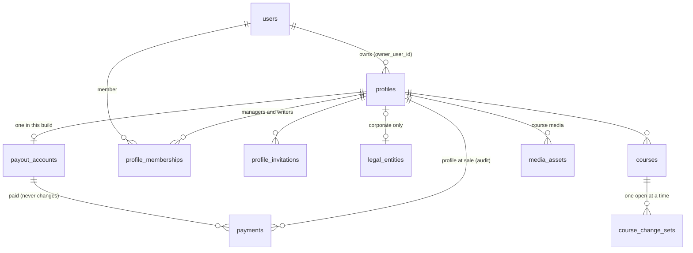

# Teacher profiles separate from users

-   **Author:** sky
-   **Status:** Proposed
-   **Date:** 2026-11-11
-   **Related:** reviews in [reviews/teacher-profiles/](reviews/teacher-profiles/); the brief this design came from, [teacher-profiles-brief.md](teacher-profiles-brief.md).
    Changes [ADR 003](../adr/003-payments-destination-charges.md): the destination charge goes to
    the profile's payout account instead of the teacher's Stripe account, and commission stays on
    the profile.

---

## Overview

Elevate Teach lets one person sell courses under their own name. This design changes that so a
teaching profile can be run by more than one person, and can belong to a company as well as to a
person.

A **profile** becomes its own record, separate from any user. Users join a profile through a
**membership** with one of three fixed roles:

| Role        | Who                     | Can do                                                                                              |
| ----------- | ----------------------- | --------------------------------------------------------------------------------------------------- |
| **Owner**   | exactly one per profile | every capability, including Stripe links and managing managers                                      |
| **Manager** | corporate profiles only | every capability except Stripe links and managing managers                                          |
| **Writer**  | any profile             | create courses, edit draft content, propose edits to live courses (held for approval), upload media |

The exact capabilities of each role, and of Support staff acting in Teach, are in the table in
Technical Plan, section 2.

There are two kinds of profile:

| Type          | Who it is for                                                                             | Paid through                 | Can it change hands?                   |
| ------------- | ----------------------------------------------------------------------------------------- | ---------------------------- | -------------------------------------- |
| **Personal**  | an individual or a sole proprietor                                                        | an individual Stripe account | never                                  |
| **Corporate** | a separate legal entity registered with ACRA, such as a private limited company or an LLP | a company Stripe account     | only through a Support recovery action |

Each Stripe account becomes a **payout account** record. Every checkout and every payment records
which payout account it pays, permanently. Earnings, reconciliation and the Support ledger are
grouped by payout account, not by teacher.

The work ships as one first build in three slices, built in order:

1. **Structure.** The data and permission changes. After this slice the product behaves as it does
   today.
2. **Helpers.** Writers, invitations, member screens, and held change sets for writer edits to live
   courses.
3. **Corporate.** Self-serve corporate applications, company Stripe accounts and the Support checks.

The product is pre-launch, so staging and production are reset rather than migrated.

**Product decision (author, 2026-11-11): corporate profiles are in the MVP because they are a
market requirement.** This goes beyond today's `docs/spec.md`, which describes a pilot of freelance
teachers; item D.2 updates the spec to record the decision. No specific company has asked yet, so
the requirement is about the market the MVP launches into, not a named customer.

## The Problem

**A teacher on Elevate is a user, and the schema, every Teach route and the payment code assume
that.**

- The teacher profile is keyed by the user's ID (`packages/db/src/schema/teachers.ts:11-13`).
- Courses and payments point at that user (`packages/db/src/schema/courses.ts:13-15`,
  `packages/db/src/schema/commerce.ts:73-75`).
- The Stripe account, commission rate and approval status sit on the same row.
- Every Teach route checks one global `teacher` role and then compares the course's teacher ID with
  the signed-in user's ID (`apps/api/src/routes/teach.ts`, `apps/api/src/services/courses.service.ts:191`).

That model breaks in three ways, and a fourth point is the reason to fix it now.

1. **A teacher cannot get help.** There is no way to let a second person edit a course without
   giving them the teacher's own login.
2. **A company cannot teach.** Every Stripe account is created as an individual account
   (`apps/api/src/providers/payments/stripe.ts:36-49`). There is no record of a legal entity and no
   way for several staff to work under one name.
3. **Money cannot follow a change of account.** Payments do not record which Stripe account they
   paid. Earnings and reconciliation compare all of a teacher's payments against whatever account is
   on the profile now (`apps/api/src/services/earnings.service.ts:138-157`). If the account ever
   changes, old sales stop reconciling with Stripe. The spec requires earnings to reconcile
   (`docs/spec.md:69`).
4. **Why now: the cost of fixing this grows after launch.** 186 lines in 27 files match
   `teacherId|teacher_id|teacherProfile|teacher_profiles|teacherProfiles` (`git grep` over `apps`
   and `packages`, migrations excluded, measured 2026-11-11). Before launch the data can be wiped.
   After launch every change needs a migration that keeps live money records correct.

**Weak points in the case for doing this now:**

- **No specific teacher or organisation has asked for helpers or a company profile.** The pilot is
  3 to 5 freelance teachers (`docs/spec.md:73`), and the spec describes the product as connecting
  learners with freelance teachers (`docs/spec.md:3`).
- **The case for slices 1 and 2 rests on point 4,** the cost of changing the model after launch.
  The case for slice 3 is the market requirement in the Overview, which names no customer.
- **The corporate slice carries the most risk.** It is built with no real company to test it
  against. Its choices about entity checks and company Stripe onboarding are untested until a real
  company onboards.

## Goals

### Slice 1: Structure

1.  **Every course and payment belongs to a profile, not a user.** Measured by: a test reads the
    generated `0000` and finds no foreign key from `courses`, `payments` or
    `media_assets.profile_id` to `users`.
2.  **Every profile has exactly one owner at all times.** Measured by: the database rejects a
    profile row with no owner, and blocks deleting a user who owns a profile.
3.  **One permission check decides every Teach action.** Measured by:
    - every guarded Teach route calls a single function, `can(user, profile, capability)`;
    - the role-to-capability table lives in `packages/core`;
    - the global `teacher` platform role no longer exists.
4.  **Every sale records who was paid.** Measured by:
    - each payment row stores a payout account ID that never changes;
    - fulfilment takes the payee from the checkout, not from the course's current state.
5.  **Money is grouped by payout account.** Measured by: earnings, reconciliation and the Support
    ledger select payments by `payout_account_id`, and a test shows their totals equal the sum of
    the fixture's payments for that account. First-payout analytics is counted per profile.
6.  **A user can belong to more than one profile without mixing them up.** Measured by:
    - every Teach request names its profile in the URL;
    - a test shows a member of two profiles cannot read or change the other profile's data through
      any route.
7.  **The product behaves as it does today when this slice is merged.** Measured by: the existing
    API, Teach, Support and learner test suites pass with changes only to fixtures, route paths and
    renamed fields.
8.  **Staging and production start from a clean database.** Measured by: both run from a single
    squashed `0000` migration and a seed run as a one-off task.

### Slice 2: Helpers

9.  **An owner can add a writer without sharing a login.** Measured by: an owner invites an email
    address, and that person accepts and edits a draft course. This works whether or not they had
    an Elevate account beforehand.
10. **Writers cannot change money or publishing.** Measured by: a role-by-route test shows writers
    are refused on price, submit for review, course deletion, earnings, members and Stripe routes.
11. **Writer edits to a live course reach learners only after approval.** Measured by: a writer's
    change to a live lesson is invisible to an enrolled learner until an owner or manager approves
    the change set.
12. **Course media belongs to the profile.** Measured by: a removed writer's uploads remain usable
    by the profile.

### Slice 3: Corporate

13. **A company can apply on its own.** Measured by: a signed-in user submits a corporate
    application, Support approves it in the review queue, the owner completes company Stripe
    onboarding, and Support confirms the legal name matches.
14. **No company sells before both Support checks pass.** Measured by: checkout refuses a corporate
    profile's course while either check is pending.

### Across all slices

15. **Staff actions are visible.** Measured by:
    - every staff change to a profile writes an audit entry under the staff member's own user ID;
    - no staff role can request a Stripe link.

## Non-Goals

-   **Promotion from personal to corporate.** This is a later brief. This design only guarantees the
    data model will not need rework for it.
-   **Ownership transfer** between people or entities. The only change of owner is Support's
    recovery action.
-   **Custom roles.** Roles are fixed at owner, manager and writer.
-   **Google and Apple sign-in,** which is a later brief.
-   **Automated ACRA or Singpass/Corppass lookup.** The entity check is manual.
-   **Several profiles for one legal entity.** One UEN backs at most one profile.
-   **Per-course writer permissions** and per-course instructor credit.
-   **Support review of approved writer changes.** Approved change sets go live without a second
    Support review, matching how owner edits work today.
-   **Dispute handling, GST and invoicing.**
-   **Keeping existing data.** Staging and production are reset.

## Open Questions

-   **Stripe behaviour for company accounts**: Deferred by the author until slices 1 and 2 are done;
    no company Stripe account exists yet. Slice 3 cannot start until this is tested. Assumption:
    Stripe test mode accepts made-up company details, so a real company is not needed for the test.
    Each point is an assumption until tested:
    - a Singapore company account can be created with the settings used for individual accounts;
    - one person can hold two connected accounts;
    - the dashboard login link works for company accounts, and which person it signs in: the
      representative Stripe holds for the company, or whoever controls the owner's email;
    - the company's legal name can be read from the account.
-   **Stripe sorts accounts by legal form**: assumed, not tested, that Stripe classes a connected
    account as individual or company by legal form, not by how many people run it. Alternative F
    relies on this.
-   **Apple relay addresses**: assumed, not tested, that Apple sign-in can hand Elevate a relay
    address, so an invited email may not match the accepting account. Alternative V relies on
    this; it matters only once the sign-in brief lands.
-   **Drizzle 1.0 status**: the design depends on `drizzle-orm@1.0.0-rc.5`, a release candidate
    (Technical Plan, section 13). The upgrade is Step 0, before step 1, because the squashed `0000`
    is generated with the new `drizzle-kit`. Doing it later means generating the squashed migration
    twice.
-   **`drizzle-kit` RC and views**: not yet tested whether it generates the `CREATE VIEW`
    statements for `snakeCase.view` definitions. Tested in item 0.10, before step 2 needs the
    views. Fallback: the views are declared with `.existing()` and the generate wrapper (item 1.8a)
    adds their SQL to `0000`.

## Critical User Journeys (CUJs)

### CUJ 1: A teacher applies and sells, as today (step 1)

-   **Given**: a signed-in user with no profile.
-   **When**: they apply in Teach, Support approves them, they finish individual Stripe onboarding,
    and they publish a course that Support approves.
-   **Then**:
    - a personal profile exists with them as owner;
    - its payout account becomes active as soon as Stripe enables charges;
    - a learner's purchase creates a payment that names that payout account and that profile.

### CUJ 2: An owner adds a writer (step 2)

-   **Given**: an approved personal profile.
-   **When**: the owner invites `helper@example.com` as a writer, and the helper opens the link,
    signs in (creating an account if needed) and accepts.
-   **Then**:
    - the helper is a writer on the profile and the owner is notified;
    - the helper can edit draft courses, and is refused on price, submit, earnings, members and
      Stripe routes.
-   **Variant, a manager on a corporate profile**: the owner invites `ops@example.com` as a
    manager, and the person accepts while signed in as `ops.personal@example.com`. The membership
    waits in `awaiting_confirmation` until the owner confirms it, and then the person is a manager.

### CUJ 3: A writer edits a live course (step 2)

-   **Given**: a writer on a profile with a live course and enrolled learners.
-   **When**: the writer changes a lesson's text and adds an artefact.
-   **Then**:
    - learners see no change;
    - the owner sees one pending change set for the course;
    - after the owner approves it, learners see both changes.

### CUJ 4: A company applies and sells (step 3)

-   **Given**: a signed-in user who may already own a personal profile.
-   **When**:
    1. They submit a corporate application with a UEN, legal name, registry document and teaching
       details.
    2. Support approves it in one review.
    3. They complete company Stripe onboarding.
    4. Support confirms the Stripe legal name matches.
-   **Then**:
    - the corporate profile's payout account becomes active;
    - its courses can be bought only from this point;
    - before step 4, checkout refuses with `teacher_not_payable`.

### CUJ 5: Support helps a teacher directly (step 1)

-   **Given**: a `super_admin` and an approved profile.
-   **When**: the `super_admin` opens Teach at that profile's URL and fixes a quiz.
-   **Then**:
    - Teach shows a banner saying they are acting as staff;
    - the change is saved and audited under the staff user's ID;
    - price, delete, submit, change-set approval, Stripe link, member and ownership actions are
      refused.

### CUJ 6: A member belongs to two profiles (step 2)

-   **Given**: a user who is a writer on profile A and the owner of profile B.
-   **When**: they open profile A in one browser tab and profile B in another, and save in both.
-   **Then**: each save lands on the profile named in that tab's URL, and neither tab can read the
    other profile's earnings or members through A's URLs.

### CUJ 7: Support recovers a company's owner (step 3)

-   **Given**: an approved corporate profile whose owner has left the company and cannot sign in,
    and an existing Elevate user the company names as the new owner.
-   **When**: a `super_admin` uploads the company officer's written authorisation and sets the new
    owner in the Support portal.
-   **Then**:
    - the new user is the owner, and their membership row, if any, is removed;
    - the previous owner becomes a manager, unless the request removed them, and their sessions are
      revoked;
    - the change is audited, and the old and new owners' addresses are emailed.

## Technical Plan (Architecture)

Which step builds each section (steps 1–3 are slices 1–3; Step 0 is the Drizzle upgrade):

| Section                                                   | Step                                                                                   |
| --------------------------------------------------------- | -------------------------------------------------------------------------------------- |
| 1 Data model                                              | 1, with memberships and invitations in 2, change-set columns in 2, legal entities in 3 |
| 2 Permissions                                             | 1 (owner and staff rows), 2 (manager and writer rows)                                  |
| 3 Signed-in user, 5 Checkout, 6 Money, 10 Staff, 12 Reset | 1                                                                                      |
| 4 Payout accounts                                         | 1, with the company rule and name check in 3                                           |
| 7 Invitations, 8 Writer edits                             | 2                                                                                      |
| 9 Corporate checks, 11 Owner recovery                     | 3                                                                                      |
| 13 Drizzle 1.0                                            | 0                                                                                      |

### 1. Data model



**`profiles`** replaces `teacher_profiles`.

- It keeps today's columns: display name, headline, bio, credentials, teaching sample, status,
  review note, commission and review fields.
- New columns:
  - `id`, its own primary key;
  - `type`: `personal` or `corporate`, fixed in this build (the promotion brief may change it);
  - `owner_user_id`: required, referencing `users` with delete **restricted**;
  - `avatar_media_id`;
  - `legal_entity_id`: nullable, unique.
- The Stripe columns move to `payout_accounts`.
- A user may own many profiles, but at most one personal profile. This is a partial unique index on
  `owner_user_id` where `type = 'personal'`.
- The owner is a column, not a membership row. That gives exactly one owner without a trigger, and a
  change of owner is a single update.

**`profile_memberships`** holds managers and writers only.

- Columns: `(profile_id, user_id)` as the primary key, `role` (`manager` or `writer`), `added_by`
  and `created_at`.
- The rule "managers only on corporate profiles" spans two tables, so a column check cannot express
  it. The membership service enforces it, and a test covers it.

**`profile_invitations`**

- Columns: `id`, `profile_id`, `email`, `role`, `invited_by`, `token_hash` (unique), `status`,
  `accepted_by`, `expires_at` and `created_at`.
- Status is one of `pending`, `awaiting_confirmation`, `accepted`, `revoked` or `expired`.
- A partial unique index on `(profile_id, email)` where the status is `pending` allows one pending
  invitation per profile and email.

**`payout_accounts`** is one row per Stripe connected account. In this build a profile has at most
one.

- Columns:
  - `id`, `profile_id` (unique), and `stripe_account_id` (unique, nullable until Stripe returns
    the ID; see section 4);
  - `business_type`: `individual` or `company`, taken from the profile type when the account is
    created (personal gives individual, corporate gives company);
  - `status`: `onboarding` or `active`;
  - the three Stripe flags that live on the profile today;
  - `activated_at`, `name_verified_by` and `name_verified_at`.
- **Why a separate table now, with one account per profile.** The part that is costly to add after
  launch is `payments.payout_account_id`, because it would mean rewriting payment rows. That column
  is added now. The later promotion brief needs a profile to hold two accounts for a while: the
  individual account keeps taking payments while the company account onboards. That brief adds a
  `retired` status, a changeable `profile_id`, and replaces the unique `profile_id` with "at most
  one active". Each of those is an additive change. Decided by author during review (Stage 9,
  IB2), replacing an earlier version that built these states now with no flow that reached them.
- No database rule ties `business_type` to the profile's type, because during that later overlap a
  corporate profile can still hold an individual account.

**`legal_entities`**

- Columns:
  - `id`, `uen` (unique), `legal_name`;
  - `entity_type`: `private_limited` or `llp`;
  - `registry_document_media_id`;
  - `check_status`: `pending`, `verified` or `rejected`;
  - `checked_by`, `checked_at` and `rejection_reason`.

**Changed tables**

- `courses.teacher_id` becomes `profile_id`, referencing `profiles` with delete restricted.
- `payments.teacher_id` becomes `profile_id`, recording the profile at the time of sale for audit,
  plus a new required `payout_account_id`, restricted and never updated.
- `media_assets.owner_id` becomes:
  - `uploader_id`, nullable, set to null when the user is deleted;
  - `profile_id`, nullable, set for course media.

  Learner avatars and teaching samples keep `profile_id` empty.
- `audit_log` gains a nullable `profile_id` and an index on it.
- `user_role` loses `teacher` and keeps `support_agent` and `super_admin`.
- **Writer edits (step 2; behaviour in section 8):**
  - new table `course_change_sets`;
  - `lessons`, `artefacts` and `quizzes` gain `change_set_id`, `source_id`, `removed` and
    `copied_from_live`; `lesson_prerequisites` gains `change_set_id`;
  - four new views, `live_lessons`, `live_artefacts`, `live_quizzes` and
    `live_lesson_prerequisites`.
- `sessions` is unchanged: its `created_at` is the sign-in time used in section 4.

### 2. Permissions

```text
request ──► authenticate (unchanged: user rebuilt from the session on every request)
        ──► /teach/profiles/:profileId/* ──► loadActor(user, profileId)
                 owner_user_id = user.id          → actor role "owner"
                 membership row                   → "manager" | "writer"
                 user is super_admin              → "staff"
                 otherwise                        → 404
        ──► route handler calls can(actor, capability) ──► 403 when false
        ──► resource lookups (course, lesson, artefact, media) filter by profileId ──► 404 when absent
```

- **`packages/core` holds the rules as pure functions:**
  - a list of capabilities;
  - a table from role and profile type to capabilities;
  - `can(actor, capability)`.
- **Capabilities:**
  - `profile.read`, `profile.edit`
  - `course.create`, `course.editDraft`, `course.editLive`, `course.proposeLiveEdit`
  - `course.setPrice`, `course.submit`, `course.delete`
  - `changeSet.review`, `media.upload`, `earnings.read`
  - `members.read`, `members.manageWriters`, `members.manageManagers`
  - `stripe.links`
- **The role table.** A manager exists only on corporate profiles; on a personal profile the
  manager row is empty. Invitation capabilities also need the profile to be approved.

  | Capability               | Owner | Manager | Writer | Staff |
  | ------------------------ | ----- | ------- | ------ | ----- |
  | `profile.read`           | yes   | yes     | yes    | yes   |
  | `profile.edit`           | yes   | yes     | no     | yes   |
  | `course.create`          | yes   | yes     | yes    | no    |
  | `course.editDraft`       | yes   | yes     | yes    | yes   |
  | `course.editLive`        | yes   | yes     | no     | yes   |
  | `course.proposeLiveEdit` | yes   | yes     | yes    | no    |
  | `course.setPrice`        | yes   | yes     | no     | no    |
  | `course.submit`          | yes   | yes     | no     | no    |
  | `course.delete`          | yes   | yes     | no     | no    |
  | `changeSet.review`       | yes   | yes     | no     | no    |
  | `media.upload`           | yes   | yes     | yes    | yes   |
  | `earnings.read`          | yes   | yes     | no     | yes   |
  | `members.read`           | yes   | yes     | no     | yes   |
  | `members.manageWriters`  | yes   | yes     | no     | no    |
  | `members.manageManagers` | yes   | no      | no     | no    |
  | `stripe.links`           | yes   | no      | no     | no    |

- **Unapproved profiles.** While a profile is `applied` or `rejected`, its owner and members get
  only `profile.read` and `profile.edit`, whatever their role, as applicants have today.
- **Staff** is one named row in the table, not an exception on each route. Staff fix content to
  help a teacher and can read the profile, its members and its earnings. Money, publishing and
  membership stay with the teacher: staff cannot set prices, submit or delete courses, approve
  change sets, manage members or request Stripe links. Each staff change is audited under the staff
  member's own user ID, and Teach shows a banner (section 10).
- **Inaccessible profiles return 404.** A profile the user cannot access answers 404, not 403, so
  its ID is not confirmed to exist.
- **Lesson, artefact and quiz routes move under the profile path.** Each one verifies, in the same
  query that loads the resource, that the resource belongs to that profile.
- **Writers get two routes for course details.** Price moves out of the general course update into
  `PUT .../courses/:id/price`, so writers can edit a draft course's title, summary, category and
  thumbnail without `course.setPrice`.
- **Support routes** keep `requireRole('support_agent')` and its `super_admin` bypass. Each one
  that changes a profile writes an audit entry with the `profile_id`.

### 3. Signed-in user contract

- **`AuthUser.teacher`** (a single object) is replaced by **`AuthUser.profiles`**, a list of
  `{ id, type, displayName, status, role }` built on each request.
- **Teach:**
  - It remembers the last profile used, on the client only.
  - It routes to `/p/:profileId/...`.
  - It shows a profile switcher when the list has more than one entry.
  - It shows the application page when the list is empty.
- **The learner app** shows its teacher badge when `profiles` is not empty, in place of checking
  `roles` for `teacher` (`apps/learner/src/app/(tabs)/profile.tsx:44`).

### 4. Payout accounts and Stripe

- **Creating an account:** `createConnectedAccount` takes `businessType` (derived from the profile
  type), the profile ID, the payout account ID, the owner's email and the profile's display name
  (sent as `business_profile.name`, as today's display name is).
  - Metadata changes from `elevateUserId` to `elevateProfileId` and `elevatePayoutAccountId`.
  - Order, in one transaction: insert the `payout_accounts` row with `stripe_account_id` null,
    call Stripe with the row's ID in metadata, then store the returned Stripe ID.
- **Onboarding:** an onboarding link reuses the profile's payout account, whatever its status, and
  reissues the link for it, as `ensureAccount` does today. An account is created only when the
  profile has none. Return and refresh URLs move to `/p/:profileId/stripe/return` and `/refresh`.
- **One activation rule.** A single function, `applyAccountState(account, flags)`, updates the
  flags and decides the status. Both the `account.updated` webhook and `syncStatus` (the fallback
  when webhooks lag) call it. When charges become enabled:
  - an `individual` account becomes `active`;
  - a `company` account stays `onboarding` until Support records the legal-name match, which sets
    `name_verified_by`, `name_verified_at` and `active`.
- **Unmatched webhooks:** an `account.updated` for an unknown Stripe account throws
  `unknown_account`. The existing webhook route stores the error in `webhook_events`, where today
  the event is ignored.
- **`retrieveAccount`** also returns the company's legal name when Stripe provides it, so Support
  can compare. Assumption: the field is readable for Singapore company accounts. When Stripe
  returns no name, Support compares in the Stripe dashboard instead, and the audit entry records
  that the dashboard was used.
- **Payability:** a course is payable when its profile has an `active` payout account with charges
  enabled. This replaces the check at `apps/api/src/services/payments.service.ts:160-166`.
- **Stripe links:** dashboard and onboarding links need `stripe.links`. Each request is audited and
  emails the owner.
- **Recent sign-in for Stripe links:** a session is created only when an emailed sign-in link is
  used, and renewal changes only `last_seen_at` and `expires_at`. So `sessions.created_at` is the
  sign-in time, and no new column is needed. Stripe link routes answer `401 reauth_required` when
  it is more than 24 hours old. Teach then sends the owner through
  sign-in with a redirect back to the Stripe page. This stops a stolen session, not a stolen inbox.

### 5. Checkout and fulfilment

- **When checkout starts:**
  - the course's active payout account is chosen;
  - the session's `payment_intent_data.transfer_data.destination` is set to that account's Stripe
    ID;
  - its metadata gets `elevatePayoutAccountId` and `elevateProfileId`, beside the existing
    enrolment metadata (`apps/api/src/services/payments.service.ts:201-214`).
- **The idempotency key** becomes `checkout:${enrollmentId}:${amountCents}:${payoutAccountId}`
  (`apps/api/src/providers/payments/stripe.ts:107`).
- **Fulfilment** reads both IDs from the session metadata in the Stripe event and writes them to
  the payment. It no longer reads the course's teacher at fulfilment time (`payments.service.ts:288`).
- **Missing metadata:** if either ID is absent, or the payout account does not exist, fulfilment
  returns a new outcome, `unattributed`, and writes no payment. On the webhook path this is thrown
  as an error and stored in `webhook_events`; on the success-page poll (`syncSession`) the session
  is reported as still pending and an error is logged. A test covers both. Every session is
  created after the reset, so this happens only if session creation leaves out the metadata.
  Known gap: the learner has paid and has no enrolment until Support acts on the error.
- **Unchanged:** the enrolment row still keeps only the latest session ID. A learner who starts
  checkout twice and pays the older session still gets `unmatched`, as today
  (`payments.service.ts:216-219`).
- **Decided:** session metadata only, with no local copy before payment. Alternatives X and Y
  were rejected.

### 6. Money queries

- **Earnings, per-course earnings and reconciliation for a profile** cover payments whose
  `payout_account_id` is the profile's payout account. Queries select by payout account, not by
  profile, so when the promotion brief lets an account move to another profile, its history moves
  with it. This is the "earnings follow the account" rule.
- **The per-course breakdown** groups those payments by `course_id`. It does not start from the
  courses the profile owns. Reconciliation runs per payout account, using
  `listTransferAmountCents(account)`.
- **The Support ledger** groups by payout account and shows the profile beside it.
- **First-payout analytics** is counted per profile: the time from profile approval to the first
  payment on the profile's payout account. The event's `userId` is the owner's user ID, and its
  properties are `profileId` and `payoutAccountId`.
- **`payments.profile_id`** records the profile at the time of sale. No query in this build reads
  it; it is kept for audit and for the promotion brief, when the account's current profile and the
  profile at sale can differ.

### 7. Invitations

```text
owner/manager ── POST invite ──► pending ──(7 days)──► expired
                                    │  └── revoke ───► revoked
              invitee opens link, signs in, accepts
                                    │
            ┌───────────────────────┴───────────────────────┐
     role = writer, or accepting email             role = manager and
     equals invited email                          accepting email differs
            │                                               │
         accepted ◄────────── inviter confirms ── awaiting_confirmation
```

- **Who can do what:**
  - inviting a manager needs `members.manageManagers`, which only the owner has;
  - inviting a writer needs `members.manageWriters`;
  - only approved profiles can invite.
- **The limit** is 20 invitations per profile in any 24 hours, counted from `profile_invitations`
  in the database. The existing rate limiter is in memory per process and resets on every deploy,
  so it is not used for this.
- **The link** is `/teach/invitations/:token`. It is the one Teach route outside a profile path,
  because the user is not yet a member.
- **Emails:** the inviter is emailed on acceptance, and the owner too when the inviter is a manager.
- **Screens (Teach):** a members page (list, invite, resend, revoke, remove, confirm pending
  managers) and an invitation page at `/invitations/:token`, outside any profile.

### 8. Writer edits to live courses

**Decided:** a draft copy of the course content, hidden from learners by database views, read
through Drizzle 1.0's relational queries (section 13). Alternatives P, Q, R and S were rejected.

**Screens (Teach):** the builder shows writers a "Changes waiting for approval" bar on live
courses; owners and managers get a change-set review screen that shows each changed item's live
and draft versions, lets them pick one for each conflict, then approve or discard.

**Storage**

- **`course_change_sets`:**
  - columns: `id`, `course_id`, `opened_by`, `status`, `opened_at`, `opened_at_snapshot`,
    `opened_prerequisites` (the live prerequisite links at opening, as JSON), `decided_by`,
    `decided_at`;
  - `status` is `open`, `approved` or `discarded`;
  - a partial unique index on `course_id` where the status is `open` allows one open change set per
    course.
- **Four tables gain columns:** `lessons`, `artefacts`, `quizzes` and `lesson_prerequisites` gain a
  nullable `change_set_id`, which cascades when its change set is deleted. `lessons`, `artefacts`
  and `quizzes` also gain a nullable `source_id`, pointing at the live row a draft row copies, and
  a `removed` flag.
  - Live rows have `change_set_id` empty.
  - A draft row with `source_id` empty is new.
  - Removing a lesson, artefact or quiz is recorded as `removed` on its draft row.
  - `source_id` is set to null if its live row is deleted. A `copied_from_live` flag, set when the
    draft is copied, lets the conflict check tell such a draft apart from a new one.
  - Prerequisite links are saved per lesson, as the editor saves them today (one lesson's links
    replaced at a time), so they need no `source_id` or `removed` flag: a lesson's draft links
    replace its live links on approval.
- **Opening a change set:** when a writer first edits a live course, the API copies that course's
  lessons, artefacts, quizzes and prerequisite links into draft rows in one transaction. It sets
  `source_id` on each copy, and records the latest `updated_at` among the live rows as
  `opened_at_snapshot`.
- **The writer edits the draft rows** with the existing course editor and validation code, scoped
  by `change_set_id`.

**What learners read**

- **Four views** each select the rows where `change_set_id` is null:
  - `live_lessons`
  - `live_artefacts`
  - `live_quizzes`
  - `live_lesson_prerequisites`
- **Learner-facing code queries only the views:** the catalogue, learning, certificate, checkout,
  My Learning progress and drop-off analytics reads of course content all go through them.
- **Learner code gets its own database client.** The relations for learner code are defined over
  the views. A learner-scoped `db` is passed to those services, so `db.query.lessons` does not
  exist in their types. This does not block `select().from(...)` on a raw table, so the types alone
  are not the guard.
- **A test is the guard.** Only `courses.service.ts` and `change-sets.service.ts` may refer to the
  raw `lessons`, `artefacts`, `quizzes` or `lessonPrerequisites` tables, either as `s.lessons` or a
  named import, or as a relation key in a relational query (`lessons:`, `artefacts:`, `quiz:`,
  `prerequisites:` inside `with`). The learner relations use different keys (`liveLessons`,
  `liveArtefacts`, `liveQuiz`, `livePrerequisites`), so a learner read through `learnerDb` never
  uses the raw keys, and a raw-`db` read of course content outside the two allowed files fails the
  test.
- **Teach and Support reads** (the course editor and Support's course preview, both through
  `CoursesService`) read the raw tables, filtering `change_set_id is null` unless they ask for the
  draft. This is the one place a code filter is used, and it is inside the allowed file.
- **Learner writes go to the raw tables.** Progress and quiz attempts reference `artefacts` and
  `quizzes`. The learning service already finds the artefact or quiz inside the enrolment's loaded
  course and returns 404 when it is absent; once that load reads the views, a draft ID returns 404
  with no extra lookup.

**Approval**

- **What approval guarantees:**
  - all of the change set applies, or none of it;
  - live lessons, artefacts and quizzes keep their IDs, so learner progress and quiz attempts stay
    attached;
  - references between draft rows are rewritten to live IDs before any draft row is deleted, so
    nothing a writer added is lost to a cascade;
  - conflicts are reported, not merged.
- **Conflicts:** a live row edited after `opened_at_snapshot`, a draft whose live row was deleted,
  or a lesson whose live prerequisite links differ from `opened_prerequisites`. Live rows the owner
  added during the change set are not conflicts and stay. The approver picks the live or draft
  version of each conflict; the choices are stored on the change set until approval.
- The ordered apply procedure is in the Detailed Implementation Plan, item 2.8.
- **Quiz changes:** an attempt in progress is graded against the quiz as it is at submission. This
  is today's behaviour when an owner edits a live quiz, and this design does not change it.

**Course states and editing**

- Course states today: `draft`, `pending_review`, `live` and `rejected`. `draft`, `rejected` and
  `live` are editable; `pending_review` is not (`apps/api/src/services/courses.service.ts:24`).
- Writers edit `draft` and `rejected` courses directly, and `live` courses through a change set.
- **Not in the change set:** title, summary, description, category and thumbnail. Writers cannot
  change these on a live course; owners and managers can.

**Scratch-project test results.** Tested in a scratch project, not in this repo, on
`drizzle-orm@1.0.0-rc.5` with PGlite 0.5.16:

- tables and views were declared with `snakeCase.table` and `snakeCase.view`;
- relations ran over the views with `defineRelations`;
- a nested query from `courses` through `live_lessons` to `live_artefacts` returned only the live
  lesson and the live artefact;
- the same query over the raw tables returned the draft rows as well;
- a query rooted at a view also worked.

**Not tested:** views over `lesson_prerequisites`, the API's real schema, and migration
generation (see the `drizzle-kit` item in Open Questions).

### 9. Corporate application and checks

```text
apply (UEN, legal name, registry document, teaching details)
   → profile: corporate, applied;  legal entity: pending
Support review (teaching + UEN/name vs document + UEN not used elsewhere)
   → approve: profile approved, legal entity verified
   → reject:  profile rejected, legal entity rejected (reason stored)
owner starts company Stripe onboarding → payout account: company, onboarding
Stripe enables charges → Support compares legal names → payout account: active → courses payable
```

- **The corporate application** is a new route and Teach page. It creates the profile, the legal
  entity and the uploaded document in one transaction.
- **The registry document** uses the existing `document` media kind. Support can read it, and the
  uploader can read it while the profile is still `applied`.
- **The review queue** lists corporate applications beside personal ones, with a type label.
- **Who runs the checks:** any Support staff, `support_agent` or `super_admin`, runs both the
  combined review and the legal-name comparison. Each check is audited under the staff member's
  own user ID. The accepted risk is in Risks & Mitigations.

### 10. Staff acting in Teach

- **Access:** a `super_admin` opening `/p/:profileId` gets the `staff` actor.
- **The API tells Teach:** profile responses carry `actingAsStaff: true`, and Teach shows a banner
  for as long as that is true.
- **What staff can do:** fix content and read the profile, its members and its earnings; not
  money, publishing or membership (the table in section 2).
- **Auditing:** every request from a `staff` actor that changes data writes an audit entry with the
  staff user's ID and the `profile_id`.
- **`support_agent`** loses the course-ownership bypass at
  `apps/api/src/services/courses.service.ts:191`. Support course review uses its own read routes.

### 11. Owner recovery

- **Personal profile:** a Support route changes the email on the owner's user record. The route
  refuses when another user already has that email.
- **Corporate profile:** a Support route sets `owner_user_id` to another existing user, with an
  uploaded officer authorisation.
  - If the new owner was a member, their membership row is deleted.
  - The previous owner becomes a manager, unless the request says to remove them.
- **Both routes** are `super_admin` only. Each is audited and emails both the old and the new
  addresses.

### 12. Reset and seed

- **Migrations:** `packages/db/drizzle/0000_init.sql` and `0001` are replaced by one generated
  `0000`.
- **A new API image command, `reset-schema`,** drops and recreates the `public` and `drizzle`
  schemas. It refuses to run unless `ALLOW_SCHEMA_RESET=yes` is set for that one task.
- **A new command, `seed`,** runs the demo seed on staging and the super-admin-only seed on
  production. The choice comes from an argument.
- **Order in each environment.** `reset-schema` exists only in the new image, and the Deploy
  workflow builds that image and then migrates at once. The procedure has four parts, (a) to (d),
  lettered so they are not confused with the plan's steps:
  a. Push the commit to the environment branch. Deploy builds the image and registers the task
  definition, then **fails at the migration step, as expected**, because the new `0000` meets
  the old tables. The workflow leaves the running API on the old version.
  b. Run `reset-schema` as a one-off task with the task definition that deploy just registered,
  overriding the command and setting `ALLOW_SCHEMA_RESET=yes` for that task only.
  c. Re-run Deploy for the branch (`workflow_dispatch`). It reuses the image, applies the new
  `0000` and rolls the service.
  d. Run `seed --demo` (staging) or `seed --admin-only` (production) as a one-off task.

  The old API serves errors between (b) and (c); this is accepted because there are no users.
  On production, (a) and (c) wait for approval by the required reviewer of the `production` GitHub Environment, the
  same approval every production deploy needs today.
- **Seed images:** the seed writes thumbnails through the storage provider, so S3 is used on
  staging.
- **The deploy workflow is unchanged.** The procedure uses it as it is, including its expected
  failure in (a). `infra/README.md` documents the procedure, and notes that this change cannot
  be undone with `git revert`.
- **Extensions:** dropping `public` also drops the `citext` and `pg_trgm` extensions; the new
  `0000` creates them again (item 1.8a).
- **Old Stripe test accounts:** connected accounts created before the reset carry `elevateUserId`
  metadata and have no `payout_accounts` row, so their `account.updated` events store
  `unknown_account` errors. These can be ignored, or the accounts closed in the Stripe test
  dashboard.

### 13. Drizzle 1.0 upgrade

**Status, checked 2026-11-11:**

- On npm, `drizzle-orm` `latest` is `0.45.4`, published 2026-10-08, which is what the repo uses.
- The newest 1.0 build is `1.0.0-rc.5`, published 2026-10-21, a release candidate.
- `drizzle-kit` `latest` is `0.31.11`, with a matching `rc` tag.

**What the upgrade changes in this repo:**

- **Casing.** Drizzle 1.0 removed the global `casing: 'snake_case'` option, which the repo sets in
  `packages/db/src/client.ts:14`, `packages/db/src/pglite.ts:18` and `packages/db/drizzle.config.ts:7`.
  Every table must be declared with `snakeCase.table`, and every view with `snakeCase.view`.
  Without it, queries use camelCase column names and fail. The scratch test confirmed this.
- **Relations.** `packages/db/src/schema/relations.ts` is rewritten with `defineRelations`, because
  the old relational query API is removed.
- **Queries.** Every `db.query.*` call in the API moves to the new syntax for `where` and `orderBy`.
  Relation filters no longer accept `undefined`.
- **Errors.** `DrizzleQueryError` omits query parameters unless `paramsInErrors: true` is set.
- **Versions.** `drizzle-kit` moves to the matching RC, and the squashed `0000` is generated with
  it.

**Pinning.** Both packages are pinned to exact RC versions, not the moving `rc` tag, and are moved
up only on purpose, because a release candidate can still change before 1.0 is final (see Risks &
Mitigations).

## Risks & Mitigations

| Risk                                                                              | Impact                                                                   | Mitigation or acceptance                                                                                                                                                         |
| --------------------------------------------------------------------------------- | ------------------------------------------------------------------------ | -------------------------------------------------------------------------------------------------------------------------------------------------------------------------------- |
| Drizzle `1.0.0-rc.5` changes before 1.0 is final                                  | the rewritten query layer may need follow-up changes                     | exact pins; Step 0 lands on its own with every suite passing; the RC is moved only on purpose                                                                                    |
| `drizzle-kit` RC does not emit views, or changes its migration layout             | the single `0000` cannot be generated as planned                         | tested in item 0.10 before step 2; fallback: the generate wrapper (item 1.8a) adds the view SQL                                                                                  |
| Stripe company accounts behave differently from the assumptions in Open Questions | step 3 is blocked or changes                                             | tested in Stripe test mode before step 3 starts                                                                                                                                  |
| The reset cannot be undone                                                        | staging and production data are lost                                     | accepted: no real data exists; production is reset only after staging passes, and its deploys wait for the required reviewer of the `production` GitHub Environment (section 12) |
| A forged or out-of-date registry document                                         | a company that is not who it claims, or has been struck off, is approved | accepted by the author; remaining safeguards are Stripe's own verification and the legal-name check                                                                              |
| Anyone holding a company's registry document can apply as that company            | as above                                                                 | accepted; Elevate cannot prove the applicant is connected to the company                                                                                                         |
| Any Support staff member can approve a company and its payee                      | more people can approve a forged application                             | accepted by the author; each check is audited under the staff member's own user ID                                                                                               |
| The public name drifts from the verified legal name                               | learners see a different name from the verified one                      | accepted; display-name changes are audited                                                                                                                                       |
| A forwarded invitation lets someone join as a writer                              | an unwanted writer                                                       | their live edits are held for approval; new courses need Support approval; the inviter is notified and can remove them                                                           |
| A Support email change is a takeover route                                        | account takeover                                                         | `super_admin` only, audited, both addresses emailed, sessions revoked; accepted because Support cannot reliably verify who is asking                                             |
| Opening a change set copies the whole course                                      | write cost on a writer's first edit                                      | accepted at pilot size (tens of lessons per course); revisit if a course passes a few hundred artefacts                                                                          |
| A paid checkout has no payee metadata                                             | the learner paid and has no enrolment                                    | possible only if session creation leaves out the metadata; the error is stored for Support to act on                                                                             |
| Staff acting in Teach                                                             | staff change a teacher's live content                                    | staff cannot change money, publishing or membership (section 2); every change is audited; Teach shows a banner                                                                   |

## Alternatives Considered

Every decision in this section is the author's (sky).

### Identity and sign-in

#### Alternative A: Company single sign-on into Teach

-   **Pros**: a company manages its staff's access in its own identity system.
-   **Cons**:
    - SAML or OIDC set up per company;
    - a second sign-in path in Teach;
    - support work for each company's identity provider.
-   **Reason for Rejection**: Rejected. Members sign in with their own Elevate accounts
    and join a profile through a membership, so a company login adds nothing the membership model
    does not already give.

#### Alternative B: Enterprise single sign-on (SAML) for Support

-   **Pros**: central control of staff access, and enforced two-factor sign-in.
-   **Cons**: a SAML integration for a team of one staff member.
-   **Reason for Rejection**: Rejected. Support uses Google Workspace, and Google sign-in
    restricted to the Workspace domain gives the same onboarding and offboarding control. That
    belongs to the later sign-in brief.

### Profile and membership model

#### Alternative C: Course-level collaborators, keeping the user as the teacher

-   **Pros**:
    - the smallest change: a collaborators table on courses;
    - no change to `courses.teacher_id` or to payments.
-   **Cons**: a company still cannot own courses or be paid. Every course stays tied to one person's
    Stripe account.
-   **Reason for Rejection**: Rejected. It cannot express a corporate profile, which is in
    the first build.

#### Alternative D: Owner stored as a membership row

-   **Pros**: one table for every role, so listing members needs no special case.
-   **Cons**: a partial unique index gives "at most one owner", not "exactly one". Exactly one needs
    a deferred trigger, which Drizzle does not generate.
-   **Reason for Rejection**: Rejected in favour of a required `owner_user_id` column, which
    gives exactly one owner with no trigger and makes an owner change a single update.

#### Alternative E: Custom roles in the first build

-   **Pros**: profiles define their own permission sets.
-   **Cons**: it needs a permission catalogue, a role editor and rules against granting more than the
    granter holds. No user has asked for it.
-   **Reason for Rejection**: Rejected for now. Permission checks are written against named
    capabilities (Technical Plan, section 2), so custom roles later are a data change.

#### Alternative F: Corporate means "multi-person organisation"

-   **Pros**: it matches how people describe teams.
-   **Cons**: it leaves a one-director private limited company with no valid type. Personal profiles
    take only individual Stripe accounts, and the company would be paid through a company account.
-   **Reason for Rejection**: Rejected. Legal form decides instead, which matches how
    Stripe sorts accounts (an assumption, listed in Open Questions).

#### Alternative G: Deferring the corporate type

-   **Pros**:
    - the first build shrinks to two slices;
    - nothing is built before a company asks;
    - keeping a `type` column with a default blocks nothing.
-   **Cons**: the corporate work happens after launch, when it may need migrations of live data.
-   **Reason for Rejection**: Rejected: corporate profiles are a market requirement for the MVP
    (product decision, 2026-11-11, recorded in the Overview). Launching without them would mean
    launching without a feature the market expects. Building them as slice 3, before launch, also
    avoids migrating live data later. The cost of this choice: the open question on Stripe company
    accounts is on the MVP's critical path, and slice 3 is built without a real company to test it
    against.

### Acting profile

#### Alternative H: Acting profile stored in the session

-   **Pros**: Teach URLs stay as they are.
-   **Cons**:
    - two browser tabs on two profiles would write to whichever profile was chosen last;
    - a removed member keeps the stored choice until the session ends.
-   **Reason for Rejection**: Rejected. The profile goes in the
    URL and is checked on each request.

### Corporate application and checks

#### Alternative I: Corporate profiles created by Support only

-   **Pros**:
    - no corporate application form;
    - Support's judgement replaces the question of what teacher approval means for a company.
-   **Cons**: every company waits on one Support person. A request sent by email leaves no record in
    the product.
-   **Reason for Rejection**: Rejected, with and without a request form. Applications are
    self-serve and reviewed in the queue.

#### Alternative J: Trusting Stripe with no comparison after onboarding

-   **Pros**: Support handles each corporate profile once.
-   **Cons**: nothing catches a company Stripe account opened for a different company than the one
    Elevate approved.
-   **Reason for Rejection**: Rejected. Support compares legal names before the payout
    account becomes active.

#### Alternative K: Stripe onboarding before one combined review

-   **Pros**: one Support pass covers teaching, the entity and the Stripe match.
-   **Cons**: it needs code changes so onboarding can start before approval
    (`apps/api/src/services/connect.service.ts:23-24`), and it puts unapproved applicants through
    Stripe.
-   **Reason for Rejection**: Rejected. The review comes first, as it does for personal
    profiles today.

#### Alternative L: Full entity check

This version adds a three-month age limit on the registry document, a check that the applicant is
an officer, and Support approval of name changes.

-   **Pros**: it catches struck-off companies and casual misuse of another company's document. It
    also keeps the public name tied to the verified one.
-   **Cons**:
    - applicants must buy a fresh registry document;
    - every rename goes through Support;
    - the officer check rests on a free-text name Elevate does not verify.
-   **Reason for Rejection**: Rejected. The lighter check keeps the UEN, legal name,
    document, duplicate and Stripe-name parts. The accepted risks are in Risks & Mitigations.

### Owner recovery

#### Alternative M: Corporate-only recovery, or no recovery feature

-   **Pros**: it removes the email-change takeover route. The no-recovery version removes two
    Support routes.
-   **Cons**: a personal profile whose owner lost their email is stuck. Without a feature, every
    case is a hand edit in the database.
-   **Reason for Rejection**: Rejected. Both routes are built, `super_admin` only, and
    audited.

### Writers and live courses

#### Alternative N: Writers barred from live courses

-   **Pros**: no draft copy and no approval screen.
-   **Cons**: on a personal profile only the owner can fix a live course.
-   **Reason for Rejection**: Rejected. Writers can propose changes to live courses through
    a change set.

#### Alternative O: Writers edit live courses directly, with an audit trail

-   **Pros**: no new storage. Bad edits can be traced afterwards.
-   **Cons**: a writer who has not been vetted changes what paying learners see, with no review.
-   **Reason for Rejection**: Rejected: an unvetted writer would change what paying learners see, and an audit trail only helps after the damage.

#### Alternative P: Change set stored as a list of recorded edits

-   **Pros**: one table and no change to the content tables.
-   **Cons**:
    - the editor must show edits merged onto the live course, which needs merging logic;
    - each edit type needs its own conflict check;
    - every new course feature needs a new edit type.
-   **Reason for Rejection**: Rejected in favour of draft row copies, which reuse the
    existing editor.

#### Alternative Q: Draft fields on the live rows

-   **Pros**: no copying, and IDs never change.
-   **Cons**:
    - every editable field exists twice;
    - forgetting a pending twin for a new field silently bypasses review;
    - pending inserts still need hiding from learners.
-   **Reason for Rejection**: Rejected: a new field without a pending twin bypasses review silently, and new rows still need hiding, so it removes no machinery.

#### Alternative R: Hiding draft rows with a shared query filter

In this version Drizzle stays on 0.45 and no views are created.

-   **Pros**: no dependency upgrade, and the learner reads keep their shape.
-   **Cons**: the hiding happens in code. Any nested query written without the helper leaks draft
    content, and only a text-scanning test catches it.
-   **Reason for Rejection**: Rejected in favour of database views.

#### Alternative S: Views with learner reads rewritten as explicit joins

In this version Drizzle also stays on 0.45.

-   **Pros**: the database does the hiding with no dependency upgrade.
-   **Cons**:
    - the two main learner reads (`apps/api/src/services/learning.service.ts:47-60`,
      `apps/api/src/services/catalog.service.ts:112-125`) become hand-written joins assembled in
      code;
    - a scanning test is the only guard, because the raw tables stay in the learner client's types.
-   **Reason for Rejection**: Rejected in favour of upgrading to Drizzle 1.0, whose
    relational queries work over views. A scratch test on `1.0.0-rc.5` confirmed this. The cost
    accepted is depending on a release candidate.

### Staff access

#### Alternative T: No staff acting inside Teach

-   **Pros**: one path for staff changes, and a smaller permission table.
-   **Cons**: Support cannot fix a teacher's course directly during the pilot.
-   **Reason for Rejection**: Rejected. `super_admin` can act as a profile, audited, with
    no Stripe links.

#### Alternative U: Keeping today's staff bypass

Today `super_admin` passes every check, and `support_agent` can edit any course.

-   **Pros**: no change.
-   **Cons**:
    - the bypass is implicit and inconsistent;
    - every Teach route would need the exception;
    - staff could request Stripe links.
-   **Reason for Rejection**: Rejected: `support_agent` can edit any course but no other Teach action, and `super_admin` can request Stripe links; a named staff role fixes both in one place.

### Invitations

#### Alternative V: Strict email match on acceptance

-   **Pros**: a forwarded invitation cannot be used.
-   **Cons**: it breaks once Apple sign-in hides real email addresses behind relay addresses
    (an assumption, listed in Open Questions).
-   **Reason for Rejection**: Rejected. Anyone holding the link can accept, the inviter is
    notified, and a manager accepted from a different email waits for confirmation.

#### Alternative W: Invitations from profiles awaiting approval

-   **Pros**: a new teacher can bring in a helper straight away.
-   **Cons**: an applicant can use invitations to send unwanted email before Support has looked at
    them.
-   **Reason for Rejection**: Rejected: an applicant could email anyone before Support has reviewed them.

### Checkout payee

#### Alternative X: Payout account stored on the enrolment row

-   **Pros**: Elevate holds its own record before payment.
-   **Cons**: a second checkout overwrites it, so paying the older session no longer matches.
-   **Reason for Rejection**: Rejected in favour of session metadata only.

#### Alternative Y: A `checkout_sessions` table

-   **Pros**: every session keeps its own payee, so paying an older session still works.
-   **Cons**: a new table, a change to how fulfilment finds its rows, and abandoned rows that build up.
-   **Reason for Rejection**: Rejected in favour of session metadata only.

### Reset

#### Alternative Z: A destructive `0002` migration

-   **Pros**: it runs through the normal deploy, with no one-off schema task.
-   **Cons**: the wipe stays in the migration history for good, and every new database replays it.
-   **Reason for Rejection**: Rejected in favour of squashing into a fresh `0000` and
    dropping the schema once.

### Options kept open for the promotion brief

These are not alternatives to this design. They are options for the later promotion brief, recorded so the data model here does not close them off.

-   **Payout account held by a person or legal entity, not a profile.** The original person would
    reach the old account's history as its holder, with no extra personal profile. Not chosen: the
    author decided the person gets a new personal profile. The data model allows either: payments
    record their payout account, and making a payout account's `profile_id` changeable later is an
    additive change (section 1).
-   **New corporate profile with courses moved.** Under "earnings follow the payout account" it
    leaves the same money records as switching the active account. Not chosen: the author wants the
    profile, its courses and its public identity kept.
-   **Disconnect first, then re-approve.** Rejected: the profile could not sell while
    waiting, and old sales would stop reconciling.

---

## Detailed Implementation Plan

The work lands in four steps, in this order. Each step ends with `npm run lint` and
`npx turbo run typecheck test` passing. Nothing is deployed until step 3 is done; staging and
production are then reset with the procedure in section 12.

| Step               | Contents                                                                           | Ends when                                                                         |
| ------------------ | ---------------------------------------------------------------------------------- | --------------------------------------------------------------------------------- |
| **0. Drizzle 1.0** | the ORM upgrade on today's schema, no behaviour change                             | all suites pass on `1.0.0-rc.5`                                                   |
| **1. Structure**   | profiles, payout accounts, permissions, profile URLs, staff acting, reset and seed | Goals 1–7 and 15 pass; Goal 8's local migration check passes                      |
| **2. Helpers**     | writers, managers, invitations, change sets, profile media                         | Goals 9–12 pass                                                                   |
| **3. Corporate**   | corporate application, legal entities, company Stripe, name check, owner recovery  | Goals 13–14 pass, after the Stripe test in Open Questions; then Goal 8 on staging |

Steps 1–3 are slices 1–3 of the Overview; this plan calls them steps. Step 0 is separate from step 1
so that a failure in the upgrade is not mixed up with a failure in the new model. The squashed
`0000` is first generated at the end of step 1, then regenerated at the end of steps 2 and 3 with
their tables added. That is allowed because no environment has applied it yet. Once staging is
reset (end of step 3), later changes are normal additive migrations. "Done" for a step means merged
with its checks passing.

### Target Files to Create/Modify

#### Step 0: Drizzle 1.0 upgrade

##### 0.1 `package.json`, `packages/db/package.json`, `apps/api/package.json` (Modify)

-   **Type / Scope**: dependency manifests.
-   **Proposed Changes**: pin `drizzle-orm` to exactly `1.0.0-rc.5`, and `drizzle-kit` to the exact
    RC version published with it. Gate at the start of Step 0: look both up on npm (and check
    whether 1.0 has gone stable) and write them into this item before any other change. Add
    `drizzle-orm` to the root `overrides`, so one copy is installed. Move `@electric-sql/pglite`
    from `0.5.15` to `0.5.16`, the version the scratch test used, in both `packages/db` and
    `apps/api` (dev dependency).
-   **Why**: Technical Plan, section 13. An exact pin stops an `npm install` picking up a later RC
    with breaking changes.

##### 0.2 `scripts/check-dupes.mjs` (Modify)

-   **Type / Scope**: repo check script.
-   **Proposed Changes**: add `drizzle-orm` to the packages that must have a single copy.
-   **Why**: two copies of `drizzle-orm` would give two different `SQL` classes, and queries built
    in `packages/db` would fail type checks in `apps/api`.

##### 0.3 `packages/db/src/schema/*.ts` (Modify: `auth.ts`, `teachers.ts`, `courses.ts`, `commerce.ts`, `learning.ts`, `media.ts`, `system.ts`)

-   **Type / Scope**: Drizzle table definitions.
-   **Proposed Changes**: replace each `pgTable(...)` with `snakeCase.table(...)`. Column names and
    types do not change.
-   **Why**: Drizzle 1.0 removed the global `casing` option. The scratch test showed that without
    this, queries use camelCase column names and fail.

##### 0.4 `packages/db/src/schema/columns.ts` (Verify, no change expected)

-   **Type / Scope**: shared column helpers.
-   **Proposed Changes**: none. The `id`, `ts`, `createdAt` and `updatedAt` helpers set no column
    names, so `snakeCase.table` names them.
-   **Why**: these helpers are used by every table.

##### 0.5 `packages/db/src/schema/relations.ts` (Modify, rewritten)

-   **Type / Scope**: relational query definitions.
-   **Proposed Changes**: replace the `relations(...)` calls with one `defineRelations(schema, (r)
    => ({ ... }))` export named `relations`. Each `one` and `many` keeps today's name, so the
    `with:` keys used in queries stay the same. Each relation that uses `relationName` today
    becomes an explicit `from`/`to` pair, so two relations between the same tables stay distinct.
-   **Why**: the old relational API is removed in 1.0.

##### 0.6 `packages/db/src/client.ts`, `packages/db/src/pglite.ts`, `packages/db/src/index.ts` (Modify)

-   **Type / Scope**: database client factories and their types.
-   **Proposed Changes**: remove `casing: 'snake_case'`; pass `relations` in place of `schema`. The
    `Db`, `PgliteDb` and `AnyDb` types take the relations type in place of the schema type. Set
    `paramsInErrors: true` only when `NODE_ENV` is not `production`, so query values (which can
    include emails) stay out of production logs.
-   **Why**: section 13.

##### 0.7 `packages/db/drizzle.config.ts` (Modify)

-   **Type / Scope**: `drizzle-kit` configuration.
-   **Proposed Changes**: remove `casing: 'snake_case'`; keep `schema`, `out` and `dialect`.
-   **Why**: casing now comes from the table definitions.

##### 0.8 Every file with `db.query.*` or `tx.query.*` (Modify)

-   **Type / Scope**: API services, seed and tests. The files are: `transactions.service.ts`,
    `courses.service.ts`, `payments.service.ts`, `earnings.service.ts`, `certificates.service.ts`,
    `auth.service.ts`, `teachers.service.ts`, `catalog.service.ts`, `people.service.ts`,
    `media.service.ts`, `enrollments.service.ts`, `review.service.ts`, `learning.service.ts`,
    `connect.service.ts` (all in `apps/api/src/services/`); `packages/db/src/seed/index.ts`; and
    the tests `checkout`, `money-loop`, `learning`, `certificates-earnings`, `webhooks-stripe`,
    `teach-onboarding`, `course-builder`, `media`, `media-video` and `helpers/test-app.ts` in
    `apps/api/test/`.
-   **Proposed Changes**:
    - simple equality filters become the object form (`where: { id: x }`);
    - filters built from SQL expressions today (`eq`, `and(...conditions)`, `exists` and `ilike`
      subqueries in the catalogue, the tuple cursor in people, the transactions list) move to RQB
      v2's raw-SQL filter (`where: { RAW: (t) => ... }`), keeping the same expressions;
    - `CoursesService.listSummaries(where)` takes a `RAW` filter in place of
      `ReturnType<typeof and>`;
    - `orderBy` arrays (`[desc(...)]`) become the object or callback form;
    - where a filter value may be `undefined`, the key is left out of the filter object.

    The exact `RAW` syntax is checked against the Drizzle 1.0 docs at the start of Step 0.
-   **Why**: the RQB v2 syntax. Intended to change syntax only; the existing suites must pass
    unchanged to confirm this.

##### 0.9 `packages/db/drizzle/meta/*` (Modify)

-   **Type / Scope**: `drizzle-kit` snapshots.
-   **Proposed Changes**: run `drizzle-kit generate` on the unchanged schema and confirm it produces
    no new migration. If the new kit rewrites the snapshot format, commit the rewritten snapshots.
-   **Why**: shows that casing and relation changes left the database shape the same.

##### 0.10 Scratch check: `drizzle-kit` and views (no repo file)

-   **Type / Scope**: a test in the scratchpad, not the repo.
-   **Proposed Changes**: in the existing scratch project, add a `snakeCase.view` over a table with
    a composite key like `lesson_prerequisites`, run `drizzle-kit generate`, and read the SQL. Also
    check that the RC still writes `NNNN_name.sql` files and `meta/_journal.json`; if not,
    `packages/db/src/migrations-folder.ts`, `apps/api/src/migrate.ts` and the Dockerfile's
    `COPY packages/db/drizzle` change to match.
-   **Why**: answers the open question on `CREATE VIEW` before step 2 depends on it. If the kit does
    not emit views, the views are declared in TypeScript with `.existing()` and their SQL is added
    to `0000` by `packages/db/scripts/generate.ts` (1.8a), so there is still one `0000`.

#### Step 1: Structure

##### 1.1 `packages/db/src/schema/enums.ts` (Modify)

-   **Type / Scope**: Postgres enums.
-   **Proposed Changes**:
    - `user_role` loses `teacher`;
    - `teacher_status` is renamed `profile_status`, values unchanged (`applied`, `approved`,
      `rejected`);
    - new: `profile_type` (`personal`, `corporate`), `payout_account_status` (`onboarding`,
      `active`), `stripe_business_type` (`individual`, `company`).
-   **Why**: section 1.

##### 1.2 `packages/db/src/schema/teachers.ts` (Delete) and `packages/db/src/schema/profiles.ts` (Create)

-   **Type / Scope**: Drizzle tables.
-   **Proposed Changes**: `profiles.ts` defines `profiles` and `payoutAccounts` as described in
    section 1, including:
    - the partial unique index on `owner_user_id` where `type = 'personal'`;
    - a unique index on `payout_accounts.profile_id` (one account per profile in this build);
    - a unique index on `payout_accounts.stripe_account_id`, which is nullable until Stripe
      returns the ID.

    `profiles.type` does not change in this build; only the later promotion brief may change it.

    `legal_entity_id` is declared here as a nullable unique UUID; its foreign key is added in step
    3, with the `legal_entities` table. `profile_memberships` and `profile_invitations` are added in
    step 2. The commission check carries over as `profiles_commission_bps_range`
    (`commission_bps between 0 and 10000`, today's `teacher_profiles_commission_bps_range`).
    `avatar_media_id` references `media_assets` with `on delete set null`, like the teaching sample.
-   **Why**: the profile becomes its own record (Goal 1, Goal 2).

##### 1.3 `packages/db/src/schema/courses.ts` (Modify)

-   **Type / Scope**: Drizzle tables.
-   **Proposed Changes**: `courses.teacherId` becomes `profileId`, referencing `profiles.id` with
    delete restricted. The index on it is renamed.
-   **Why**: Goal 1.

##### 1.4 `packages/db/src/schema/commerce.ts` (Modify)

-   **Type / Scope**: Drizzle tables.
-   **Proposed Changes**: `payments.teacherId` becomes `profileId` (restricted). New required
    `payoutAccountId`, referencing `payout_accounts.id` with delete restricted. The
    `(teacher_id, paid_at)` index becomes `(profile_id, paid_at)`, and a new index covers
    `(payout_account_id, paid_at)` for the money queries.
-   **Why**: Goal 4 and section 6.

##### 1.5 `packages/db/src/schema/media.ts` (Modify)

-   **Type / Scope**: Drizzle tables.
-   **Proposed Changes**: `ownerId` becomes `uploaderId`, nullable, set to null on user delete.
    New nullable `profileId`, referencing `profiles.id` with delete restricted.
-   **Why**: section 1. Step 1 adds the column and the access rule (1.26), so the Teach builder
    sends `profileId` from the start; step 2 only adds writers who rely on it.

##### 1.6 `packages/db/src/schema/system.ts` (Modify)

-   **Type / Scope**: Drizzle tables.
-   **Proposed Changes**: `auditLog` gains a nullable `profileId` (set null on delete) and an index
    on it.
-   **Why**: Goal 15.

##### 1.7 `packages/db/src/schema/index.ts`, `packages/db/src/schema/relations.ts` (Modify)

-   **Type / Scope**: schema barrel and relations.
-   **Proposed Changes**: export `profiles.ts` in place of `teachers.ts`.
    - New relations: `users.ownedProfiles`, `profiles.owner`, `profiles.courses`,
      `profiles.payoutAccount` (one), `profiles.avatar`, `profiles.teachingSample`,
      `payments.payoutAccount`, `payments.profile`, `courses.profile`, `mediaAssets.uploader`,
      `mediaAssets.profile`.
    - Removed: `users.teacherProfile`, `users.courses`, `teacherProfiles.*`, `courses.teacher`,
      `payments.teacher`, `mediaAssets.owner`.
    - Every query that uses `teacher: { with: { teacherProfile: true } }` or reads
      `course.teacher.teacherProfile` (about 13 places, in the catalogue, certificates, courses,
      enrolments, learning, payments, review and transactions services; `git grep teacherProfile
      apps/api/src` lists them) becomes `profile: { with: { owner: true } }`, or `profile: true`
      where the owner is not needed.
-   **Why**: the services query through these names.

##### 1.8 `packages/db/drizzle/0000_init.sql`, `0001_payment_enrollment_indexes.sql`, `meta/*` (Delete, then regenerate `0000_init.sql` and `meta/*`)

-   **Type / Scope**: migrations.
-   **Proposed Changes**: delete both migrations and the snapshots, then run `drizzle-kit generate
    --name init` through the wrapper in 1.8a. Regenerated the same way at the end of steps 2 and 3.
-   **Why**: section 12 (squash).

##### 1.8a `packages/db/scripts/generate.ts` (Create), `packages/db/package.json` (Modify), `apps/api/test/migration-guard.test.ts` (Create)

-   **Type / Scope**: migration generation script and test.
-   **Proposed Changes**: `generate.ts` runs `drizzle-kit generate` and then adds the `citext` and
    `pg_trgm` `CREATE EXTENSION IF NOT EXISTS` lines to the top of `0000` if they are missing, and,
    if 0.10 shows the kit does not emit views, appends the four `CREATE VIEW` statements.
    `packages/db/package.json`'s `generate` script calls it, so regenerating never loses these
    lines. `migration-guard.test.ts` reads `0000` and fails if the extension lines are missing, or
    if any of `courses.profile_id`, `payments.profile_id`, `payments.payout_account_id` or
    `media_assets.profile_id` references `users`, or if `courses.teacher_id` or
    `payments.teacher_id` still exists (Goal 1). Other foreign keys to `users` are correct and not
    checked: `courses.reviewed_by` (the Support reviewer) and `payments.user_id` (the learner).
-   **Why**: hand edits to a generated file are lost when it is regenerated.

##### 1.9 `packages/core/src/domain/permissions.ts` (Create)

-   **Type / Scope**: pure domain module.
-   **Proposed Changes** (pseudocode, not implementation):

    ```text
    CAPABILITIES = [profile.read, profile.edit, course.create, course.editDraft, course.editLive,
                    course.proposeLiveEdit, course.setPrice, course.submit, course.delete,
                    changeSet.review, media.upload, earnings.read, members.read,
                    members.manageWriters, members.manageManagers, stripe.links]
    ActorRole  = owner | manager | writer | staff
    Actor      = { role: ActorRole, profileType: personal | corporate, profileStatus }
    TABLE[role][profileType] -> set of capabilities
      owner:   all
      manager: all except stripe.links, members.manageManagers  (corporate only; empty on personal)
      writer:  profile.read, course.create, course.editDraft, course.proposeLiveEdit, media.upload
      staff:   profile.read, profile.edit, course.editDraft, course.editLive, media.upload,
               earnings.read, members.read   (see the table in section 2)
    can(actor, capability) -> boolean
    ```

    UNAPPROVED = { profile.read, profile.edit }
    can(actor, capability):
    if actor.profileStatus != approved and actor.role != staff:
    return capability in UNAPPROVED
    return capability in TABLE[actor.role][actor.profileType]

    On a profile that is `applied` or `rejected`, members get only `profile.read` and
    `profile.edit`, matching today, where an applicant has no `teacher` role and cannot reach
    course, price, earnings, member or Stripe routes. Inviting and removing members therefore also
    need an approved profile. Step 1 uses only `owner` and `staff`; the table for `manager` and
    `writer` is written now so step 2 only adds routes.
-   **Why**: Goal 3; section 2.

##### 1.10 `packages/core/src/domain/index.ts` (Modify), `packages/core/test/permissions.test.ts` (Create)

-   **Type / Scope**: barrel export and unit test.
-   **Proposed Changes**: export the module. The test checks every role, profile type and capability
    against a written-out expected table, so a change to the table must change the test too. It
    also checks that `manager` on a personal profile has no capabilities.
-   **Why**: the role table is the security boundary for Teach.

##### 1.11 `packages/core/src/contracts/auth.ts`, `packages/core/src/contracts/common.ts` (Modify)

-   **Type / Scope**: zod contracts.
-   **Proposed Changes**:
    - `auth.ts`: `AuthUser.teacher` is replaced by `profiles: ProfileSummary[]`. `TeacherSummary`
      (line 24) becomes `ProfileSummary = { id, type, displayName, status, role }`, where `role` is
      `owner`, `manager` or `writer`. A separate exported type, `ActorRole`, adds `staff` and is
      what the Teach client uses for the current profile (1.30);
    - `common.ts`: `roleSchema` (line 6) loses `teacher`.
-   **Why**: section 3.

##### 1.12 `packages/core/src/contracts/teach.ts`, `support.ts`, `catalog.ts` (Modify)

-   **Type / Scope**: zod contracts.
-   **Proposed Changes**:
    - `teach.ts`:
      - `teacherApplicationSchema` becomes `personalApplicationSchema`;
      - the course update schema drops `priceCents`; new `setPriceSchema`;
      - the profile update schema gains `avatarMediaId`;
      - `TeacherProfileView` becomes `ProfileView`: `id`, `type`, `status`, the application
        fields, `avatarMediaId`, `commissionBps`, `payout: { status, chargesEnabled } | null` and
        `actingAsStaff`;
      - `CourseView.teacher` becomes `CourseView.profile: { id, displayName, ownerEmail, payable }`;
      - `CourseSummary.teacherName` and `teacherEmail` become `profileName` and `ownerEmail`.
    - `support.ts`: people filters lose `role: 'teacher'`; `PersonSummary.teacher` and
      `PersonDetail.teacherProfile` become `profiles: ProfileSummary[]`; new profile list and
      profile detail types; `PayoutLedgerRow` (`support.ts:81–90`) becomes `{ payoutAccountId,
      stripeAccountId, payoutsEnabled, profileId, profileName, ownerEmail, transferCount,
      transferredCents, refundedCents }`, replacing `teacherId`, `teacherName` and `teacherEmail`.
    - `catalog.ts`: the public teacher card (line 60) keeps its shape and field names
      (`teacher.displayName`, `teacherName`), so the learner app does not change for it.
      `teacher.id` becomes the profile ID.
-   **Why**: sections 2, 3 and 6.

##### 1.13 `apps/api/src/services/auth.service.ts`, `apps/api/src/middleware/auth.ts` (Modify)

-   **Type / Scope**: auth service and Hono middleware.
-   **Proposed Changes**:
    - `AuthService.buildAuthUser` (lines 206–230) builds `profiles` in place of `teacherProfile`:
      owned profiles in step 1, plus member profiles from step 2, in one query;
    - new exported function `loadActor(deps, user, profileId): Promise<Actor | null>` resolves the
      actor as in section 2 (owner, member, `super_admin` as staff, else `null`);
    - new `requireProfile(deps, capability?)` middleware in `middleware/auth.ts`, built like
      `authenticate(deps)`: reads `:profileId`, calls `loadActor` (404 on `null`), stores the actor
      on the context, and answers 403 when a capability is given and `can` is false. Services
      outside the profile path (media, 1.26) call `loadActor` directly;
    - `createSession` writes `createdAt: deps.now()` explicitly, so the sign-in time uses the same
      clock as the checks in 1.38 (today the column takes the database default);
    - `requireRole` keeps its `super_admin` bypass for Support routes only.
-   **Why**: Goal 3, Goal 6, section 10.

##### 1.14 `apps/api/src/middleware/auth.ts` (Modify)

-   **Type / Scope**: Hono context types (`AppEnv`, lines 9–14).
-   **Proposed Changes**: add `actor: { role, profileId, profileType, profileStatus, userId }` to
    `AppEnv`'s variables, beside `requestId` and `user`, set by `requireProfile`.
-   **Why**: handlers and services read the actor from here.

##### 1.15 `apps/api/src/routes/teach.ts` (Modify, rewritten)

-   **Type / Scope**: Hono routes.
-   **Proposed Changes**:
    - outside a profile: `GET /teach/profiles` (the caller's list), `POST /teach/apply` (creates a
      personal profile);
    - everything else moves under `/teach/profiles/:profileId/*`, each with `requireProfile` and
      the capability in the table below;
    - every handler returns `c.json(body, 200)` with an explicit status.

    Capabilities per route. "Editable" means the course status is `draft`, `rejected` or `live`;
    `pending_review` is never editable. Where the capability depends on the course status, the
    middleware checks `profile.read` and the service checks the rest through `can` after loading
    the course.

    | Route (under `/teach/profiles/:profileId`)                                       | Capability                                                                                                                                                                                                                                                                                                              |
    | -------------------------------------------------------------------------------- | ----------------------------------------------------------------------------------------------------------------------------------------------------------------------------------------------------------------------------------------------------------------------------------------------------------------------- |
    | `GET profile`                                                                    | `profile.read`                                                                                                                                                                                                                                                                                                          |
    | `PATCH profile`                                                                  | `profile.edit`                                                                                                                                                                                                                                                                                                          |
    | `GET stripe/status`                                                              | `profile.read`. Not read-only: it calls `syncStatus`, which asks Stripe and may update the flags and activate an account through `applyAccountState`. Accepted, because the result is the same state the webhook would set; any member can trigger the refresh, and it is rate-limited by the existing per-user limiter |
    | `POST stripe/onboarding-link`, `POST stripe/login-link`                          | `stripe.links`, plus recent sign-in (1.38)                                                                                                                                                                                                                                                                              |
    | `GET earnings`, `GET earnings/reconcile`, `GET earnings/courses/:id`             | `earnings.read`                                                                                                                                                                                                                                                                                                         |
    | `GET courses`, `GET courses/:id`                                                 | `profile.read`                                                                                                                                                                                                                                                                                                          |
    | `POST courses`                                                                   | `course.create`                                                                                                                                                                                                                                                                                                         |
    | `PATCH courses/:id` (details)                                                    | `course.editDraft` on `draft` or `rejected`; `course.editLive` on `live`                                                                                                                                                                                                                                                |
    | `PUT courses/:id/price` (new)                                                    | `course.setPrice`                                                                                                                                                                                                                                                                                                       |
    | `DELETE courses/:id`                                                             | `course.delete`                                                                                                                                                                                                                                                                                                         |
    | `POST courses/:id/submit`                                                        | `course.submit`                                                                                                                                                                                                                                                                                                         |
    | lesson, artefact, quiz and prerequisite routes (create, update, reorder, delete) | `course.editDraft` on `draft` or `rejected`; on `live`, `course.editLive` edits the live rows and `course.proposeLiveEdit` edits the change set (step 2)                                                                                                                                                                |

    Step 2 adds the member, invitation and change-set rows (2.10). `role-routes.test.ts` (2.16)
    uses this table as its expected values.
-   **Why**: Goals 3 and 6; AGENTS.md rule on explicit statuses.

##### 1.16 `apps/api/src/services/teachers.service.ts` (Delete) and `apps/api/src/services/profiles.service.ts` (Create)

-   **Type / Scope**: API service.
-   **Proposed Changes**:
    - `apply`, `getProfile`, `updateProfile`, `listForUser`, keyed by profile ID;
    - `apply` updates the user's personal profile in place when it is `applied` or `rejected`, as
      today (the rejection email invites a resubmit), and refuses with `409 profile_exists` only
      when it is `approved`;
    - Support `approve`, `reject` and `setCommission` move here from `teachers.service.ts`
      (lines 123–246) and take a profile ID. `approve` no longer inserts a `teacher` role. Their
      emails link to `${TEACH_URL}/p/:profileId` in place of `/pending` and `/apply`;
    - `updateProfile` accepts `avatarMediaId`, and writes an audit entry when the display name
      changes, with the old and new names, because the public name can drift from a verified legal
      name ([brief](teacher-profiles-brief.md), decision 4).
-   **Why**: the teacher service is keyed by user ID throughout.

##### 1.17 `apps/api/src/services/courses.service.ts` (Modify)

-   **Type / Scope**: API service.
-   **Proposed Changes**:
    - every Teach-facing function takes `(actor: Actor, …)` in place of a user, for example
      `update(actor, courseId, input)`; the actor carries `profileId`, the role and the profile
      status, so the service can call `can(actor, …)` for status-dependent checks (1.15);
    - lesson, artefact and quiz lookups join to `courses` and filter by `actor.profileId` in the
      same query; not found gives 404;
    - the ownership check in the course loader and its `support_agent` bypass are removed;
    - price is set only through a new `setPrice`, which writes an audit entry with the old and new
      price;
    - the queries that join `teacher: { with: { teacherProfile: true } }` (lines 42 and 150) use
      `profile` instead;
    - `loadCourseView` passes `payable` (the profile has an active payout account with charges
      enabled) to `validateCourseForSubmission`. The input field `teacherStripeChargesEnabled` is
      renamed `payable` in `packages/core/src/domain/course-validation.ts` (lines 28 and 118) and
      in `packages/core/test/course-validation.test.ts`, which are added to this item;
    - Support's course reads (`review.service.ts`) call the loader without an actor, through a
      separate `loadForSupport(courseId)`.
-   **Why**: section 2 and section 10.

##### 1.18 `apps/api/src/services/connect.service.ts` (Modify)

-   **Type / Scope**: API service.
-   **Proposed Changes**:
    - `onboardingLink(profileId)`: reuses the profile's payout account, whatever its status, and
      reissues the link; creates one only when the profile has none. Creation inserts the row with
      `stripe_account_id` null, calls Stripe with the row's ID in metadata, then stores the Stripe
      ID, in one transaction. `businessType` comes from the profile type;
    - return and refresh URLs become `${TEACH_URL}/p/:profileId/stripe/return` and `/refresh`;
    - new `applyAccountState(account, flags)` holds the activation rules (section 4);
      `applyAccountUpdated` (lines 87–100) and `syncStatus` (lines 64–84) both call it;
      `applyAccountUpdated` throws `unknown_account` for a Stripe account with no row;
    - `loginLink` acts on the profile's account;
    - each link request writes an audit entry and emails the owner.
-   **Why**: section 4.

##### 1.19 `apps/api/src/providers/payments/types.ts`, `stripe.ts`, `fake.ts` (Modify)

-   **Type / Scope**: payment provider.
-   **Proposed Changes**:
    - `createConnectedAccount({ businessType, profileId, payoutAccountId, email, displayName })`,
      with metadata `elevateProfileId` and `elevatePayoutAccountId`; `displayName` is still sent as
      `business_profile.name`;
    - `createCheckoutSession` takes `payoutAccountId` and `profileId` and writes the metadata it is
      given; the caller (`payments.service.ts`, 1.20) builds the metadata. The idempotency key comes
      from a new exported function, `checkoutIdempotencyKey({ enrollmentId, amountCents,
      payoutAccountId })` in `providers/payments/types.ts`, which returns
      `checkout:${enrollmentId}:${amountCents}:${payoutAccountId}`; `stripe.ts` calls it, and a
      unit test checks it directly;
    - `retrieveAccount` also returns `legalName` (company name or `null`);
    - the fake provider mirrors this, and records `businessType` so tests can assert on it.
-   **Why**: sections 4 and 5.

##### 1.20 `apps/api/src/services/payments.service.ts` (Modify)

-   **Type / Scope**: API service.
-   **Proposed Changes**:
    - payability (the check before checkout): the course's profile has an `active` payout account
      with charges enabled; otherwise `teacher_not_payable`, as today (the error code keeps its old
      name so clients do not change);
    - checkout uses that account's Stripe ID as the destination and builds the session metadata:
      the existing `enrollmentId` and other keys, `elevatePayoutAccountId` and `elevateProfileId`
      added, and `teacherId` (line 205) removed. Fulfilment no longer reads `teacherId` (line 288);
    - `fulfilCheckout` reads `elevatePayoutAccountId` and `elevateProfileId` from session metadata.
      Its return type gains `'unattributed'`, returned when either is missing or the account does
      not exist; no payment is written. The webhook path throws on it, so it is stored in
      `webhook_events.error`; `syncSession` reports the session as pending and logs an error;
    - the `firstPayout` event (in fulfilment) is counted per profile, from profile approval to the
      first payment on its payout account; `userId` is the owner's user ID; properties are
      `profileId` and `payoutAccountId`.
-   **Why**: Goal 4; sections 5 and 6.

##### 1.21 `apps/api/src/services/stripe-events.ts` (Modify)

-   **Type / Scope**: webhook dispatch.
-   **Proposed Changes**: `account.updated` is still dispatched to
    `ConnectService.applyAccountUpdated` (1.18). `checkout.session.completed` handling throws when
    `fulfilCheckout` returns `'unattributed'`. No change to `webhooks.service.ts` or
    `routes/webhooks.ts`: the route already stores a thrown error in `webhook_events.error`
    (`routes/webhooks.ts:59–65`), and Stripe's retry is acknowledged as a duplicate.
-   **Why**: section 4.

##### 1.22 `apps/api/src/services/earnings.service.ts`, `transactions.service.ts`, `analytics.service.ts` (Modify)

-   **Type / Scope**: money queries.
-   **Proposed Changes**:
    - earnings and per-course earnings select payments by the profile's `payout_account_id`,
      grouped by `course_id`;
    - reconciliation calls `listTransferAmountCents` for the profile's payout account;
    - the Support ledger and payouts group by payout account and show the profile name;
    - `analytics.service.ts` needs no step 1 change: it already takes the median of
      `secondsSinceApproval` over stored `firstPayout` events (lines 62–72); the event itself is
      written in fulfilment (1.20). Its step 2 change is in 2.6;
    - refunds: `refund` (Support, `transactions.service.ts:156`) emails the learner today and also
      emails the owner of the payment's profile. Refunds made in the Stripe dashboard arrive
      through `applyChargeRefunded` (lines 244–278), which sends no email today. After this change
      it sends the same two emails as a Support refund, to the learner and to the profile owner
      (decided by the author, 2026-11-11). To avoid sending them twice for a Support refund, whose
      `charge.refunded` webhook also arrives: `applyRefund` (lines 206–241) returns whether it
      inserted a new refund row (it already uses `onConflictDoNothing` on the Stripe refund ID),
      and `applyChargeRefunded` emails only when it did. A Support refund records its row first,
      so its webhook inserts nothing and sends nothing;
    - `payout-accounts.test.ts` (1.36) gains: a dashboard refund emails the learner and the owner
      once; a Support refund followed by its webhook emails each of them once.
-   **Why**: Goal 5; section 6; [brief](teacher-profiles-brief.md) "Refund notices".

##### 1.23 `apps/api/src/services/catalog.service.ts`, `certificates.service.ts`, `enrollments.service.ts`, `learning.service.ts`, `review.service.ts` (Modify)

-   **Type / Scope**: API services.
-   **Proposed Changes**:
    - replace `course.teacher` joins with `course.profile`, reading the display name, headline and
      bio from the profile;
    - **avatar:** the profile's `avatar_media_id`; a personal profile with none falls back to the
      owner's `users.avatarUrl`, so teacher cards look as they do today (Goal 7); a corporate
      profile with none shows initials;
    - **preview:** any member of the course's profile, and staff, can view an unpublished course in
      the catalogue (`CatalogService.detail`, which today allows only the teacher and staff);
    - **emails:** course-review emails go to the profile owner and every manager, matching the
      brief. Managers exist from step 2, so in step 1 this is the owner only; the recipient lookup
      is written once, as "owner plus members with role `manager`".
-   **Why**: follows the rename; public responses keep their field names (1.12).

##### 1.24 `apps/api/src/services/people.service.ts`, `apps/api/src/routes/support.ts` (Modify)

-   **Type / Scope**: Support API.
-   **Proposed Changes**:
    - people list and detail no longer return a teacher profile; the person page lists the
      profiles they own or belong to;
    - new `GET /support/profiles` (filter by status and type) and `GET /support/profiles/:id`; the
      detail includes the profile's courses, its payout accounts, its earnings totals (from the
      same earnings service Teach uses) and, from step 2, its members and pending invitations;
    - `/support/teachers/:id/*` becomes `/support/profiles/:id/{approve,reject,commission}`; the
      commission route keeps `requireRole('super_admin')` (`support.ts:76–79`);
    - `PeopleService.setRole`'s `teacher` branch and the `role: 'teacher'` list filters are
      removed. The `role: 'learner'` filter (today "has no teacher profile",
      `people.service.ts:94–102`) becomes "owns no profile and has no membership"; the
      teacher-status filter (`status`, lines 89–92) moves to the profiles list;
    - each change writes an audit entry with `profile_id`.
-   **Why**: Goal 15; the support portal must reach profiles directly.

##### 1.25 `apps/api/src/services/audit.service.ts` (Modify)

-   **Type / Scope**: audit writes.
-   **Proposed Changes**: `recordAudit(deps, {...})` takes an optional `profileId`. A new helper
    records a staff actor's changes, called by `requireProfile` after a non-GET request from a
    `staff` actor succeeds, with `action: 'staff.<method> <route pattern>'` (Hono's
    `c.req.routePath`, for example `staff.PATCH /teach/profiles/:profileId/courses/:id`),
    `entityType: 'profile'`, `entityId` the profile ID, and `metadata: { method, path }` where
    `path` is the concrete path.
-   **Why**: Goal 15; section 10.

##### 1.26 `apps/api/src/services/media.service.ts`, `apps/api/src/routes/media.ts`, `packages/core/src/contracts/media.ts`, `packages/web-ui/src/components/MediaUploader.tsx` (Modify)

-   **Type / Scope**: media.
-   **Proposed Changes**:
    - `ownerId` becomes `uploaderId`;
    - `createUploadSchema` (`contracts/media.ts`) gains an optional `profileId`; when given, the
      caller must have `media.upload` on it, and the asset is stored with that `profileId`;
    - `MediaUploader` takes an optional `profileId` prop and sends it; the Teach builder passes it;
    - the ownership rule in `getOwnedAsset` (`media.service.ts:197`), used by `getOwnedReadyAsset`
      and the course service, becomes: the uploader; any member of the asset's profile (checked
      with `loadActor`, 1.13); or any user with `hasRole(user, 'support_agent')`, which includes
      `super_admin`, as today. Support's previews of course media and teaching samples
      (`review-course.tsx`, `person.tsx`) keep working. Learners keep the existing course-content
      rules.
-   **Why**: Goal 12, made ready in step 1 so the Teach builder sends `profileId` from the start.

##### 1.27 Emails (no change to `apps/api/src/emails/templates.ts`)

-   **Type / Scope**: email content.
-   **Proposed Changes**: new emails follow the existing pattern: an inline `simpleEmail(...)` call
    in the service that sends them. Step 1 adds the Stripe-link notice (1.18) and the refund notice
    (1.22). Existing teacher emails use the profile's display name.
-   **Why**: `templates.ts` exports only `magicLinkEmail` and `simpleEmail`; every teacher email is
    an inline `simpleEmail` call today.

##### 1.28 `apps/api/src/reset-schema.ts` (Create), `apps/api/src/seed.ts` (Create), `apps/api/tsup.config.ts` (Modify)

-   **Type / Scope**: one-off image commands.
-   **Proposed Changes**:
    - `reset-schema.ts`: exits with an error unless `ALLOW_SCHEMA_RESET` equals `yes`; drops and
      recreates the `public` and `drizzle` schemas; logs the database host it reset;
    - `seed.ts`: takes `--demo` or `--admin-only`, and exits with an error if neither is given or
      if `SEED_SUPER_ADMIN_EMAIL` is not set (it is optional in `env.ts` and set by Terraform only
      when the variable is given); it builds the storage provider from the API's env, so thumbnails
      go to S3 on staging;
    - `tsup.config.ts` adds both entries.
-   **Why**: section 12. `packages/db/scripts/reset.ts` refuses `NODE_ENV=production`, which
    staging also sets, so it cannot be used there.

##### 1.29 `packages/db/src/seed/index.ts`, `packages/db/src/seed/content.ts`, `packages/db/scripts/seed.ts` (Modify)

-   **Type / Scope**: seed.
-   **Proposed Changes**:
    - `seedDatabase` takes `storage: { provider: 'local' | 's3', put(key, bytes, contentType) }` in
      place of `storageDir`; `put` has the signature of `StorageProvider.put`
      (`providers/storage/types.ts:22`). The local script passes a disk writer with `provider:
      'local'`; the API command passes the configured storage provider and its name. Seed media
      rows use `storage.provider`, and course thumbnails get the course's `profile_id`;
    - promo codes (`WELCOME10`, and `CERAMICS20`, which needs the demo course) are created only in
      `demo` mode;
    - a `mode` option: `admin-only` creates only the super admin (no support agent, no demo
      learner); `demo` also creates the support agent, the demo learner, the demo teachers as
      personal profiles **with no payout account**, and the demo courses. Demo courses are
      therefore unpayable, as today, and staging checkout refuses them cleanly with
      `teacher_not_payable` instead of sending Stripe an unknown destination;
    - this replaces the hard-coded `provider: 'local'` at `seed/index.ts:109`.
-   **Why**: section 12, and the "Seeding" known gap in `infra/README.md`.

##### 1.30 `apps/teach/src/router.tsx`, `apps/teach/src/lib/urls.ts` (Modify), `apps/teach/src/lib/profile.tsx` (Create)

-   **Type / Scope**: Teach routing.
-   **Proposed Changes**:
    - routes: `/apply` stays outside profiles; all profile pages move under `/p/:profileId/`;
    - `/` opens the profile stored in `localStorage` if it is still in the user's list, else the
      first approved profile, else the first profile, else `/apply`;
    - any page under `/p/:profileId` shows the pending page when that profile is not approved, or
      when it is a corporate profile whose payout account is not yet active (3.10);
    - the switcher lists every profile with its status, so a writer on an approved profile whose
      own application is pending can use both;
    - `profile.tsx`: `ProfileProvider` reads `:profileId` and looks it up in `user.profiles`. If it
      is not there, it calls `GET profile`: a `200` with `actingAsStaff: true` gives role `staff`
      (this is how a `super_admin` acting in Teach is recognised, CUJ 5); a `404` shows "profile
      not found". It exposes `profileId`, `role: ActorRole` (1.11), `profileStatus` and
      `can(capability)` using the core table, so screens hide what the API would refuse;
    - `gate.tsx` lets a `super_admin` through on `/p/*` even with an empty `user.profiles`;
    - `urls.ts`: create helpers that build profile-scoped paths (today it has only `learnerUrl`).
-   **Why**: section 3; Goal 6.

##### 1.31 `apps/teach/src/lib/queries.ts`, `apps/teach/src/lib/courses.ts`, `apps/teach/src/lib/api.ts` (Modify)

-   **Type / Scope**: Teach data layer.
-   **Proposed Changes**: every call goes through `api.teach.profiles[':profileId']...`; query keys
    include the profile ID, so two profiles never share a cache entry.
-   **Why**: CUJ 6.

##### 1.32 `apps/teach/src/routes/*.tsx`, `apps/teach/src/components/*.tsx` (Modify)

-   **Type / Scope**: Teach screens. The routes are `gate`, `layout`, `apply`, `pending`,
    `dashboard`, `earnings`, `settings`, `stripe`, `courses/list` and `courses/builder`; the
    components are `details-form`, `curriculum-editor`, `quiz-editor`, `prerequisites-editor`,
    `course-map`, `review-panel` and `sortable-list`.
-   **Proposed Changes**:
    - `gate.tsx` checks `user.profiles` in place of the `teacher` role and `user.teacher.status`;
    - `layout.tsx` takes the display name from `ProfileProvider`, adds a profile switcher when there
      is more than one profile, and shows the staff banner when `actingAsStaff` is true;
    - `details-form.tsx` saves price through the new price route, and reads `commissionBps` for the
      net-price preview from `GET profile` in place of `user.teacher`;
    - `settings.tsx` adds an avatar upload that saves `avatarMediaId`;
    - the other screens take the profile ID from `ProfileProvider`.
-   **Why**: sections 2, 3 and 10.

##### 1.33 `packages/web-ui/src/portal/auth.tsx` (Verify, no code change expected)

-   **Type / Scope**: shared portal auth.
-   **Proposed Changes**: none expected. The `Role` type change in 1.11 flows through, and `hasRole`
    keeps working for Support. Typecheck confirms nothing calls it with `'teacher'`.
-   **Why**: listed so the type change is checked here.

##### 1.34 `apps/support/src/lib/queries.ts`, `apps/support/src/router.tsx`, `apps/support/src/routes/people.tsx`, `person.tsx`, `review-queue.tsx`, `review-course.tsx`, `transactions.tsx`, `insights.tsx` (Modify); `apps/support/src/routes/profiles.tsx`, `profile.tsx` (Create)

-   **Type / Scope**: Support screens.
-   **Proposed Changes**:
    - `profiles.tsx` lists profiles with the Applications and Teachers tabs that `people.tsx` has
      today; `people.tsx` keeps only people;
    - `profile.tsx` takes over the teacher half of `person.tsx`: application details, approve,
      reject, commission, payout accounts, owner, and an "Open in Teach" link for `super_admin`;
    - `person.tsx` lists the person's profiles with links;
    - `review-course.tsx` and `review-queue.tsx` show the profile name and the owner's email from
      `course.profile` (in place of `course.teacher.email` and `stripeChargesEnabled`);
    - `transactions.tsx` shows the payout account and profile per row.
-   **Why**: Goals 5 and 15.

##### 1.35 `apps/learner/src/app/(tabs)/profile.tsx` (Modify)

-   **Type / Scope**: learner screen.
-   **Proposed Changes**: show the teacher badge when `user.profiles.length > 0`.
-   **Why**: section 3. No other learner file changes, because public field names are kept (1.12).

##### 1.36 API tests (Modify and Create) in `apps/api/test/`

-   **Type / Scope**: Vitest integration tests on PGlite.
-   **Proposed Changes**:
    - modify `helpers/test-app.ts`: fixtures create a profile and an active payout account in place
      of a teacher role; a helper signs in as owner, or `super_admin`;
    - modify `teach-onboarding`, `course-builder`, `checkout`, `money-loop`, `webhooks-stripe`,
      `certificates-earnings`, `media`, `media-video`, `learning`, `hardening`, `auth`: fixtures,
      route paths and the renamed fields only, such as `user.teacher` becoming `user.profiles`
      (Goal 7);
    - create `profiles.test.ts`: one personal profile per user; the owner column rejects null;
      deleting a user who owns a profile fails; re-applying after rejection updates the profile
      (Goal 2);
    - create `profile-isolation.test.ts`: the second profile is created by a direct database
      insert of a `corporate` profile owned by the same user, since step 1 has no other way; the
      user calls every Teach route on one profile with the other profile's resource IDs and gets
      404 (Goal 6);
    - create `payout-accounts.test.ts`:
      - Goal 4: fulfilment writes the payout account and profile from metadata; fulfilment with
        missing metadata returns `unattributed`, writes no payment and stores the webhook error;
        `syncSession` reports pending; `checkoutIdempotencyKey` includes the payout account (a
        direct unit test of the exported function, since the fake provider builds no key);
      - Goal 5: earnings, reconciliation and the ledger equal the sum of the fixture's payments for
        the account; `firstPayout` fires once per profile with the owner's user ID;
      - onboarding twice reuses the same account; `syncStatus` activates an individual account
        when charges are enabled, as the webhook does; an `account.updated` for an unknown account
        stores an error;
    - create `staff-acting.test.ts`: `super_admin` edits a quiz, the audit row has the staff user
      and the profile; price, delete, submit, change-set, member and Stripe link routes give 403
      (Goal 15, CUJ 5);
    - create `role-routes.test.ts` for the step 1 roles: every route in the 1.15 table against
      owner, staff, a signed-in non-member (404) and the owner of an `applied` profile (only
      `profile.read` and `profile.edit` allowed), with the table as expected values (Goal 3).
      Step 2 extends it with managers and writers (2.16).
-   **Why**: each step 1 goal has a named test: Goal 1 (`migration-guard.test.ts`, 1.8a), Goal 2
    (`profiles.test.ts`), Goal 3 (`permissions.test.ts`, 1.10, and `role-routes.test.ts`), Goals 4
    and 5 (`payout-accounts.test.ts`), Goal 6 (`profile-isolation.test.ts`), Goal 7 (the existing
    suites), Goal 8 (the local migration check in the Verification Plan; the staging and
    production runs follow at the end of step 3), Goal 15 (`staff-acting.test.ts`).

##### 1.38 Recent sign-in for Stripe links: `apps/api/src/services/auth.service.ts`, `apps/api/src/middleware/auth.ts`, `apps/api/src/routes/teach.ts`, `apps/teach/src/routes/stripe.tsx`, `apps/teach/src/routes/settings.tsx` (Modify); `apps/api/test/stripe-reauth.test.ts` (Create)

-   **Type / Scope**: auth service, middleware, Teach UI, test. No schema change.
-   **Proposed Changes**:
    - the authenticated user on the context carries `signedInAt`, read from `sessions.created_at`
      (sessions are created only at sign-in, `auth.service.ts:150, 168–183`, and renewal changes
      only `last_seen_at` and `expires_at`). `createSession` writes `createdAt: deps.now()` (1.13),
      so tests with a fixed clock can create a session 25 hours old;
    - new middleware `requireRecentSignIn(24h)` on the Stripe onboarding-link and login-link
      routes answers `401 { code: 'reauth_required' }` when it is older;
    - Teach catches `reauth_required` and sends the owner to sign-in with a redirect path back to
      the page they were on, using the redirect that sign-in already supports;
    - the test covers a fresh session (link returned), a session created 25 hours ago (401), and a
      renewed session keeping its original `created_at`.
-   **Why**: Technical Plan, section 4; [brief](teacher-profiles-brief.md) "Stripe link safety".

#### Step 2: Helpers

##### 2.1 `packages/db/src/schema/profiles.ts` (Modify)

-   **Type / Scope**: Drizzle tables.
-   **Proposed Changes**: add `profileMemberships` and `profileInvitations` as in section 1, the
    `membership_role` (`manager`, `writer`) and `invitation_status` enums, and the partial unique
    index on `(profile_id, email)` where status is `pending`.
-   **Why**: section 7.

##### 2.2 `packages/db/src/schema/courses.ts` (Modify)

-   **Type / Scope**: Drizzle tables and views.
-   **Proposed Changes**:
    - new `courseChangeSets` table (including `openedPrerequisites` and `resolutions`, both JSON),
      `change_set_status` enum, and the partial unique index on `course_id` where status is
      `open`;
    - `lessons`, `artefacts`, `quizzes`, `lessonPrerequisites` gain `changeSetId` (cascade) and,
      except prerequisites, `sourceId` (self-reference, `on delete set null`), `removed` and
      `copiedFromLive` (booleans, default false; `copiedFromLive` tells a draft whose live row was
      deleted apart from a new draft);
    - four views, `liveLessons`, `liveArtefacts`, `liveQuizzes`, `liveLessonPrerequisites`, each
      `snakeCase.view(...)` selecting rows where `change_set_id` is null;
    - the position indexes on lessons and artefacts are not unique today, so draft copies do not
      collide with them; `quizzes.artefact_id` is unique, and the apply order in 2.8 (steps 5 and 6)
      never writes a live artefact's ID onto a draft quiz, so it still holds;
    - `lesson_prerequisites` keeps its primary key `(lesson_id, prerequisite_lesson_id)`; draft
      links use draft lesson IDs, so they cannot collide with live links, and 2.8 step 7 removes
      draft links before inserting their mapped copies.
-   **Why**: section 8.

##### 2.3 `packages/db/src/schema/relations.ts`, `packages/db/src/learner-relations.ts` (Modify, Create), `packages/db/src/index.ts` (Modify)

-   **Type / Scope**: relations and a second relations set.
-   **Proposed Changes**: the main relations gain memberships, invitations and change sets.
    `learner-relations.ts` defines relations over `courses`, the four views, `mediaAssets`,
    `profiles`, `users`, `userRoles`, enrolments, progress, attempts and certificates. The view
    relations get their own keys: `courses.liveLessons`, `liveLessons.liveArtefacts`,
    `liveArtefacts.liveQuiz`, `liveLessons.livePrerequisites`. `courses.thumbnail`,
    `liveArtefacts.media` and `courses.profile` are included. The learner services' `with:` trees
    change only by these key names (`lessons` → `liveLessons`, `artefacts` → `liveArtefacts`,
    `quiz` → `liveQuiz`, `prerequisites` → `livePrerequisites`), which is what lets the guard in
    2.17 tell learner reads from raw reads. It exports `createLearnerDb(client)`, which takes the
    pool returned by `createDb` or the PGlite client returned by `createPgliteDb`, and returns
    `LearnerDb`. `index.ts` exports both.
-   **Why**: section 8.

##### 2.4 `apps/api/src/deps.ts`, `apps/api/test/helpers/test-app.ts` (Modify)

-   **Type / Scope**: dependency wiring.
-   **Proposed Changes**: `Deps` gains `learnerDb: LearnerDb`, built from the same client as `db`
    (the node-postgres pool in `deps.ts`, the PGlite client in `test-app.ts`). It is passed to the
    catalogue, learning, certificate, enrolment, analytics and checkout-quote services. The raw `db`
    stays in `Deps`, because learner writes and non-content reads (enrolments, payments, promo
    codes) need it. The types do not stop a raw content read from these services; the guard is the
    test in 2.17.
-   **Why**: section 8.

##### 2.5 `apps/api/src/services/catalog.service.ts`, `learning.service.ts`, `certificates.service.ts` (Modify)

-   **Type / Scope**: learner services.
-   **Proposed Changes**: course-content reads go through `learnerDb` with the `live*` keys (2.3).
    Progress and quiz-attempt writes need no extra lookup: `updateProgress`, `startAttempt` and
    `submitAttempt` already find the artefact or quiz in the loaded enrolment graph and return 404
    when it is absent (`learning.service.ts:268–273, 316–321, 365–369`), and that graph is now
    loaded from the views. Raw-table imports are removed.
-   **Why**: Goal 11.

##### 2.6 `apps/api/src/services/payments.service.ts`, `enrollments.service.ts`, `analytics.service.ts` (Modify)

-   **Type / Scope**: services that count course content.
-   **Proposed Changes**: any lesson or artefact read shown to learners or used in progress maths
    reads the views through `learnerDb`: the checkout quote's lesson list in `payments.service.ts`,
    My Learning progress in `enrollments.service.ts` (today it counts every artefact), and the
    drop-off lesson index in `analytics.service.ts`.
-   **Why**: a draft lesson must not change a learner's progress percentage or the analytics.

##### 2.7 `apps/api/src/services/members.service.ts` (Create)

-   **Type / Scope**: API service.
-   **Proposed Changes**: `list`, `invite`, `resend`, `revoke`, `accept(token, user)`, `confirm`,
    `remove`, `leave`, `changeRole`. Rules:
    - `resend` issues a new token and expiry for a pending invitation; the old link stops working;
    - `leave` lets a manager or writer remove their own membership; the owner cannot leave (409
      `owner_cannot_leave`), because only Support recovery changes the owner;
    - `remove`: the owner removes anyone; a manager removes writers only;
    - managers only on corporate profiles (409 otherwise);
    - invite only when the profile is approved;
    - the token is made and stored as sign-in tokens are today: `randomToken(32)`, stored as its
      HMAC keyed by `SESSION_SECRET` (`lib/crypto.ts`), valid for 7 days;
    - `profile_invitations` rows are inserted with `createdAt: deps.now()`, so the 24-hour limit
      (2.10) and expiry use the same clock as tests;
    - **expiry** is applied when an invitation is read: an invitation whose `expires_at` is before
      `deps.now()` counts as expired, and `invite`, `list` and `accept` first set such rows to
      `expired`. So an expired invitation never blocks a new one under the "one pending per email"
      index;
    - a second `invite` to an email with a pending invitation resends it (new token and expiry)
      instead of failing; resends count toward the limit of 20;
    - acceptance follows the diagram in section 7;
    - the owner cannot be added as a member, and a user already a member gets 409;
    - `changeRole(actor, userId, role)` (decided by the author, 2026-11-11): only the owner can
      change a role, in either direction (writer to manager, manager to writer), and only on an
      approved corporate profile. On a personal profile it returns `409 managers_corporate_only`.
      Managers and staff cannot change roles. The member is already on the profile, so no
      confirmation step applies. Each change is audited and emails the member.
-   **Why**: Goals 9 and 10.

##### 2.8 `apps/api/src/services/change-sets.service.ts` (Create)

-   **Type / Scope**: API service.
-   **Proposed Changes**: `openFor(course, user)`, `get`, `approve`, `resolveConflicts(choices)`,
    `discard`. Writers editing a live course are routed here by the course service; owners and
    managers editing live courses keep editing live rows, as today.
    - **`openFor`**, in one transaction: copy the course's live lessons, artefacts and quizzes into
      draft rows with new IDs and `source_id` set; rewrite the copies' `lesson_id` and
      `artefact_id` to the new draft IDs; copy the prerequisite links with both ends rewritten to
      draft lesson IDs; store the live links in `opened_prerequisites` and the latest live
      `updated_at` in `opened_at_snapshot`.
    - **Terms used below.** A _copied_ draft has `copied_from_live = true`; its `source_id` points
      at the live row, or is null if that live row was deleted since. A _new_ draft has
      `copied_from_live = false` and keeps its own ID when it goes live. The _map_ sends each draft
      ID to a live ID: a copied draft's `source_id`, or a new draft's own ID.
    - **`approve`**, in one transaction, in this order:
      1. lock the change set and the course row (`select ... for update`);
      2. **conflict check.** A conflict is any of:
         - a copied draft whose live row has `updated_at` after `opened_at_snapshot` (kind
           `edited`);
         - a copied draft with `source_id` null, because its live row was deleted (kind `deleted`);
         - a lesson whose live prerequisite links differ from its links in
           `opened_prerequisites` (kind `prerequisites`, keyed by the live lesson ID).

         Live rows the owner added after opening have no draft, are not conflicts, and stay as they
         are. If any conflict has no entry in `resolutions`, return `409 change_set_conflict` with
         the list and change nothing;
      3. apply the stored resolutions (see `resolveConflicts`): for each `keep: 'live'` on an
         `edited` row, mark the draft so step 5 skips its own fields; for each `keep: 'live'` on a
         `deleted` row, delete the draft and its draft children, accepting the owner's deletion;
         for each `keep: 'draft'` on a `deleted` row, treat the draft as new from here on;
      4. build the map;
      5. **update copied rows**, parents first (lessons, then artefacts, then quizzes): for each
         copied draft not marked `removed` and not skipped in step 3, update its live row from it.
         Every column is copied except `id`, `course_id`, `change_set_id`, `source_id`, `removed`
         and `copied_from_live`. Foreign keys are written through the map: an artefact's
         `lesson_id`, a quiz's `artefact_id`. The draft row itself is not changed, so no unique
         index sees two rows with the same value (a copied quiz's draft keeps pointing at its draft
         artefact until step 9);
      6. **promote new rows**, parents first: for each new draft not marked `removed`, rewrite its
         foreign keys through the map and clear `change_set_id`, `source_id` and
         `copied_from_live`. A new quiz on a copied artefact now points at the live artefact; it
         can only exist if the writer removed the old quiz, and that live quiz is deleted first, in
         this step, before the new one is promoted;
      7. **prerequisites**, per lesson, as the editor saves them today (`setPrerequisites` replaces
         one lesson's links, `courses.service.ts:381`): first delete every draft prerequisite row
         of this change set into memory; then, for each lesson that has a draft, delete its live
         links and insert its draft links with both ends written through the map. Lessons with no
         draft keep their live links;
      8. delete each live row whose copied draft is marked `removed` (quizzes were already handled
         in step 6); its cascades remove its live children, as an owner's delete does today;
      9. delete every row still carrying this `change_set_id`. No live row points at a draft row
         by now, so the cascade removes only drafts;
      10. set the change set to `approved` with `decided_by` and `decided_at`, and email the writer.
    - **`resolveConflicts(choices)`** writes the choices into `course_change_sets.resolutions`
      (JSON), one entry per conflict: `{ kind, id, keep: 'live' | 'draft' }`, where `id` is the
      draft ID for `edited` and `deleted`, and the live lesson ID for `prerequisites`. It changes no
      rows; `approve` applies them (step 3). After resolving, `approve` no longer reports those
      conflicts; a live edit made after resolving is a new conflict.
      - `keep: 'live'` on `edited`: the live row keeps its own fields, but the writer's new children
        under it are still promoted;
      - `keep: 'live'` on `deleted`: the draft and its draft children are discarded; the conflict
        list shows the approver how many new children that drops;
      - `keep: 'live'` on `prerequisites`: that lesson's live links stay.
    - **`discard`** deletes the change set; its draft rows cascade.
    - **Removing a new draft** while editing deletes it at once; only copied drafts are kept with
      `removed = true`.
-   **Why**: Goal 11; section 8's guarantees.

##### 2.9 `apps/api/src/services/courses.service.ts` (Modify)

-   **Type / Scope**: API service.
-   **Proposed Changes**: when the actor lacks `course.editLive` and the course is live, lesson,
    artefact, quiz and prerequisite edits are applied to the open change set's draft rows (opening
    it if needed). Course details on a live course need `course.editLive`. All existing reads
    filter `change_set_id is null`, unless the request asks for the draft (`?draft=1`, 2.10).
    These reads serve the Teach editor and Support's course preview (`review.service.ts`), and are
    the one place a code filter hides drafts (section 8).

    Which row an edit reaches while a change set is open:
    - an actor without `course.editLive` (a writer) may send a live ID or a draft ID. A live ID is
      mapped to its copied draft through `source_id`; a draft ID is used as is. Either way the edit
      lands on the draft;
    - an actor with `course.editLive` (owner, manager, staff) edits live rows. A draft ID from them
      gives 404, because the lookup for these actors filters `change_set_id is null`;
    - the lesson, artefact and quiz lookups from 1.17 (joined to `courses`, filtered by
      `profile_id`) add that filter: `change_set_id is null` for editors of live rows, and
      `change_set_id = <open set>` for writers.

    The builder loads `?draft=1` whenever the course has an open change set and the user is a
    writer (2.14).
-   **Why**: section 8.

##### 2.10 `apps/api/src/routes/teach.ts` (Modify)

-   **Type / Scope**: Hono routes.
-   **Proposed Changes**:
    - member and invitation routes under `/teach/profiles/:profileId` (each needs an approved
      profile, 1.9):

      | Route                                                                  | Capability                                                                   |
      | ---------------------------------------------------------------------- | ---------------------------------------------------------------------------- |
      | `GET members` (members and pending invitations)                        | `members.read`                                                               |
      | `POST invitations` `{ email, role }`                                   | `members.manageWriters` for `writer`; `members.manageManagers` for `manager` |
      | `POST invitations/:id/resend`                                          | same as inviting that role                                                   |
      | `DELETE invitations/:id` (revoke)                                      | same as inviting that role                                                   |
      | `POST invitations/:id/confirm` (a manager accepted from another email) | `members.manageManagers`                                                     |
      | `DELETE members/:userId` (remove)                                      | `members.manageWriters` for a writer; `members.manageManagers` for a manager |
      | `PATCH members/:userId` `{ role }` (change role)                       | `members.manageManagers` (owner only); corporate profiles only               |
      | `DELETE members/me` (leave)                                            | membership only; the owner gets 409 `owner_cannot_leave`                     |

    - `GET /teach/invitations/:token` (shows profile and role, no sign-in needed) and
      `POST /teach/invitations/:token/accept` (signed in);
    - change-set routes:
      - `GET courses/:id?draft=1` (`profile.read`) returns the open change set's tree with draft
        IDs and each item's `sourceId`; without `draft=1` it returns the live tree;
      - a writer's first edit on a live course carries live IDs; the service opens the change set,
        applies the edit to the matching draft row, and responds with the draft tree, so the
        builder switches to draft IDs from then on;
      - `GET courses/:id/change-set` (`profile.read`): status, author, changed items;
      - `POST courses/:id/change-set/approve` (`changeSet.review`): `200` with the course, or
        `409 { code: 'change_set_conflict', conflicts: [{ kind: 'edited' | 'deleted' |
        'prerequisites', item: 'lesson' | 'artefact' | 'quiz' | null, id, liveId, draftId,
        droppedChildren }] }`;
      - `POST courses/:id/change-set/resolve` (`changeSet.review`), body
        `{ choices: [{ kind, id, keep: 'live' | 'draft' }] }`, stored in `resolutions` (2.8);
      - `POST courses/:id/change-set/discard` (`changeSet.review`);
    - invitations are limited to 20 per profile in any 24 hours, counted in the database
      (`profile_invitations` rows for the profile with `created_at` after `deps.now()` minus 24
      hours), so the limit survives restarts and tests can control the clock. The 21st gives 429.
-   **Why**: sections 7 and 8.

##### 2.11 `apps/api/src/services/auth.service.ts`, `apps/api/src/middleware/auth.ts` (Modify)

-   **Type / Scope**: auth service and middleware.
-   **Proposed Changes**: `buildAuthUser` adds member profiles to `AuthUser.profiles`; actor
    resolution in `requireProfile` reads memberships. `rate-limit.ts` is not changed: invitations
    are counted in the database (2.10).
-   **Why**: sections 2 and 7.

##### 2.12 Emails (no change to `apps/api/src/emails/templates.ts`)

-   **Type / Scope**: email content, as inline `simpleEmail(...)` calls in the services (1.27).
-   **Proposed Changes**: invitation, invitation accepted (to the inviter, and the owner when the
    inviter is a manager), confirm manager, change set pending (to owner and managers), change set
    decided (to the writer).
-   **Why**: sections 7 and 8.

##### 2.13 `packages/core/src/contracts/teach.ts` (Modify)

-   **Type / Scope**: zod contracts.
-   **Proposed Changes**:
    - `inviteSchema = { email, role: 'manager' | 'writer' }`;
    - `MemberView = { userId, name, email, role, addedAt, addedBy }`;
    - `InvitationView = { id, email, role, status, invitedBy, expiresAt, createdAt }`;
    - `GET members` returns `{ members: MemberView[], invitations: InvitationView[] }`;
    - `InvitationPreview` (for `GET /teach/invitations/:token`) `= { profileName, profileType,
      role, invitedByName, expiresAt, status }`;
    - change-set schemas: `ChangeSetView = { id, status, openedBy, openedAt, items: [{ kind,
      liveId, draftId, change: 'added' | 'edited' | 'removed' }] }`, the conflict list and the
      resolve body from 2.10.
-   **Why**: typed RPC for Teach.

##### 2.14 Teach screens: `apps/teach/src/routes/members.tsx`, `invitation.tsx` (Create); `courses/builder.tsx`, `courses/list.tsx`, `components/review-panel.tsx` (Modify); `apps/teach/src/components/change-set-review.tsx` (Create)

-   **Type / Scope**: Teach UI.
-   **Proposed Changes**:
    - `members.tsx`: list, invite, revoke, remove, confirm pending managers;
    - `invitation.tsx` at `/invitations/:token`, outside the profile layout: sign in, then accept;
    - for a writer on a live course, the builder loads `?draft=1` whenever a change set is open,
      shows a "Changes waiting for approval" bar, and greys out details, price and submit;
    - `change-set-review.tsx`: owners and managers see each changed item, its live and draft
      version, conflicts with a live/draft choice, then approve or discard;
    - the course list shows a pending-changes badge.
-   **Why**: CUJs 2 and 3.

##### 2.15 `packages/db/src/seed/index.ts` (Modify)

-   **Type / Scope**: seed.
-   **Proposed Changes**: the demo seed adds one writer on the first demo profile.
-   **Why**: staging has a writer to test with.

##### 2.16 API tests in `apps/api/test/` (Create)

-   **Type / Scope**: Vitest integration tests.
-   **Proposed Changes**:
    - `members.test.ts`: invite, accept as existing and as new user, expiry, revoke, manager email
      mismatch waits for confirmation, managers refused on personal profiles, 21st invite in a day
      gives 429; resend makes the old link fail; an expired invitation is marked `expired` and a
      new one to the same email succeeds; a second invite to a pending email resends it; a writer
      leaves, the owner cannot; a manager cannot remove another manager; the owner changes a
      writer to manager and back on a corporate profile; a manager changing a role gets 403; a role
      change on a personal profile gets 409; nothing works on an `applied` profile (Goal 9,
      CUJ 2);
    - `role-routes.test.ts` (from 1.36), extended: every route in the 1.15 and 2.10 tables against
      every role, including manager and writer, and every course status, with the tables as
      expected values; writers get 403 on price, submit, delete,
      earnings, members and Stripe routes (Goals 3 and 10);
    - `change-sets.test.ts` (Goal 11, CUJ 3):
      - writer edits a live lesson and adds an artefact to an existing lesson; the learner sees no
        change; after approval the learner sees both, and the new artefact still exists;
      - learner progress on the edited artefact survives approval;
      - a change set on a course with a quiz approves (no unique-index error), and an edited quiz
        keeps its ID;
      - a prerequisite added and one removed both apply; a link between two new lessons applies
        without a primary-key error;
      - an owner editing a live lesson, and an owner deleting a live lesson, while the change set
        is open are both reported as conflicts; resolving them makes approval succeed; `keep:
        'live'` on the deleted lesson drops its draft children and reports how many;
      - a lesson the owner adds while the change set is open is not a conflict and survives
        approval with its links;
      - a new artefact the writer adds and then removes does not go live;
      - a writer sending a stale live ID edits the draft; an owner sending a draft ID gets 404;
      - a progress write to a draft artefact ID gives 404;
      - My Learning progress and the checkout quote are unchanged while a change set is open;
    - `profile-media.test.ts`: a removed writer's upload stays readable by the profile (Goal 12);
    - `schema-guard.test.ts` (2.17): the learner-read guard.
-   **Why**: each step 2 goal has a named test: Goal 9 `members.test.ts`, Goal 10
    `role-routes.test.ts`, Goal 11 `change-sets.test.ts`, Goal 12 `profile-media.test.ts`.

##### 2.17 `apps/api/test/schema-guard.test.ts` (Create)

-   **Type / Scope**: static test.
-   **Proposed Changes**: the learner-read guard from section 8. It scans every file under
    `apps/api/src/services/` and fails if any file other than `courses.service.ts` and
    `change-sets.service.ts` contains:
    - `s.lessons`, `s.artefacts`, `s.quizzes`, `s.lessonPrerequisites`, or a named import of those
      tables from `@elevate/db`;
    - a raw relation key in a relational query: the regular expression
      `\b(lessons|artefacts|quiz|prerequisites)\s*:` inside a `with:` block.

    The learner relations' keys (`liveLessons`, `liveArtefacts`, `liveQuiz`, `livePrerequisites`)
    do not match. The test includes one fixture file that breaks each rule, to show the guard
    fires.
-   **Why**: the types alone do not stop a raw-table read (section 8).

#### Step 3: Corporate

Step 3 starts only after the Stripe company-account test in Open Questions passes.

##### 3.1 `packages/db/src/schema/profiles.ts`, `enums.ts` (Modify)

-   **Type / Scope**: Drizzle tables.
-   **Proposed Changes**: `legalEntities` table and the `entity_type` (`private_limited`, `llp`)
    and `entity_check_status` enums as in section 1; the foreign key from
    `profiles.legal_entity_id`.
-   **Why**: section 9.

##### 3.2 `packages/core/src/domain/uen.ts` (Create), `packages/core/test/uen.test.ts` (Create)

-   **Type / Scope**: pure validation.
-   **Proposed Changes**: format checks keyed on the chosen `entity_type`, after trimming and
    upper-casing:
    - `private_limited`: 9 digits and a letter (the year of incorporation, five digits, a check
      letter), whatever the year of incorporation;
    - `llp`: `T`, two digits (year), `LL`, four digits and a letter.

    Format only; no check-letter calculation or registry lookup. Before step 3 starts, both
    patterns are checked against ACRA's published UEN format and the source is cited in `uen.ts`.
-   **Why**: catch typing errors before Support sees the application.

##### 3.3 `packages/core/src/contracts/teach.ts`, `support.ts` (Modify)

-   **Type / Scope**: zod contracts.
-   **Proposed Changes**: `corporateApplicationSchema` (UEN, legal name, entity type, registry
    document media ID, the teaching fields of the personal application); Support legal-entity and
    name-check types.
-   **Why**: section 9.

##### 3.4 `apps/api/src/services/profiles.service.ts` (Modify), `apps/api/src/routes/teach.ts` (Modify)

-   **Type / Scope**: API.
-   **Proposed Changes**: `POST /teach/apply/corporate` creates the profile (`corporate`,
    `applied`), the legal entity (`pending`) and links the document, in one transaction. It
    refuses a UEN already used (409 `uen_in_use`). The document must be a `document` media asset
    uploaded by the caller.

    **Re-applying after a rejection** (decided by the author, 2026-11-11): only the owner of the
    rejected corporate profile can resubmit, through `PUT /teach/profiles/:profileId/apply/corporate`
    with the same body. It updates the profile and its legal entity in place (UEN, legal name,
    entity type, document, teaching fields) and sets them back to `applied` and `pending`, so the
    application returns to the review queue. The UEN stays with that profile: a new
    `POST /teach/apply/corporate` with it still gets `409 uen_in_use`, even when the holder is
    rejected. Changing the UEN on resubmit is allowed only to a UEN no other profile holds. The
    previous rejection reason stays in the audit log for Support to see.
-   **Why**: Goal 13.

##### 3.5 `apps/api/src/services/connect.service.ts` (Modify)

-   **Type / Scope**: Stripe.
-   **Proposed Changes**: corporate profiles create `company` accounts (from the profile type,
    1.18). `applyAccountState` gains its company rule: a `company` account is `active` only when
    charges are enabled **and** `name_verified_at` is set; otherwise it is `onboarding`. The rule
    is evaluated on every webhook, `syncStatus` call and name-check decision, so the order does not
    matter: a name match recorded before charges are enabled activates the account when Stripe
    enables them. The same function sets any account (individual or company) back to `onboarding`
    if Stripe disables charges, which makes its courses unpayable until they are enabled again.
    Because both the webhook and `syncStatus` use it, neither path can activate a company account
    early.
-   **Why**: Goal 14.

##### 3.6 `apps/api/src/services/legal-entities.service.ts` (Create), `apps/api/src/routes/support.ts` (Modify)

-   **Type / Scope**: Support API.
-   **Proposed Changes**:
    - approving a corporate profile also sets the legal entity to `verified`, with `checked_by`;
      rejecting sets both to rejected with the reason;
    - `GET /support/profiles/:id/payout-account/name-check` returns the Stripe legal name (or
      `null` when Stripe returns none) beside the entity's legal name, plus the Stripe dashboard URL
      for the account;
    - `POST .../name-check` takes `{ match, source: 'api' | 'dashboard', note? }` and needs no
      particular Stripe state. `match: true` sets `name_verified_by` and `name_verified_at`, then
      calls `applyAccountState` (3.5), which activates the account if charges are already enabled;
      `match: false` keeps it in `onboarding` and stores the note. The audit entry stores both names as seen and the source;
      `source: 'api'` is refused when Stripe returned no name;
    - the review queue includes corporate applications with a type label;
    - all of these routes use `requireRole('support_agent')`, so any Support staff can run them
      (Technical Plan, section 9).
-   **Why**: Goals 13 and 14.

##### 3.7 `apps/api/src/services/media.service.ts` (Modify)

-   **Type / Scope**: media access.
-   **Proposed Changes**: a registry document is readable by Support, and by its uploader while the
    profile is `applied`.
-   **Why**: section 9.

##### 3.8 `apps/api/src/services/recovery.service.ts` (Create), `apps/api/src/routes/support.ts` (Modify)

-   **Type / Scope**: Support API, `super_admin` only.
-   **Proposed Changes**: `POST /support/profiles/:id/recover-owner`:
    - personal: `{ newEmail }` changes the owner's email; 409 when the email is taken. The
      owner's email identity row is updated too (`identities.providerSubject`, which is set from
      the email at sign-up, `auth.service.ts:161–164`), so the new address signs in to the same
      user;
    - corporate: `{ newOwnerUserId, authorisationMediaId, removePreviousOwner }` sets the owner,
      deletes the new owner's membership row, and adds the previous owner as manager unless removed;
    - both audited and both email the old and new addresses;
    - sessions revoked: on a personal recovery, all sessions of the owner's user (whose email
      changed); on a corporate recovery, all sessions of the previous owner. The new owner's
      sessions are kept.
-   **Why**: section 11. This is in the MVP because a corporate profile whose owner cannot sign in
    has no other way to get a new owner.

##### 3.9 Emails (no change to `apps/api/src/emails/templates.ts`)

-   **Type / Scope**: email content, as inline `simpleEmail(...)` calls in the services (1.27).
-   **Proposed Changes**: corporate application received, name check failed, owner recovered.
-   **Why**: sections 9 and 11.

##### 3.10 Teach screens: `apps/teach/src/routes/apply-corporate.tsx` (Create), `apply.tsx`, `pending.tsx`, `stripe.tsx`, `layout.tsx` (Modify)

-   **Type / Scope**: Teach UI.
-   **Proposed Changes**: the apply page offers "Personal" or "Company"; the company form takes UEN,
    legal name, entity type and the registry document upload; `pending.tsx` shows the step the
    company is on: review while the profile is `applied`; then, once approved, Stripe onboarding
    and the name check while the payout account is not yet `active` (the routing rule in 1.30); the "Create a company profile" entry lives in the
    profile switcher.
-   **Why**: CUJ 4.

##### 3.11 Support screens: `apps/support/src/routes/profile.tsx`, `review-queue.tsx`, `profiles.tsx` (Modify)

-   **Type / Scope**: Support UI.
-   **Proposed Changes**: the profile page shows the legal entity and registry document, the name
    check (both names side by side, match or no match), and the recovery form for `super_admin`.
-   **Why**: Goals 13 and 14.

##### 3.12 `packages/db/src/seed/index.ts` (Modify)

-   **Type / Scope**: seed.
-   **Proposed Changes**: the demo seed adds one approved corporate profile with a verified legal
    entity and one manager, and no payout account, so its courses are unpayable like the other
    demo courses (1.29).
-   **Why**: staging can show a corporate profile without a real company, and checkout never sends
    Stripe a made-up destination.

##### 3.13 API tests in `apps/api/test/` (Create)

-   **Type / Scope**: Vitest integration tests.
-   **Proposed Changes**:
    - `corporate.test.ts`: apply, approve, onboard, webhook enables charges, checkout still refuses
      with `teacher_not_payable`, name check passes, checkout succeeds (Goals 13–14, CUJ 4); UEN in
      use gives 409; rejection stores the reason; the owner of a rejected application resubmits
      and it returns to the queue as `applied`; another user applying with that UEN still gets
      409;
    - `owner-recovery.test.ts`: personal email change, corporate owner change with previous owner
      kept as manager, non-`super_admin` gets 403, the right sessions revoked in each case;
    - `uen.test.ts` (core, 3.2): valid and invalid examples of each pattern, and a company UEN
      from after 2009 accepted.
-   **Why**: each step 3 goal has a named test: Goals 13 and 14 `corporate.test.ts`; owner
    recovery (CUJ 7) `owner-recovery.test.ts`.

#### Documentation and infrastructure

##### D.1 `docs/adr/006-teacher-profiles.md`, `docs/adr/007-payout-accounts.md` (Create)

-   **Type / Scope**: architecture decision records.
-   **Proposed Changes**:
    - `006`: the profile model, the owner column, memberships and fixed roles, the capability
      table, the profile in the URL, change sets with views for learner reads, and the Drizzle RC
      pin with its risk;
    - `007`: payout accounts (one per profile in this build) and their states, why
      `payments.payout_account_id` is added now, "earnings follow the account", the payee carried
      in checkout metadata, and the Support legal-name check before a company account becomes
      active.
-   **Why**: `docs/adr/` records architecture decisions (AGENTS.md). Payout accounts get their own
    record because the later promotion brief (moving a personal profile to corporate) will revisit
    them, and superseding `007` then leaves the profile decisions in `006` standing.

##### D.2 `docs/spec.md` (Modify)

-   **Type / Scope**: product spec.
-   **Proposed Changes**: teachers become profiles; roles; writer change sets; and corporate
    profiles as an MVP market requirement, dated 2026-11-11, beside the existing freelance-teacher
    pilot.
-   **Why**: the spec is the product source of truth, and the corporate decision is made outside
    it, so the spec records the decision rather than this design standing in for it.

##### D.3 `docs/adr/003-payments-destination-charges.md`, `docs/runbooks/stripe.md`, `docs/runbooks/money-loop.md` (Modify)

-   **Type / Scope**: payment docs.
-   **Proposed Changes**: destination comes from the payout account; metadata keys; company
    accounts and the name check; reconciliation per payout account.
-   **Why**: these describe the old per-user model.

##### D.4 `infra/README.md`, `docs/runbooks/deploy.md`, `docs/runbooks/local-dev.md` (Modify)

-   **Type / Scope**: operations docs.
-   **Proposed Changes**:
    - the one-time reset procedure from section 12, written out as commands:
      a. push to the branch, and expect Deploy to fail at "Run database migrations";
      b. find the task definition it registered
      (`aws ecs list-task-definitions --family-prefix "$ECS_TASK_FAMILY" --sort DESC
         --max-items 1`) and run `reset-schema` with the same `aws ecs run-task` flags the
      workflow's migration step uses (`--cluster "$ECS_CLUSTER"`, `--launch-type FARGATE`,
      `--network-configuration` with `$ECS_SUBNETS` and `$ECS_SECURITY_GROUP`,
      `deploy.yml:90–97`; the values come from `terraform output github_environment_variables`),
      overriding the container command to `["node", "dist/reset-schema.js"]` and adding
      `ALLOW_SCHEMA_RESET=yes` to its environment;
      c. re-run Deploy for the branch with `workflow_dispatch`;
      d. run `seed` the same way as (b), with `["node", "dist/seed.js", "--demo"]` on staging or
      `"--admin-only"` on production;
    - that the old API serves errors between (b) and (c), and that on production (a) and (c) wait
      for approval by the required reviewer of the `production` GitHub Environment;
    - the note that `git revert` cannot undo the reset; remove the "Seeding" known gap;
    - local dev uses `npm run db:reset`, `db:migrate`, `db:seed` as today.
-   **Why**: section 12.

##### D.5 `AGENTS.md` (Modify)

-   **Type / Scope**: agent notes.
-   **Proposed Changes**: rules: Teach routes live under `/teach/profiles/:profileId` and use
    `requireProfile` with a capability from the 1.15 table; learner-facing services read course
    content only through `learnerDb`, and only `courses.service.ts` and `change-sets.service.ts`
    touch the raw content tables; `drizzle-orm` is pinned to an exact RC and has one copy;
    regenerate migrations with `npm run db:generate`, never `drizzle-kit generate` directly.
-   **Why**: keeps future changes from bypassing the profile check or showing drafts to learners.

##### D.6 `.github/workflows/deploy.yml`, `infra/terraform/**` (No change)

-   **Why**: the reset procedure (D.4) uses the existing workflow as it is, including its expected
    failure at the migration step on the first push. `ALLOW_SCHEMA_RESET` is passed only in the one
    `run-task` call and is never set in Terraform, so a normal deploy cannot reset the database.

### Verification Plan

-   **Compilation/Build**: `npx turbo run typecheck build`. `npm run build:types -w @elevate/api`
    must pass, since Teach and Support depend on the RPC types.
-   **Unit Tests**: `npx turbo run test`. New core tests: `permissions.test.ts`, `uen.test.ts`.
-   **Integration Tests**: the API suite on PGlite, including the new tests in 1.8a, 1.36, 1.38,
    2.16, 2.17 and 3.13. Goal-to-test mapping: step 1 goals are listed in the "Why" of 1.36;
    Goal 9 `members.test.ts`; Goal 10 `role-routes.test.ts`; Goal 11 `change-sets.test.ts`; Goal 12
    `profile-media.test.ts`; Goals 13 and 14 `corporate.test.ts`; Goal 15 `staff-acting.test.ts`.
-   **Static Analysis & Linting**: `npm run lint` (Biome); `npm run check:dupes` with `drizzle-orm`
    added; `npx expo-doctor` in `apps/learner`.
-   **Test Coverage Requirement**: no numeric target, as the repo has none today. The requirement is
    one test per goal and the role-by-route table in `role-routes.test.ts` covering every Teach
    route.
-   **Migration check (Goal 8)**: after each step, `npm run db:reset && npm run db:migrate && npm
    run db:seed` against local Postgres from `docker-compose.yml`, then `npm run db:generate`
    reports no changes, and `drizzle/` holds exactly one migration, `0000`.
-   **Manual, local**: run CUJs 1–6 in the browser against the local stack with the fake payment
    provider; CUJ 4 again against Stripe test mode with made-up company details.
-   **Staging**: after step 3, run the reset procedure in D.4, then CUJs 1, 2, 3 and 5 on staging
    with Stripe test mode. Production is reset with `seed --admin-only` only after staging passes,
    and its deploys wait for the required reviewer of the `production` GitHub Environment.

---

_Drafted with EGM_
